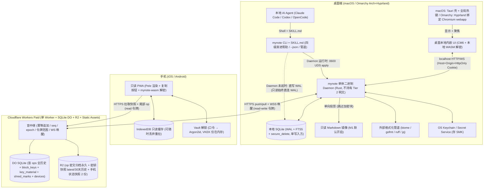
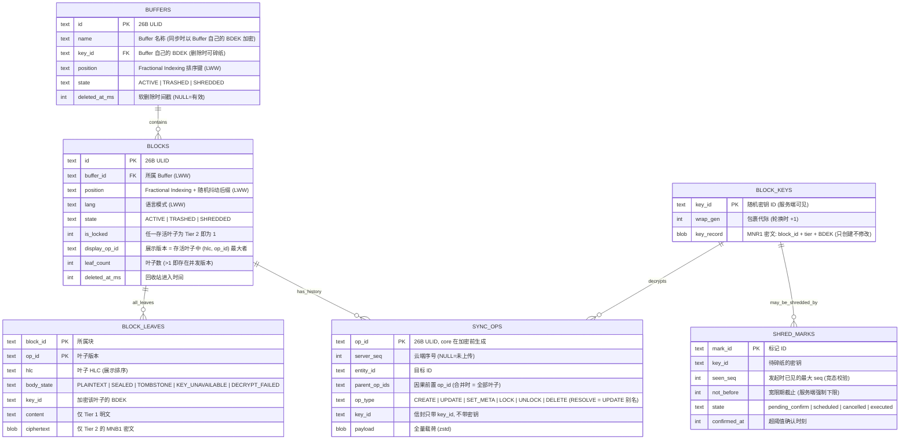
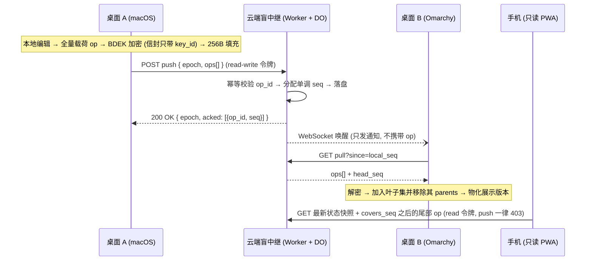
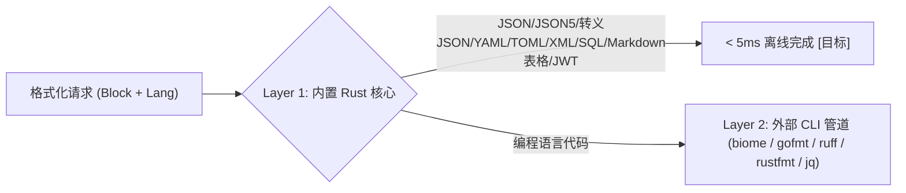
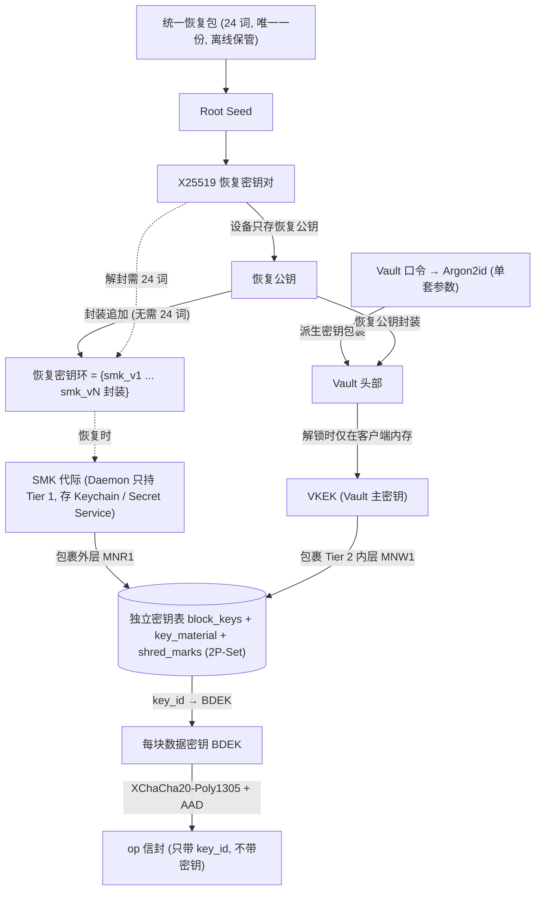
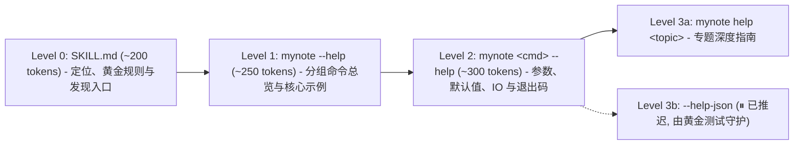
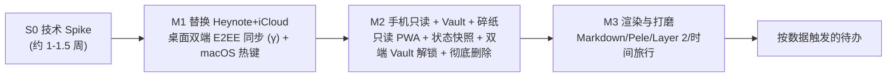

# 轻量级多端可靠同步开发者笔记软件：深度调研与架构方案

> 2026-11-24 修订：依据 [第一性原理审查 §9](../review/2026-11-24-first-principles-review.md) 的决策 D1–D7 更新。

> **定位**：面向开发者的高频临时记录 / Scratchpad 工具，继承 Heynote「多语言分块 + 一键格式化」的顺手体验，从架构根源消除同步丢数问题，原生适配 **macOS**、**Omarchy（Arch + Hyprland）** 与 **移动端（只读 + 复制 + Vault 解锁）**，并兼顾**块级加密**、**Markdown/Mermaid 渲染**与 **CLI + Skill（Agent 友好）**。
>
> **文档状态**：Proposed。本文是总览、ADR 与路线图的单一事实来源；协议、线格式、安全承诺等细节只在下方配套规范中定义，本文仅做概述并链接。

---

## 目录

0. [目标、约束、非目标与成功指标](#0-目标约束非目标与成功指标)
1. [根因诊断：为什么 Heynote + iCloud 会反复无故清空？](#1-根因诊断为什么-heynote--icloud-会反复无故清空)
2. [行业成熟方案深度调研（开源与商业）](#2-行业成熟方案深度调研开源与商业)
3. [核心约束的深度理解、剖析与挑战](#3-核心约束的深度理解剖析与挑战)
4. [推荐系统架构设计蓝图](#4-推荐系统架构设计蓝图)
5. [核心子系统详细设计](#5-核心子系统详细设计)
   - [5.1 数据模型：Block-First 而非文本分隔符](#51-数据模型block-first-而非文本分隔符)
   - [5.2 同步引擎：不可变操作日志（Anti-Wipe by Construction）](#52-同步引擎不可变操作日志anti-wipe-by-construction)
   - [5.3 格式化引擎：两层管线（桌面）](#53-格式化引擎两层管线桌面)
   - [5.4 安全与块级加密模型](#54-安全与块级加密模型)
   - [5.5 Agent 友好设计：CLI + Skill 与四级渐进披露帮助体系](#55-agent-友好设计cli--skill-与四级渐进披露帮助体系)
   - [5.6 Markdown 与 Mermaid 图渲染设计（轻量、离线与防 XSS）](#56-markdown-与-mermaid-图渲染设计轻量离线与防-xss)
6. [多端形态与技术栈选型对比](#6-多端形态与技术栈选型对比)
7. [分阶段演进路线图（S0 → M3）](#7-分阶段演进路线图s0--m3)
8. [架构决策记录（ADR 摘要）](#8-架构决策记录adr-摘要)
9. [已移除 / 推迟的机制（2026-11-24）](#9-已移除--推迟的机制2026-11-24)

> **配套核心工程规范**（单一事实来源）：
> - [核心数据结构、存储 Schema 与二进制线格式规范 (`data-structures.md`)](./data-structures.md)（ULID/定长 HLC/FractionalIndex、Rust Sans-I/O 类型、加密信封字节布局与**唯一的 AAD 定义**、独立密钥表、SQLite `STRICT` 完整 DDL 与 PWA IndexedDB Schema）
> - [全链路接口与跨边界契约规范 (`interface-contracts.md`)](./interface-contracts.md)（统一错误码表、CLI 全子命令 JSON 信封、本地 Daemon REST/WS/UDS 契约、云端 Sync API 与 `mynote-wasm` FFI 契约）
> - [同步协议与确定性物化规范 (`sync-protocol.md`)](./sync-protocol.md)
> - [安全架构与威胁模型规范 (`threat-model.md`)](./threat-model.md)
> - [Cloudflare 技术栈云端架构专项评估 (`cloudflare-cloud-architecture.md`)](./cloudflare-cloud-architecture.md)
> - [评测与质量门禁规范 (`eval-framework.md`)](./eval-framework.md)

---

## 0. 目标、约束、非目标与成功指标

### 0.1 目标与约束

按不可逆程度排序（来自审查 §1.2，已按 D1、D4、D7 修订）：

- **G1 永不静默丢数**：涵盖同步 bug、**丢钥匙**、误操作、平台驱逐、逻辑 bug 扩散。
- **G2 随手即记、随叫随到**：热键唤出 < 100 ms [目标]，CLI 秒回。
- **G3 多端可得**：桌面之间实时同步；**手机能读、能复制，并能解锁 Vault**（D1、D7）。
- **G4 秘密不落明文、不以明文进云端。**
- **G5 Agent 可读写**（通过 CLI）。
- **G6 Heynote 式分块与格式化，Markdown / Mermaid 渲染。**
- **C1 一个人能长期维护**：复杂度预算建议为 M1 结束时云端代码 < 500 行 [目标]（M2 加入碎纸状态机与竞态校验后约 500–700 行 [估算]）、core 同步部分 < 3k 行 [目标]；任何新机制都需附上触发它的测量数据（F-08）。
- **C2 成本约 \$5/月**（Cloudflare Workers Paid）[估算]，并配置支出告警（D4）。

### 0.2 非目标（Non-goals）

- 多人协作、共享与权限管理。
- 字符级实时协同 / 自动合并：同块并发编辑以多版本并列 + 手动合并呈现，不引入 CRDT 库（D3）。
- 手机编辑或追加（按数据触发再议，§7）。
- 本地或云端 MCP、开放 API。
- P2P、自托管多节点等去中心化部署。
- 防御能持久化篡改执行环境的同 UID 攻击者（F-07，见 [`threat-model.md`](./threat-model.md)）。
- 应用内自升级（交给包管理器，F-14）。

### 0.3 成功指标

- **M1 准出**：Mac 与 Omarchy 日常使用连续 4 周零丢数；Heynote（及其 iCloud 目录）已卸载；热键唤出实测 < 100 ms；[`eval-framework.md`](./eval-framework.md) 中的质量门禁全部通过。
- **可恢复性**：INV-RECOVERY（零设备 + 恢复包 + 本地导出的 R2 归档目录 → 恢复全部已归档未删除数据）在 CI 中持续通过。
- **M2 准出**：iPhone 单次 Vault 解锁约 1–2 s [目标]；手机端 SEC 取证（IndexedDB / Cache Storage 无明文与 VKEK）与自动上锁测试通过。
- **成本与复杂度**：月账单约 \$5 [估算]、支出告警未触发；代码量在 C1 预算内。

### 0.4 数据可移植性

- **只读 Markdown 镜像（M1 默认开启）**：未加密块单向导出为 `~/.local/share/mynote/mirror/<buffer>.md`，加密块只输出占位符；删除（碎纸到期）时同步删文件。它同时服务 G1（独立明文副本）、G5（`rg` / `cat` 直接可用）与反锁定（F-19）。
- **零设备恢复（双层最简路径）**：若仅客户端全失而云端 DO 健在，凭部署级 `BOOTSTRAP_TOKEN` + 24 词恢复包直接从 DO 零丢失拉回全部笔记；若客户端与 DO 同时损毁，从 CF 控制台 / `wrangler` / `rclone` 下载 R2 `archives/` 到本地执行纯离线 `mynote restore --from-archive <local-dir>` 重建，云端不暴露归档 HTTP 接口（细节见 [`interface-contracts.md`](./interface-contracts.md) 与 [`cloudflare-cloud-architecture.md`](./cloudflare-cloud-architecture.md)）。
- **本地备份**：`VACUUM INTO` 自动备份按 `T_snap` 轮换；SQLite 本身是开放格式。
- **迁入**：`mynote import heynote <path>` 导入 Heynote 1.x / 2.x 的 `∞∞∞lang` 文本文件。

---

## 1. 根因诊断：为什么 Heynote + iCloud 会反复无故清空？

如果不先定位旧方案的根因，自研软件极易在换了一套壳之后重演同类数据丢失事故。

### 1.1 Heynote 的存储机制

Heynote（Electron + Vue 3 + CodeMirror 6 + Prettier + Math.js）将每个 Buffer 存为磁盘上的一个纯文本文件（1.x 为单文件 `buffer.txt`，2.x 为目录内多个 `.txt` 文件），块之间通过特殊文本分隔符（如 `∞∞∞javascript`）切分。它本身**没有内置同步协议**，官方仅建议把目录放进 Dropbox / OneDrive / iCloud Drive，并由进程监听文件变化来重新加载。

### 1.2 iCloud Drive 与实时编辑器叠加的四大结构性缺陷

2026 年发表的系统研究 *Why iCloud Fails: The Category Mistake of Cloud Synchronization*（arXiv:2602.19433）系统性地指出了此类故障的本质：**iCloud Drive 是一个将分布式因果同步强行伪装成 POSIX 本地文件系统的抽象泄漏**。在 Heynote 这种「高频自动保存 + 整文件读写」场景下，会触发四类致命路径：

1. **Dataless / 驱逐占位符（Eviction）触发空文件反写**：
   macOS Sonoma 起，iCloud Drive 会更积极地回收本地文件内容，留下未水化（dataless / `.icloud`）占位符。Heynote 作者在 Issue #365 中也明确确认：云同步目录未常驻本地缓存会导致 Buffer 列表异常。当应用打开一个尚未完成水化、或读取返回空/失败的 Buffer 文件时，若初始化逻辑误以为是「新建空 Buffer」并触发自动保存，就会把一个 **0 字节 / 初始空模板** 写回磁盘——iCloud 随即将这份「最新修改」同步到云端并覆盖所有其他设备。
2. **静默 LWW（Last-Write-Wins）与隐藏冲突**：
   与 Dropbox/Syncthing 生成明显冲突副本不同，iCloud Drive 在版本冲突时缺乏透明冲突管理界面，常以墙钟时间做静默覆盖，将离线/休眠唤醒期间的另一端修改直接抹除。
3. **文件监听器与同步守护进程（`bird` / FileProvider）的竞态环**：
   按键防抖写盘与云同步守护进程替换 inode 同时发生，非事务性的 read-modify-write 极易造成文件截断或编辑器重载为空态后二次刷盘。
4. **行业共性教训——「空状态误当权威覆盖」**：
   即便拥有自研同步服务器的产品也踩过这个坑。例如 Standard Notes 历史上曾发生过 iPhone 恢复备份后未恢复 Keychain 密钥，客户端无法解密本地数据却在重新登录后把空/异常状态同步覆盖了云端的事故（mobile#18）。

### 1.3 由此推导出的系统不变量（Anti-Wipe Invariants）

我们自研系统的第一性原则必须从机制上杜绝上述事故（形式化定义见 [`sync-protocol.md`](./sync-protocol.md)）：

- **不变量 1（禁止第三方网盘直写）**：同步必须发生在**应用层协议**，绝不把正在活跃写入的数据库或 Buffer 文件托管给 iCloud Drive / Dropbox / OneDrive。
- **不变量 2（不可变操作日志 + 防空 `UPDATE` 类型隔离）**：所有修改以携带因果前置版本（`parent_op_ids`）的**追加操作（Append-Only OpLog）**记录；未水化（`Unhydrated`）或解密失败（`DecryptFailed`）态在编译期严禁生成 `UPDATE`，外部格式化器与 CLI 非交互空管道自动熔断，杜绝把异常空态当成有效编辑写回。
- **不变量 3（新设备强制引导门禁 Bootstrap Gate）**：未完成首次同步引导（`bootstrap_completed == false`）的客户端严禁对任何远端已有实体发出修改或删除操作（`UPDATE / SET_META / LOCK / DELETE`）；离线未引导期间新建的内容仅允许作为全新 ULID 独立块追加。
- **不变量 4（完整历史永久保留，快照不参与因果判定）**：op 日志不做 GC，R2 每日 op 密文归档只追加、永久保留；手机用的「当前状态快照」只供读取，出错只需重新拉取，不覆写历史日志；即便人工手误清空整块内容，也可通过 OpLog 找回。删除的唯一路径是带服务端强制宽限期的加密碎纸（§5.4）。

---

## 2. 行业成熟方案深度调研（开源与商业）

为了避免闭门造车，以下按**五种典型架构范式**调研了 11 款代表性开源与商业产品/引擎，聚焦它们的**存储模型、同步协议、加密边界、跨端形态与 Agent 友好度**。

### 2.1 五大架构范式拆解

#### 范式 A：开发者专用 Scratchpad（最贴近你的使用场景）

| 产品 | 形态与技术栈 | 存储与同步实现 | 关键优缺点与启示 |
| --- | --- | --- | --- |
| **Heynote** (开源) | Electron + Vue 3 + CodeMirror 6 + Prettier + Math.js | 磁盘 `.txt` 文件 + `∞∞∞lang` 文本分隔符；无内置同步 | **优点**：分块多语言、一键格式化、数学计算、极低心智负担。<br>**痛点**：Electron 内存重（180–250MB）；无移动端；无加密；分隔符混在正文里导致 `deleteLine` / Vim `dd` / 全局替换会破坏块边界（Issue #24/#43/#51）；Wayland 下全局快捷键失效。 |
| **Tot / Drafts** (商业) | 原生 Swift（仅 Apple 生态） | 本地库 + **Apple CloudKit**（结构化记录同步，非 iCloud Drive 文件） | **启示**：用 CloudKit 结构化同步比 iCloud Drive 文件可靠得多，但 Tot 官方知识库仍承认 iCloud 偶发同步混乱/丢字；且**彻底锁死在苹果生态，无法支持 Omarchy（Linux）与 Android**。 |
| **[Benchpad](https://benchpad.app)** (商业) | Mac / Win / Linux / iOS / Android / Web | 本地 IndexedDB + **Yjs 字符级 CRDT** + 托管同步服务 | **启示**：专门对标 Heynote 的跨端竞品（固定 3 个永久 Markdown Pad + `/code` 代码围栏），证明「Scratchpad + 离线优先同步」体验极顺滑；但非任意多语言分块流、闭源 SaaS、无代码格式化、无块级加密、无本地 Agent/CLI。 |

#### 范式 B：轻量自托管单二进制笔记

| 产品 | 形态与技术栈 | 存储与同步实现 | 关键优缺点与启示 |
| --- | --- | --- | --- |
| **Memos (`usememos/memos`)** (开源) | **Go 单二进制** + 内嵌 React SPA + SQLite/PG + gRPC/Connect/REST | **服务端中心化**（非 Local-First），多端通过浏览器/第三方客户端连同一服务 | **优点**：单二进制极轻（空闲 ~50MB）、部署零门槛、API 极其清晰、适合脚本与 Bot。<br>**缺点**：强依赖在线服务端，无真正离线编辑与冲突合并，无端到端加密，无代码格式化。 |
| **SilverBullet** (开源) | **单二进制服务端** + **Local-First PWA**（IndexedDB + Service Worker） | 服务端以**纯 Markdown 文件**落盘；浏览器端全量缓存于 IndexedDB，离线可写，联网双向同步 | **优点**：服务端文件天然对 Agent 友好；PWA 一套代码覆盖 macOS / Omarchy / iOS / Android。<br>**缺点**：文件级同步在多端离线并发编辑时仍有冲突副本；无 E2EE；受 iOS Safari PWA 存储回收约束。 |

#### 范式 C：零知识端到端加密（E2EE）跨端笔记

| 产品 | 形态与技术栈 | 存储与同步实现 | 关键优缺点与启示 |
| --- | --- | --- | --- |
| **Standard Notes** (开源/商业) | Electron + React Native + Web；TS Monorepo；Protocol 004 | **分层密钥（Argon2id → Root Key → Item Key）+ XChaCha20-Poly1305**；Item 级密文同步，服务端完全零知识 | **优点**：密码学设计教科书级，支持自托管与切换同步服。<br>**缺点**：客户端重（Electron）、自托管服务端极其臃肿（需模拟 Redis/SNS/SQS 多服务）；**对本地 Agent 极度不友好**（数据全密文锁在应用内）。 |
| **Notesnook** (开源/商业) | Electron + React Native + Web；本地 SQLite 加密 | 默认全量 E2EE（XChaCha20-Poly1305），并额外提供 **Private Vault（独立二次密码/生物识别锁定单条笔记）** | **核心启示**：清晰区分了**「同步层 E2EE」**与**「内容级独立加密锁（Vault）」**两层模型——这正是解决你「加密某一块内容」的最佳参考！ |
| **Joplin** (开源) | Electron + React Native + 本地 SQLite | 支持 WebDAV / Dropbox / S3 / **Joplin Server** + 可选 E2EE | **反面教训**：早期押注 WebDAV/网盘等「哑文件存储」，导致同步极慢（PROPFIND 风暴）、锁文件卡死、冲突笔记泛滥，最终不得不自建专用的 Joplin Server。 |

#### 范式 D：Local-First、纯文件与开发者同步引擎

| 产品 / 引擎 | 核心技术栈 | 存储与同步实现 | 关键优缺点与启示 |
| --- | --- | --- | --- |
| **Obsidian + Sync / LiveSync** | Electron + Capacitor；本地纯 `.md` 文件 | 官方 Sync：AES-256 E2EE + `diff-match-patch` 事后合并；LiveSync：CouchDB 分块 E2EE | **优点**：本地纯 Markdown 是 **AI Agent 的黄金标准**。<br>**缺点**：`diff-match-patch` 事后猜测合并会导致文本重复（重复段落）；CouchDB 自托管运维重且重设密钥易踩坑。 |
| **Anytype (`any-sync`)** (开源) | Go 核心 + CRDT + IPFS/libp2p + E2EE | 局域网 P2P + 自托管多节点（coordinator/tree/filenode） | **反面教训**：P2P + 全套去中心化节点架构极度复杂，违背「足够轻量、简洁易维护」的目标。 |
| **Atuin (Sync v2)** (开源) | **Rust 单二进制 CLI/Daemon** + 本地 SQLite | **Append-Only 加密 Record Store** + 客户端打包加密 Packfile + 极简自托管同步服 | **最大灵感来源！** 面向开发者的 macOS/Linux 工具：本地 SQLite 保证毫秒级 CLI 查询与离线可用；Sync v2 只追加不可变加密记录，永不覆盖历史，服务端极薄且零知识。 |
| **Evolu / Loro + Durable Streams** (开源引擎) | SQLite + HLC + Range-Based Set Reconciliation；Loro Rust/WASM CRDT | **Loro 2026 工程总结核心洞见**：加密 CRDT 的最佳云端后端其实极其简单——就是一个**带单调偏移量（offset）+ 快照压缩 + CAS 的纯追加字节流（Append-Only Log）** | **关键理论支撑**：服务端不需要懂业务逻辑、不需要在云端运行 CRDT 合并，内存开销极低，同时天然支持 E2EE 与断点续传。 |

### 2.2 竞品横向对比矩阵

| 产品 | 轻量度 | 同步可靠性 | 移动端 | Omarchy/Wayland 体验 | 内容格式化 | 块级加密 | 本地 Agent / CLI 友好 | 云端架构与零知识 |
| --- | :---: | :---: | :---: | :---: | :---: | :---: | :---: | :---: |
| Heynote | 中下 (Electron) | 差 (依赖网盘) | ❌ | 一般 (全局热键坑) | ✅ 强 | ❌ | 良 (纯文本) | ❌ 无内置云端 |
| Benchpad | 良 | ✅ 强 (Yjs CRDT) | ✅ | 良 (Web) | ❌ | ❌ | ❌ (闭源) | 闭源 SaaS |
| Memos | ✅ 极轻 (Go) | 中 (在线中心化) | ✅ Web/三方 | ✅ 良 | ❌ | ❌ | 良 (API) | 自托管 (非 E2EE) |
| SilverBullet | 良 | 良 (文件级同步) | ✅ PWA | ✅ 良 | 弱 | ❌ | ✅ 强 (服务端md) | 自托管 (非 E2EE) |
| Standard Notes | 差 (重服务端) | 良 (Item 级) | ✅ | 一般 | 弱 | 整篇锁定 | ❌ 极差 | 重自托管 (E2EE) |
| Notesnook | 中 | 良 | ✅ | 一般 | 弱 | 整篇 Vault | ❌ 差 | 托管/自建 (E2EE) |
| Obsidian | 中下 | 良 (付费/自建) | ✅ | 一般 | 插件 | 插件 | ✅ 极强 | 付费 Sync (E2EE) |
| Atuin (参考引擎) | ✅ 极轻 (Rust) | ✅ 极强 (OpLog) | ❌ | ✅ 极佳 | N/A | 全量 E2EE | ✅ 极强 (CLI/DB) | 极简自建 (E2EE) |
| **目标方案 (my-note)** | **✅ 单二进制 <15MB [目标]** | **✅ 追加日志 + 多版本并列** | **✅ 只读 PWA + Vault 解锁** | **✅ 原生契合** | **✅ 两层（桌面）** | **✅ 原生块级 Vault** | **✅ CLI+Skill (渐进披露)** | **✅ CF 盲中继 约 \$5/月 [估算]** |

---

## 3. 核心约束的深度理解、剖析与挑战

针对你提出的 6 条约束，以下逐条拆解其背后的真实诉求，并重点揭示**约束之间隐藏的冲突、工程陷阱与必须提前做出的权衡**。

---

### 约束 1：软件形态不限（单体二进制带 GUI、CLI + 网页都可以）

- **真实诉求**：不要被框架教条束缚，关键是跨 **macOS + Omarchy + 移动端** 好用、省心、维护成本低。
- **架构挑战 1A — 真正的分水岭不是「GUI vs 网页」，而是「桌面本地二进制 vs 移动端沙盒」**：
  - 无论选 Rust 原生 GUI（GPUI / egui / Slint）还是桌面单二进制，都**无法直接作为本地守护进程跑在 iOS 上**。如果桌面做原生 GUI、iOS 做 SwiftUI、Android 做 Kotlin，个人维护三套编辑器和格式化 UI 会直接拖垮项目。
- **架构挑战 1B — 慎选 Tauri v2 作为 Omarchy 主力 GUI（但 macOS 用 Tauri 薄壳）**：
  - Tauri v2 在 Linux 下底层依赖 **WebKitGTK**。在 Arch Linux + Hyprland（Wayland）环境下（尤其配合高分屏分数缩放或 NVIDIA 显卡），WebKitGTK 长期存在黑屏/白屏、渲染卡顿、焦点键（如 `Shift+Tab`）被吞掉等顽疾。
  - 反观 **Omarchy 的原生工作流**：Omarchy 一等公民支持 **Chromium Web App（`omarchy-launch-webapp`）**、**Hyprland Special Workspace Scratchpad（`SUPER + S` 一键呼出/隐藏）** 与终端 TUI。因此，**「本地单二进制后台守护进程 + 内嵌 Web UI」**在 Omarchy 上反而是兼容坑最少的原生级体验：Hyprland 键绑定直接唤出 / 聚焦 Chromium webapp 即可。
  - **macOS 则不同**：浏览器 App Mode 无法注册全局热键，而 Tauri 在 macOS 上用的是 WKWebView（没有 WebKitGTK 的问题）。因此 **M1 就采用「macOS Tauri 壳 + 全局快捷键插件」**（D5），两端加载同一份内嵌前端资源。
- **架构挑战 1C — 移动端 PWA 的两个隐藏暗坑，及「手机只读」如何化解（D1）**：
  1. **iOS Safari / WebKit 存储驱逐**：在磁盘压力或长期未打开情况下，WebKit 仍可能清理 IndexedDB。手机第一版**只读 + 复制**，不持有任何未上传数据，被驱逐的后果只是「下次打开重新下载」，不再是丢数风险。
  2. **iOS PWA 不支持真正的后台同步（Background Sync API）**：切后台后 Service Worker 会被挂起。只读客户端只需在回到前台（`visibilitychange` / `pageshow`）时拉取最新状态，无需后台推送。
  - 手机上的编辑 / 追加列为「按数据触发的待办」（§7），届时再引入 outbox 与持久化存储申请。

---

### 约束 2：需要支持对内容进行格式化

- **真实诉求**：像 Heynote 一样，随手贴一段压缩成一行的 JSON、混乱的 SQL、HTML/XML、YAML、Markdown 或代码片段，按一个快捷键瞬间美化。
- **架构挑战 2A — 「全语言格式化」与「足够轻量（约束 3）」直接冲突**：
  - Heynote 靠内置 Prettier + 多种 Parser 实现了多语言格式化，仅 Prettier standalone 及其常用插件就会增加数 MB JS 体积，且仍覆盖不了 SQL、XML、Go、Rust、Python、Shell 等开发常用格式。
- **架构挑战 2B — 区分「高频数据格式」与「编程语言代码」，分层解决**：
  - 开发者在临时记事本中 **80% 的格式化需求其实不是写完整工程代码，而是数据片段**：JSON（尤其是带转义字符串的脏 JSON、JSON5/JSONC 尾逗号）、SQL、XML、YAML、TOML、URL Query / Base64 / JWT 解码、Markdown 表格对齐。
  - 这些高频格式化器用 **纯 Rust 实现**，体积仅几百 KB，既可编译进桌面单二进制/CLI，（手机只读，不做格式化）。
  - 其余编程语言（JS/TS/CSS/HTML/Go/Python/Rust/Shell）：
    - 桌面端（macOS / Omarchy）直接通过 **可配置的外部 CLI 管道**调用本机已有工具链（`biome`、`gofmt`、`ruff`、`rustfmt`、`jq`、`shfmt`）——零体积膨胀，且格式化规则与你的开发环境一致。
    - 原「移动端懒加载 Biome WASM / Prettier」（Layer 3）已随 D1 删除。
- **架构挑战 2C — 必须抛弃 Heynote 的文本分隔符设计**：
  - Heynote 用 `∞∞∞lang` 分隔符把所有块塞进一个文本文件，这会直接摧毁块级加密、块级版本冲突隔离和 Vim 键位体验。**块（Block）必须是底层一等数据结构**，界面层再把它渲染成类似 Heynote 那样顺滑的连续流（按 `Cmd/Ctrl+Enter` 无缝新建下一块）。

---

### 约束 3：足够轻量

- **真实诉求**：替代 Electron（动辄 200MB+ 内存、2–3 秒冷启），做到「随时唤出、零存在感、低资源消耗、部署极简」。
- **架构挑战 3A — 必须用诚实、对等的量化预算约束架构，避免功能蔓延**：
  - 单体二进制体积：`< 15 MB` [目标]（内嵌编译后的前端静态资源，不打包重型运行时）
  - 桌面内存双态披露（公平对比 Electron 常驻 180–250 MB）：
    - **无头后台守护态（未打开窗口，仅维持 CLI 唤醒与后台同步）**：`< 15–20 MB` [目标]（Electron 即使关窗驻留托盘仍占百兆以上）；
    - **打开 Web UI 窗口态**：复用系统已驻留浏览器主进程时渲染器增量约 `40–80 MB`（冷起独立浏览器 App Mode 进程组约 `120–200 MB`）[估算]，关闭窗口后释放。
  - CLI 单次命令耗时：`< 15 ms` [目标]（直写本地 SQLite WAL，Daemon 未启动亦可独立完成）
  - 界面唤出延迟：`< 100 ms` [目标]（Omarchy：Hyprland 键绑定聚焦 Chromium webapp；macOS：Tauri 壳常驻隐藏窗口 + 全局热键只做显示 + 聚焦；M1 准出须实测）
  - 云端同步服：Cloudflare Workers + SQLite Durable Object + R2（或逃生舱单二进制 + SQLite），**Workers Paid 约 \$5/月** [估算]，并配置 Spend Management 支出告警（D4）
- **架构挑战 3B — 同步引擎不要过度设计成「重型分布式系统」**：
  - 不要引入 CouchDB、Anytype 多节点、RabbitMQ/Redis 或复杂 P2P NAT 穿透。
  - **关键反思：单人多端 Scratchpad 是否需要字符级 CRDT？结论：不需要（路径 γ，D3）**
    - 相比 Heynote 单文件把 50 个笔记块绑在一起，**一旦把同步粒度拆到「块（Block）级」**，两台设备离线并发修改**不同块**时不会冲突。
    - 同时离线改**同一个块**的情况很少（D1 之后会并发写入的只有 Mac 与 Omarchy 两台桌面）。此时采用「全量载荷 op + 所有版本永久保留」：冲突就是同一块出现多个叶子，并列展示为「另一台设备的版本」，由用户手动合并。不引入 Loro / Yjs，也不做 `SPAN_PATCH`；与 CRDT 方案的复杂度对比没有测量依据，不作量化断言。
    - 复杂度预算（C1）：M1 结束时云端代码 < 500 行 [目标]（M2 含碎纸状态机与竞态校验约 500–700 行 [估算]）、core 同步部分 < 3k 行 [目标]（F-08）。

---

### 约束 4：足够安全，支持加密某一块内容

- **真实诉求**：临时记事本经常顺手粘贴 Token、环境变量、服务器密码、私密想法；不希望它们明文落盘，也不希望被云端或误操作泄露，但又不想每次看普通笔记都输密码。
- **架构挑战 4A — 「加密某一块内容」与「云端存储零知识 E2EE」是两套不同的安全边界，必须分清**：
  - **边界 1（云端传输与云端被动存储零知识 —— Tier 1 Sync E2EE）**：普通笔记与业务元数据离开设备前做 256B 阶梯填充并用 `Sync Master Key (SMK)` 自动加密，日常使用**无感**（桌面由 OS Keychain / Secret Service 自动解封，PWA 由不可导出 WebCrypto 密钥包裹存入 IndexedDB），云端数据库与备份只见密文。自 M1 起每个块用自己的数据密钥 BDEK 加密，Tier 1 的 BDEK 由 SMK 包裹（§5.4）。
  - **边界 2（本地静态 + 防偷窥 + 防同 UID 被动读取 —— Tier 2 Block-Level Vault）**：被标记为「加密」的块，其 BDEK 改由 `VKEK` 包裹，存于独立密钥表 `block_keys`；`VKEK` 只以「Vault 口令（Argon2id）派生密钥包裹」与「恢复公钥封装」两种形式存在于 Vault 头部。解锁与加解密只在当前交互客户端内存（桌面 Web UI WASM、单次 CLI 进程或手机 PWA）中完成，后台常驻 Daemon 不持有 `VKEK` 与加密块明文。它防被动读取，不防能持久化篡改执行环境的同 UID 攻击者（F-07）。
- **架构挑战 4B — 加密块周边最容易被忽略的 5 个泄露点**：
  1. **「先写后锁」历史残留（WAL / FTS5 / 云端旧记录）**：加锁 = **换钥**——用 VKEK 包裹的新 BDEK 重新加密当前版本写新 op，再对旧 Tier 1 密钥发碎纸；本地清理并 `merge` FTS5、执行 WAL checkpoint。云端旧密文原样保留，宽限期（可在 UI 中缩短到 24 小时下限）到期后因密钥被置空而不可读，彻底不可恢复上界约 37 天（§5.4）。
  2. **元数据侧信道泄露**：加密块将正文与敏感属性一并封入密文，云端同步层把 `entity_id`、`op_type`、`hlc` 封入盲信封并做 256B 对齐填充（信封布局见 [`data-structures.md`](./data-structures.md)）。服务端仍可见 `key_id`、碎纸请求的时间与数量，剩余泄露面见 [`threat-model.md`](./threat-model.md)。
  3. **不可变日志阻碍销毁**：op 信封只带 `key_id`，包裹后的密钥放在独立密钥表 `block_keys`（只创建不修改）+ `shred_marks`（2P-Set）；删除只作用于密钥（加密碎纸），op 密文永久保留，可靠性不受影响（D2′）。
  4. **内存与剪贴板残留**：客户端内存中的解锁态闲置 N 分钟或切后台即 `zeroize` 回锁；桌面复制加密块内容时可定时清空剪贴板。手机 Web 页面无法可靠清空 iOS 剪贴板，且「通用剪贴板」可能把它同步到 Mac——UI 只能如实提示。
  5. **密钥遗忘即永久丢失**：初始化时强制生成可打印的**统一恢复包**（24 词，唯一一份）→ Root Seed → X25519 恢复密钥对；设备只存恢复公钥，新 SMK 代际 / VKEK 可随时封装追加，无需重新抄写，轮换后用 `mynote recovery drill` 验证；INV-RECOVERY 进 CI（F-05）。

---

### 约束 5：对本地 Agent 友好

- **真实诉求**：让本地运行的代码助手（Claude Code、Codex、OpenCode、Cursor、自写脚本）能顺手读取你刚贴在 Scratchpad 里的报错日志/API 响应，或者把分析结果、代码片段、Mermaid 图直接写进你的 Scratchpad。
- **架构挑战 5A — 「纯文本文件友好」与「可靠同步引擎」的冲突**：
  - 本地 Agent 习惯用 `rg`/`cat` 读纯文件，但如果允许外部进程直接修改同步目录里的原始文本文件，就会回到 Heynote 的竞态老路（部分写入、监听死循环、破坏结构）。
  - **已确认解法：SQLite 为唯一权威数据源 + 「CLI + Skill（渐进披露帮助）」为主入口（明确放弃本地 MCP）**：
    1. **一等公民 CLI + 极轻 `SKILL.md`**：不引入任何 MCP 协议栈与常驻 Schema 上下文负担。通过完备的 CLI（`--json` / `--jsonl`、Unix 管道、稳定退出码、错误提示 `hint`、乐观锁）配合 **四级渐进披露帮助体系（L0 `SKILL.md` → L1 总览 → L2 子命令帮助 → L3 专题指南）**，严格遵守 SQLite 单写入方契约（Daemon 运行时写命令经 `0600` Unix Socket `apply` 交由 Daemon 执行，Daemon 未运行时直写本地 SQLite WAL；读路径始终直连 WAL，单次命令 `< 15 ms` [目标]）。
    2. **只读纯文本镜像（Read-Only Mirror，M1 默认开启）**：后台单向导出所有**未锁定**块为 `~/.local/share/mynote/mirror/<buffer>.md`，供 `rg`/fzf/编辑器只读检索，同时充当独立明文备份与反锁定出口；严禁反写，加密块只输出 `<!-- LOCKED BLOCK: <id> -->` 占位符，块删除时同步删文件（F-19）。
- **架构挑战 5B — 「Agent 友好」与「安全（约束 4）」的真实权限边界**：
  - Prompt Injection 已成为本地 Agent 的现实威胁。必须坦诚：**同用户 UID 下运行的 Agent 具备读取本地普通文件与伪造 PTY（`script`/`expect`）的系统能力**，因此 CLI 的 TTY 检测与 `MYNOTE_ACTOR` 仅定位为防误触/防浅层注入的**体验与审计护栏**。
  - **密码学防线及其边界**：加密块在本地磁盘只有密文，且常驻 Daemon 不持有 `VKEK` 与明文——同 UID Agent **被动读取**本地文件与 Daemon Cookie 时解不开加密块；但能持久化篡改执行环境（替换用户可写的二进制、改 shell alias、改 `formatters.toml`、装浏览器扩展）的攻击者可以等你下次输入口令时截获，这是 OS 权限模型决定的。缓解：二进制由包管理器安装到用户不可写位置、Agent 跑在沙箱 / 容器 / 独立 UID（F-07，详见 [`threat-model.md` 第 5 节](./threat-model.md#5-本地-daemon-鉴权加固与同-uid-agent-隔离边界)）。

---

### 约束 6：云端定位收敛（明确放弃云端 MCP / 开放接口，回归纯粹零知识同步中继）

> [!NOTE]
> **架构收敛（Proposed，见 §8 ADR-08）**：原方案曾分析「云端零知识 E2EE ⚔️ 云端 MCP / Open API」的根本悖论。经过权衡，已明确决定 **不考虑云端 MCP，本地也不考虑 MCP，Agent 交互统一收口到「本地 CLI + Skill」**。

这一决定直接带来**巨大的架构简化与清晰的信任边界**：
1. **对被动存储零知识 + 诚实的代码分发边界**：DO SQLite 与 R2 只存盲密文；桌面端只运行本地内嵌资源（不加载远端代码）；手机 PWA 前端由自有 Cloudflare 账号下发，因此在手机上 Tier 1 与 Tier 2（D7 允许手机解锁 Vault）都**不防 CF 账户 / 部署流水线被攻破**。缓解：CF 强 2FA（硬件 FIDO2）、最小权限部署 Token 且只从 CI 部署、Service Worker 固定版本并在 UI 显示版本号（详见 [`threat-model.md`](./threat-model.md)）。
2. **云端保持极薄**：无需云端 OAuth 2.1 授权服、云端物化视图/FTS5、远端 MCP 路由或内网穿透隧道；服务端只做幂等追加、分配 seq、按 seq 分页、epoch、令牌范围、WebSocket 唤醒、密钥表 / `key_material` / 碎纸标记存储及校验、每日归档（F-12）。代码量预算 M1 结束时 < 500 行 [目标]（M2 含碎纸状态机与竞态校验约 500–700 行 [估算]）；成本为 Workers Paid 约 \$5/月 [估算]（D4）。
3. **客户端更轻更纯**：桌面 Rust 单二进制同样无需引入 MCP SDK 与额外传输层，体积更小、面更窄、更稳固。

> [!TIP]
> 详细云端配额精算、同步状态机与威胁模型请参阅：[Cloudflare 云端架构评估 (`cloudflare-cloud-architecture.md`)](./cloudflare-cloud-architecture.md)、[同步协议规范 (`sync-protocol.md`)](./sync-protocol.md) 与 [威胁模型规范 (`threat-model.md`)](./threat-model.md)。

---

## 4. 推荐系统架构设计蓝图

综合以上调研与决策，推荐采用 **「Local-First Sans-I/O 核心（CLI + Skill + 内嵌 Web）+ macOS Tauri 薄壳 / Omarchy Chromium webapp + 手机只读 PWA + Cloudflare 盲中继追加日志同步」** 架构。

### 4.1 整体架构图



> 云端实现细节见 [`cloudflare-cloud-architecture.md`](./cloudflare-cloud-architecture.md)；本地 API / CLI 契约见 [`interface-contracts.md`](./interface-contracts.md)。

### 4.2 为什么这套架构契合目标？

1. **一套前端覆盖桌面与手机，规避 WebKitGTK 坑，桌面不加载远端代码**：
   - 前端基于 **CodeMirror 6 + Pele 纯 SVG + 极简响应式框架（SolidJS / Svelte 5 / Preact）**，打包后通过 `rust-embed` 内嵌进桌面单体二进制（不加载远端代码）。
   - **Omarchy**：systemd user service 运行 `mynote daemon`，Hyprland 键绑定唤出 / 聚焦 Chromium webapp（可放入 Special Workspace），原生 Wayland 渲染，不依赖 WebKitGTK。
   - **macOS**：**Tauri 壳（WKWebView）+ 全局快捷键插件，M1 必备**（D5）；窗口常驻隐藏，热键只做「显示 + 聚焦」、不重新加载页面，目标唤出 < 100 ms [目标]。壳内嵌 Daemon 还是拉起独立 Daemon 由 S0 决定；无论哪种，CLI 都必须在 UI 未打开时独立工作，SQLite 只有一个写入方。
   - **手机**：访问自有域名 Workers Static Assets 托管的**只读 PWA**：查看、复制、解锁 Vault（D1、D7）；不编辑、不追加，因此没有 outbox、冲突合并 UI 与移动端编辑器，IndexedDB 被驱逐的后果只是下次重新下载。
2. **结构性防丢 + 双层加密**：本地 SQLite WAL + 防空 `UPDATE` 类型门禁 + 多叶子并列（所有版本保留）+ 完整历史与 R2 永久 op 归档，配合每块数据密钥、受控碎纸与客户端内存级 Tier 2 解密。
3. **Agent 友好（零 MCP 负担）**：完备的 `CLI + SKILL.md` + 四级渐进披露帮助 + 离线友好的稳定退出码契约 + 默认开启的只读 Markdown 镜像。

---

## 5. 核心子系统详细设计

### 5.1 数据模型：Block-First 而非文本分隔符

彻底放弃 Heynote 的「整文件文本分隔符」，将 **Block** 提升为最小同步、格式化、加密与检索单元（完整 SQLite `STRICT` DDL 与字节布局见 [`data-structures.md`](./data-structures.md)）。

> [!NOTE]
> 下图是概念模型，只列关键字段；表名、字段与 DDL 以 [`data-structures.md`](./data-structures.md) 为准。



**关键设计细节**：
- **Fractional Indexing 防碰撞**：插入时附带随机抖动后缀，查询排序强制 `ORDER BY position COLLATE BINARY ASC, id ASC`（以 ULID 破除离线同位插入平局）；**不做重平衡**，允许索引键变长（两台设备并发重平衡会被逐字段 LWW 交错合并，F-18）。
- **明文 / 密文隔离与「先写后锁」**：加锁 = 换钥（§5.4）：用 VKEK 包裹的新 BDEK 重新加密当前版本写新 op，再对旧 Tier 1 密钥发碎纸；本地同一事务内清空 `content`、删除并 `merge` `blocks_fts` 倒排段、执行 WAL checkpoint（开启 `PRAGMA secure_delete`）。云端旧 op 密文原样保留，宽限期到期后因密钥被置空而不可读。
- **编辑器形态（单 CM6 文档 vs 按块挂载 `EditorView`）待 S0 spike 决定**（F-11，见 §6.3）：Block-First 是存储层决策，并不强制 UI 按块拆分 EditorView。按块挂载便于独立预览态、加密锁卡与块级 Undo，但跨块选择 / 多光标 / 跨块撤销 / 整体查找替换需要自行桥接，工作量此前被低估；单文档 + 原子化块边界装饰（transaction filter 保护边界）同样能避免 Heynote 分隔符被 `dd` 删掉的问题。

---

### 5.2 同步引擎：不可变操作日志（Anti-Wipe by Construction）

借鉴 **Atuin Sync v2（追加记录日志）** 与 **Evolu（HLC + E2EE）** 的做法，采用「块级 op + 全量载荷 + 所有版本永久保留」的**路径 γ**（D3）。协议细节以 [`sync-protocol.md`](./sync-protocol.md) 为准，本节只做概述。

#### 同步时序流程



#### 为什么该协议不会重演「无故清空」？

1. **只用全量载荷**：每个 op 自包含块的完整内容（zstd 压缩），不存在 delta 链拼错或基底缺失；`SPAN_PATCH` 推迟到「单条 op p95 > 64 KB」时再议。300 KB 的块压缩后每次推送约 30–60 KB [估算]，个人规模下可接受。
2. **冲突 = 同块多叶子，所有版本都保留**：
   - 展示版本 = `(hlc, op_id)` 最大的叶子（确定性，各端一致），其余标记为「另一台设备的版本」；合并 = 用户提交 `UPDATE`，`parents` = 全部叶子（`RESOLVE` 视为别名）。
   - HLC 只决定展示顺序，**不做漂移钳制、不拒收**；本地时钟偏差过大仅提示。
   - `position`、`lang`、`buffer_id` 走字段 LWW；`DELETE` 遇并发 `UPDATE` 自动复活（Update-Wins）。
   - **无 Lock-Wins 特例**：`LOCK` 是一个普通版本（实现上是换钥，§5.4）；若任一叶子加锁，整块按加锁渲染并提示「存在未加锁的并发版本」。
3. **防空 `UPDATE` 类型门禁与引导隔离**：未完成首次引导前禁推已有实体变更；`DecryptFailed` / `Unhydrated` 编译期禁止构造 `UPDATE`；外部格式化器与 CLI 非交互 0 字节管道自动熔断。
4. **完整历史永久保留，不做 GC**：Workers Paid 单 DO 10 GB，按约 220 MB/年 [估算] 不需要 GC（D4）；R2 每日 op 密文归档只追加、永久保留，另存每日覆写更新的 `latest.mnks`（不挂生命周期删除）与按日历史密钥快照（`T_snap` = 30 天后由生命周期规则删除），极端灾难下 `mynote restore --from-archive <local-dir>` 可纯离线从零恢复。
5. **手机引导用「当前状态快照」**：由任一桌面每日或尾部 op 超过阈值时发布到 R2，内容为非 `Shredded` 块（含 `Active` 与 `Trashed`）的全部叶子版本 + 字段 LWW 结果 + `covers_seq`（块内容仍用各自 BDEK 加密）；在同一 `journal_epoch` 内按 `covers_seq` 单调接受、保留最近 2 份、无 CAS，**不参与桌面之间的因果判定**——快照出错的后果只是手机显示不对，重新拉取即可（D1）。
6. **`epoch` 并集对账**：PITR 回滚或迁移导致 `epoch` 变化时，客户端按 `op_id` 求本地与远端的**集合并集**（不清空本地表），补推远端缺失项。
7. **密钥表与 op 日志分开同步**：`block_keys` / `key_material` / `shred_marks` 按 2P-Set 合并、每次同步全量比对；删除的唯一路径是带服务端强制宽限期的加密碎纸（§5.4）。

#### 跨设备复制粘贴场景（低延迟 × 高可靠）

1. **粘贴快车道（Fast-Flush）**：普通输入防抖 `400–500ms` 本地合并；**粘贴（`paste`）、失焦（`blur`）或 CLI 写入**时立即 HTTP `push`，其他桌面经 WebSocket 唤醒后 `pull`（WebSocket 携带 op 推迟，触发条件见 §7）。
2. **一键复制**：块顶一键 Copy（桌面 `Cmd/Ctrl+Shift+C`）；手机每块一个「复制」按钮（在用户点击手势内调用 `navigator.clipboard.writeText`），满足「桌面 → 手机」的跨端剪贴板需求。
3. **手机前台唤醒即拉**：PWA 在 `visibilitychange` / `pageshow` 回到前台时执行 HTTP `pull` 与 WS 重连。

---

### 5.3 格式化引擎：两层管线（桌面）

兼顾 **多语言覆盖** 与 **零体积膨胀**。格式化只在桌面进行；手机只读（D1），原 Layer 3 移动端懒加载格式化已删除：



**开发者专属高频加分项与防空护栏**：
- **脏 JSON 急救模式**：内置一键 `Unescape & Format JSON`，解包日志双层转义字符串与尾逗号。
- **结构化转换动作**：JSON ↔ YAML ↔ TOML 互转、Base64 编解码、URL Query 转 JSON、JWT 载荷预览、Unix 时间戳转换——纯本地离线执行。
- **零字节异常熔断**：Layer 2 外部 CLI 子进程若对非空输入返回 `0 bytes`、退出码非 `0` 或超时，**无条件丢弃输出并保留原文本报错**，严防异常格式化脚本清空笔记块。
- **外部格式化器配置示例（`~/.config/mynote/formatters.toml`）**：
  ```toml
  [formatters.typescript]
  cmd = ["biome", "format", "--stdin-file-path=scratch.ts"]
  timeout_ms = 2000

  [formatters.python]
  cmd = ["ruff", "format", "-"]

  [formatters.go]
  cmd = ["gofmt"]
  ```

---

### 5.4 安全与块级加密模型

采用成熟现代密码学原语组合；安全承诺（含删除时间上界与「代码管不到的副本」）以 [`threat-model.md`](./threat-model.md) 为准，密钥表与信封字节布局以 [`data-structures.md`](./data-structures.md) 为准。本节只做概述。

- **KDF**：`Argon2id` + `HKDF-SHA256`；Vault 口令的 Argon2id **只用一套参数，按最弱设备（iPhone）来定**，参数与盐存于 Vault 头部（D7；具体取值待 S0 在 iPhone 上实测，目标单次解锁约 1–2 s [目标]）。
- **对称认证加密（AEAD）**：`XChaCha20-Poly1305`（192-bit 随机 Nonce）+ 256B 阶梯填充（保留，因为便宜；不再宣称额外安全收益）。
- **关联认证数据（AAD）**：只在 [`data-structures.md`](./data-structures.md) 定义一次，必须绑定 `block_id`、`op_id`、`key_id` 与格式版本；`op_id` 由执行正文加密的 core 实例在加密前生成（F-01）。

#### 密钥层级：每块数据密钥 + 独立密钥表 + 统一恢复包



**核心机制**：
1. **每块一把数据密钥（BDEK），信封只带 `key_id`**：块的正文版本用它的 BDEK 加密为 `MNB1`；Tier 1 的 BDEK 直接由 SMK 包裹入 `MNR1`，Tier 2 先由 VKEK 包裹为 `MNW1` 再由 SMK 封装入 `MNR1`。**这是 M1 线格式，不可推迟**：M1 期间写入的 op 会进永久归档，若直接用 SMK 加密，日后除了废掉整个 SMK 就无法单独删掉某一块（D2′）。
2. **独立密钥表 `block_keys` + `key_material` + 碎纸标记 `shred_marks`**（取代 `vault_keys` / `MNK1` / `key_seq`）：密钥记录只创建（或随轮换提升 `wrap_gen` 重包）、不就地覆写；合并 = 已创建密钥的并集 − 服务端已到期置空的碎纸标记（2P-Set），合并本身不会弄丢密钥。M1 定型 `block_keys` 与 `key_material`（`RecoveryKeyringV1` + `VaultHeaderV1`），M2 上线 `shred_marks` 状态机。桌面与 DO 各存一份，同步时全量比对（体量约「块数 × 250 B」[估算]）。字段定义见 [`data-structures.md`](./data-structures.md)，同步规则见 [`sync-protocol.md`](./sync-protocol.md)。
3. **删除优先、有界时延**：M1 删除进入软删回收站（随时可恢复）；M2 起 `DELETE` 对该块全部未碎纸 `key_id` 登记碎纸标记（默认 `grace_ms = T_grace` = 7 天），宽限期内任一桌面可撤销，到期后由服务端 DO alarm 置空密钥，客户端**仅在同步观测到服务端 `executed`（`key_record = null`）时**执行本地删钥与明文清理（不受本机快表误触发）。op 日志与 R2 归档中的密文原样保留，只是不再有密钥能解开。服务端强制最短宽限期（24 小时）与批量阈值（20 块/天），CLI 只能删进回收站，只读令牌不能碎纸。**彻底不可恢复上界 ≈ `T_grace + max(DO PITR 30 天, T_snap 30 天)` ≈ 37 天** [保证]（不含 OS 级备份、手动冷备、剪贴板、丢失后离线的手机缓存等代码管不到的副本）。完整流程见 [`threat-model.md`](./threat-model.md) 与 [`sync-protocol.md`](./sync-protocol.md)。
4. **换钥原语**：用新 BDEK′ 重新加密当前版本写一个普通 op，再对旧 key 发碎纸。「清除历史」与「先写后锁」（换到 VKEK 包裹的新 BDEK + 碎纸旧 Tier 1 key）都复用它；碎纸旧钥前必须确认服务端已收下新 op 与新密钥记录。不新增 op 类型。
5. **统一恢复包 + 恢复密钥环（公钥封装）**：只有一份 24 词恢复包 → Root Seed → X25519 恢复密钥对。设备只存**恢复公钥**，因此可随时把新 SMK 代际 / VKEK 封装追加到恢复密钥环并经 `/v1/keys` 的 `key_material` 同步，无需 24 词；解封才需要 24 词。Daemon 只持有 Tier 1 SMK 代际；VKEK 只以「Vault 口令派生密钥包裹」与「恢复公钥封装」两种形式存在于 Vault 头部，Vault 不再有第二套恢复码。轮换 = 封装追加 + 重新包裹密钥表，**不需要重新抄写恢复包**，轮换后用 `mynote recovery drill` 验证；**旧 SMK 代际在客户端与恢复密钥环中永久保留**（仅 32B/代，确保未重包的历史记录与本地旧备份永远可解）；其他存活设备可通过 `mynote keyring unlock`（本地输 24 词）或 `mynote device refresh` / `claim`（10 分钟一次性票据）获取新代际。**INV-RECOVERY**：零设备 + 恢复包 + 本地导出的 R2 归档目录 → 恢复全部已归档未删除数据，进 CI（F-05）。
6. **常驻 Daemon 不持有 Tier 2 明文 + 本地严格鉴权**：Tier 2 解密只发生在当前 Web UI WASM 或单次 CLI 进程内存中，闲置或切后台即 `zeroize`；本地 UI 统一入口 `http://localhost:<port>`，Daemon 接口校验 `Host` + `Origin` + `HttpOnly` Session Cookie。Tier 2 只防被动读取，不防能持久化篡改执行环境的同 UID 攻击者（F-07）。
7. **引导、配对（一次性领取）与止损**：首台桌面（或客户端全失而 DO 健在时）凭部署级 `BOOTSTRAP_TOKEN` 走 `mynote device bootstrap` 接入；后续设备由 `mynote device add --scope read|read-write` 在发起端桌面本地生成随机 `device_token` 与一次性密钥 `K_pair`，将 SMK 密钥环与明文 `device_token` 一并用 `K_pair` 加密后暂存服务端（服务端只存未激活的 `SHA-256(device_token)`，全程不接触明文令牌），TTL 10 分钟，**首次领取即删除并激活**。iOS 主流程 = PWA 内 `getUserMedia` 扫码或粘贴配对码。设备令牌分 `read` / `read-write`，手机只拿 `read`（服务端对其 push / 碎纸请求返回 403）。协议细节见 [`threat-model.md`](./threat-model.md) 与 [`interface-contracts.md`](./interface-contracts.md)。设备遗失 = 吊销令牌 + 密钥环轮换；已离线的失窃手机缓存不在碎纸覆盖范围内。
8. **手机解锁 Vault（D7）**：口令 → Argon2id（WASM）→ VKEK → 解开密钥表中该块 BDEK → 查看 / 复制；VKEK 只在内存，永不写入 IndexedDB / Cache Storage，`visibilitychange` 或闲置 N 分钟自动上锁。复制出的秘密会留在 iOS 剪贴板，并可能经「通用剪贴板」同步到 Mac（UI 提示）。**新信任边界**：手机 PWA 代码由 Cloudflare 下发，Tier 2 在手机上不防 CF 账户 / 部署流水线被攻破（缓解：CF 强 2FA、只从 CI 部署、Service Worker 固定版本并显示版本号）。WebAuthn PRF 推迟。

---

### 5.5 Agent 友好设计：CLI + Skill 与四级渐进披露帮助体系

> **设计决策**：**不实现本地 MCP，也不实现云端 MCP**。所有本地 AI Agent（Claude Code、Codex、OpenCode、Cursor 等）与人类开发者共享同一套**高完备度 CLI + 极轻 `SKILL.md`**，把 Token 占用、维护复杂度与攻击面同时压到最低。

#### 1. 为什么「CLI + Skill」比 MCP 更适合本工具？
- **零常驻上下文税**：传统 MCP 每次会话都会预先注入大量 JSON Tool Schema，而极轻的 `SKILL.md` 仅占 ~150–250 tokens，其余命令参数由 Agent 按需调用 `--help` 渐进读取。
- **天然 Unix 可组合性**：直接与 `curl`、`jq`、`rg`、`pbcopy`/`wl-copy`、Shell 管道无缝衔接，人类和 Agent 用的是同一套心智模型。
- **二进制更轻更纯**：Rust 核心无需引入 MCP SDK 与额外的 `stdio`/SSE 传输协议栈。

#### 2. 四级渐进披露帮助体系（Progressive Disclosure Help）

帮助信息严格按 **「先路由、后参数、按需展开专题」** 分级披露，绝不在顶层一次性倾倒几千字说明：



- **Level 0 — 极简 `SKILL.md`（常驻 Agent 技能目录，严格控制在 `< 250 tokens`）**：
  - 只写 4 件事：① `mynote` 是什么（本地多语言分块草稿本）；② 渐进发现入口（`mynote --help`、`mynote <cmd> --help`、`mynote help agent`）；③ 4 条 Agent 黄金法则（程序化调用必加 `--json`；更新已有块必带 `--expected-head`；绝不尝试解密加密块；列表查询注意 `--limit`）；④ 3 条最高频命令速查。
  - **反模式禁止**：严禁把全部子命令和几十个 Flag 写死在 `SKILL.md` 中（既浪费 Token，又容易与 CLI 实际版本漂移）。

- **Level 1 — 顶层命令路由（`mynote -h` / `mynote --help`，控制在 25–35 行）**：
  ```text
  mynote — Local-first block scratchpad with E2EE sync & formatting

  CAPTURE & BLOCKS:
    add         Create a new block (supports stdin pipe & --format)
    block       Read, update, append, move, revert, or delete (to trash) a block
    buf         List, create, rename, reorder, or delete buffers
    trash       List or restore blocks in the recycle bin
    import      Import existing Heynote buffers (∞∞∞ delimiter migration)

  QUERY:
    ls          List recent blocks (summary-first, token-budget safe)
    search      Full-text search across unlocked blocks (FTS5)

  TRANSFORM & OPS:
    format      Format a block or stdin (json/sql/yaml/xml/md + external CLIs)
    sync        Inspect sync status, force push/pull, view multi-version blocks
    vault       Lock/unlock sensitive blocks (client-side decryption)
    device      Bootstrap, pair/refresh (one-time claim code), list, or revoke
    keyring     Rotate SMK generation or unlock synced keyring with recovery words
    recovery    Show recovery bundle on init or run offline recovery drill
    restore     Rebuild offline from local R2 archive directory (--from-archive)
    help        Deep topics: formatting, locking, conflict, agent

  GLOBAL FLAGS:
    --json            Structured JSON output envelope {ok, data, error, meta}
    --jsonl           Line-delimited JSON stream for list/search
    --quiet           Suppress non-data stderr notices
    --non-interactive Never prompt; fail fast with exit code 2 or 5

  NEXT STEP:
    Run 'mynote <cmd> --help' for flags & examples.
    Run 'mynote help agent' for AI agent integration contract & exit codes.
  ```

- **Level 2 — 子命令精准参考（`mynote <cmd> --help`）**：
  - 仅在 Agent 确定要调用某个子命令时按需加载，固定包含 5 个结构化区块：**SYNOPSIS / FLAGS（含类型与默认值）/ STDIN & STDOUT 契约 / EXIT CODES / 2–3 个可直接复制的 EXAMPLES**。

- **Level 3 — 深度专题（按需按主题展开）**：
  - `mynote help <topic>`：内置离线文档专题（如 `mynote help agent`、`mynote help formatting`、`mynote help conflict`、`mynote help locking`），覆盖边界场景与冲突恢复配方；
  - `mynote <cmd> --help-json`：**⏸ 已推迟**（当前由 CLI 黄金测试直接守护 `--json` 输出与退出码契约，待外部自动化集成确有需要时再启用，见 §7 与 §9）。

#### 3. Agent-Native CLI 工程契约（比 `--help` 更关键的 6 条硬规范）

1. **单写入方本地存储 + 统一结构化输出信封（`--json`）**：
   - 读命令始终直接读取本地 SQLite WAL；写命令在 Daemon 运行时经 `0600` Unix Socket `apply` 转交 Daemon 执行，**后台 Daemon 未启动时则由 CLI 直接以短事务写 SQLite WAL 独立完成**（单次命令 `< 15 ms` [目标]，协议见 [`interface-contracts.md` §3.0](./interface-contracts.md#30-进程模型daemonmacos-tauri-壳与-cli)）。
   - 带 `--json` 时，stdout 永远是合法单条 JSON（日志/警告只走 stderr，精确字段见 [`interface-contracts.md` §2](./interface-contracts.md#2-cli-全子命令参数与机读输出契约agent-first)）：
     ```json
     {
       "ok": true,
       "data": { "block_id": "01JXYZ...", "op_id": "01JABC...", "head_op_ids": ["01JABC..."], "buffer_id": "01JBUF..." },
       "error": null,
       "meta": { "duration_ms": 4, "sync_state": "pending_offline", "local_op_count_pending": 1, "redacted_locked_count": 0 }
     }
     ```
   - 当检测到 `!isatty(stdout)`（处于管道或 Agent Shell 执行中）时，自动关闭 ANSI 颜色码与交互式分页器（pager）。
2. **语义化稳定退出码（消除离线假失败重试）+ 可执行错误提示（`hint`，全表见 [`interface-contracts.md` §1](./interface-contracts.md#1-全局错误码注册表与跨层映射契约)）**：
   - **常规本地写命令离线成功一律返回 `0`**（通过 `meta.sync_state = "pending_offline"` 表达待同步，避免触发 Shell `set -e` 中断或诱导 Agent 误判失败反复重试产生重复块）；
   - `0` 成功 | `2` 参数或空管道错误 | `3` 目标不存在 | `4` 乐观锁/CAS 冲突 | `5` 加密块受限/密钥已销毁/未授权 | `6` 显式联网命令离线失败 | `7` 格式化语法错误 | `8` 密文或哈希完整性校验失败。
   - 错误返回必带下一步动作建议，让 Agent 无需盲猜就能自愈：
     ```json
     {
       "ok": false,
       "data": null,
       "error": {
         "code": "HEAD_MISMATCH",
         "message": "Block 01JXYZ was modified concurrently",
         "retryable": true,
         "details": { "expected_heads": ["01JAA1"], "actual_heads": ["01JBB9"] },
         "hint": "Run 'mynote block get 01JXYZ --json' to inspect latest versions, then retry with --expected-head 01JBB9"
       },
       "meta": { "duration_ms": 2, "sync_state": "synced", "local_op_count_pending": 0, "redacted_locked_count": 0 }
     }
     ```
3. **非交互快速失败（Never Hang）**：
   - 在非 TTY 环境下或传入 `--non-interactive` / `--json` 时，**绝不允许阻塞等待用户输入密码或 `y/N` 确认**；缺少必填确认或需要解锁 Vault 时立即以明确退出码（`2` / `5`）返回。
4. **防误覆写、防空管道覆盖与幂等保障**：
   - `mynote block update <id> --expected-head <op_id>`：强制乐观锁，防止 Agent 静默覆盖用户刚刚手敲的内容；
   - **空管道熔断**：`block update` 从非交互 `stdin` 收到 `0 bytes` 而目标块非空时默认报错（退出码 `2`），需显式传 `--allow-empty` 才允许清空，防住前置管道命令报错把块清零；
   - `mynote add --idempotency-key <key>`：支持 Agent 重试不产生重复块；破坏性命令统一支持 `--dry-run`。
   - **CLI 只能把块删进回收站**：缩短宽限期、清空回收站只能在桌面 UI 交互确认（D2′，细节见 [`interface-contracts.md`](./interface-contracts.md)）。
5. **Context / Token 预算保护（防撑爆上下文）**：
   - `mynote ls` 与 `mynote search` 默认返回**摘要视图**（`id`、`buffer`、`lang`、`updated_at`、`byte_size`、`preview` 截断前 240 字符，`--limit 20`），避免某个 300KB 的 JSON 响应块瞬间撑爆 Agent 上下文；完整正文需按 `id` 显式调用 `mynote block get <id> --raw` 或 `--max-chars <N>` 读取。
6. **加密块密码学隔离与诚实的护栏定位**：
   - 普通/Agent 调用 `ls`、`search`、`block get` 时，加密块统一返回 `{ id, is_locked: true, public_hint, redacted: true }`；
   - **诚实说明**：`/dev/tty` 交互检测（防浅层非交互窃密）与环境变量 `MYNOTE_ACTOR="agent:claude-code"`（自我声明的审计归因标签，便于在 UI 中高亮与一键回滚）属于**体验与协作护栏，而非对抗同 UID 恶意代码的安全边界**；真正的边界来自密码学（本地磁盘只有密文 + 常驻 Daemon 不持有 Tier 2 明文 + 口令仅由人类掌握），但它**只防被动读取**（读库 / 读 Daemon / 读 WAL）；对能持久化篡改执行环境的同 UID 攻击者（替换二进制、改 shell alias、改 `formatters.toml`、装浏览器扩展后等你输口令）不设防。缓解：二进制由包管理器安装到用户不可写位置、Agent 跑在沙箱 / 容器 / 独立 UID（F-07，见 [`threat-model.md`](./threat-model.md)）。

#### 4. 只读纯文本镜像（M1 默认开启）
- 后台将**非加密块**单向投影为 `~/.local/share/mynote/mirror/<buffer>.md`，供 `rg` / `fzf` / 外部编辑器只读检索；加密块统一投影为 `<!-- LOCKED BLOCK: 01JXYZ... (hint: prod key) -->`，严禁外部直接反写；块删除（碎纸到期）时同步删除对应内容。它同时是独立的明文备份与反锁定出口（见 [§0.4](#04-数据可移植性)）。

---

### 5.6 Markdown 与 Mermaid 图渲染设计（轻量、离线与防 XSS）

新增对 **Markdown** 与 **Mermaid 图** 的原生支持，不仅高度契合个人临时记录，更是 **AI Agent 输出的最佳载体**（Agent 经由 `mynote add --lang mermaid` 或 Markdown 块写入架构图、时序图与任务清单，多端立刻可见）。针对「足够轻量（约束 3）」与「足够安全（约束 4）」两条红线，采取以下定稿设计：

#### 1. 三项核心工程决策

1. **挑战 M1：摒弃 1.6 MB 重型 `mermaid.js`，默认采用零依赖纯 SVG 引擎 `Pele`**
   - 官方 `mermaid.js` 打包后约 **1.6 MB gzip（未压缩超 3 MB）**，还会向 SVG 注入 `<foreignObject>` HTML 子树（导致 Safari 将 SVG 绘制到 `<canvas>` 调用 `toBlob()` 时触发 Tainted Canvas 安全异常，令 **Copy PNG** 功能直接失效！）。
   - **已敲定方案（默认内置 [Obsidian `Pele`](https://github.com/obsidianmd/pele) + 保留可插拔 `DiagramRenderer` 接口）**：
     - 采用 Obsidian 团队开源的 **[Pele](https://pele.run)**（MIT 协议，支持 Mermaid 12.1 内置图表类型，异步按需懒加载 Chunk 仅 `~230 KB`）；
     - **四大决定性收益**：① 零运行时依赖、同步亚毫秒级直出纯 SVG；② **完全不产生 `<foreignObject>` 标签**，在 macOS / iOS Safari 上画入 Canvas 导出高分屏 PNG 不触发 Tainted Canvas；③ 原生通过 CSS 变量响应深浅色与 Omarchy 主题，无需重绘或放开危险内联样式；④ 不打包 1.6 MB 的 `mermaid.js`，桌面单二进制保持极致小巧，同时保留 `DiagramRenderer` 接口便于未来按需扩展。

2. **挑战 M2：Markdown / Mermaid 渲染防 XSS 与防外带通道（严格 CSP）**
   - 页面运行在本地鉴权上下文或持有内存态密钥，一次 Stored XSS 足以窃取全部笔记。
   - **强制安全防御栈**（详见 [`threat-model.md` 第 6 节](./threat-model.md#6-渲染层防-xss--防外带通道与严格-csp-策略)）：
     - Markdown 默认**禁止原始 HTML 解析**，输出经 `DOMPurify` 严格白名单净化；`Pele` 生成的纯 SVG 同样经 `DOMPurify` SVG Profile 二次校验；
     - 全端强制下发严格 **CSP**：`default-src 'none'; script-src 'self' 'wasm-unsafe-eval'; style-src 'self'; img-src 'self' data: blob:; connect-src 'self' https://<sync-domain> wss://<sync-domain>;`——锁死 `style-src 'self'` 并禁止第三方外链图片静默请求，封堵 Prompt Injection 渲染层 XSS 与信标外泄的主要通道。

3. **挑战 M3：Markdown 源码/预览双模切换与「预览态极致复制体验」**
   - **为什么放弃混合 Live Preview、改用「源码模式 ↔ 预览模式」切换？**
     - 在混合 Live Preview 中，拖选跨行文本会不断弹开隐藏的 `**` / `###` 标记干扰复制；而清晰的**双模切换（快捷键 `Cmd/Ctrl+E` 或块头切换按钮，宽屏可选分栏）**既让源码编辑零光标跳动，又让预览态变成纯粹的阅读与复制界面（手机端预览态点击文字也不会误弹虚拟键盘！）。
   - **预览模式（Preview Mode）的复制体验专项打磨**：
     - **双格式剪贴板（Dual-Format Copy）**：划选复制或点击「复制渲染内容」时，同时写入 `ClipboardItem` 的干净语义 `text/html` 与 `text/plain`——贴入飞书、Notion、Slack、Google Docs 保留排版，贴入终端自动回落纯文本。
     - **细粒度一键复制按钮（所见即所拷）**：
       - 代码围栏右上角悬浮一键 **Copy Code**（自动剥离反引号）；
       - 内嵌或独立 **Mermaid 图** 提供一键 **Copy PNG（Safari/Chromium 全兼容）** / **Copy SVG** / **Copy 源码**；
       - **GFM 表格** 提供一键 **Copy TSV（直贴 Excel / 飞书表格）** / **Copy Markdown**；
       - 任务清单复选框（`- [ ]` ↔ `- [x]`）支持桌面预览态直接点击勾选并原子回写源码（手机只读，仅展示）。
   - **独立 Mermaid 块（`lang = "mermaid"`）**：源码态高亮、宽屏左右分栏实时重绘（语法输入中途报错时保留上一帧有效 SVG 不闪白屏）、内置缩放平移（Pan/Zoom）及移动端默认预览态双指缩放。
   - **Markdown 格式化增强（复用 Layer 1 Rust/WASM 管线）**：一键触发 GFM 表格列对齐、标题/列表缩进规整、冗余空行清理。

---

## 6. 多端形态与技术栈选型对比

### 6.1 核心语言选型：已确认 Rust（Sans-I/O 核心 + WASM）+ TypeScript（前端 & Cloudflare Worker）

| 维度 | **Rust（已确认）** | Go（已放弃的备选） |
| --- | --- | --- |
| 单体二进制与内存 | 极佳（8–15MB，无头常驻 ~12–20MB RAM [估算]，无 GC 抖动） | 极佳（12–20MB，空闲 ~15–25MB RAM [估算]） |
| **Sans-I/O & WASM 复用** | **极强**：`mynote-core` 纯同步状态机零异步存储依赖，同一套解密、解压与渲染所需逻辑（`chacha20poly1305`/`argon2`/`zstd`）编译成 WASM 给手机只读 PWA 复用（D1 后手机只需解密、解压、渲染与 Argon2id；体积待 S0 实测） | 较弱：Go WASM 运行时体积较大（通常数 MB），TinyGo 对完整标准库/密码学生态支持有限 |
| 密码学与内存安全 | 原生 `zeroize` 自动清零敏感密钥内存，无 GC 副本残留风险 | GC 拷贝可能导致密钥在堆中短时残留，难以彻底擦除 |
| CLI 与生态成熟度 | `clap`（分组帮助；`--help-json` 推迟）+ `axum` + `rusqlite` + `zstd` + `rust-embed` | `cobra` + `chi`/`echo` + `modernc.org/sqlite` + `embed` |

**推荐 Monorepo / Cargo Workspace 目录规划**：
```text
my-note/
├── Cargo.toml                 # Rust workspace root
├── crates/
│   ├── mynote-core/           # Sans-I/O 纯领域核 (Block模型 / HLC / Fractional Index / 加解密 / 格式化 / 同步状态机 / 确定性模拟器)
│   ├── mynote-wasm/           # wasm-bindgen 封装 (复用 mynote-core 供桌面 Web UI Tier2 解密与手机只读 PWA 解密 / Vault 解锁使用)
│   ├── mynote-store/          # 桌面端 SQLite WAL + FTS5 + secure_delete 持久化适配 (rusqlite)
│   └── mynote-cli/            # 单体二进制入口 (CLI + Heynote导入 + 守护进程 Daemon + rust-embed 本地 WebUI)
├── shell-macos/               # macOS Tauri 薄壳 (WKWebView + 全局快捷键插件，加载同一份前端资源)
├── web/                       # TypeScript 前端：桌面编辑 UI (CM6) + Markdown/Pele 预览层 + 手机只读 PWA (IndexedDB 只读缓存)
├── cloud-cf/                  # Cloudflare Worker (极薄中继 + SQLite DO + WS Hibernation + R2 + Static Assets)
├── skill/
│   └── SKILL.md               # 随版本同步的极轻 Agent Skill (<250 tokens)
├── evals/                     # Plane A 质量门禁资产 (seeds/ DST 回归种子、golden/ CLI 黄金测试、archive/ 推迟的 Plane B 资产)
└── docs/                      # 架构蓝图、数据结构、接口契约、同步协议、威胁模型与评测执行规范 (eval-framework.md)
```

### 6.2 桌面端 UI 形态对比（重点考量 macOS + Omarchy）

| 方案 | macOS 体验 | Omarchy (Arch + Hyprland) 体验 | 移动端复用 | 真实资源开销（双态口径） | 综合评价 |
| --- | --- | --- | :---: | --- | --- |
| **方案 1：本地 Daemon + 内嵌 Web UI（推荐）+ macOS Tauri 薄壳** | 佳（**Tauri 壳 = WKWebView + 全局快捷键插件，M1 必备**；窗口常驻隐藏，热键只做显示 + 聚焦） | **极佳**（Hyprland 键绑定唤出 / 聚焦 `omarchy-launch-webapp` Chromium webapp，可放入 Special Workspace） | 渲染层复用（手机只读 PWA） | 关窗后台 `<20MB` [目标]；开窗复用浏览器增量 `~40–80MB`（独立实例 `120–200MB`）[估算] | **推荐**：两端加载同一份前端资源，桌面不加载远端代码 |
| **方案 2：Tauri v2 作为全平台主力（macOS + Linux + Mobile）** | 极佳（WKWebView，包小） | **较差（高风险）**（WebKitGTK 在 Wayland/Hyprland 下图形/缩放/快捷键坑多） | 中（移动端调试构建重） | 轻（但 Linux 强依赖系统 webkit2gtk） | 只在 macOS 上作为薄壳采用（并入方案 1）；Linux 不用 |
| **方案 3：原生 Rust GUI（GPUI / egui / Slint）** | 极佳（极致丝滑） | 极佳（原生 Wayland） | **0% 复用**（移动端需重写全部编辑器与 UI） | 极轻 | 缺少 CodeMirror 6 级多语言代码编辑与图表生态，自研成本黑洞 |
| **方案 4：Electron** | 良（同 Heynote） | 一般（Wayland 需 flag，全局热键受限） | 0% | **重（即使关窗驻留后台仍占 `150–250MB` + 200MB 磁盘包）** | 直接淘汰 |

### 6.3 前端编辑器选型

- 推荐 **CodeMirror 6**（只用于桌面；手机只读，不加载编辑器）：
  - 模块化核心 gzip 约 `150–200KB` [估算]，原生支持触控/IME、多光标、折叠与 Vim/Emacs 模式；
  - **形态待 S0 spike 决定**（F-11）：候选 A「按块挂载」——仅对视口内处于源码态的块挂载 `EditorView`（预览态 Markdown/Pele 图表与加密锁卡直接渲染轻量原生 DOM），需自行桥接跨块光标跳转、两段式 `Cmd+A` 与全局搜索替换；候选 B「单 CM6 文档 + 原子化、不可编辑的块边界装饰（transaction filter 保护边界）」——天然支持跨块选择、多光标、跨块撤销与整体查找替换。Block-First 是存储层决策，并不强制 UI 按块拆分。

---

## 7. 分阶段演进路线图（S0 → M3）

<a id="7-分阶段演进路线图m0--m3"></a>

> [!IMPORTANT]
> 2026-11-24：本节整体替换为 [审查 §9.11](../review/2026-11-24-first-principles-review.md) 的路线图。原「M0 桌面本地闭环 → M1 同步」的排序作废：M0 不含同步，结束时仍要靠 Heynote + iCloud 跨端（F-10）。**第一个里程碑就是能卸载 Heynote + iCloud 的最小闭环。**



### S0：技术 spike（约 1–1.5 周 [估算]，每项限时）
- [x] **编辑器形态（S0-1）**：完成候选 A vs 候选 B 双原型 Chromium 实测，选定**候选 A（视口虚拟化 + 按源码块挂载 `EditorView`）**，详见 [`docs/spikes/s0-1-editor-architecture.md`](./spikes/s0-1-editor-architecture.md)。
- [ ] **macOS Tauri 壳 + 全局热键 + Keychain 跨二进制 ACL 验证（S0-2，必做，D5）**：可运行脚手架与预研结论已就绪（[`docs/spikes/s0-2-macos-tauri-shell.md`](./spikes/s0-2-macos-tauri-shell.md)），待 macOS 真机回填热键毫秒数与 Keychain 弹窗观测。
- [ ] **WASM（S0-3）**：桌面/手机 WASM 体积基线与纯 Rust `ruzstd` 帧互通已实测达标（手机 `71.5 KiB` / 桌面全功能 `260.4 KiB` gzip，详见 [`docs/spikes/s0-3-wasm-argon2.md`](./spikes/s0-3-wasm-argon2.md)）；**iPhone 真机 Argon2id 耗时与内存（D7）**待在真机打开 `bench.html` 回填最终参数。
- [ ] **CF Paid echo 中继（S0-4）**：真实 `workerd` 验证全部通过（`297 LOC` TS、令牌范围、WS Hibernation、150-op 批次、DO Alarm 复用与 R2 双轨归档，详见 [`docs/spikes/s0-4-cloudflare-relay.md`](./spikes/s0-4-cloudflare-relay.md)）；真实 CF Paid 账号的 Spend Management 告警与 R2 30 天前缀生命周期待控制台核验回填。
- 「γ vs β（Loro）」spike 已取消（D3）。
- **产出**：4 份一页报告位于 `docs/spikes/s0-*.md`；§8 中已获完整实测证据的 ADR 已升级为 `Accepted`。

### M1：替换 Heynote + iCloud
- [x] **core**：块、全量载荷 op、在完整因果图 `G(b)` 上求叶子、多叶子并列 + 手动合并、字段 LWW、Update-Wins（`crates/mynote-core`，见 [`sync-protocol.md`](./sync-protocol.md)）。
- [x] **每块数据密钥 BDEK + 信封带 `key_id` + 独立密钥表 `block_keys` / `key_material`（D2′ 不可逆线格式，已在 M1 Day-1 定型，服务端仅校验 `KEY_UNKNOWN`）**；删除走纯软删回收站（写 `DELETE` 墓碑 op，`shred_state = "unscheduled"`，随时可 `trash restore`，M1 4 周观察期内物理零删钥路径）。
- [ ] SQLite 存储；CLI：`add` / `ls` / `block` / `buf` / `trash` / `search` / `format`（Layer 1）/ `sync` / `device` / `keyring` / `recovery` / `restore`；最小可用 UI；Heynote 导入。（*进度：SQLite 存储 `mynote-store`、完整 `mynote` CLI + `skill/SKILL.md`、Layer 1/2 格式化与 Heynote 导入已完成并绿灯；待本地 Daemon 与最小可用桌面 UI*）
- [ ] **macOS Tauri 壳 + 全局热键；Omarchy 用 Hyprland 键绑定唤出 / 聚焦 Chromium webapp**；两端加载同一份前端资源。
- [ ] Tier 1 E2EE 同步到 CF DO：push / pull / `/v1/keys` / `BOOTSTRAP_TOKEN` 首台引导 / 一次性配对与刷新 / epoch / WebSocket 唤醒（只发通知），**无手机快照、无 GC、云端代码 < 500 行 [目标]**。（*进度：S0-4 `workerd` 原型已验证 `297 LOC` [已测]；待正式 `cloud-cf/` 落地*）
- [ ] R2 每日 op 密文归档（永久、只追加）+ 密钥表快照（每日覆写、不挂过期删除的 `latest.mnks` + 30 天生命周期的 `history/<yyyy-mm-dd>.mnks`）+ 纯离线 `mynote restore --from-archive <local-dir>`；本地 `VACUUM INTO` 自动备份（按 `T_snap` 轮换）+ 只读 Markdown 镜像（默认开启）。（*进度：本地离线 `restore --from-archive`、`VACUUM INTO` 备份与只读 Markdown 镜像已完成；待云端 `cloud-cf/` 每日归档任务部署*）
- [x] 统一恢复包 + 恢复密钥环（公钥封装追加、旧 SMK 代际永久保留）+ `mynote recovery drill` + INV-RECOVERY + INV-KEY-LIVENESS + 密钥每日自检。
- [ ] 质量门禁（[`eval-framework.md`](./eval-framework.md)）：属性测试、同步核心 DST、针对真实 Worker 的契约测试、CLI 黄金测试、macOS + Linux 双平台 CI；部署时配置 Spend Management 支出告警。（*进度：属性测试、200 种子 DST + 回归种子集、`INV-RECOVERY`、CLI `G01–G11` 合约测试与双平台 CI `.github/workflows/ci.yml` 已就绪；待正式 `cloud-cf/` Worker 契约测试、独立 `[eval-only]` 黄金快照与 Spend Management 配置*）
- **准出条件**：上述门禁全部通过；热键唤出实测 < 100 ms；Mac 与 Omarchy 日常使用 4 周零丢数；Heynote 卸载。

### M2：手机只读 + Vault + 碎纸
- [ ] **只读 PWA**：一次性领取配对（发起桌面本地生成令牌并用 `K_pair` 加密，PWA 内 `getUserMedia` 扫码或粘贴配对码，`mynote device add --scope read`）、轮换后 `device refresh` 10 分钟票据、`read` 范围设备令牌、「状态快照（含 `Active` + `Trashed`）+ 尾部 op」引导、多版本只读展示、每块复制按钮。
- [ ] **加密碎纸状态机与执行器**（`shred_marks` + DO alarm）：服务端强制最短宽限期、滚动 24 小时批量阈值、竞态校验（`SHRED_STALE` / `KEY_PENDING_SHRED` / `KEY_SHREDDED`）、UI 确认清空回收站 / 超额确认、换钥（「清除历史」）；M2 升级迁移时对 M1 回收站存量块一次性豁免阈值补建 `not_before_ms = M2_launch + T_grace` 标记；INV-SHRED-BOUND、INV-GRACE 进门禁。
- [ ] **Tier 2 Vault**：口令 + 统一恢复包，内层 `MNW1`（VKEK 包裹 BDEK）外包 `MNR1`（SMK 封装）存于密钥表；「先写后锁」= 换钥 + 碎纸旧 Tier 1 密钥；**桌面与手机都能解锁、查看、复制**（单套 KDF 参数、仅内存会话、自动上锁）。
- [ ] 粘贴时的密钥特征提示；SEC 取证测试（桌面 + 手机）。
- **准出条件新增**：手机端 SEC 取证（IndexedDB / Cache Storage 中无明文与 VKEK）、自动上锁测试、iPhone 上的解锁耗时实测。

### M3：渲染与打磨
- [ ] Markdown 源码 / 预览双模、`Pele`、预览态复制体验（§5.6）。
- [ ] Layer 2 外部格式化管道（§5.3）。
- [ ] 历史时间旅行（按版本 / 按 `actor` 回滚）。

### 按数据触发的待办

| 机制 | 触发条件 |
| --- | --- |
| 手机追加 / 编辑（届时再引入 outbox、持久化存储申请、写令牌） | 每周多次出现「想在手机上记一条却记不了」 |
| 加密图片 / 二进制附件（`blobs/`，每个附件独立随机 32B `BlobKey` 存入 `BlockPlaintextV1`，避免块换钥时重传附件） | 纯文本 + Mermaid 不足以承载日常临时截图或文件片段需求 |
| `SPAN_PATCH` / delta | 单条 op 体积 p95 > 64 KB，或日上行 > 50 MB |
| WebSocket 携带 op | 跨端粘贴 p95 > 1 s，且瓶颈确认在多出的那一次 pull |
| WebAuthn PRF | 每天解锁 Vault 超过 N 次，且口令输入成为明显痛点 |
| `--help-json` 机读参数反射 | `SKILL.md` + L1/L2 `--help` + CLI 黄金测试仍不足以支撑外部自动化工具集成 |
| Agent 使用 CLI 的统计评测 | CLI 黄金测试都通过，但仍观察到 Agent 系统性用错 CLI |
| 自升级 | 出现包管理器覆盖不到的分发渠道 |

---

## 8. 架构决策记录（ADR 摘要）

<a id="8-已最终拍板的架构决策基线adr-摘要"></a>

> [!NOTE]
> **状态：按实测证据逐条转为 Accepted（2026-11-24）**。每条决策在 S0 spike 或对应里程碑给出实测证据后逐条改为 **Accepted**（或 Rejected 并回到本表修订）。实现细节以各专题文档为准：线格式 / AAD / 表结构 → [`data-structures.md`](./data-structures.md)；同步协议 → [`sync-protocol.md`](./sync-protocol.md)；安全承诺 → [`threat-model.md`](./threat-model.md)；云端实现 → [`cloudflare-cloud-architecture.md`](./cloudflare-cloud-architecture.md)；本地 API / CLI → [`interface-contracts.md`](./interface-contracts.md)；测试门禁 → [`eval-framework.md`](./eval-framework.md)。

| # | 决策项 | 结论 | 依据 | 状态（证据链接） |
| --- | --- | --- | --- | --- |
| ADR-01 | **核心状态机与存储** | Rust Sans-I/O `mynote-core`（WASM 侧采用纯 Rust `ruzstd` + 关闭 `x25519` 预计算表）；桌面 `rusqlite`（SQLite 单写入方）；手机 IndexedDB 仅作只读缓存 | §6.1、D1 | **Accepted**（[`s0-3-wasm-argon2.md`](./spikes/s0-3-wasm-argon2.md)：手机 `71.5 KiB` / 桌面全功能 `260.4 KiB` gzip [已测]；`mynote-core` + `mynote-store` 绿灯） |
| ADR-02 | **云端基础设施** | Cloudflare **Workers Paid**（约 \$5/月 [估算]）：单 Worker + SQLite DO + R2 + Static Assets；服务端极薄（幂等追加、分配 seq、按 seq 分页、epoch、令牌范围、WebSocket 唤醒、密钥表 / `key_material` / 碎纸标记存储 + 宽限期 / 批量阈值校验 + alarm 置空、每日归档，不暴露云端归档 HTTP 路由）；配置支出告警 | D4、F-12 | Proposed（[`s0-4-cloudflare-relay.md`](./spikes/s0-4-cloudflare-relay.md)：`workerd` 3/3 绿灯、`297 LOC` [已测]；待真实 CF 账号补测 Spend Management） |
| ADR-03 | **同步协议（路径 γ）** | 全量载荷 op；在完整因果图 `G(b)` 上求叶子，冲突 = 同块多存活叶子，并列展示 + 手动合并；HLC 只决定展示顺序；字段 LWW；Update-Wins；无 `SPAN_PATCH` / Lock-Wins / GC / 快照 CAS | D3 | Proposed（`mynote-core` 200 种子 DST + 回归种子集 + 属性测试绿灯 [已测]；待 M1 4 周真机实测） |
| ADR-04 | **加密与密钥** | 每块 BDEK，信封只带 `key_id`；独立密钥表 `block_keys` + `key_material` + `shred_marks`（2P-Set）；统一恢复包 → Root Seed → X25519 恢复密钥对（设备只存公钥，SMK 代际 / VKEK 封装追加，旧 SMK 代际永久保留）；AAD 只在 `data-structures.md` 定义 | D2′、F-01、F-05 | Proposed（[`s0-3-wasm-argon2.md`](./spikes/s0-3-wasm-argon2.md) + `INV-RECOVERY` / `INV-KEY-LIVENESS` / `SEC-04` 绿灯 [已测]；待真机联调闭环） |
| ADR-05 | **删除语义** | 删除优先、有界时延：M1 软删回收站，M2 启用服务端强制宽限期（`T_grace` = 7 天）+ 加密碎纸（仅服务端 `executed` 触发本地删钥）；彻底不可恢复上界约 37 天；op 密文永久保留 | D2′、Q7–Q9 | Proposed（[`s0-4-cloudflare-relay.md`](./spikes/s0-4-cloudflare-relay.md)：DO alarm 置空 `workerd` [已测]；待真账号 R2 生命周期 & M2 INV-SHRED-BOUND / INV-GRACE） |
| ADR-06 | **平台形态** | macOS：Tauri 壳 + 全局热键（M1 必备）；Omarchy：Hyprland 绑定 Chromium webapp；手机：只读 PWA + Vault 解锁；本地 UI 统一 `http://localhost:<port>` | D1、D5、D7、F-15 | Proposed（待真机补测：[`s0-2-macos-tauri-shell.md`](./spikes/s0-2-macos-tauri-shell.md) 热键/Keychain、[`s0-3-wasm-argon2.md`](./spikes/s0-3-wasm-argon2.md) iPhone Argon2id） |
| ADR-07 | **编辑器与渲染** | CodeMirror 6 **候选 A：视口虚拟化 + 按源码块独立挂载 `EditorView`** + Markdown 双模 + `Pele` 纯 SVG | F-11 | **Accepted**（[`s0-1-editor-architecture.md`](./spikes/s0-1-editor-architecture.md)：200 块虚拟化挂载 `31.7 ms`、打字 P50 `7.30 ms`、`266 LOC`，Vim `dG` 物理隔离 [已测]） |
| ADR-08 | **Agent 集成** | 纯 CLI（Daemon 运行时 UDS `apply` / 未起时直写 WAL）+ 极轻 `SKILL.md`（L0–L3a，`--help-json` 推迟）；不做本地与云端 MCP；CLI 只能把块删进回收站 | §5.5、D2′ | Proposed（`mynote-cli` + `skill/SKILL.md` + `G01–G11` 合约测试绿灯 [已测]；待 UDS Daemon 联调与独立黄金快照） |
| ADR-09 | **分发与升级** | Homebrew tap / AUR / `cargo install`，二进制装在用户不可写位置；不做自升级；Schema 迁移前 `VACUUM INTO` 备份 | F-14、F-07 | Proposed（`VACUUM INTO` 备份与 `SCHEMA_TOO_NEW` 守卫已测；待打包发布） |
| ADR-10 | **质量保障** | 只保留 Plane A 确定性门禁（属性测试、DST、真实 Worker 契约测试、INV-RECOVERY、SEC 取证、格式化幂等、CLI 黄金测试、双平台 CI） | D6 | Proposed（双平台 CI + DST + 属性测试 + CLI 合约测试已上线；待 `cloud-cf/` 契约测试与夜间长浸泡） |

---

## 9. 已移除 / 推迟的机制（2026-11-24）

依据 [第一性原理审查](../review/2026-11-24-first-principles-review.md) 及 PR #31 审阅补充决议，以下机制已从本方案正文移除或推迟（每条一行；括号内 § 号与 F-xx 均指审查文档）：

- `SPAN_PATCH` / delta 链 / 每 20 步检查点：改为只用全量载荷；单条 op p95 > 64 KB 时再议（§9.4、§9.11）。
- Lock-Wins 特例：`LOCK` 是普通版本（实现上是换钥），任一叶子加锁则整块按加锁渲染（§9.4）。
- HLC 漂移钳制 / 拒收：所有版本都保留，HLC 只决定展示顺序，偏差过大仅本地提示（§9.4、F-03）。
- DO 滑动窗口 GC：Workers Paid 单 DO 10 GB，不再需要（§9.5）。
- R2 K=5 多代快照 + CAS：改为只给手机读的「当前状态快照」，在同一 `journal_epoch` 内按 `covers_seq` 单调接受、保留 2 份（§9.2）。
- `purge_op_ids`：op 密文永不删除，删除只作用于密钥（§9.3、F-04）。
- `vault_keys` + `vault_key_slots` + `MNK1` + `key_seq` + INV-SYNC-4：由独立密钥表 `block_keys` + `key_material` + `shred_marks` 取代（§9.3、§9.7）。
- Vault 第二套 24 词恢复码：并入统一恢复包（F-05）。
- `/v1/archive/*` 云端归档 HTTP 路由与恢复专用挑战-应答鉴权：移除，改为 `BOOTSTRAP_TOKEN`（DO 健在时）+ 从 R2 下载目录本地执行 `mynote restore --from-archive <local-dir>`（§9.12）。
- `/v1/blobs/:sha256` 加密附件：推迟至「按数据触发的待办」（届时每附件独立随机 `BlobKey`，§9.12）。
- 瞬态加密剪贴板（`clip push --ephemeral`）：手机复制按钮取代（§9.2）。
- 移动端编辑器 / outbox / 冲突合并 UI / Layer 3 移动端格式化：手机只读（§9.2）。
- WebSocket 携带 op（「顺风车」）：推迟，WebSocket 只发通知（§9.11 待办）。
- WebAuthn PRF 多槽位：推迟，口令为主路径（§9.10）。
- `--help-json` 机读反射：推迟，由 CLI 黄金测试守护机读契约（§9.9）。
- 分数索引重平衡：删除，保留随机抖动后缀（F-18、§9.4）。
- `mynote update` 自升级子系统：交给包管理器（F-14）。
- Plane B 统计评测与自动爬山：移出路线图（§9.9）。
- 「复杂度只有 CRDT 的 1/5」「云端代码量骤减 ~70%」「约 300–350 行 TypeScript」等无测量依据的论断：已删除（F-09、F-16）。
