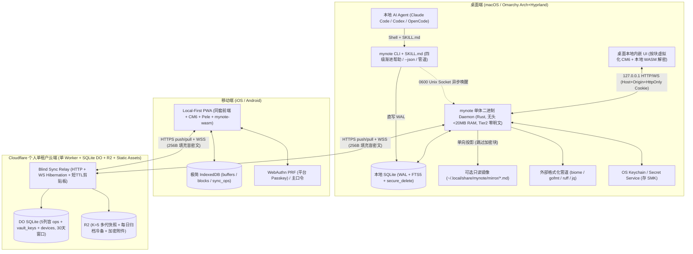
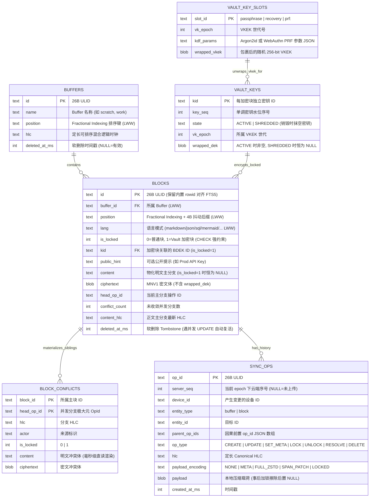
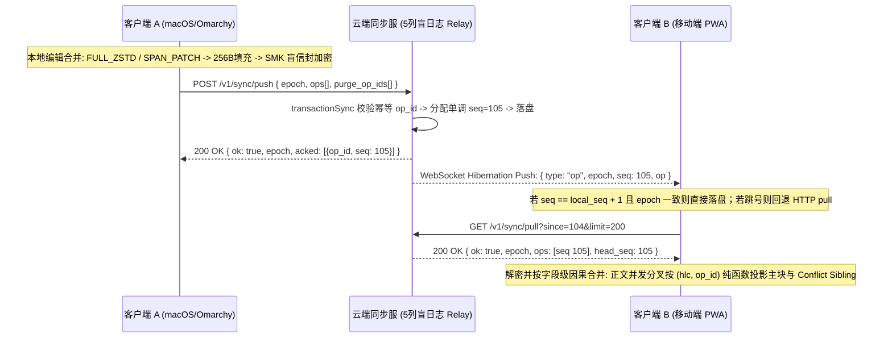
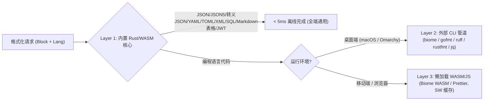
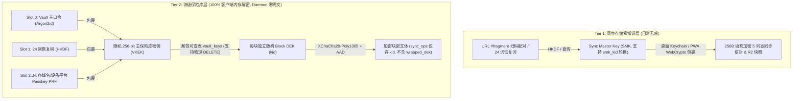
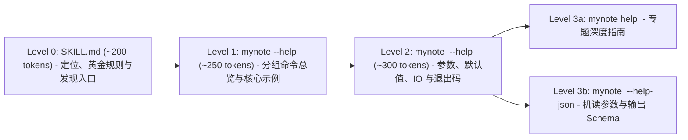

# 轻量级多端可靠同步开发者笔记软件：深度调研与架构方案

> **定位**：面向开发者的高频临时记录 / Scratchpad 工具，继承 Heynote「多语言分块 + 一键格式化」的顺手体验，从架构根源消除同步丢数问题，原生适配 **macOS**、**Omarchy（Arch + Hyprland）** 与 **移动端**，并兼顾**块级加密**、**Markdown/Mermaid 渲染**与 **CLI + Skill（Agent 友好）**。

---

## 目录

1. [根因诊断：为什么 Heynote + iCloud 会反复无故清空？](#1-根因诊断为什么-heynote--icloud-会反复无故清空)
2. [行业成熟方案深度调研（开源与商业）](#2-行业成熟方案深度调研开源与商业)
3. [核心约束的深度理解、剖析与挑战](#3-核心约束的深度理解剖析与挑战)
4. [推荐系统架构设计蓝图](#4-推荐系统架构设计蓝图)
5. [核心子系统详细设计](#5-核心子系统详细设计)
   - [5.1 数据模型：Block-First 而非文本分隔符](#51-数据模型block-first-而非文本分隔符)
   - [5.2 同步引擎：不可变操作日志（Anti-Wipe by Construction）](#52-同步引擎不可变操作日志anti-wipe-by-construction)
   - [5.3 格式化引擎：三层混合管线](#53-格式化引擎三层混合管线)
   - [5.4 安全与块级加密模型](#54-安全与块级加密模型)
   - [5.5 Agent 友好设计：CLI + Skill 与四级渐进披露帮助体系](#55-agent-友好设计cli--skill-与四级渐进披露帮助体系)
   - [5.6 Markdown 与 Mermaid 图渲染设计（轻量、离线与防 XSS）](#56-markdown-与-mermaid-图渲染设计轻量离线与防-xss)
6. [多端形态与技术栈选型对比](#6-多端形态与技术栈选型对比)
7. [分阶段演进路线图（M0 → M3）](#7-分阶段演进路线图m0--m3)
8. [已最终拍板的架构决策基线（ADR 摘要）](#8-已最终拍板的架构决策基线adr-摘要)

> **配套核心工程规范**：
> - [核心数据结构、存储 Schema 与二进制线格式规范 (`data-structures.md`)](./data-structures.md)（ULID/定长 HLC/FractionalIndex、Rust Sans-I/O 类型、4 类加密信封字节布局、SQLite `STRICT` 完整 DDL 与 PWA IndexedDB Schema）
> - [全链路接口与跨边界契约规范 (`interface-contracts.md`)](./interface-contracts.md)（统一错误码表、CLI 全子命令 JSON 信封、本地 Daemon REST/WS/UDS 契约、云端 Sync API 与 `mynote-wasm` FFI 契约）
> - [同步协议与确定性物化规范 (`sync-protocol.md`)](./sync-protocol.md)
> - [安全架构与威胁模型规范 (`threat-model.md`)](./threat-model.md)
> - [Cloudflare 技术栈云端架构专项评估 (`cloudflare-cloud-architecture.md`)](./cloudflare-cloud-architecture.md)

---

## 1. 根因诊断：为什么 Heynote + iCloud 会反复无故清空？

如果不先定位旧方案的根因，自研软件极易在换了一套壳之后重演同类数据丢失事故。

### 1.1 Heynote 的存储机制

Heynote（Electron + Vue 3 + CodeMirror 6 + Prettier + Math.js）将每个 Buffer 存为磁盘上的一个纯文本文件（1.x 为单文件 `buffer.txt`，2.x 为目录内多个 `.txt` 文件），块之间通过特殊文本分隔符（如 `∞∞∞javascript`）切分。它本身**没有内置同步协议**，官方仅建议把目录放进 Dropbox / OneDrive / iCloud Drive，并由进程监听文件变化来重新加载。

### 1.2 iCloud Drive 与实时编辑器叠加的四大结构性缺陷

2026 年发表的系统研究 *Why iCloud Fails: The Category Mistake of Cloud Synchronization*（arXiv:2602.19433）系统性地指出了此类故障的本质：**iCloud Drive 是一个将分布式因果同步强行伪装成 POSIX 本地文件系统的抽象泄漏**。在 Heynote 这种「高频自动保存 + 整文件读写」场景下，会触发四类致命路径：

1. **Dataless / 驱逐占位符（Eviction）触发空文件反写**：
   macOS Sonoma 起，iCloud Drive 会更积极地回收本地文件内容，留下未水化（dataless / `.icloud`）占位符。Heynote 作者在 Issue #365 中也明确确认：云同步目录未常驻本地缓存会导致 Buffer 列表异常。当应用打开一个尚未完成水化、或读取返回空/失败的 Buffer 文件时，若初始化逻辑误以为是「新建空 Buffer」并触发自动保存，就会把一个 **0 字节 / 初始空模板** 写回磁盘——iCloud 随即将这份「最新修改」同步到云端并覆盖所有其他设备。
2. **静默 LWW（Last-Write-Wins）与隐藏冲突**：
   与 Dropbox/Syncthing 生成明显冲突副本不同，iCloud Drive 在版本冲突时缺乏透明冲突管理界面，常以墙钟时间做静默覆盖，将离线/休眠唤醒期间的另一端修改直接抹除。
3. **文件监听器与同步守护进程（`bird` / FileProvider）的竞态环**：
   按键防抖写盘与云同步守护进程替换 inode 同时发生，非事务性的 read-modify-write 极易造成文件截断或编辑器重载为空态后二次刷盘。
4. **行业共性教训——「空状态误当权威覆盖」**：
   即便拥有自研同步服务器的产品也踩过这个坑。例如 Standard Notes 历史上曾发生过 iPhone 恢复备份后未恢复 Keychain 密钥，客户端无法解密本地数据却在重新登录后把空/异常状态同步覆盖了云端的事故（mobile#18）。

### 1.3 由此推导出的系统不变量（Anti-Wipe Invariants）

我们自研系统的第一性原则必须从机制上杜绝上述事故（形式化定义见 [`sync-protocol.md`](./sync-protocol.md)）：

- **不变量 1（禁止第三方网盘直写）**：同步必须发生在**应用层协议**，绝不把正在活跃写入的数据库或 Buffer 文件托管给 iCloud Drive / Dropbox / OneDrive。
- **不变量 2（不可变操作日志 + 防空 `UPDATE` 类型隔离）**：所有修改以携带因果前置版本（`parent_op_ids`）的**追加操作（Append-Only OpLog）**记录；未水化（`Unhydrated`）或解密失败（`DecryptFailed`）态在编译期严禁生成 `UPDATE`，外部格式化器与 CLI 非交互空管道自动熔断，杜绝把异常空态当成有效编辑写回。
- **不变量 3（新设备强制引导门禁 Bootstrap Gate）**：未完成首次同步引导（`bootstrap_completed == false`）的客户端严禁对任何远端已有实体发出修改或删除操作（`UPDATE / SET_META / LOCK / DELETE`）；离线未引导期间新建的内容仅允许作为全新 ULID 独立块追加。
- **不变量 4（多代快照与历史回溯分离）**：快照仅做冷启动加速且在 R2 滚动保留多世代，永不单点覆写历史日志；即便人工手误清空整块内容，也可通过 OpLog 秒级找回。

---

## 2. 行业成熟方案深度调研（开源与商业）

为了避免闭门造车，以下按**五种典型架构范式**调研了 11 款代表性开源与商业产品/引擎，聚焦它们的**存储模型、同步协议、加密边界、跨端形态与 Agent 友好度**。

### 2.1 五大架构范式拆解

#### 范式 A：开发者专用 Scratchpad（最贴近你的使用场景）

| 产品 | 形态与技术栈 | 存储与同步实现 | 关键优缺点与启示 |
| --- | --- | --- | --- |
| **Heynote** (开源) | Electron + Vue 3 + CodeMirror 6 + Prettier + Math.js | 磁盘 `.txt` 文件 + `∞∞∞lang` 文本分隔符；无内置同步 | **优点**：分块多语言、一键格式化、数学计算、极低心智负担。<br>**痛点**：Electron 内存重（180–250MB）；无移动端；无加密；分隔符混在正文里导致 `deleteLine` / Vim `dd` / 全局替换会破坏块边界（Issue #24/#43/#51）；Wayland 下全局快捷键失效。 |
| **Tot / Drafts** (商业) | 原生 Swift（仅 Apple 生态） | 本地库 + **Apple CloudKit**（结构化记录同步，非 iCloud Drive 文件） | **启示**：用 CloudKit 结构化同步比 iCloud Drive 文件可靠得多，但 Tot 官方知识库仍承认 iCloud 偶发同步混乱/丢字；且**彻底锁死在苹果生态，无法支持 Omarchy（Linux）与 Android**。 |
| **[Benchpad](https://benchpad.app)** (商业) | Mac / Win / Linux / iOS / Android / Web | 本地 IndexedDB + **Yjs 字符级 CRDT** + 托管同步服务 | **启示**：专门对标 Heynote 的跨端竞品（固定 3 个永久 Markdown Pad + `/code` 代码围栏），证明「Scratchpad + 离线优先同步」体验极顺滑；但非任意多语言分块流、闭源 SaaS、无代码格式化、无块级加密、无本地 Agent/CLI。 |

#### 范式 B：轻量自托管单二进制笔记

| 产品 | 形态与技术栈 | 存储与同步实现 | 关键优缺点与启示 |
| --- | --- | --- | --- |
| **Memos (`usememos/memos`)** (开源) | **Go 单二进制** + 内嵌 React SPA + SQLite/PG + gRPC/Connect/REST | **服务端中心化**（非 Local-First），多端通过浏览器/第三方客户端连同一服务 | **优点**：单二进制极轻（空闲 ~50MB）、部署零门槛、API 极其清晰、适合脚本与 Bot。<br>**缺点**：强依赖在线服务端，无真正离线编辑与冲突合并，无端到端加密，无代码格式化。 |
| **SilverBullet** (开源) | **单二进制服务端** + **Local-First PWA**（IndexedDB + Service Worker） | 服务端以**纯 Markdown 文件**落盘；浏览器端全量缓存于 IndexedDB，离线可写，联网双向同步 | **优点**：服务端文件天然对 Agent 友好；PWA 一套代码覆盖 macOS / Omarchy / iOS / Android。<br>**缺点**：文件级同步在多端离线并发编辑时仍有冲突副本；无 E2EE；受 iOS Safari PWA 存储回收约束。 |

#### 范式 C：零知识端到端加密（E2EE）跨端笔记

| 产品 | 形态与技术栈 | 存储与同步实现 | 关键优缺点与启示 |
| --- | --- | --- | --- |
| **Standard Notes** (开源/商业) | Electron + React Native + Web；TS Monorepo；Protocol 004 | **分层密钥（Argon2id → Root Key → Item Key）+ XChaCha20-Poly1305**；Item 级密文同步，服务端完全零知识 | **优点**：密码学设计教科书级，支持自托管与切换同步服。<br>**缺点**：客户端重（Electron）、自托管服务端极其臃肿（需模拟 Redis/SNS/SQS 多服务）；**对本地 Agent 极度不友好**（数据全密文锁在应用内）。 |
| **Notesnook** (开源/商业) | Electron + React Native + Web；本地 SQLite 加密 | 默认全量 E2EE（XChaCha20-Poly1305），并额外提供 **Private Vault（独立二次密码/生物识别锁定单条笔记）** | **核心启示**：清晰区分了**「同步层 E2EE」**与**「内容级独立加密锁（Vault）」**两层模型——这正是解决你「加密某一块内容」的最佳参考！ |
| **Joplin** (开源) | Electron + React Native + 本地 SQLite | 支持 WebDAV / Dropbox / S3 / **Joplin Server** + 可选 E2EE | **反面教训**：早期押注 WebDAV/网盘等「哑文件存储」，导致同步极慢（PROPFIND 风暴）、锁文件卡死、冲突笔记泛滥，最终不得不自建专用的 Joplin Server。 |

#### 范式 D：Local-First、纯文件与开发者同步引擎

| 产品 / 引擎 | 核心技术栈 | 存储与同步实现 | 关键优缺点与启示 |
| --- | --- | --- | --- |
| **Obsidian + Sync / LiveSync** | Electron + Capacitor；本地纯 `.md` 文件 | 官方 Sync：AES-256 E2EE + `diff-match-patch` 事后合并；LiveSync：CouchDB 分块 E2EE | **优点**：本地纯 Markdown 是 **AI Agent 的黄金标准**。<br>**缺点**：`diff-match-patch` 事后猜测合并会导致文本重复（重复段落）；CouchDB 自托管运维重且重设密钥易踩坑。 |
| **Anytype (`any-sync`)** (开源) | Go 核心 + CRDT + IPFS/libp2p + E2EE | 局域网 P2P + 自托管多节点（coordinator/tree/filenode） | **反面教训**：P2P + 全套去中心化节点架构极度复杂，违背「足够轻量、简洁易维护」的目标。 |
| **Atuin (Sync v2)** (开源) | **Rust 单二进制 CLI/Daemon** + 本地 SQLite | **Append-Only 加密 Record Store** + 客户端打包加密 Packfile + 极简自托管同步服 | **最大灵感来源！** 面向开发者的 macOS/Linux 工具：本地 SQLite 保证毫秒级 CLI 查询与离线可用；Sync v2 只追加不可变加密记录，永不覆盖历史，服务端极薄且零知识。 |
| **Evolu / Loro + Durable Streams** (开源引擎) | SQLite + HLC + Range-Based Set Reconciliation；Loro Rust/WASM CRDT | **Loro 2026 工程总结核心洞见**：加密 CRDT 的最佳云端后端其实极其简单——就是一个**带单调偏移量（offset）+ 快照压缩 + CAS 的纯追加字节流（Append-Only Log）** | **关键理论支撑**：服务端不需要懂业务逻辑、不需要在云端运行 CRDT 合并，内存开销极低，同时天然支持 E2EE 与断点续传。 |

### 2.2 竞品横向对比矩阵

| 产品 | 轻量度 | 同步可靠性 | 移动端 | Omarchy/Wayland 体验 | 内容格式化 | 块级加密 | 本地 Agent / CLI 友好 | 云端架构与零知识 |
| --- | :---: | :---: | :---: | :---: | :---: | :---: | :---: | :---: |
| Heynote | 中下 (Electron) | 差 (依赖网盘) | ❌ | 一般 (全局热键坑) | ✅ 强 | ❌ | 良 (纯文本) | ❌ 无内置云端 |
| Benchpad | 良 | ✅ 强 (Yjs CRDT) | ✅ | 良 (Web) | ❌ | ❌ | ❌ (闭源) | 闭源 SaaS |
| Memos | ✅ 极轻 (Go) | 中 (在线中心化) | ✅ Web/三方 | ✅ 良 | ❌ | ❌ | 良 (API) | 自托管 (非 E2EE) |
| SilverBullet | 良 | 良 (文件级同步) | ✅ PWA | ✅ 良 | 弱 | ❌ | ✅ 强 (服务端md) | 自托管 (非 E2EE) |
| Standard Notes | 差 (重服务端) | 良 (Item 级) | ✅ | 一般 | 弱 | 整篇锁定 | ❌ 极差 | 重自托管 (E2EE) |
| Notesnook | 中 | 良 | ✅ | 一般 | 弱 | 整篇 Vault | ❌ 差 | 托管/自建 (E2EE) |
| Obsidian | 中下 | 良 (付费/自建) | ✅ | 一般 | 插件 | 插件 | ✅ 极强 | 付费 Sync (E2EE) |
| Atuin (参考引擎) | ✅ 极轻 (Rust) | ✅ 极强 (OpLog) | ❌ | ✅ 极佳 | N/A | 全量 E2EE | ✅ 极强 (CLI/DB) | 极简自建 (E2EE) |
| **目标方案 (my-note)** | **✅ 单二进制 <15MB** | **✅ 追加日志+可选CRDT** | **✅ PWA起步** | **✅ 原生契合** | **✅ 三层混合** | **✅ 原生块级Vault** | **✅ CLI+Skill (渐进披露)** | **✅ CF 零知识 \$0** |

---

## 3. 核心约束的深度理解、剖析与挑战

针对你提出的 6 条约束，以下逐条拆解其背后的真实诉求，并重点揭示**约束之间隐藏的冲突、工程陷阱与必须提前做出的权衡**。

---

### 约束 1：软件形态不限（单体二进制带 GUI、CLI + 网页都可以）

- **真实诉求**：不要被框架教条束缚，关键是跨 **macOS + Omarchy + 移动端** 好用、省心、维护成本低。
- **架构挑战 1A — 真正的分水岭不是「GUI vs 网页」，而是「桌面本地二进制 vs 移动端沙盒」**：
  - 无论选 Rust 原生 GUI（GPUI / egui / Slint）还是桌面单二进制，都**无法直接作为本地守护进程跑在 iOS 上**。如果桌面做原生 GUI、iOS 做 SwiftUI、Android 做 Kotlin，个人维护三套编辑器和格式化 UI 会直接拖垮项目。
- **架构挑战 1B — 慎选 Tauri v2 作为 Omarchy 主力 GUI**：
  - Tauri v2 在 Linux 下底层依赖 **WebKitGTK**。在 Arch Linux + Hyprland（Wayland）环境下（尤其配合高分屏分数缩放或 NVIDIA 显卡），WebKitGTK 长期存在黑屏/白屏、渲染卡顿、焦点键（如 `Shift+Tab`）被吞掉等顽疾。
  - 反观 **Omarchy 的原生工作流**：Omarchy 一等公民支持 **Chromium Web App（`omarchy-launch-webapp`）**、**Hyprland Special Workspace Scratchpad（`SUPER + S` 一键呼出/隐藏）** 与终端 TUI。因此，**「本地单二进制后台守护进程 + 内嵌 Web UI」**在 Omarchy 上反而是最丝滑、零兼容坑的原生级体验！
- **架构挑战 1C — 移动端 PWA 的两个隐藏暗坑**：
  1. **iOS Safari / WebKit 存储驱逐**：虽然添加到主屏幕（Add to Home Screen）的 PWA 存储稳定性优于普通标签页，但在磁盘压力或长期未打开情况下，WebKit 仍有清理本地缓存/IndexedDB 的风险——因此**绝不能把移动端浏览器本地存储当成唯一持久副本**，必须由云端同步服兜底。
  2. **iOS PWA 不支持真正的后台定期同步（Background Sync API）**：切后台数十秒后 Service Worker 会被挂起。应对方案是**编辑后防抖 300–500ms 立即推送**，并在顶栏常驻极简的同步状态指示点（绿=已落云 / 黄=待同步 / 灰=离线）。

---

### 约束 2：需要支持对内容进行格式化

- **真实诉求**：像 Heynote 一样，随手贴一段压缩成一行的 JSON、混乱的 SQL、HTML/XML、YAML、Markdown 或代码片段，按一个快捷键瞬间美化。
- **架构挑战 2A — 「全语言格式化」与「足够轻量（约束 3）」直接冲突**：
  - Heynote 靠内置 Prettier + 多种 Parser 实现了多语言格式化，仅 Prettier standalone 及其常用插件就会增加数 MB JS 体积，且仍覆盖不了 SQL、XML、Go、Rust、Python、Shell 等开发常用格式。
- **架构挑战 2B — 区分「高频数据格式」与「编程语言代码」，分层解决**：
  - 开发者在临时记事本中 **80% 的格式化需求其实不是写完整工程代码，而是数据片段**：JSON（尤其是带转义字符串的脏 JSON、JSON5/JSONC 尾逗号）、SQL、XML、YAML、TOML、URL Query / Base64 / JWT 解码、Markdown 表格对齐。
  - 这些高频格式化器用 **纯 Rust 实现**，体积仅几百 KB，既可编译进桌面单二进制/CLI，又可编译为 **WASM** 直接在手机 PWA 离线毫秒级执行。
  - 其余编程语言（JS/TS/CSS/HTML/Go/Python/Rust/Shell）：
    - 桌面端（macOS / Omarchy）直接通过 **可配置的外部 CLI 管道**调用本机已有工具链（`biome`、`gofmt`、`ruff`、`rustfmt`、`jq`、`shfmt`）——零体积膨胀，且格式化规则 100% 匹配你的开发环境；
    - 移动端/无工具链环境按需懒加载轻量 Biome WASM / Prettier standalone（由 Service Worker 缓存，不影响冷启动）。
- **架构挑战 2C — 必须抛弃 Heynote 的文本分隔符设计**：
  - Heynote 用 `∞∞∞lang` 分隔符把所有块塞进一个文本文件，这会直接摧毁块级加密、块级版本冲突隔离和 Vim 键位体验。**块（Block）必须是底层一等数据结构**，界面层再把它渲染成类似 Heynote 那样顺滑的连续流（按 `Cmd/Ctrl+Enter` 无缝新建下一块）。

---

### 约束 3：足够轻量

- **真实诉求**：替代 Electron（动辄 200MB+ 内存、2–3 秒冷启），做到「随时唤出、零存在感、低资源消耗、部署极简」。
- **架构挑战 3A — 必须用诚实、对等的量化预算约束架构，避免功能蔓延**：
  - 单体二进制体积：`< 15 MB`（内嵌编译后的前端静态资源，不打包重型运行时）
  - 桌面内存双态披露（公平对比 Electron 常驻 180–250 MB）：
    - **无头后台守护态（未打开窗口，仅维持 CLI、剪贴板监听与后台同步）**：`< 15–20 MB`（Electron 即使关窗驻留托盘仍占百兆以上）；
    - **打开 Web UI 窗口态**：复用系统已驻留浏览器主进程时渲染器增量约 `40–80 MB`（冷起独立浏览器 App Mode 进程组约 `120–200 MB`），**关闭窗口即 100% 释放回系统**。
  - CLI 单次命令耗时：`< 15 ms`（直写本地 SQLite WAL，Daemon 未启动亦零阻塞完成）
  - 界面唤出延迟：`< 100 ms`（Hyprland Special Workspace / macOS 驻留窗口瞬时切出）
  - 云端同步服：Cloudflare Workers + SQLite Durable Object + R2（或逃生舱单二进制 + SQLite），个人月成本 **\$0**（可选 \$5 Paid）
- **架构挑战 3B — 同步引擎不要过度设计成「重型分布式系统」**：
  - 不要引入 CouchDB、Anytype 多节点、RabbitMQ/Redis 或复杂 P2P NAT 穿透。
  - **关键反思：单人多端 Scratchpad 是否一定要在 M0/M1 就上全套字符级 CRDT？**
    - 相比 Heynote 单文件把 50 个笔记块绑在一起，**一旦把同步粒度拆到「块（Block）级」**，两台设备离线并发修改**不同块**时天然零冲突！
    - 只有极少数情况你会同时离线改**同一个块**。采用「不可变追加日志 + 字段级因果拆分 + 内生 `(hlc, op_id)` 纯函数冲突分支投影」，同一块并发修改正文时确定性展示主块与冲突兄弟（Conflict Sibling）供一键合并，**零丢数且复杂度只有 CRDT 的 1/5**；未来按需在单块内嵌入 Loro/Yjs 增量流亦无需推翻传输层。

---

### 约束 4：足够安全，支持加密某一块内容

- **真实诉求**：临时记事本经常顺手粘贴 Token、环境变量、服务器密码、私密想法；不希望它们明文落盘，也不希望被云端或误操作泄露，但又不想每次看普通笔记都输密码。
- **架构挑战 4A — 「加密某一块内容」与「云端存储零知识 E2EE」是两套不同的安全边界，必须分清**：
  - **边界 1（云端传输与云端被动存储零知识 —— Tier 1 Sync E2EE）**：普通笔记与业务元数据离开设备前做 256B 阶梯填充并用 `Sync Master Key (SMK)` 自动加密，日常使用**无感**（桌面由 OS Keychain / Secret Service 自动解封，PWA 由不可导出 WebCrypto 密钥包裹存入 IndexedDB），云端数据库与备份永远看不到明文。
  - **边界 2（本地静态 + 防偷窥 + 防同 UID Agent 泄露 —— Tier 2 Block-Level Vault）**：被标记为「加密」的单个块由独立随机 `BDEK` 加密（`BDEK` 存于可变表 `vault_keys`，主密钥 `VKEK` 由口令、恢复词及各端 WebAuthn PRF 多槽位包裹），且**解锁与加解密 100% 在当前交互客户端内存（Web UI WASM 或单次 CLI 进程）完成，后台常驻 Daemon 永不持有 `VKEK` 与加密块明文**！
- **架构挑战 4B — 加密块周边最容易被忽略的 5 个泄露点**：
  1. **「先写后锁」历史残留（WAL / FTS5 / 云端旧记录）**：先粘贴明文再点锁定时，必须在同一事务内清空本地历史 op 明文、清理并 `merge` FTS5 倒排表、立即执行 `PRAGMA wal_checkpoint(TRUNCATE)` 截断清零 `.db-wal` 残留帧，同时向云端发送 `purge_op_ids[]` 原地将旧 `ops.envelope` 置 `NULL`！
  2. **元数据侧信道泄露**：加密块将正文与敏感属性一并封入密文，云端同步层进一步将 `entity_id`、`op_type`、`hlc` 全部封入 5 列盲信封并做 256B 对齐填充。
  3. **不可变日志阻碍销毁**：`wrapped_dek` 绝不写入不可变 `sync_ops`，而是抽离至支持物理 `DELETE` 的可变表 `vault_keys`；一次性跨端传密（`clip push --ephemeral`）走独立短 TTL 瞬态槽位，不入主日志与 R2 冷备。
  4. **内存与剪贴板残留**：客户端内存中的解锁态空闲 5 分钟或切后台立即 `zeroize` 清零回锁，复制加密块内容时默认 30 秒清空系统剪贴板。
  5. **密钥遗忘即永久丢失**：初始化时强制生成可打印备份的 **24 词助记恢复词（Recovery Key）**。

---

### 约束 5：对本地 Agent 友好

- **真实诉求**：让本地运行的代码助手（Claude Code、Codex、OpenCode、Cursor、自写脚本）能顺手读取你刚贴在 Scratchpad 里的报错日志/API 响应，或者把分析结果、代码片段、Mermaid 图直接写进你的 Scratchpad。
- **架构挑战 5A — 「纯文本文件友好」与「可靠同步引擎」的冲突**：
  - 本地 Agent 习惯用 `rg`/`cat` 读纯文件，但如果允许外部进程直接修改同步目录里的原始文本文件，就会回到 Heynote 的竞态老路（部分写入、监听死循环、破坏结构）。
  - **已确认解法：SQLite 为唯一权威数据源 + 「CLI + Skill（渐进披露帮助）」为主入口（明确放弃本地 MCP）**：
    1. **一等公民 CLI + 极轻 `SKILL.md`**：不引入任何 MCP 协议栈与常驻 Schema 上下文负担。通过完备的 CLI（`--json` / `--jsonl`、Unix 管道、稳定退出码、错误提示 `hint`、乐观锁）配合 **四级渐进披露帮助体系（L0 `SKILL.md` → L1 总览 → L2 子命令帮助 → L3 专题/机读 Schema）**，直接读写本地 SQLite WAL（`busy_timeout=5s`，Daemon 未运行亦照常毫秒级完成），并通过非阻塞 Unix Socket 唤醒 Daemon 即时同步。
    2. **可选的只读纯文本镜像（Read-Only Mirror）**：后台单向导出所有**未锁定**块为 `~/.local/share/mynote/mirror/<buffer>.md`，供 `rg`/fzf/编辑器只读检索；严禁反写，且加密块只输出 `<!-- LOCKED BLOCK: <id> -->` 占位符。
- **架构挑战 5B — 「Agent 友好」与「安全（约束 4）」的真实权限边界**：
  - Prompt Injection 已成为本地 Agent 的现实威胁。必须坦诚：**同用户 UID 下运行的 Agent 具备读取本地普通文件与伪造 PTY（`script`/`expect`）的系统能力**，因此 CLI 的 TTY 检测与 `MYNOTE_ACTOR` 仅定位为防误触/防浅层注入的**体验与审计护栏**。
  - **真正的密码学硬防线**：加密块在本地磁盘只有密文，且常驻 Daemon 不持有 `VKEK` 与明文——只要人类不亲手把 Vault 口令喂给被劫持的 Agent，同 UID Agent 即便读穿本地文件与 Daemon Cookie 也无法解开任何加密块（详见 [`threat-model.md` 第 5 节](./threat-model.md#5-本地-daemon-鉴权加固与同-uid-agent-隔离边界)）。

---

### 约束 6：云端定位收敛（明确放弃云端 MCP / 开放接口，回归纯粹零知识同步中继）

> [!NOTE]
> **已拍板架构收敛**：原方案曾分析「云端零知识 E2EE ⚔️ 云端 MCP / Open API」的根本悖论。经过权衡，已明确决定 **不考虑云端 MCP，本地也不考虑 MCP，Agent 交互统一收口到「本地 CLI + Skill」**。

这一决定直接带来**巨大的架构简化与清晰的信任边界**：
1. **对被动存储 100% 零知识 + 诚实的代码分发边界**：DO SQLite 与 R2 只存盲密文；桌面端严格运行本地内嵌资源（100% 免疫云端篡改），移动端 PWA 前端由自有 Cloudflare 账号下发（要求开启硬件 FIDO2 2FA + 最小权限部署 Token）。
2. **云端代码量骤减 ~70%**：无需构建云端 OAuth 2.1 授权服、云端物化视图/FTS5、远端 MCP 路由或内网穿透隧道；整个 Cloudflare 后端仅需约 **300–350 行 TypeScript**，个人成本稳定在 **\$0/月**。
3. **客户端更轻更纯**：桌面 Rust 单二进制同样无需引入 MCP SDK 与额外传输层，体积更小、面更窄、更稳固。

> [!TIP]
> 详细云端配额精算、同步状态机与威胁模型请参阅：[Cloudflare 云端架构评估 (`cloudflare-cloud-architecture.md`)](./cloudflare-cloud-architecture.md)、[同步协议规范 (`sync-protocol.md`)](./sync-protocol.md) 与 [威胁模型规范 (`threat-model.md`)](./threat-model.md)。

---

## 4. 推荐系统架构设计蓝图

综合以上调研与决策，推荐采用 **「Local-First Sans-I/O 核心（CLI + Skill + 内嵌 Web） + 移动端 PWA + Cloudflare 存储零知识追加日志同步服」** 架构。

### 4.1 整体架构图



### 4.2 为什么这套架构最契合你的全部目标？

1. **一套前端覆盖三端，彻底规避 WebKitGTK 坑且桌面端零远端代码风险**：
   - 前端基于 **按块虚拟化 CodeMirror 6 + Pele 纯 SVG + 极简响应式框架（SolidJS / Svelte 5 / Preact）**，打包后通过 `rust-embed` 内嵌进桌面单体二进制（永不加载远端代码）。
   - **Omarchy**：后台 systemd user service 运行 `mynote daemon`，Hyprland 绑定快捷键拉起本地鉴权会话放入 Special Workspace，享受原生 Wayland 渲染、瞬时切换、零 WebKitGTK 崩溃。
   - **macOS**：`launchd` 运行同一 `mynote daemon`，前端可用浏览器 App Mode，或包一层 ~3MB 的极薄原生 Swift `WKWebView` 壳支持全局热键与菜单栏常驻。
   - **移动端**：访问自有域名 Cloudflare Workers Static Assets 托管的**同一份 PWA**，使用 Service Worker + 极简 IndexedDB（零 `sqlite-wasm` 体积负担与文件锁冲突）实现离线编辑；同步状态机、加解密与轻量格式化通过 `mynote-wasm` 100% 复用。
2. **形式化防丢 + 双层零知识隔离**：本地 SQLite WAL + 防空 `UPDATE` 类型门禁 + `(hlc, op_id)` 确定性冲突投影 + R2 多代快照与活跃水位 GC，配合客户端内存级 Tier 2 解密。
3. **极致的 Agent 友好（零 MCP 负担）**：完备的 `CLI + SKILL.md` + 四级渐进披露帮助 + 离线友好的稳定退出码契约。

---

## 5. 核心子系统详细设计

### 5.1 数据模型：Block-First 而非文本分隔符

彻底放弃 Heynote 的「整文件文本分隔符」，将 **Block** 提升为最小同步、格式化、加密与检索单元（完整 SQLite `STRICT` DDL 与字节布局见 [`data-structures.md`](./data-structures.md)）。



**关键设计细节**：
- **Fractional Indexing 防碰撞与重平衡**：插入时附带 4 字符随机抖动后缀，查询排序强制 `ORDER BY position COLLATE BINARY ASC, id ASC`（以 ULID 破除离线同位插入平局）；单键长度超过 64 字节时自动对局部相邻窗口重平衡。
- **物理隔离明文、密文与「先写后锁」残留擦除**：当块转为 `is_locked = 1` 时，同一事务内清空 `content`、抹除本地历史 `sync_ops` 明文、删除并 `merge` `blocks_fts` 倒排段，随后立即执行 `PRAGMA wal_checkpoint(TRUNCATE)` 截断清零 `.db-wal` 残留帧，并向云端发送 `purge_op_ids[]` 原地将旧 `ops.envelope` 置 `NULL`。
- **为什么前端坚持「按块独立/虚拟化挂载 CodeMirror 6」而非「单 CM6 文档」？**
  - Heynote 采用单 CM6 文档 + 分隔符装饰是因为它只有纯源码态，即便如此也在 `deleteLine` 吞块与 Vim 操作符破坏分隔符上饱受困扰（Heynote Issue #24/#43/#51）；
  - 本项目核心包含**单块独立 Markdown/Mermaid 原生 DOM 预览态（支持直接划选复制干净富文本）、左右分栏、锁定态加密卡片与块级独立 Undo**——若强塞进单 CM6 文档 Block Widget，会引发 CM6 选区复制拦截、视口高度估算跳动与混合语法树复杂度失控；
  - 参考 JupyterLab 4 成熟方案：**仅对视口内处于源码编辑态的块挂载轻量 `EditorView`**，并通过 `< 150` 行交互桥接实现**首尾行上下方向键 / Vim `j`/`k` 跨块无缝跳转、两段式 `Cmd+A`（首按选当前块、连按第 2 次选全 Buffer）以及顶层全局跨块搜索替换**，兼得连续流手感与架构整洁度。

---

### 5.2 同步引擎：不可变操作日志（Anti-Wipe by Construction）

借鉴 **Atuin Sync v2（追加记录日志）**、**Evolu（HLC + E2EE）** 与 **Loro Durable Streams（哑线性流 + 快照）** 的最佳实践，构建形式化防丢同步协议（详见 [`sync-protocol.md`](./sync-protocol.md)）。

#### 同步时序流程



#### 为什么该协议不可能重演「无故清空」？

1. **混合确定性压缩载荷（`FULL_ZSTD` + `SPAN_PATCH`）与本地合并**：`< 4 KB` 块、所有加密块及每 20 步检查点均采用 100% 自包含的 `FULL_ZSTD`；仅 `>= 4 KB` 明文块连续编辑采用带 `base_blake3` 与 `post_blake3` 硬校验的精确字节区间补丁 `SPAN_PATCH`（拒绝模糊 `diff-match-patch`），配合出站前本地合并，既杜绝链式拼错，又消除 300 KB 大块写放大。
2. **纯函数冲突视图 + 字段级因果拆分**：
   - `position`、`lang`、`buffer_id` 走独立 LWW-Register，并发移动与改字互不干扰；`DELETE` 遇并发 `UPDATE` 自动复活（Update-Wins）；`LOCK` 遇并发明文 `UPDATE` 强制保持锁定（Lock-Wins）；
   - 正文并发分叉**不自动派生新 `CREATE` 操作**（避免 $N$ 台设备生成 $N$ 份重复冲突块），而是各端按内生不可变的 **`(hlc, op_id)` 字典序** 纯函数投影出主块与冲突兄弟列表，直至用户点击合并发出多父指针 `RESOLVE` 操作收敛分支。
3. **防空 `UPDATE` 类型门禁与引导隔离**：未完成首次引导前禁推已有实体变更；`DecryptFailed` / `Unhydrated` 编译期禁止构造 `UPDATE`；外部格式化器与 CLI 非交互 0 字节管道自动熔断。
4. **R2 多世代快照（`K=5`）与 DO 活跃水位滑动窗口 GC 解耦**：快照只存 R2（带 `prev_snapshot_id` CAS 与 `state_blake3` 自检），永不单点覆写；DO SQLite 仅在低于所有活跃设备已拉取水位且满 30 天（或达 700 MB）并归档 R2 后才回收旧行，确保单 DO 常态仅占 `~15–25 MB`，永不触碰免费版 1 GB `SQLITE_FULL`。
5. **`epoch` 并集对账状态机**：PITR 回滚或迁移自建服导致 `epoch` 变化时，客户端将本地与远端按 `op_id` 求**集合并集**（严禁先清空本地表！），按 `(hlc, op_id)` 重新物化后补推缺失项。

#### 跨设备复制粘贴场景的专项优化（低延迟 × 高可靠）

1. **粘贴快车道（Fast-Flush）**：普通输入防抖 `400–500ms` 本地合并；触发 **粘贴（`paste`）、失焦（`blur`）或剪贴板命令** 时 `0–100ms` 立即走 HTTP `push` + `<= 16KB` WebSocket Hibernation 顺风车直达（跳号自动回退 HTTP `pull`）。
2. **一键复制与桌面极速剪贴板 CLI**：块顶一键 Copy（桌面 `Cmd/Ctrl+Shift+C`）；CLI `mynote clip push/pull` 对接 `pbpaste`/`pbcopy` 与 `wl-paste`/`wl-copy`（Daemon 未运行时 CLI 自动进程内直推）。
3. **移动端前台唤醒即拉**：PWA 在 `visibilitychange` / `pageshow` 回到前台瞬间并发执行 HTTP `pull` 与 WS 重连，`~300ms` 内呈现最新粘贴内容。
4. **独立瞬态加密剪贴板（`mynote clip push --lock --ephemeral`）**：跨设备传临时验证码/Token 走 DO 专用短 TTL 瞬态槽位（阅后即焚，**不写入持久化 `sync_ops` 主日志，也不进入每日 R2 冷备与长期归档**），复制后 30 秒自动清空本地剪贴板。

---

### 5.3 格式化引擎：三层混合管线

兼顾 **多语言覆盖**、**零体积膨胀** 与 **桌面/移动端全离线可用**：



**开发者专属高频加分项与防空护栏**：
- **脏 JSON 急救模式**：内置一键 `Unescape & Format JSON`，解包日志双层转义字符串与尾逗号。
- **结构化转换动作**：JSON ↔ YAML ↔ TOML 互转、Base64 编解码、URL Query 转 JSON、JWT 载荷预览、Unix 时间戳转换——纯本地离线执行。
- **零字节异常熔断**：Layer 2 外部 CLI 子进程若对非空输入返回 `0 bytes`、退出码非 `0` 或超时，**无条件丢弃输出并保留原文本报错**，严防异常格式化脚本清空笔记块。
- **外部格式化器配置示例（`~/.config/mynote/formatters.toml`）**：
  ```toml
  [formatters.typescript]
  cmd = ["biome", "format", "--stdin-file-path=scratch.ts"]
  timeout_ms = 2000

  [formatters.python]
  cmd = ["ruff", "format", "-"]

  [formatters.go]
  cmd = ["gofmt"]
  ```

---

### 5.4 安全与块级加密模型

采用成熟现代密码学原语组合，并将密钥包裹、存储位置与销毁边界形式化收敛于 [`threat-model.md`](./threat-model.md)：

- **KDF**：`Argon2id`（桌面默认 64 MiB / t=3 / p=1；移动端 WASM 下限 32 MiB / t=3 / p=1）+ `HKDF-SHA256`
- **对称认证加密（AEAD）**：`XChaCha20-Poly1305`（192-bit 随机 Nonce）+ 256B 阶梯填充
- **关联认证数据（AAD）**：Tier 1 绑定 `"mynote-sync-v1" || smk_kid || op_id || device_id`；Tier 2 绑定 `"mynote-vault-v1" || entity_id || op_id || kid`

#### 双层密钥与 LUKS 式多槽位包裹体系



**块级加密核心机制**：
1. **可变密钥表分离（真 Crypto-Shredding）**：`wrapped_dek` 绝不进入不可变 `sync_ops`，而是独立存于可变表 `vault_keys`；销毁加密块时物理删除对应 `kid` 行（并在威胁模型中诚实说明常规块受云端底层 30 天 PITR 约束，一次性传密请用 `--ephemeral` 瞬态槽位）。
2. **LUKS 式多槽位包裹（跨 RP / 跨设备生物识别）**：针对 `localhost` 与线上 PWA 域名 RP ID 不同、各设备 Passkey 不同的客观约束，随机主密钥 `VKEK` 由 `vault_key_slots` 多槽位独立包裹（注：iOS Safari 18+ PRF 支持内置 Face ID Passkey，不支持外接硬件 YubiKey，后者自动回退主口令）。
3. **常驻 Daemon 零明文 + 本地严格鉴权**：Tier 2 解密仅发生在当前 Web UI WASM 或单次 CLI 进程内存中，空闲 5 分钟或切后台即 `zeroize`；Daemon 本地接口强制校验 `Host` + `Origin` + `HttpOnly` 随机 Session Cookie。
4. **零服务器泄露扫码配对与丢失止损**：`mynote device add` 通过不发往服务端的 URL `#fragment` 二维码传发密钥；设备遗失支持秒级 `revoke` 并轮换 `smk_kid`。

---

### 5.5 Agent 友好设计：CLI + Skill 与四级渐进披露帮助体系

> **设计决策**：**不实现本地 MCP，也不实现云端 MCP**。所有本地 AI Agent（Claude Code、Codex、OpenCode、Cursor 等）与人类开发者共享同一套**高完备度 CLI + 极轻 `SKILL.md`**，把 Token 占用、维护复杂度与攻击面同时压到最低。

#### 1. 为什么「CLI + Skill」比 MCP 更适合本工具？
- **零常驻上下文税**：传统 MCP 每次会话都会预先注入大量 JSON Tool Schema，而极轻的 `SKILL.md` 仅占 ~150–250 tokens，其余命令参数由 Agent 按需调用 `--help` 渐进读取。
- **天然 Unix 可组合性**：直接与 `curl`、`jq`、`rg`、`pbcopy`/`wl-copy`、Shell 管道无缝衔接，人类和 Agent 用的是同一套心智模型。
- **二进制更轻更纯**：Rust 核心无需引入 MCP SDK 与额外的 `stdio`/SSE 传输协议栈。

#### 2. 四级渐进披露帮助体系（Progressive Disclosure Help）

帮助信息严格按 **「先路由、后参数、按需展开专题与机读 Schema」** 分为 4 级，绝不在顶层一次性倾倒几千字说明：



- **Level 0 — 极简 `SKILL.md`（常驻 Agent 技能目录，严格控制在 `< 250 tokens`）**：
  - 只写 4 件事：① `mynote` 是什么（本地多语言分块草稿本）；② 渐进发现入口（`mynote --help`、`mynote <cmd> --help`、`mynote help agent`）；③ 4 条 Agent 黄金法则（程序化调用必加 `--json`；更新已有块必带 `--expected-head`；绝不尝试解密加密块；列表查询注意 `--limit`）；④ 3 条最高频命令速查。
  - **反模式禁止**：严禁把全部子命令和几十个 Flag 写死在 `SKILL.md` 中（既浪费 Token，又容易与 CLI 实际版本漂移）。

- **Level 1 — 顶层命令路由（`mynote -h` / `mynote --help`，控制在 25–35 行）**：
  ```text
  mynote — Local-first block scratchpad with E2EE sync & formatting

  CAPTURE & BLOCKS:
    add         Create a new block (supports stdin pipe & --format)
    block       Read, update, append, move, or delete a specific block
    buf         List, create, or rename buffers
    import      Import existing Heynote buffers (∞∞∞ delimiter migration)

  QUERY & CLIPBOARD:
    ls          List recent blocks (summary-first, token-budget safe)
    search      Full-text search across unlocked blocks (FTS5)
    clip        Instant cross-device clipboard push/pull (--ephemeral supported)

  TRANSFORM & OPS:
    format      Format a block or stdin (json/sql/yaml/xml/md + external CLIs)
    sync        Inspect sync status, force push/pull, rotate-smk, view conflicts
    vault       Lock/unlock/shred sensitive blocks (client-side decryption)
    device      Pair new device (QR #fragment), list, or revoke lost devices
    help        Deep topics: formatting, locking, conflict, agent

  GLOBAL FLAGS:
    --json        Structured JSON output envelope {ok, data, error, meta}
    --jsonl       Line-delimited JSON stream for list/search
    --quiet       Suppress non-data stderr notices
    --help-json   Machine-readable command & flag schema

  NEXT STEP:
    Run 'mynote <cmd> --help' for flags & examples.
    Run 'mynote help agent' for AI agent integration contract & exit codes.
  ```

- **Level 2 — 子命令精准参考（`mynote <cmd> --help`）**：
  - 仅在 Agent 确定要调用某个子命令时按需加载，固定包含 5 个结构化区块：**SYNOPSIS / FLAGS（含类型与默认值）/ STDIN & STDOUT 契约 / EXIT CODES / 2–3 个可直接复制的 EXAMPLES**。

- **Level 3 — 深度专题与机读 Schema（按需按主题展开）**：
  - `mynote help <topic>`：内置离线文档专题（如 `mynote help agent`、`mynote help formatting`、`mynote help conflict`、`mynote help locking`），覆盖边界场景与冲突恢复配方；
  - `mynote <cmd> --help-json`（基于 `clap` 元数据自动生成，永不漂移）：输出该命令所有参数的名称、类型、枚举值、是否必填、退出码表以及返回 JSON 结构，供需要严格 Schema 的自动化脚本/Agent 零歧义解析。

#### 3. Agent-Native CLI 工程契约（比 `--help` 更关键的 6 条硬规范）

1. **直写本地 SQLite WAL + 统一结构化输出信封（`--json`）**：
   - CLI 直接读写本地 SQLite WAL（`busy_timeout=5s`），写后通过非阻塞 Unix Socket 唤醒 Daemon 同步；**即使后台 Daemon 未启动，CLI 依然 `< 5–15ms` 完成且零报错**。
   - 带 `--json` 时，stdout 永远是合法单条 JSON（日志/警告只走 stderr）：
     ```json
     {
       "ok": true,
       "data": { "id": "01JXYZ...", "buffer": "scratch", "lang": "json", "head_op_id": "01JABC..." },
       "meta": { "local_seq": 108, "sync_state": "pending_offline", "redacted_count": 1 }
     }
     ```
   - 当检测到 `!isatty(stdout)`（处于管道或 Agent Shell 执行中）时，自动关闭 ANSI 颜色码与交互式分页器（pager）。
2. **语义化稳定退出码（消除离线假失败重试）+ 可执行错误提示（`hint`，全表见 [`interface-contracts.md` §1](./interface-contracts.md#1-全局错误码注册表与跨层映射契约)）**：
   - **常规本地写命令离线成功一律返回 `0`**（通过 `meta.sync_state = "pending_offline"` 表达待同步，避免触发 Shell `set -e` 中断或诱导 Agent 误判失败反复重试产生重复块）；
   - `0` 成功 | `2` 参数或空管道错误 | `3` 目标不存在 | `4` 乐观锁/CAS 冲突 | `5` 加密块受限/密钥已销毁/未授权 | `6` 显式联网命令离线失败 | `7` 格式化语法错误 | `8` 密文或哈希完整性校验失败。
   - 错误返回必带下一步动作建议，让 Agent 无需盲猜就能自愈：
     ```json
     {
       "ok": false,
       "error": {
         "code": "HEAD_MISMATCH",
         "message": "Block 01JXYZ was modified concurrently (expected 01JAA1, actual 01JBB9)",
         "hint": "Run 'mynote block get 01JXYZ --json' to inspect latest content, then retry with --expected-head 01JBB9"
       }
     }
     ```
3. **非交互快速失败（Never Hang）**：
   - 在非 TTY 环境下或传入 `--non-interactive` / `--json` 时，**绝不允许阻塞等待用户输入密码或 `y/N` 确认**；缺少必填确认或需要解锁 Vault 时立即以明确退出码（`2` / `5`）返回。
4. **防误覆写、防空管道覆盖与幂等保障**：
   - `mynote block update <id> --expected-head <op_id>`：强制乐观锁，防止 Agent 静默覆盖用户刚刚手敲的内容；
   - **空管道熔断**：`block update` 从非交互 `stdin` 收到 `0 bytes` 而目标块非空时默认报错（退出码 `2`），需显式传 `--allow-empty` 才允许清空，彻底防住前置管道命令报错把块清零；
   - `mynote add --idempotency-key <key>`：支持 Agent 重试不产生重复块；破坏性命令统一支持 `--dry-run`。
5. **Context / Token 预算保护（防撑爆上下文）**：
   - `mynote ls` 与 `mynote search` 默认返回**摘要视图**（`id`、`buffer`、`lang`、`updated_at`、`byte_size`、`preview` 截断前 240 字符，`--limit 20`），避免某个 300KB 的 JSON 响应块瞬间撑爆 Agent 上下文；完整正文需按 `id` 显式调用 `mynote block get <id> --raw` 或 `--max-chars <N>` 读取。
6. **加密块密码学隔离与诚实的护栏定位**：
   - 普通/Agent 调用 `ls`、`search`、`block get` 时，加密块统一返回 `{ id, is_locked: true, public_hint, redacted: true }`；
   - **诚实说明**：`/dev/tty` 交互检测（防浅层非交互窃密）与环境变量 `MYNOTE_ACTOR="agent:claude-code"`（自我声明的审计归因标签，便于在 UI 中高亮与一键回滚）属于**体验与协作护栏，而非对抗同 UID 恶意代码的安全边界**；真正的硬边界来自密码学本身（本地磁盘全密文 + 常驻 Daemon 零明文 + 口令仅由人类掌握）。

#### 4. 可选只读纯文本镜像（补充零门槛检索）
- 开启后后台将**非加密块**单向投影为 `~/.local/share/mynote/mirror/<buffer>.md`，供 `rg` / `fzf` / 外部编辑器只读检索；加密块统一投影为 `<!-- LOCKED BLOCK: 01JXYZ... (hint: prod key) -->`，严禁外部直接反写。

---

### 5.6 Markdown 与 Mermaid 图渲染设计（轻量、离线与防 XSS）

新增对 **Markdown** 与 **Mermaid 图** 的原生支持，不仅高度契合个人临时记录，更是 **AI Agent 输出的最佳载体**（Agent 经由 `mynote add --lang mermaid` 或 Markdown 块写入架构图、时序图与任务清单，多端立刻可见）。针对「足够轻量（约束 3）」与「足够安全（约束 4）」两条红线，采取以下定稿设计：

#### 1. 三项核心工程决策

1. **挑战 M1：摒弃 1.6 MB 重型 `mermaid.js`，默认采用零依赖纯 SVG 引擎 `Pele`**
   - 官方 `mermaid.js` 打包后约 **1.6 MB gzip（未压缩超 3 MB）**，还会向 SVG 注入 `<foreignObject>` HTML 子树（导致 Safari 将 SVG 绘制到 `<canvas>` 调用 `toBlob()` 时触发 Tainted Canvas 安全异常，令 **Copy PNG** 功能直接失效！）。
   - **已敲定方案（默认内置 [Obsidian `Pele`](https://github.com/obsidianmd/pele) + 保留可插拔 `DiagramRenderer` 接口）**：
     - 采用 Obsidian 团队开源的 **[Pele](https://pele.run)**（MIT 协议，支持 Mermaid 12.1 内置图表类型，异步按需懒加载 Chunk 仅 `~230 KB`）；
     - **四大决定性收益**：① 零运行时依赖、同步亚毫秒级直出纯 SVG；② **完全不产生 `<foreignObject>` 标签**，在 macOS / iOS Safari 上画入 Canvas 导出高分屏 PNG 100% 原生无污染；③ 原生通过 CSS 变量响应深浅色与 Omarchy 主题，无需重绘或放开危险内联样式；④ 不打包 1.6 MB 的 `mermaid.js`，桌面单二进制保持极致小巧，同时保留 `DiagramRenderer` 接口便于未来按需扩展。

2. **挑战 M2：Markdown / Mermaid 渲染防 XSS 与防外带通道（严格 CSP）**
   - 页面运行在本地鉴权上下文或持有内存态密钥，一次 Stored XSS 足以窃取全部笔记。
   - **强制安全防御栈**（详见 [`threat-model.md` 第 6 节](./threat-model.md#6-渲染层防-xss--防外带通道与严格-csp-策略)）：
     - Markdown 默认**禁止原始 HTML 解析**，输出经 `DOMPurify` 严格白名单净化；`Pele` 生成的纯 SVG 同样经 `DOMPurify` SVG Profile 二次校验；
     - 全端强制下发严格 **CSP**：`default-src 'none'; script-src 'self' 'wasm-unsafe-eval'; style-src 'self'; img-src 'self' data: blob:; connect-src 'self' https://<sync-domain> wss://<sync-domain>;`——锁死 `style-src 'self'` 并禁止第三方外链图片静默请求，彻底封堵 Prompt Injection 渲染层 XSS 与信标外泄通道。

3. **挑战 M3：Markdown 源码/预览双模切换与「预览态极致复制体验」**
   - **为什么放弃混合 Live Preview、改用「源码模式 ↔ 预览模式」切换？**
     - 在混合 Live Preview 中，拖选跨行文本会不断弹开隐藏的 `**` / `###` 标记干扰复制；而清晰的**双模切换（快捷键 `Cmd/Ctrl+E` 或块头切换按钮，宽屏可选分栏）**既让源码编辑零光标跳动，又让预览态变成纯粹的阅读与复制界面（手机端预览态点击文字也不会误弹虚拟键盘！）。
   - **预览模式（Preview Mode）的复制体验专项打磨**：
     - **双格式剪贴板（Dual-Format Copy）**：划选复制或点击「复制渲染内容」时，同时写入 `ClipboardItem` 的干净语义 `text/html` 与 `text/plain`——贴入飞书、Notion、Slack、Google Docs 保留排版，贴入终端自动回落纯文本。
     - **细粒度一键复制按钮（所见即所拷）**：
       - 代码围栏右上角悬浮一键 **Copy Code**（自动剥离反引号）；
       - 内嵌或独立 **Mermaid 图** 提供一键 **Copy PNG（Safari/Chromium 全兼容）** / **Copy SVG** / **Copy 源码**；
       - **GFM 表格** 提供一键 **Copy TSV（直贴 Excel / 飞书表格）** / **Copy Markdown**；
       - 任务清单复选框（`- [ ]` ↔ `- [x]`）支持预览态直接点击勾选并原子回写源码。
   - **独立 Mermaid 块（`lang = "mermaid"`）**：源码态高亮、宽屏左右分栏实时重绘（语法输入中途报错时保留上一帧有效 SVG 不闪白屏）、内置缩放平移（Pan/Zoom）及移动端默认预览态双指缩放。
   - **Markdown 格式化增强（复用 Layer 1 Rust/WASM 管线）**：一键触发 GFM 表格列对齐、标题/列表缩进规整、冗余空行清理。

---

## 6. 多端形态与技术栈选型对比

### 6.1 核心语言选型：已确认 Rust（Sans-I/O 核心 + WASM）+ TypeScript（前端 & Cloudflare Worker）

| 维度 | **Rust（已确认）** | Go（已放弃的备选） |
| --- | --- | --- |
| 单体二进制与内存 | 极佳（8–15MB，无头常驻 ~12–20MB RAM，无 GC 抖动） | 极佳（12–20MB，空闲 ~15–25MB RAM） |
| **Sans-I/O & WASM 复用** | **极强**：`mynote-core` 纯同步状态机零异步存储依赖，同一套协议合并、密码学（`chacha20poly1305`/`argon2`/`blake3`）与 Layer 1 格式化器编译成几百 KB WASM 给移动端 PWA 复用 | 较弱：Go WASM 运行时体积较大（通常数 MB），TinyGo 对完整标准库/密码学生态支持有限 |
| 密码学与内存安全 | 原生 `zeroize` 自动清零敏感密钥内存，无 GC 副本残留风险 | GC 拷贝可能导致密钥在堆中短时残留，难以彻底擦除 |
| CLI 与生态成熟度 | `clap`（分组帮助 + `--help-json`）+ `axum` + `rusqlite` + `zstd` + `rust-embed` | `cobra` + `chi`/`echo` + `modernc.org/sqlite` + `embed` |

**推荐 Monorepo / Cargo Workspace 目录规划**：
```text
my-note/
├── Cargo.toml                 # Rust workspace root
├── crates/
│   ├── mynote-core/           # Sans-I/O 纯领域核 (Block模型 / HLC / Fractional Index / 加解密 / 格式化 / 同步状态机 / 确定性模拟器)
│   ├── mynote-wasm/           # wasm-bindgen 封装 (复用 mynote-core 供 Web UI Tier2 解密与移动端 PWA 使用)
│   ├── mynote-store/          # 桌面端 SQLite WAL + FTS5 + secure_delete 持久化适配 (rusqlite)
│   └── mynote-cli/            # 单体二进制入口 (CLI + Heynote导入 + 守护进程 Daemon + rust-embed 本地 WebUI)
├── web/                       # TypeScript + 按块虚拟化 CM6 + Markdown/Pele 预览层 + 极简 IndexedDB (PWA)
├── cloud-cf/                  # Cloudflare Worker (~300行 TS + SQLite DO + WS Hibernation + R2 + Static Assets)
├── skill/
│   └── SKILL.md               # 随版本同步的极轻 Agent Skill (<250 tokens)
├── evals/                     # 不可变评测与爬山底座 (climb-spec.toml / JSON Schemas / DST回归种子 / Agent沙盒题库)
└── docs/                      # 架构蓝图、数据结构、接口契约、同步协议、威胁模型与评测执行规范 (eval-framework.md)
```

### 6.2 桌面端 UI 形态对比（重点考量 macOS + Omarchy）

| 方案 | macOS 体验 | Omarchy (Arch + Hyprland) 体验 | 移动端复用 | 真实资源开销（双态口径） | 综合评价 |
| --- | --- | --- | :---: | --- | --- |
| **方案 1：本地 Daemon + 内嵌 Web UI（推荐）** | 良（浏览器 App Mode；可选加 3MB Swift WKWebView 壳补全局热键） | **极佳**（`omarchy-launch-webapp` + Hyprland Special Workspace `SUPER+N` 完美融入） | **100% 复用** | **关窗后台 `<20MB`；开窗复用浏览器增量 `~40–80MB`（独立实例 `120–200MB`，关窗即释放）** | **性价比之王**，零跨平台渲染坑，桌面零远端代码风险 |
| **方案 2：Tauri v2（macOS + Linux + Mobile）** | 极佳（WKWebView，包小） | **较差（高风险）**（WebKitGTK 在 Wayland/Hyprland 下图形/缩放/快捷键坑多） | 中（移动端调试构建重） | 轻（但 Linux 强依赖系统 webkit2gtk） | 表面诱人，但在 Omarchy 环境下踩坑成本高 |
| **方案 3：原生 Rust GUI（GPUI / egui / Slint）** | 极佳（极致丝滑） | 极佳（原生 Wayland） | **0% 复用**（移动端需重写全部编辑器与 UI） | 极轻 | 缺少 CodeMirror 6 级多语言代码编辑与图表生态，自研成本黑洞 |
| **方案 4：Electron** | 良（同 Heynote） | 一般（Wayland 需 flag，全局热键受限） | 0% | **重（即使关窗驻留后台仍占 `150–250MB` + 200MB 磁盘包）** | 直接淘汰 |

### 6.3 前端编辑器选型

- 强烈推荐 **CodeMirror 6（按可编辑块虚拟化挂载）**：
  - 模块化核心 gzip 仅 `~150–200KB`，原生支持移动端触控/IME、多光标、折叠与 Vim/Emacs 模式；
  - 仅对视口内处于源码态的块挂载 `EditorView`（预览态 Markdown/Pele 图表与加密锁卡直接渲染轻量原生 DOM），辅以跨块上下方向键跳转、两段式 `Cmd+A` 与顶层全局搜索替换，彻底规避单文档混合多语言与预览 Widget 选区冲突。

---

## 7. 分阶段演进路线图（M0 → M3）

遵循「风险前置、迁移先行、形式化模拟测试卡住同步质量」的务实节奏，切分为四个独立可验收里程碑：

### M0：桌面本地闭环、CLI 体系与 Heynote 无痛迁移
- [ ] **Sans-I/O 核心与本地存储（`mynote-core` + `mynote-store`）**：SQLite WAL + FTS5 + `secure_delete` + Block-First 数据模型 + 带防碰撞抖动与重平衡的 Fractional Indexing + 防空 `UPDATE` 类型门禁。
- [ ] **Heynote 存量迁移工具**：`mynote import heynote <path>`，一键无损解析 Heynote 1.x/2.x 的 `∞∞∞lang` 文本文件切块导入。
- [ ] **Agent 友好 CLI + Skill（L0–L3）**：`add / ls / search / block / buf / format / import / help`，直写 SQLite WAL + Unix Socket 唤醒、统一 `--json` 信封、离线友好的稳定退出码、空管道熔断与 `--expected-head` 乐观锁。
- [ ] **桌面内嵌基础 UI + 格式化管线**：按块虚拟化 CM6、跨块光标/Vim 跳转、两段式 `Cmd+A`、Layer 1/2 格式化器、本地 Daemon `Host + Origin + HttpOnly Cookie` 鉴权，跑通 macOS 与 Omarchy Special Workspace。

### M1：Cloudflare 存储零知识同步底座与确定性模拟测试门禁
- [ ] **Tier 1 `SMK` 盲信封同步协议**：从第一条云端消息起即内置 `XChaCha20-Poly1305` + 256B 对齐填充（绝不先上明文同步）、`FULL_ZSTD` / `SPAN_PATCH`（`blake3` 硬校验）混合载荷与本地出站合并。
- [ ] **Cloudflare 同步中继（`cloud-cf/`）**：5 列盲 `ops` 表（`transactionSync` 规避 100 绑定参数限制）+ WebSocket Hibernation 小包顺风车 + R2 `K=5` 多代快照（CAS 防并发）+ 活跃设备水位 30 天滑动窗口 GC + `epoch` 并集对账状态机。
- [ ] **跨端极速剪贴板**：粘贴 `0–100ms` 快刷 + `mynote clip push/pull` 对接 `pbcopy`/`wl-copy`。
- [ ] **M1 准出硬门槛 —— 确定性故障模拟测试套件（`SimCluster` + `proptest`）**：自动化注入随机分区、乱序、并发编辑/删除、PITR `epoch` 回滚、快照截断追赶与损坏密文，100% 验证全端比特级收敛且零字符静默丢失。

### M2：Tier 2 块级保险库（Vault）与移动端 Local-First PWA
- [ ] **Tier 2 客户端内存级保险库**：Web UI WASM / 单次 CLI 进程内加解密（常驻 Daemon 零明文）、LUKS 式 `vault_key_slots` 多槽位包裹（主口令 + 24 词恢复码 + 各端/各域名平台 Passkey PRF）、可变 `vault_keys` 表物理删除碎纸。
- [ ] **事后加锁擦除与瞬态剪贴板**：`LOCK` 触发本地 `wal_checkpoint(TRUNCATE)` + FTS5 `merge` + 云端 `purge_op_ids[]` 原地墓碑置空、粘贴密钥特征非阻塞提示条、独立短 TTL 瞬态加密剪贴板（`--ephemeral`）。
- [ ] **移动端 PWA 与设备管理**：CF Workers Static Assets 部署、`mynote-wasm` + 极简 IndexedDB（配不可导出 WebCrypto 包裹密钥）、`mynote device add/revoke`（URL `#fragment` 零泄露扫码配对）与 `rotate-smk` 密钥轮换。

### M3：Markdown / Pele 极致复制体验与高阶打磨
- [ ] **Markdown 双模与极致复制**：`Cmd/Ctrl+E` 源码/预览切换（宽屏分栏、移动端默认预览防误弹键盘）、双格式富文本/纯文本复制、代码块一键 Copy、GFM 表格一键 TSV、可勾选任务复选框。
- [ ] **默认内置 Obsidian `Pele` 纯 SVG 引擎**：零 `<foreignObject>` 离线亚毫秒渲染、CSS 变量主题联动、Pan/Zoom、Safari/Chromium 全兼容一键 **Copy PNG / Copy SVG**。
- [ ] **时间旅行与高阶外设**：按版本/按 `actor` 一键回滚历史、可选只读 Markdown 镜像（`~/.local/share/mynote/mirror/`）；后续按需扩展 R2 加密图片附件、macOS 3MB `WKWebView` 菜单栏壳与单块可选 CRDT。

---

## 8. 已最终拍板的架构决策基线（ADR 摘要）

经架构审查收敛后，核心选型与配套规范已全部对齐定稿（编码实现严格以本基线及两份子规范 [`sync-protocol.md`](./sync-protocol.md)、[`threat-model.md`](./threat-model.md) 为准）：

| 决策项 | 最终结论 | 核心收益与精确边界约束 |
| --- | --- | --- |
| **核心状态机与跨端存储** | **Rust Sans-I/O 核心 + 桌面 `rusqlite` + 移动极简 IndexedDB** | `mynote-core` 零异步存储依赖编译进 WASM；桌面无头 `<20MB` RAM，移动端零 `sqlite-wasm` 体积膨胀与 OPFS 多标签页锁冲突 |
| **云端基础设施与信任边界** | **Cloudflare 5 列盲日志 DO + R2 多代快照 + Static Assets** | 对被动存储/冷备 100% 零知识（含 256B 填充隐藏元数据）；桌面永不加载远端代码，移动 PWA 代码分发信任开启硬件 FIDO2 2FA 的自有 CF 账号 |
| **防丢同步协议与配额控制** | **`FULL_ZSTD`/`SPAN_PATCH` + `(hlc, op_id)` 冲突投影 + 滑动窗口 GC** | 纯函数派生冲突视图与字段级因果（跨 `epoch` 不翻转）；R2 `K=5` 快照与 DO 30 天水位 GC 解耦，单 DO 常驻 `~20MB` 彻底根除 1GB `SQLITE_FULL`；配确定性模拟测试门禁 |
| **双层加密与本地安全隔离** | **可变 `vault_keys` + `vault_key_slots` + 客户端内存解密** | 消除不可变日志残留 `wrapped_dek` 矛盾；事后加锁同步截断 WAL 并置空云端旧记录；常驻 Daemon 零 Tier 2 明文 + `Host/Origin/HttpOnly` 鉴权，阻断同 UID 被劫持 Agent 窃密 |
| **多块编辑器与图表渲染** | **按块虚拟化 CodeMirror 6 + Markdown 双模 + `Pele` 纯 SVG** | 兼容原生富文本预览划选复制与块级独立 Undo，配跨块光标跳转与两段式 `Cmd+A`；内置 MIT 开源 `Pele` 消除 1.6MB 体积与 Safari `<foreignObject>` Copy PNG 污染 |
| **Agent 集成范式** | **纯 CLI（直写 WAL + Socket 唤醒）+ 极轻 `SKILL.md`（L0–L3）** | **明确不做本地与云端 MCP**；Daemon 未起亦 `<15ms` 可用，离线本地写成功统一返回退出码 `0`（防误重试），空管道默认熔断防误清空 |
