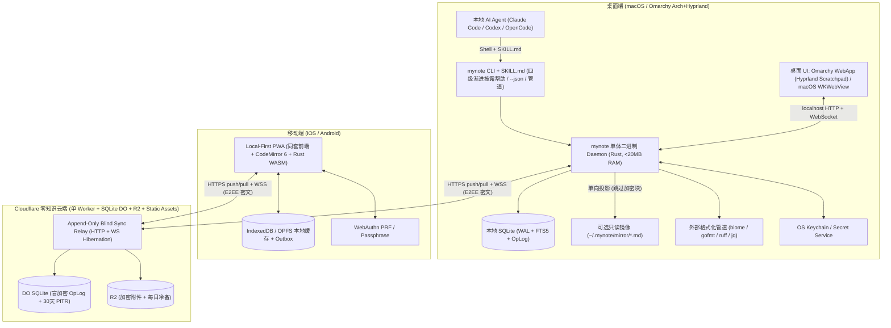
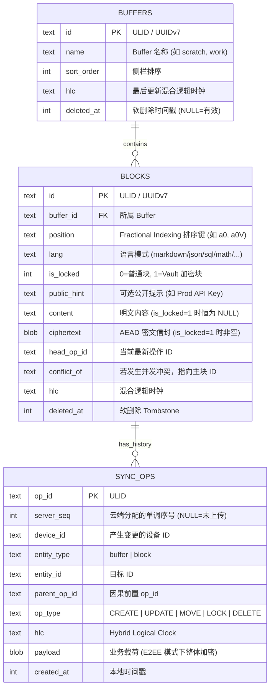
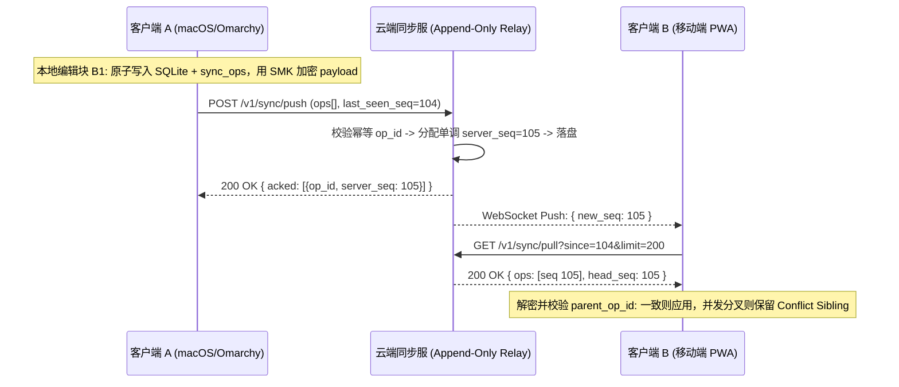
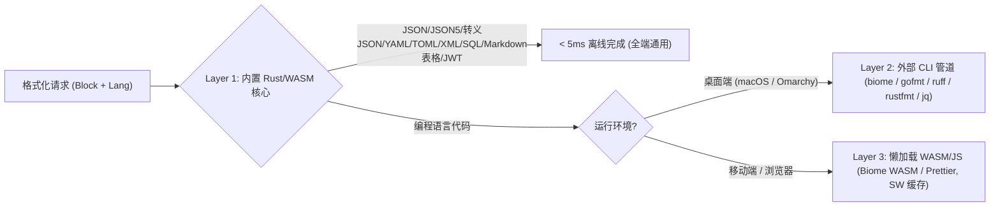
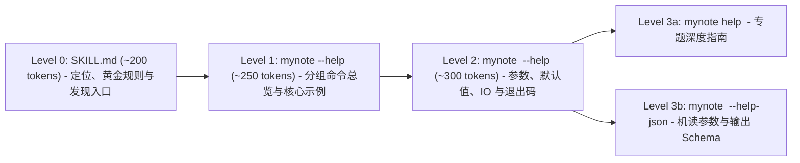

# 轻量级多端可靠同步开发者笔记软件：深度调研与架构方案

> **定位**：面向开发者的高频临时记录 / Scratchpad 工具，继承 Heynote「多语言分块 + 一键格式化」的顺手体验，从架构根源消除同步丢数问题，原生适配 **macOS**、**Omarchy（Arch + Hyprland）** 与 **移动端**，并兼顾**块级加密**、**Markdown/Mermaid 渲染**与 **CLI + Skill（Agent 友好）**。

---

## 目录

1. [根因诊断：为什么 Heynote + iCloud 会反复无故清空？](#1-根因诊断为什么-heynote--icloud-会反复无故清空)
2. [行业成熟方案深度调研（开源与商业）](#2-行业成熟方案深度调研开源与商业)
3. [核心约束的深度理解、剖析与挑战](#3-核心约束的深度理解剖析与挑战)
4. [推荐系统架构设计蓝图](#4-推荐系统架构设计蓝图)
5. [核心子系统详细设计](#5-核心子系统详细设计)
   - [5.1 数据模型：Block-First 而非文本分隔符](#51-数据模型block-first-而非文本分隔符)
   - [5.2 同步引擎：不可变操作日志（Anti-Wipe by Construction）](#52-同步引擎不可变操作日志anti-wipe-by-construction)
   - [5.3 格式化引擎：三层混合管线](#53-格式化引擎三层混合管线)
   - [5.4 安全与块级加密模型](#54-安全与块级加密模型)
   - [5.5 Agent 友好设计：CLI + Skill 与四级渐进披露帮助体系](#55-agent-友好设计cli--skill-与四级渐进披露帮助体系)
   - [5.6 Markdown 与 Mermaid 图渲染设计（轻量、离线与防 XSS）](#56-markdown-与-mermaid-图渲染设计轻量离线与防-xss)
6. [多端形态与技术栈选型对比](#6-多端形态与技术栈选型对比)
7. [分阶段演进路线图（MVP → V1 → V2）](#7-分阶段演进路线图mvp--v1--v2)
8. [编码前待确认的关键架构决策](#8-编码前待确认的关键架构决策)

---

## 1. 根因诊断：为什么 Heynote + iCloud 会反复无故清空？

如果不先定位旧方案的根因，自研软件极易在换了一套壳之后重演同类数据丢失事故。

### 1.1 Heynote 的存储机制

Heynote（Electron + Vue 3 + CodeMirror 6 + Prettier + Math.js）将每个 Buffer 存为磁盘上的一个纯文本文件（1.x 为单文件 `buffer.txt`，2.x 为目录内多个 `.txt` 文件），块之间通过特殊文本分隔符（如 `∞∞∞javascript`）切分。它本身**没有内置同步协议**，官方仅建议把目录放进 Dropbox / OneDrive / iCloud Drive，并由进程监听文件变化来重新加载。

### 1.2 iCloud Drive 与实时编辑器叠加的四大结构性缺陷

2026 年发表的系统研究 *Why iCloud Fails: The Category Mistake of Cloud Synchronization*（arXiv:2602.19433）系统性地指出了此类故障的本质：**iCloud Drive 是一个将分布式因果同步强行伪装成 POSIX 本地文件系统的抽象泄漏**。在 Heynote 这种「高频自动保存 + 整文件读写」场景下，会触发四类致命路径：

1. **Dataless / 驱逐占位符（Eviction）触发空文件反写**：
   macOS Sonoma 起，iCloud Drive 会更积极地回收本地文件内容，留下未水化（dataless / `.icloud`）占位符。Heynote 作者在 Issue #365 中也明确确认：云同步目录未常驻本地缓存会导致 Buffer 列表异常。当应用打开一个尚未完成水化、或读取返回空/失败的 Buffer 文件时，若初始化逻辑误以为是「新建空 Buffer」并触发自动保存，就会把一个 **0 字节 / 初始空模板** 写回磁盘——iCloud 随即将这份「最新修改」同步到云端并覆盖所有其他设备。
2. **静默 LWW（Last-Write-Wins）与隐藏冲突**：
   与 Dropbox/Syncthing 生成明显冲突副本不同，iCloud Drive 在版本冲突时缺乏透明冲突管理界面，常以墙钟时间做静默覆盖，将离线/休眠唤醒期间的另一端修改直接抹除。
3. **文件监听器与同步守护进程（`bird` / FileProvider）的竞态环**：
   按键防抖写盘与云同步守护进程替换 inode 同时发生，非事务性的 read-modify-write 极易造成文件截断或编辑器重载为空态后二次刷盘。
4. **行业共性教训——「空状态误当权威覆盖」**：
   即便拥有自研同步服务器的产品也踩过这个坑。例如 Standard Notes 历史上曾发生过 iPhone 恢复备份后未恢复 Keychain 密钥，客户端无法解密本地数据却在重新登录后把空/异常状态同步覆盖了云端的事故（mobile#18）。

### 1.3 由此推导出的系统不变量（Anti-Wipe Invariants）

我们自研系统的第一性原则必须从机制上杜绝上述事故：

- **不变量 1（禁止第三方网盘直写）**：同步必须发生在**应用层协议**，绝不把正在活跃写入的数据库或 Buffer 文件托管给 iCloud Drive / Dropbox / OneDrive。
- **不变量 2（不可变操作日志 + 软删除）**：所有修改以**追加操作（Append-Only OpLog）**记录；删除只能是携带因果前置版本（`parent_op_id`）的显式 Tombstone，**空状态初始化永远不会产生删除操作**。
- **不变量 3（新设备强制先拉后推）**：未完成首次同步引导（bootstrap）的空客户端禁止向上游推送破坏性状态。
- **不变量 4（保留历史快照，支持时间旅行）**：本地与云端均保留可回溯的版本日志，即便手误 `Cmd+A` 删除整块内容，也可秒级找回。

---

## 2. 行业成熟方案深度调研（开源与商业）

为了避免闭门造车，以下按**五种典型架构范式**调研了 11 款代表性开源与商业产品/引擎，聚焦它们的**存储模型、同步协议、加密边界、跨端形态与 Agent 友好度**。

### 2.1 五大架构范式拆解

#### 范式 A：开发者专用 Scratchpad（最贴近你的使用场景）

| 产品 | 形态与技术栈 | 存储与同步实现 | 关键优缺点与启示 |
| --- | --- | --- | --- |
| **Heynote** (开源) | Electron + Vue 3 + CodeMirror 6 + Prettier + Math.js | 磁盘 `.txt` 文件 + `∞∞∞lang` 文本分隔符；无内置同步 | **优点**：分块多语言、一键格式化、数学计算、极低心智负担。<br>**痛点**：Electron 内存重（180–250MB）；无移动端；无加密；分隔符混在正文里导致 Vim `dd` / 全局替换会破坏块边界；Wayland 下全局快捷键失效。 |
| **Tot / Drafts** (商业) | 原生 Swift（仅 Apple 生态） | 本地库 + **Apple CloudKit**（结构化记录同步，非 iCloud Drive 文件） | **启示**：用 CloudKit 结构化同步比 iCloud Drive 文件可靠得多，但 Tot 官方知识库仍承认 iCloud 偶发同步混乱/丢字；且**彻底锁死在苹果生态，无法支持 Omarchy（Linux）与 Android**。 |
| **Benchpad** (商业) | Mac / Win / iOS / Android / Web | 离线优先 + **Yjs 字符级 CRDT** + 托管同步服务 | **启示**：作为 2026 年专门对标 Heynote 的商业竞品，证明「Scratchpad + CRDT 跨桌面/手机同步」体验极顺滑；但闭源、SaaS 绑定、无代码格式化、无块级加密、无本地 Agent/CLI。 |

#### 范式 B：轻量自托管单二进制笔记

| 产品 | 形态与技术栈 | 存储与同步实现 | 关键优缺点与启示 |
| --- | --- | --- | --- |
| **Memos (`usememos/memos`)** (开源) | **Go 单二进制** + 内嵌 React SPA + SQLite/PG + gRPC/Connect/REST | **服务端中心化**（非 Local-First），多端通过浏览器/第三方客户端连同一服务 | **优点**：单二进制极轻（空闲 ~50MB）、部署零门槛、API 极其清晰、适合脚本与 Bot。<br>**缺点**：强依赖在线服务端，无真正离线编辑与冲突合并，无端到端加密，无代码格式化。 |
| **SilverBullet** (开源) | **单二进制服务端** + **Local-First PWA**（IndexedDB + Service Worker） | 服务端以**纯 Markdown 文件**落盘；浏览器端全量缓存于 IndexedDB，离线可写，联网双向同步 | **优点**：服务端文件天然对 Agent 友好；PWA 一套代码覆盖 macOS / Omarchy / iOS / Android。<br>**缺点**：文件级同步在多端离线并发编辑时仍有冲突副本；无 E2EE；受 iOS Safari PWA 存储回收约束。 |

#### 范式 C：零知识端到端加密（E2EE）跨端笔记

| 产品 | 形态与技术栈 | 存储与同步实现 | 关键优缺点与启示 |
| --- | --- | --- | --- |
| **Standard Notes** (开源/商业) | Electron + React Native + Web；TS Monorepo；Protocol 004 | **分层密钥（Argon2id → Root Key → Item Key）+ XChaCha20-Poly1305**；Item 级密文同步，服务端完全零知识 | **优点**：密码学设计教科书级，支持自托管与切换同步服。<br>**缺点**：客户端重（Electron）、自托管服务端极其臃肿（需模拟 Redis/SNS/SQS 多服务）；**对本地 Agent 极度不友好**（数据全密文锁在应用内）。 |
| **Notesnook** (开源/商业) | Electron + React Native + Web；本地 SQLite 加密 | 默认全量 E2EE（XChaCha20-Poly1305），并额外提供 **Private Vault（独立二次密码/生物识别锁定单条笔记）** | **核心启示**：清晰区分了**「同步层 E2EE」**与**「内容级独立加密锁（Vault）」**两层模型——这正是解决你「加密某一块内容」的最佳参考！ |
| **Joplin** (开源) | Electron + React Native + 本地 SQLite | 支持 WebDAV / Dropbox / S3 / **Joplin Server** + 可选 E2EE | **反面教训**：早期押注 WebDAV/网盘等「哑文件存储」，导致同步极慢（PROPFIND 风暴）、锁文件卡死、冲突笔记泛滥，最终不得不自建专用的 Joplin Server。 |

#### 范式 D：Local-First、纯文件与开发者同步引擎

| 产品 / 引擎 | 核心技术栈 | 存储与同步实现 | 关键优缺点与启示 |
| --- | --- | --- | --- |
| **Obsidian + Sync / LiveSync** | Electron + Capacitor；本地纯 `.md` 文件 | 官方 Sync：AES-256 E2EE + `diff-match-patch` 事后合并；LiveSync：CouchDB 分块 E2EE | **优点**：本地纯 Markdown 是 **AI Agent 的黄金标准**。<br>**缺点**：`diff-match-patch` 事后猜测合并会导致文本重复（重复段落）；CouchDB 自托管运维重且重设密钥易踩坑。 |
| **Anytype (`any-sync`)** (开源) | Go 核心 + CRDT + IPFS/libp2p + E2EE | 局域网 P2P + 自托管多节点（coordinator/tree/filenode） | **反面教训**：P2P + 全套去中心化节点架构极度复杂，违背「足够轻量、简洁易维护」的目标。 |
| **Atuin (Sync v2)** (开源) | **Rust 单二进制 CLI/Daemon** + 本地 SQLite | **Append-Only 加密 Record Store** + 客户端打包加密 Packfile + 极简自托管同步服 | **最大灵感来源！** 面向开发者的 macOS/Linux 工具：本地 SQLite 保证毫秒级 CLI 查询与离线可用；Sync v2 只追加不可变加密记录，永不覆盖历史，服务端极薄且零知识。 |
| **Evolu / Loro + Durable Streams** (开源引擎) | SQLite + HLC + Range-Based Set Reconciliation；Loro Rust/WASM CRDT | **Loro 2026 工程总结核心洞见**：加密 CRDT 的最佳云端后端其实极其简单——就是一个**带单调偏移量（offset）+ 快照压缩 + CAS 的纯追加字节流（Append-Only Log）** | **关键理论支撑**：服务端不需要懂业务逻辑、不需要在云端运行 CRDT 合并，内存开销极低，同时天然支持 E2EE 与断点续传。 |

### 2.2 竞品横向对比矩阵

| 产品 | 轻量度 | 同步可靠性 | 移动端 | Omarchy/Wayland 体验 | 内容格式化 | 块级加密 | 本地 Agent / CLI 友好 | 云端架构与零知识 |
| --- | :---: | :---: | :---: | :---: | :---: | :---: | :---: | :---: |
| Heynote | 中下 (Electron) | 差 (依赖网盘) | ❌ | 一般 (全局热键坑) | ✅ 强 | ❌ | 良 (纯文本) | ❌ 无内置云端 |
| Benchpad | 良 | ✅ 强 (Yjs CRDT) | ✅ | 良 (Web) | ❌ | ❌ | ❌ (闭源) | 闭源 SaaS |
| Memos | ✅ 极轻 (Go) | 中 (在线中心化) | ✅ Web/三方 | ✅ 良 | ❌ | ❌ | 良 (API) | 自托管 (非 E2EE) |
| SilverBullet | 良 | 良 (文件级同步) | ✅ PWA | ✅ 良 | 弱 | ❌ | ✅ 强 (服务端md) | 自托管 (非 E2EE) |
| Standard Notes | 差 (重服务端) | 良 (Item 级) | ✅ | 一般 | 弱 | 整篇锁定 | ❌ 极差 | 重自托管 (E2EE) |
| Notesnook | 中 | 良 | ✅ | 一般 | 弱 | 整篇 Vault | ❌ 差 | 托管/自建 (E2EE) |
| Obsidian | 中下 | 良 (付费/自建) | ✅ | 一般 | 插件 | 插件 | ✅ 极强 | 付费 Sync (E2EE) |
| Atuin (参考引擎) | ✅ 极轻 (Rust) | ✅ 极强 (OpLog) | ❌ | ✅ 极佳 | N/A | 全量 E2EE | ✅ 极强 (CLI/DB) | 极简自建 (E2EE) |
| **目标方案 (my-note)** | **✅ 单二进制 <15MB** | **✅ 追加日志+可选CRDT** | **✅ PWA起步** | **✅ 原生契合** | **✅ 三层混合** | **✅ 原生块级Vault** | **✅ CLI+Skill (渐进披露)** | **✅ CF 零知识 \$0** |

---

## 3. 核心约束的深度理解、剖析与挑战

针对你提出的 6 条约束，以下逐条拆解其背后的真实诉求，并重点揭示**约束之间隐藏的冲突、工程陷阱与必须提前做出的权衡**。

---

### 约束 1：软件形态不限（单体二进制带 GUI、CLI + 网页都可以）

- **真实诉求**：不要被框架教条束缚，关键是跨 **macOS + Omarchy + 移动端** 好用、省心、维护成本低。
- **架构挑战 1A — 真正的分水岭不是「GUI vs 网页」，而是「桌面本地二进制 vs 移动端沙盒」**：
  - 无论选 Rust 原生 GUI（GPUI / egui / Slint）还是桌面单二进制，都**无法直接作为本地守护进程跑在 iOS 上**。如果桌面做原生 GUI、iOS 做 SwiftUI、Android 做 Kotlin，个人维护三套编辑器和格式化 UI 会直接拖垮项目。
- **架构挑战 1B — 慎选 Tauri v2 作为 Omarchy 主力 GUI**：
  - Tauri v2 在 Linux 下底层依赖 **WebKitGTK**。在 Arch Linux + Hyprland（Wayland）环境下（尤其配合高分屏分数缩放或 NVIDIA 显卡），WebKitGTK 长期存在黑屏/白屏、渲染卡顿、焦点键（如 `Shift+Tab`）被吞掉等顽疾。
  - 反观 **Omarchy 的原生工作流**：Omarchy 一等公民支持 **Chromium Web App（`omarchy-launch-webapp`）**、**Hyprland Special Workspace Scratchpad（`SUPER + S` 一键呼出/隐藏）** 与终端 TUI。因此，**「本地单二进制后台守护进程 + 内嵌 Web UI」**在 Omarchy 上反而是最丝滑、零兼容坑的原生级体验！
- **架构挑战 1C — 移动端 PWA 的两个隐藏暗坑**：
  1. **iOS Safari / WebKit 存储驱逐**：虽然添加到主屏幕（Add to Home Screen）的 PWA 存储稳定性优于普通标签页，但在磁盘压力或长期未打开情况下，WebKit 仍有清理本地缓存/IndexedDB 的风险——因此**绝不能把移动端浏览器本地存储当成唯一持久副本**，必须由云端同步服兜底。
  2. **iOS PWA 不支持真正的后台定期同步（Background Sync API）**：切后台数十秒后 Service Worker 会被挂起。应对方案是**编辑后防抖 300–500ms 立即推送**，并在顶栏常驻极简的同步状态指示点（绿=已落云 / 黄=待同步 / 灰=离线）。

---

### 约束 2：需要支持对内容进行格式化

- **真实诉求**：像 Heynote 一样，随手贴一段压缩成一行的 JSON、混乱的 SQL、HTML/XML、YAML、Markdown 或代码片段，按一个快捷键瞬间美化。
- **架构挑战 2A — 「全语言格式化」与「足够轻量（约束 3）」直接冲突**：
  - Heynote 靠内置 Prettier + 多种 Parser 实现了多语言格式化，仅 Prettier standalone 及其常用插件就会增加数 MB JS 体积，且仍覆盖不了 SQL、XML、Go、Rust、Python、Shell 等开发常用格式。
- **架构挑战 2B — 区分「高频数据格式」与「编程语言代码」，分层解决**：
  - 开发者在临时记事本中 **80% 的格式化需求其实不是写完整工程代码，而是数据片段**：JSON（尤其是带转义字符串的脏 JSON、JSON5/JSONC 尾逗号）、SQL、XML、YAML、TOML、URL Query / Base64 / JWT 解码、Markdown 表格对齐。
  - 这些高频格式化器用 **纯 Rust 实现**，体积仅几百 KB，既可编译进桌面单二进制/CLI，又可编译为 **WASM** 直接在手机 PWA 离线毫秒级执行。
  - 其余编程语言（JS/TS/CSS/HTML/Go/Python/Rust/Shell）：
    - 桌面端（macOS / Omarchy）直接通过 **可配置的外部 CLI 管道**调用本机已有工具链（`biome`、`gofmt`、`ruff`、`rustfmt`、`jq`、`shfmt`）——零体积膨胀，且格式化规则 100% 匹配你的开发环境；
    - 移动端/无工具链环境按需懒加载轻量 Biome WASM / Prettier standalone（由 Service Worker 缓存，不影响冷启动）。
- **架构挑战 2C — 必须抛弃 Heynote 的文本分隔符设计**：
  - Heynote 用 `∞∞∞lang` 分隔符把所有块塞进一个文本文件，这会直接摧毁块级加密、块级版本冲突隔离和 Vim 键位体验。**块（Block）必须是底层一等数据结构**，界面层再把它渲染成类似 Heynote 那样顺滑的连续流（按 `Cmd/Ctrl+Enter` 无缝新建下一块）。

---

### 约束 3：足够轻量

- **真实诉求**：替代 Electron（动辄 200MB+ 内存、2–3 秒冷启），做到「随时唤出、零存在感、低资源消耗、部署极简」。
- **架构挑战 3A — 必须用量化预算约束架构，避免功能蔓延**：
  - 单体二进制体积：`< 15 MB`（内嵌编译后的前端静态资源）
  - 桌面后台守护进程常驻内存：`< 20 MB`（对比 Electron 约 180–250 MB）
  - CLI 单次命令耗时：`< 15 ms`（保证 Agent 和 Shell 管道高频调用无卡顿）
  - 界面唤出延迟：`< 100 ms`（Hyprland Special Workspace / macOS 驻留窗口瞬时切出）
  - 云端同步服：单二进制 + SQLite（或 Cloudflare Workers + D1），内存 `< 30 MB`，月成本 \$0–\$5
- **架构挑战 3B — 同步引擎不要过度设计成「重型分布式系统」**：
  - 不要引入 CouchDB、Anytype 多节点、RabbitMQ/Redis 或复杂 P2P NAT 穿透。
  - **关键反思：单人多端 Scratchpad 是否一定要在 MVP 就上全套字符级 CRDT？**
    - 相比 Heynote 单文件把 50 个笔记块绑在一起，**一旦把同步粒度拆到「块（Block）级」**，两台设备离线并发修改**不同块**时天然零冲突！
    - 只有极少数情况你会同时离线改**同一个块**。如果用「不可变追加日志 + 因果父指针（`parent_op_id`）」，同一块并发修改时自动保留双版本分支（Conflict Sibling）并高亮提示合并，**零丢数且复杂度只有 CRDT 的 1/5**；而且由于传输层本身就是 Append-Only Stream，**V2 可无缝把单个非加密块的 payload 升级为 Loro/Yjs 增量流**，完全不推翻协议！

---

### 约束 4：足够安全，支持加密某一块内容

- **真实诉求**：临时记事本经常顺手粘贴 Token、环境变量、服务器密码、私密想法；不希望它们明文落盘，也不希望被云端或误操作泄露，但又不想每次看普通笔记都输密码。
- **架构挑战 4A — 「加密某一块内容」与「云端零知识 E2EE」是两套不同的安全边界，必须分清**：
  - **边界 1（云端传输与云端存储零知识 —— Account/Sync E2EE）**：普通笔记离开设备前用设备持有的 `Sync Master Key (SMK)` 自动加密，日常使用**无感**（由 OS Keychain / Secret Service 自动解封），但云端永远看不到明文。
  - **边界 2（本地静态 + 防偷窥 + 防 Agent 泄露 —— Block-Level Vault Encryption）**：被标记为「加密」的单个块，用独立的 `Vault Key (VK)`（独立口令 / Touch ID / WebAuthn PRF 派生）二次加密。**即使本地 SQLite 文件被拷贝、屏幕被旁人瞥见、或本地 AI Agent 扫描全部笔记，加密块依然是不可读的密文！**
- **架构挑战 4B — 加密块周边最容易被忽略的 4 个泄露点**：
  1. **全文索引泄露（FTS5 / 搜索缓存）**：若先建了 SQLite FTS5 索引再加密，明文依然残留在 FTS 倒排表里！加密块**必须严禁写入 FTS 索引**（或锁定瞬间清除对应索引项）。
  2. **元数据泄露**：如果只加密正文不加密标题/标签/语言，攻击者仍能看到 `title="prod-db-root-pwd"`。加密块应将 `{content, title, lang, tags}` 一并封装进 AEAD 密文，仅保留 `block_id`、`is_locked=true` 与可选的公开提示词（`hint`）。
  3. **内存与剪贴板残留**：解锁后的明文块必须有空闲自动回锁（如 5 分钟或锁屏时触发），密钥材料在 Rust 中使用 `zeroize` 擦除，复制加密块内容时可选 30 秒清空剪贴板。
  4. **密钥遗忘即永久丢失**：零知识加密没有「找回密码」。必须在初始化时强制生成可打印/可备份的 **24 词助记词 / Recovery Key**。

---

### 约束 5：对本地 Agent 友好

- **真实诉求**：让本地运行的代码助手（Claude Code、Codex、OpenCode、Cursor、自写脚本）能顺手读取你刚贴在 Scratchpad 里的报错日志/API 响应，或者把分析结果、代码片段、Mermaid 图直接写进你的 Scratchpad。
- **架构挑战 5A — 「纯文本文件友好」与「可靠同步引擎」的冲突**：
  - 本地 Agent 习惯用 `rg`/`cat` 读纯文件，但如果允许外部进程直接修改同步目录里的原始文本文件，就会回到 Heynote 的竞态老路（部分写入、监听死循环、破坏结构）。
  - **已确认解法：SQLite 为唯一权威数据源 + 「CLI + Skill（渐进披露帮助）」为主入口（明确放弃本地 MCP）**：
    1. **一等公民 CLI + 极轻 `SKILL.md`**：不引入任何 MCP 协议栈与常驻 Schema 上下文负担。通过完备的 CLI（`--json` / `--jsonl`、Unix 管道、稳定退出码、错误提示 `hint`、乐观锁）配合 **四级渐进披露帮助体系（L0 `SKILL.md` → L1 总览 → L2 子命令帮助 → L3 专题/机读 Schema）**，让 Agent 按需查帮助、零浪费 Context Token，直接读写本地 SQLite WAL（并立即触发同步）。
    2. **可选的只读纯文本镜像（Read-Only Mirror）**：后台单向导出所有**未锁定**块为 `~/.local/share/mynote/mirror/<buffer>.md`，供 `rg`/fzf/编辑器只读检索；严禁反写，且加密块只输出 `[LOCKED BLOCK: <id>]` 占位符。
- **架构挑战 5B — 「Agent 友好」与「安全（约束 4）」的直接冲突**：
  - Prompt Injection 已成为本地 Agent 的现实威胁：如果 Agent 读取外部网页/仓库代码后被注入指令，可能会尝试调用 CLI 读取你的笔记并外传。
  - **强制安全红线**：**CLI 默认完全隔离所有加密块（Locked Blocks）**——查询时不返回明文/密文、不可检索、非 TTY 环境下拒绝交互解锁。只有在用户本人于交互终端显式输入口令/生物识别时才允许查看，且永不向 Agent 暴露任何密钥材料。

---

### 约束 6：云端定位收敛（明确放弃云端 MCP / 开放接口，回归纯粹零知识同步中继）

> [!NOTE]
> **已拍板架构收敛**：原方案曾分析「云端零知识 E2EE ⚔️ 云端 MCP / Open API」的根本悖论。经过权衡，已明确决定 **不考虑云端 MCP，本地也不考虑 MCP，Agent 交互统一收口到「本地 CLI + Skill」**。

这一决定直接带来**巨大的架构简化与安全性跃升**：
1. **彻底消除 E2EE 悖论**：云端不再需要解密任何普通块，**Cloudflare 云端 100% 为零知识端到端加密（E2EE）盲同步中继**——DO SQLite 与 R2 中只存密文，彻底消除对云服务商的信任顾虑。
2. **云端代码量骤减 ~70%**：无需构建云端 OAuth 2.1 授权服、云端物化视图/FTS5、远端 MCP 路由或内网穿透隧道；整个 Cloudflare 后端仅需约 **250–300 行 TypeScript**（SQLite Durable Object + WebSocket Hibernation + R2 + Workers Static Assets），个人成本稳定在 **\$0/月**。
3. **客户端更轻更纯**：桌面 Rust 单二进制同样无需引入 MCP SDK 与额外传输层，体积更小、面更窄、更稳固。

> [!TIP]
> 关于 Cloudflare 技术栈的详细组件选型、成本精算、6 大专属工程暗坑与反锁定逃生舱设计，请直接参阅 [Cloudflare 技术栈云端架构专项评估 (`cloudflare-cloud-architecture.md`)](./cloudflare-cloud-architecture.md)。

---

## 4. 推荐系统架构设计蓝图

综合以上调研与决策，推荐采用 **「Local-First 单体核心（CLI + Skill + 内嵌 Web） + 移动端 PWA + Cloudflare 全量零知识追加日志同步服」** 架构。

### 4.1 整体架构图



### 4.2 为什么这套架构最契合你的全部目标？

1. **一套前端覆盖三端，彻底规避 WebKitGTK 坑**：
   - 前端基于 **CodeMirror 6 + 极简响应式框架（SolidJS / Svelte 5 / Preact）**，打包后通过 `rust-embed` 内嵌进单体二进制。
   - **Omarchy**：后台 systemd user service 运行 `mynote daemon`，Hyprland 绑定快捷键（如 `SUPER + N`）拉起 `omarchy-launch-webapp http://127.0.0.1:port` 放入 Special Workspace，享受原生 Wayland 渲染、瞬时切换、零 WebKitGTK 崩溃。
   - **macOS**：`launchd` 运行同一 `mynote daemon`，前端可用 Safari/Chrome App Mode，或在 V1 包一层 ~3MB 的极薄原生 Swift `WKWebView` 壳以支持全局快捷键（如 `Cmd+Shift+H`）与菜单栏常驻。
   - **移动端**：直接访问 Cloudflare Workers Static Assets 免费托管的**同一份 PWA 静态资源**，借助 Service Worker + IndexedDB/OPFS 实现离线可编辑与联网自动同步；核心加解密与轻量格式化通过同一份 Rust 代码编译出的 **WASM** 复用，逻辑零重复。
2. **零数据丢失 + 100% 零知识云端**：本地 SQLite WAL + 不可变 OpLog + 软删除 + 冲突保留，Cloudflare 端全程只存盲密文且自带 30 天 PITR + 每日 R2 冷备。
3. **极致的 Agent 友好（零 MCP 负担）**：完备的 `CLI + SKILL.md` + 四级渐进披露帮助 + 确定性 `--json` 契约，对加密块实施硬隔离。

---

## 5. 核心子系统详细设计

### 5.1 数据模型：Block-First 而非文本分隔符

彻底放弃 Heynote 的「整文件文本分隔符」，将 **Block** 提升为最小同步、格式化、加密与检索单元。



**关键设计细节**：
- **Fractional Indexing（分数索引，如 LexoRank / Figma 同款）**：支持在任意两个块之间 `Cmd+Enter` 插入新块、拖拽重排，**只需修改被移动那一个块的 `position` 字段**，不会引发整表重排或同步风暴。
- **物理隔离明文与密文列**：当 `is_locked = 1` 时，`content` 列强制清空并从 `blocks_fts`（SQLite FTS5 虚表）中删除对应记录，仅保留 `ciphertext` 列，从 Schema 层杜绝索引泄漏。
- **视觉上依然保持 Heynote 连续流**：前端将同一 Buffer 下的 Blocks 按 `position` 连续渲染，每个 Block 挂载独立轻量的 CodeMirror 6 实例（或虚拟列表按需激活），上下方向键跨块无缝移动，快捷键与 Heynote 保持肌肉记忆一致。

---

### 5.2 同步引擎：不可变操作日志（Anti-Wipe by Construction）

借鉴 **Atuin Sync v2（追加记录日志）**、**Evolu（HLC + E2EE）** 与 **Loro Durable Streams（哑线性流 + 快照）** 的最佳实践，设计一套极简但工业级可靠的同步协议。

#### 同步时序流程



#### 为什么该协议不可能重演「无故清空」？

1. **单调序列号拉取（Cursor-based Catch-up）**：每个设备只需持久化一个整数 `last_synced_seq`，断网三天或重装系统后从 `0`（或最新 Compact Snapshot）重放即可得到完全一致的状态。
2. **严格的因果冲突检测（非墙钟覆盖）**：
   - 每个修改操作携带 `parent_op_id`。
   - 如果设备 A 和设备 B 都在离线状态下改了**同一个块**（基于同一 `parent_op_id` 产生了两个不同 `op_id`），后到达的更新**绝不静默覆盖**，而是自动在原块下方生成一个标记为 `Conflict` 的兄弟块（`conflict_of = block_id`），提供一键 Diff / 保留左 / 保留右 / 合并操作。
   - **宁可多留一份可见副本，绝不悄悄吞掉任何一个字符。**
3. **新设备防空覆盖保护**：空客户端的 `last_synced_seq = 0`，协议层强制要求先完成 `bootstrap pull` 才能发出任何 `DELETE` 类操作。
4. **快照压缩（Compaction）**：当操作日志超过一定阈值（如 2000 条）时，客户端在本地生成压缩快照并加密上传（类似 Atuin 2026 年引入的客户端 Packfile 机制），防止长期使用后新设备首次同步变慢。
5. **平滑演进到字符级 CRDT（V2 可选）**：由于传输协议本身只关心不透明的 `payload` 字节流，未来若希望同一块也能多人/多端并发字符级无冲突合并，只需新增 `op_type = CRDT_DELTA` 并嵌入 **Loro** 或 **Yjs** 增量字节，服务端代码**一行都不用改**！

#### 跨设备复制粘贴场景的专项优化（低延迟 × 高可靠）

针对「把内容贴进笔记，立刻去另一台设备复制」的高频痛点，在**严格不牺牲可靠性**的前提下增加四项轻量增强：

1. **粘贴快车道（Fast-Flush）**：普通输入防抖 `400–500ms` 合并推送；触发 **粘贴（`paste`）、失焦（`blur`）或剪贴板命令** 时缩短至 `0–100ms` 立即走 HTTP `push`，并由 Cloudflare Durable Object 通过 **WebSocket Hibernation** 亚秒级广播到其他在线设备（`< 16KB` 小块可随 WS 帧顺风车直达；若检测跳号则自动回退 HTTP `pull`，绝不丢消息）。
2. **一键复制与桌面极速剪贴板 CLI**：
   - 每个块顶部提供移动端友好的一键 **Copy 按钮**，桌面端支持 `Cmd/Ctrl+Shift+C` 一键复制当前整块（免去手动全选）；
   - CLI 提供 `mynote clip push`（读取 `pbpaste` / `wl-paste` 0ms 推送，支持 `--lock` 直接加密传输）与 `mynote clip pull`（将最新块写入 `pbcopy` / `wl-copy`），在 Omarchy Hyprland 与 macOS 上绑快捷键即可变身**跨平台端到端加密剪贴板**。
3. **移动端前台唤醒即拉**：受 iOS Safari 后台挂起机制限制，手机端 PWA 锁屏后无法保持后台 WS；因此在 `visibilitychange` / `pageshow` 回到前台瞬间立即并发执行 HTTP `pull` 与 WS 重连，保证打开 App 约 `300ms` 内呈现最新粘贴内容。
4. **敏感内容中转的加密碎纸（Crypto-Shredding）**：跨设备常传临时 Token/验证码；对临时加密块支持标记「一次性中转 / 过期销毁」，销毁时直接删除该块的 `Block DEK`——即便底层的 Append-Only OpLog 或 R2 冷备仍留有历史密文，也因密钥永久销毁而在数学上彻底不可恢复，同时点击复制加密块后可选 30 秒自动清空本地剪贴板。

---

### 5.3 格式化引擎：三层混合管线

兼顾 **多语言覆盖**、**零体积膨胀** 与 **桌面/移动端全离线可用**：



**开发者专属高频加分项（比 Heynote 更进一步）**：
- **脏 JSON 急救模式**：开发中经常从日志里复制带双层转义的 JSON（`"{\"code\":200,\"data\":\"...\"}"`）或单引号/尾逗号对象，内置一键 `Unescape & Format JSON`。
- **结构化转换动作**：JSON ↔ YAML ↔ TOML 互转、Base64 编解码、URL Query 转 JSON、JWT 载荷预览、Unix 时间戳转本地时间——全部纯本地离线执行。
- **Math 计算块**：内置轻量表达式求值器（类似 Heynote Math Mode，支持 `prev` 引用上一行结果与常用单位换算）。
- **外部格式化器配置示例（`~/.config/mynote/formatters.toml`）**：
  ```toml
  [formatters.typescript]
  cmd = ["biome", "format", "--stdin-file-path=scratch.ts"]
  timeout_ms = 2000

  [formatters.python]
  cmd = ["ruff", "format", "-"]

  [formatters.go]
  cmd = ["gofmt"]
  ```

---

### 5.4 安全与块级加密模型

采用成熟、经审计的现代密码学原语组合（对标 Standard Notes Protocol 004 & Notesnook，零自造算法）：

- **KDF**：`Argon2id`（推荐参数：内存 64 MiB、迭代 3、并行度 1；移动端按设备能力自适应但保持高下限）
- **子密钥派生**：`HKDF-SHA256`
- **对称认证加密（AEAD）**：`XChaCha20-Poly1305`（**192-bit 超长随机 Nonce**，彻底消除 AES-GCM 96-bit Nonce 随机碰撞风险，且在无 AES-NI 的移动端/WASM 环境下性能极佳且抗时序侧信道）
- **关联认证数据（AAD）**：每次加密强制绑定 `version || entity_id || op_id || key_id`，防止恶意服务端篡改、重放或调包不同块的密文。

#### 双层密钥体系

```mermaid
flowchart TD
    subgraph Tier1["Tier 1: 同步零知识层 (日常无感)"]
        RecKey["24 词 Recovery Key / 主口令"] -->|"Argon2id / HKDF"| SMK["Sync Master Key (SMK)"]
        SMK -->|"存入 OS Keychain / Secret Service"| AutoEnc["自动加密所有出站同步 OpLog"]
    end

    subgraph Tier2["Tier 2: 块级保险库层 (敏感块显式锁定)"]
        VaultPass["Vault 独立口令 / Touch ID / WebAuthn PRF"] -->|"Argon2id"| VKEK["Vault Key-Encrypting Key (VKEK)"]
        VKEK -->|"解包"| BDEK["每块独立随机 Block DEK (256-bit)"]
        BDEK -->|"XChaCha20-Poly1305 + AAD"| LockedBlob["加密块密文信封 (本地磁盘 & 云端均为密文)"]
    end
```



**块级加密设计亮点**：
1. **信封加密（Envelope Encryption）**：每个加密块有独立随机的 `Block DEK`，由 `VKEK` 包裹保存。修改 Vault 口令时只需重新包裹 `DEK`，无需重加密历史操作日志。
2. **本地与云端一致的静态密文**：加密块在本地 SQLite 中也只存密文信封（结构自描述，如 `{"v":1,"alg":"xchacha20poly1305","kid":"...","nonce":"...","wrapped_dek":"...","ct":"..."}`），永不进入 FTS5，永不写入纯文本镜像。
3. **移动端便捷解锁**：优先支持 **WebAuthn PRF 扩展**（iOS Safari 18+ / 现代 Chromium / YubiKey 均已支持通过 Passkey 生物识别派生确定性对称密钥），降级支持 Vault 口令输入；解锁态仅存在内存中，空闲 5 分钟或切后台立即 `zeroize` 清零回锁。
4. **紧急恢复机制**：首次初始化 Vault / 同步账户时生成人类可读的 **Recovery Key**，避免忘密码导致数据永久丢失。

---

### 5.5 Agent 友好设计：CLI + Skill 与四级渐进披露帮助体系

> **设计决策**：**不实现本地 MCP，也不实现云端 MCP**。所有本地 AI Agent（Claude Code、Codex、OpenCode、Cursor 等）与人类开发者共享同一套**高完备度 CLI + 极轻 `SKILL.md`**，把 Token 占用、维护复杂度与攻击面同时压到最低。

#### 1. 为什么「CLI + Skill」比 MCP 更适合本工具？
- **零常驻上下文税**：传统 MCP 每次会话都会预先注入大量 JSON Tool Schema，而极轻的 `SKILL.md` 仅占 ~150–250 tokens，其余命令参数由 Agent 按需调用 `--help` 渐进读取。
- **天然 Unix 可组合性**：直接与 `curl`、`jq`、`rg`、`pbcopy`/`wl-copy`、Shell 管道无缝衔接，人类和 Agent 用的是同一套心智模型。
- **二进制更轻更纯**：Rust 核心无需引入 MCP SDK 与额外的 `stdio`/SSE 传输协议栈。

#### 2. 四级渐进披露帮助体系（Progressive Disclosure Help）

帮助信息严格按 **「先路由、后参数、按需展开专题与机读 Schema」** 分为 4 级，绝不在顶层一次性倾倒几千字说明：



- **Level 0 — 极简 `SKILL.md`（常驻 Agent 技能目录，严格控制在 `< 250 tokens`）**：
  - 只写 4 件事：① `mynote` 是什么（本地多语言分块草稿本）；② 渐进发现入口（`mynote --help`、`mynote <cmd> --help`、`mynote help agent`）；③ 4 条 Agent 黄金法则（程序化调用必加 `--json`；更新已有块必带 `--expected-head`；绝不尝试解密加密块；列表查询注意 `--limit`）；④ 3 条最高频命令速查。
  - **反模式禁止**：严禁把全部子命令和几十个 Flag 写死在 `SKILL.md` 中（既浪费 Token，又容易与 CLI 实际版本漂移）。

- **Level 1 — 顶层命令路由（`mynote -h` / `mynote --help`，控制在 25–35 行）**：
  ```text
  mynote — Local-first block scratchpad with E2EE sync & formatting

  CAPTURE & BLOCKS:
    add         Create a new block (supports stdin pipe & --format)
    block       Read, update, append, move, or delete a specific block
    buf         List, create, or rename buffers

  QUERY & CLIPBOARD:
    ls          List recent blocks (summary-first, token-budget safe)
    search      Full-text search across unlocked blocks (FTS5)
    clip        Instant cross-device clipboard push/pull (0ms fast-flush)

  TRANSFORM & OPS:
    format      Format a block or stdin (json/sql/yaml/xml/md + external CLIs)
    sync        Inspect sync status, force push/pull, view conflicts
    vault       Lock/unlock sensitive blocks (TTY-only for decryption)
    help        Deep topics: formatting, locking, conflict, agent

  GLOBAL FLAGS:
    --json        Structured JSON output envelope {ok, data, error, meta}
    --jsonl       Line-delimited JSON stream for list/search
    --quiet       Suppress non-data stderr notices
    --help-json   Machine-readable command & flag schema

  NEXT STEP:
    Run 'mynote <cmd> --help' for flags & examples.
    Run 'mynote help agent' for AI agent integration contract & exit codes.
  ```

- **Level 2 — 子命令精准参考（`mynote <cmd> --help`）**：
  - 仅在 Agent 确定要调用某个子命令时按需加载，固定包含 5 个结构化区块：**SYNOPSIS / FLAGS（含类型与默认值）/ STDIN & STDOUT 契约 / EXIT CODES / 2–3 个可直接复制的 EXAMPLES**。

- **Level 3 — 深度专题与机读 Schema（按需按主题展开）**：
  - `mynote help <topic>`：内置离线文档专题（如 `mynote help agent`、`mynote help formatting`、`mynote help conflict`、`mynote help locking`），覆盖边界场景与冲突恢复配方；
  - `mynote <cmd> --help-json`（基于 `clap` 元数据自动生成，永不漂移）：输出该命令所有参数的名称、类型、枚举值、是否必填、退出码表以及返回 JSON 结构，供需要严格 Schema 的自动化脚本/Agent 零歧义解析。

#### 3. Agent-Native CLI 工程契约（比 `--help` 更关键的 6 条硬规范）

1. **统一结构化输出信封（`--json`）与 TTY 自适应**：
   - 带 `--json` 时，stdout 永远是合法单条 JSON（日志/警告只走 stderr）：
     ```json
     {
       "ok": true,
       "data": { "id": "01JXYZ...", "buffer": "scratch", "lang": "json", "head_op_id": "01JABC..." },
       "meta": { "local_seq": 108, "sync_state": "synced", "redacted_count": 1 }
     }
     ```
   - 当检测到 `!isatty(stdout)`（处于管道或 Agent Shell 执行中）时，自动关闭 ANSI 颜色码与交互式分页器（pager）。
2. **语义化稳定退出码 + 可执行错误提示（`hint`）**：
   - `0` 成功 | `2` 参数错误 | `3` 目标不存在 | `4` 乐观锁冲突（`HEAD_MISMATCH`）| `5` 加密块受限（`BLOCK_LOCKED`）| `6` 云端离线（本地写入仍成功）| `7` 格式化语法错误。
   - 错误返回必带下一步动作建议，让 Agent 无需盲猜就能自愈：
     ```json
     {
       "ok": false,
       "error": {
         "code": "HEAD_MISMATCH",
         "message": "Block 01JXYZ was modified concurrently (expected 01JAA1, actual 01JBB9)",
         "hint": "Run 'mynote block get 01JXYZ --json' to inspect latest content, then retry with --expected-head 01JBB9"
       }
     }
     ```
3. **非交互快速失败（Never Hang）**：
   - 在非 TTY 环境下或传入 `--non-interactive` / `--json` 时，**绝不允许阻塞等待用户输入密码或 `y/N` 确认**；缺少必填确认或需要解锁 Vault 时立即以明确退出码（`2` / `5`）返回。
4. **防误覆写与幂等保障**：
   - `mynote block update <id> --expected-head <op_id>`：强制乐观锁，防止 Agent 静默覆盖用户刚刚手敲的内容；
   - `mynote add --idempotency-key <key>`：支持 Agent 重试不产生重复块；
   - 批量/破坏性命令（`block delete`、`format --all`）统一支持 `--dry-run`。
5. **Context / Token 预算保护（防撑爆上下文）**：
   - `mynote ls` 与 `mynote search` 默认返回**摘要视图**（`id`、`buffer`、`lang`、`updated_at`、`byte_size`、`preview` 截断前 240 字符，`--limit 20`），避免某个 300KB 的 JSON 响应块瞬间撑爆 Agent 上下文；完整正文需按 `id` 显式调用 `mynote block get <id> --raw` 或 `--max-chars <N>` 读取。
6. **加密块硬防火墙与操作审计**：
   - 普通/Agent 调用 `ls`、`search`、`block get` 时，加密块统一返回 `{ id, is_locked: true, public_hint, redacted: true }`，**严禁输出明文或可离线暴力破解的密文信封**；
   - `mynote vault unlock` 仅允许在真实交互终端（TTY）执行，杜绝 Prompt Injection 诱导非交互 Agent 窃密；
   - 支持通过环境变量 `MYNOTE_ACTOR="agent:claude-code"`（`SKILL.md` 中引导设置）自动在 `sync_ops.actor` 记录写入来源，UI 中高亮标识并支持一键时间旅行撤销。

#### 4. 可选只读纯文本镜像（补充零门槛检索）
- 开启后后台将**非加密块**单向投影为 `~/.local/share/mynote/mirror/<buffer>.md`，供 `rg` / `fzf` / 外部编辑器只读检索；加密块统一投影为 `<!-- LOCKED BLOCK: 01JXYZ... (hint: prod key) -->`，严禁外部直接反写。

---

### 5.6 Markdown 与 Mermaid 图渲染设计（轻量、离线与防 XSS）

新增对 **Markdown** 与 **Mermaid 图** 的原生支持，不仅高度契合个人临时记录，更是 **AI Agent 输出的最佳载体**（Agent 经由 `mynote add --lang mermaid` 或 Markdown 块写入架构图、时序图与任务清单，多端立刻可见）。但这项能力直接撞上了**「足够轻量（约束 3）」**与**「足够安全（约束 4）」**两条红线，必须做专项设计：

#### 1. 必须提前应对的三项核心挑战

1. **挑战 M1：Mermaid.js 体积膨胀 ⚔️ 足够轻量**
   - 官方 `mermaid.js`（v11/v12）完整打包后的体积约 **1.6 MB gzip（未压缩超 3 MB）**，如果直接打进首屏主包，会直接拖慢冷启动并令前端包膨胀数倍。
   - **解法（动态懒加载 + 可插拔渲染器抽象）**：
     - 抽象极简的 `DiagramRenderer` 接口，**首屏主包完全不含 Mermaid 代码（冷启动 0ms 开销）**；仅当视图中首次出现 `lang = "mermaid"` 块或 Markdown 内的 ```` ```mermaid ```` 代码围栏时，才通过动态 `import()` 懒加载独立 Chunk；
     - 桌面端该 Chunk 随前端资源通过 `rust-embed` 压缩内嵌在单二进制中（全离线可用，仍远低于 `< 15MB` 预算）；移动端通过 Cloudflare Workers Static Assets（免费无限流量）配合 Service Worker 永久离线缓存；
     - **轻量替代观察**：2026 年社区已出现面向 Obsidian 等场景的零依赖轻量 Mermaid-to-SVG 渲染器（如 `Pele`，~230 KB gzip，基于 CSS 变量换肤，渲染耗时 `< 1ms`）。MVP 可先用官方 `mermaid`（懒加载，确保 100% 语法兼容），待轻量引擎全图表类型稳定后可无痛切换。

2. **挑战 M2：Markdown / Mermaid 渲染引发的 XSS 与数据外泄风险（严重安全红线！）**
   - 2026 年已有多个真实 CVE / 安全通告指出：**当外部粘贴或 AI Agent 生成的 Markdown / Mermaid 源码被直接渲染进主页面 DOM 时**：
     - 若 Mermaid 配置了 `securityLevel: 'loose'` 或启用 `click` 指令，会直接导致 **Stored XSS**——由于页面运行在 `localhost`（可调用本地 Daemon）或在内存中持有刚解锁的 Vault 明文，一次 XSS 足以窃取全部笔记！
     - 即使在 `securityLevel: 'strict'` 下，恶意模型生成的 Mermaid 标签或 Markdown 仍可能利用外部图片/CSS URL 触发 **跨站请求外泄（Off-Origin Image Request）**。
   - **强制安全防御栈**：
     - Mermaid 严格启用 `securityLevel: 'sandbox'`（或 `strict` + 清洗后嵌入无脚本权限的 `<iframe sandbox="">`）；
     - Markdown 渲染默认**禁止执行/直出原始 HTML**，输出经 `DOMPurify` 严格白名单净化；
     - 前端配置严格 **CSP**：`script-src 'self' 'wasm-unsafe-eval'; img-src 'self' data: blob:;`（禁止第三方外链图片自动静默加载，需要时手动点击放行），彻底封堵 Prompt Injection → 渲染层 XSS/外带通道。

3. **挑战 M3：Markdown 源码/预览双模切换与「预览态极致复制体验」（已确定方案）**
   - **为什么放弃混合 Live Preview、改用「源码模式 ↔ 预览模式」切换？**
     - 在 Obsidian 式混合 Live Preview 中，拖选跨行文本时会不断把隐藏的 `**` / `###` / 代码围栏重新弹开，反而干扰复制；而清晰的**双模切换（快捷键 `Cmd/Ctrl+E` 或块头切换按钮，宽屏可选分栏）**既让源码编辑零光标跳动，又让预览态变成极其顺手的阅读与复制界面（手机端预览态点击文字也不会误弹虚拟键盘！）。
   - **预览模式（Preview Mode）的复制体验专项打磨**：
     - **双格式剪贴板（Dual-Format Copy）**：预览态直接划选复制或点击「复制渲染内容」时，同时写入 `ClipboardItem` 的 `text/html`（去除冗余背景色/样式的干净语义 HTML）与 `text/plain`——粘贴到飞书、Notion、Slack、微信、Google Docs 保留标题/列表/加粗/表格排版，粘贴到终端/纯文本框自动回落为干净纯文本。
     - **细粒度一键复制按钮（所见即所拷）**：
       - 预览态下每个 **代码围栏（` ```lang `）** 右上角悬浮一键 **Copy Code**（自动剥离反引号，只拷贝纯代码）；
       - 每个内嵌或独立的 **Mermaid 图** 提供一键 **Copy PNG（可直接贴聊天/文档）** / **Copy SVG** / **Copy Mermaid 源码**；
       - 每个 **GFM 表格** 提供一键 **Copy TSV（直贴 Excel / 飞书表格）** / **Copy Markdown**；
       - 块头提供明确复制入口：**复制渲染态（默认）** 与 **复制原始 Markdown**；
       - 任务清单复选框（`- [ ]` ↔ `- [x]`）在预览态下依然可直接点击勾选并原子回写源码。
   - **独立 Mermaid 块（`lang = "mermaid"`）**：
     - 源码态接入 `codemirror-lang-mermaid` 语法高亮；
     - **桌面端（macOS / Omarchy）**：支持源码/预览切换及左右分栏实时重绘（防抖 300ms）；**语法输入中途报错时保留上一帧有效 SVG 并在底部显示轻提示**，不闪烁白屏；内置缩放平移（Pan/Zoom）与一键 **Copy PNG / Copy SVG**；
     - **移动端（iOS / Android PWA）**：窄屏默认展示预览态（方便直接查看与复制），一键切源码编辑，支持双指捏合缩放；
     - **主题同步**：SVG 颜色随系统深浅色（及 Omarchy 主题色 CSS 变量）自动联动，绝不出现黑底黑字。
   - **Markdown 格式化增强（复用 Layer 1 Rust/WASM 管线）**：一键触发 GFM 表格列对齐、标题/列表缩进规整、冗余空行清理。

---

## 6. 多端形态与技术栈选型对比

### 6.1 核心语言选型：Rust vs Go（云端 Worker 固定为 TypeScript）

| 维度 | **Rust（推荐）** | **Go（务实备选）** |
| --- | --- | --- |
| 单体二进制与内存 | 极佳（8–15MB，空闲 ~10–15MB RAM，无 GC 抖动） | 极佳（12–20MB，空闲 ~15–25MB RAM） |
| **WASM 复用（关键加分项）** | **极强**：同一套密码学（`chacha20poly1305`/`argon2`）、同步状态机、JSON/SQL/YAML/Markdown 格式化器可直接编译成几百 KB 的 WASM 给移动端 PWA 复用，**零双端重复实现** | 较弱：Go WASM 运行时体积较大（通常数 MB），TinyGo 对完整标准库/密码学生态支持有限 |
| 密码学与内存安全 | 原生 `zeroize` 自动清零敏感密钥内存，无 GC 副本残留风险 | GC 拷贝可能导致密钥在堆中短时残留，难以彻底擦除 |
| CLI 与生态成熟度 | `clap`（原生支持分组帮助 + 反射导出 `--help-json`）+ `axum` + `rusqlite` + `rust-embed` + `loro`（原生 Rust） | `cobra` + `chi`/`echo` + `modernc.org/sqlite` + `embed` |
| 开发迭代速度 | 中等（编译慢、借用检查前期学习曲线） | **极快**（上手与重构成本最低） |

> **选型建议**：优先 **Rust** 作为本地单体核心与 WASM 共享层（去掉 MCP 依赖后依赖树更轻）；云端同步中继固定使用 **TypeScript（Cloudflare Workers + SQLite DO）**，详见 [Cloudflare 专项评估](./cloudflare-cloud-architecture.md)。如果非常熟悉 Go 且希望快速出原型，可选 **Go 守护进程/CLI + TypeScript 共享移动端与云端层**。

### 6.2 桌面端 UI 形态对比（重点考量 macOS + Omarchy）

| 方案 | macOS 体验 | Omarchy (Arch + Hyprland) 体验 | 移动端复用 | 轻量度 | 综合评价 |
| --- | --- | --- | :---: | :---: | --- |
| **方案 1：本地 Daemon + 内嵌 Web/PWA（推荐起步）** | 良（浏览器 App Mode；V1 可加极薄 3MB Swift WKWebView 壳补全局热键） | **极佳**（`omarchy-launch-webapp` + Hyprland Special Workspace `SUPER+N` 完美融入） | **100% 复用** | **极轻**（复用系统浏览器引擎，后台 <15MB） | **性价比之王**，零跨平台渲染坑，最贴合 Omarchy 哲学 |
| **方案 2：Tauri v2（macOS + Linux + Mobile）** | 极佳（WKWebView，包小） | **较差（高风险）**（WebKitGTK 在 Wayland/Hyprland 下图形/缩放/快捷键坑多） | 中（支持 iOS/Android，但移动端调试构建复杂） | 轻（但 Linux 需依赖系统 webkit2gtk） | 表面诱人，但在 Omarchy 环境下踩坑成本高 |
| **方案 3：原生 Rust GUI（GPUI / egui / Slint）** | 极佳（极致丝滑） | 极佳（原生 Wayland） | **0% 复用**（移动端需重写全部编辑器与格式化 UI） | 极轻 | 缺少 CodeMirror 6 级别的现成多语言代码编辑器与 Mermaid 渲染，自研成本是黑洞 |
| **方案 4：Electron** | 良（同 Heynote） | 一般（Wayland 需 flag，全局热键受限） | 0% | **重（违背约束 3）** | 直接淘汰 |

### 6.3 前端编辑器选型

- 强烈推荐 **CodeMirror 6**：
  - Heynote 已经验证了它是开发者 Scratchpad 源码编辑的最佳内核；
  - 高度模块化（按需懒加载语言高亮包与 Mermaid 渲染 Chunk，核心 gzip 仅 ~150–200KB）；
  - 原生支持移动端触控与输入法（IME）、多光标、折叠、Vim/Emacs 键位模式、自定义行内 Widget（如 Math 块实时计算结果、加密块锁态卡片）；配合独立的 Markdown 预览渲染层（`markdown-it`/`marked` + `DOMPurify` + 懒加载 Mermaid），实现丝滑的「源码 ↔ 预览」切换与预览态高便利复制。

---

## 7. 分阶段演进路线图（MVP → V1 → V2）

遵循「先彻底解决核心痛点（防丢 + 格式化 + Markdown/Mermaid + 完备 CLI/Skill），再叠加 Cloudflare 零知识同步与块级加密」的渐进策略：

### Phase 0：MVP（2 周）— 桌面端先替代 Heynote
- [ ] **核心单二进制（`mynote`）**：SQLite WAL + FTS5 + Block-First 数据模型 + Fractional Indexing。
- [ ] **内嵌 Web UI**：CodeMirror 6 多语言分块流、Heynote 同款快捷键（`Cmd/Ctrl+Enter` 建块、`Cmd/Ctrl+L` 切语言、`Cmd/Ctrl+P` 切 Buffer、`Cmd/Ctrl+E` 切预览/源码、全局搜索、块顶一键 Copy）。
- [ ] **Markdown 双模与 Mermaid 原生支持**：Markdown 源码/预览模式切换（宽屏可选分栏）、预览态极致复制（双格式富文本/纯文本复制、代码块一键 Copy、GFM 表格一键 TSV、复选框可点）、独立/内嵌 Mermaid 懒加载离线 SVG 渲染（严格防 XSS 沙箱 + 主题同步 + Pan/Zoom + Copy PNG/SVG）。
- [ ] **Layer 1 + Layer 2 格式化**：内置 JSON（含脏 JSON 解包）/ YAML / SQL / XML / Markdown 表格格式化 + 本地外部 CLI 管道（`formatters.toml`）。
- [ ] **Agent 友好 CLI + Skill 体系**：`add / ls / search / block / buf / format / help`，完整落地 **四级渐进披露帮助（L0 `SKILL.md` → L1 总览 → L2 子命令 → L3 专题与 `--help-json`）**、统一 `--json` 信封、稳定退出码、错误 `hint`、乐观锁 `--expected-head` 与 Token 摘要截断。
- [ ] **Omarchy & macOS 集成脚本**：提供 Hyprland Special Workspace 绑定示例与 systemd / launchd 守护配置。

### Phase 1：V1（2 周）— Cloudflare 全量零知识同步 + 跨端剪贴板 + 块级加密 + 移动端 PWA
- [ ] **Cloudflare 盲加密同步服（`cloud-cf/`）**：约 250–300 行 TypeScript Worker + SQLite Durable Object（Append-Only OpLog + WebSocket Hibernation + `epoch` 校验 + 每日 R2 冷备 Alarm）+ Workers Static Assets 一键部署 PWA（详见 [Cloudflare 专项评估](./cloudflare-cloud-architecture.md)）。
- [ ] **端到端加密（Tier 1 Sync E2EE）与块级 Vault 加密（Tier 2 Block Lock）**：Argon2id + XChaCha20-Poly1305 + Recovery Key + 空闲自动回锁 + 加密块对 CLI/Agent 的硬隔离与 Crypto-Shredding。
- [ ] **跨设备复制粘贴快车道**：粘贴 `0–100ms` 快刷 + `<=16KB` WS 顺风车（跳号回退 HTTP `pull`）+ `mynote clip push/pull` 对接 `pbcopy`/`wl-copy`。
- [ ] **移动端 Local-First PWA**：离线 IndexedDB/OPFS 缓存 + Rust WASM 加解密/格式化 + 切前台即拉 + 顶部诚实同步状态灯 + WebAuthn PRF 生物识别解锁 + 移动端默认预览态一键复制。
- [ ] **时间旅行（Revision History）**：任意块支持查看历史版本与一键恢复（含按 `actor` 撤销 Agent 修改）。

### Phase 2：V2（按需演进）— 极致打磨
- [ ] **macOS 极薄原生壳（可选）**：3MB Swift `WKWebView` 菜单栏应用，补齐 macOS 全局快捷键唤出与原生 Touch ID 解锁。
- [ ] **单块字符级 CRDT 升级（可选）**：为非加密块接入 Loro/Yjs，实现 Mac 与手机同时编辑同一块也能无冲突实时合并。
- [ ] **扩展能力**：Math/单位计算块、R2 加密图片粘贴（SHA-256 内容寻址附件）、只读 Markdown 镜像、终端 TUI 快速查看器（`ratatui`）。

---

## 8. 编码前待确认的关键架构决策

经过前面的收敛，**云端栈（Cloudflare 100% 零知识 E2EE 哑中继）**、**Agent 范式（纯 CLI + Skill，不做本地/云端 MCP）** 与 **Markdown 交互（源码/预览切换 + 预览态极致复制）** 均已明确拍板。正式初始化代码仓库前，仅剩以下 **2 项实现级选择**待确认：

1. **本地核心实现语言（云端 Worker 固定为 TypeScript）**：
   - **选项 A（Rust，推荐）**：单二进制极致轻量 + `clap` 原生渐进帮助/`--help-json` + WASM 复用到移动端 PWA（加密与格式化零重复）+ `zeroize` 内存擦除。
   - **选项 B（Go）**：本地守护进程与 CLI 迭代最快，但移动端 PWA 的加密与格式化逻辑需在 TypeScript 侧单独维护。
2. **移动端形态的短期验收标准**：
   - 先用 **Cloudflare Workers Static Assets 托管的 Local-First PWA** 快速覆盖 iOS/Android（\$0 运维、0 应用商店审核成本），是否能接受 iOS 上「无系统级 Share Sheet、需手动添加到主屏幕」的限制？
