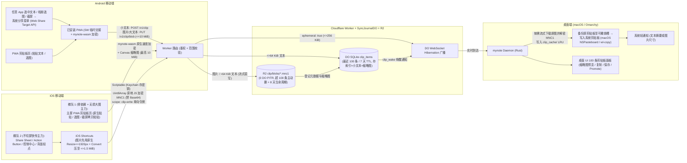
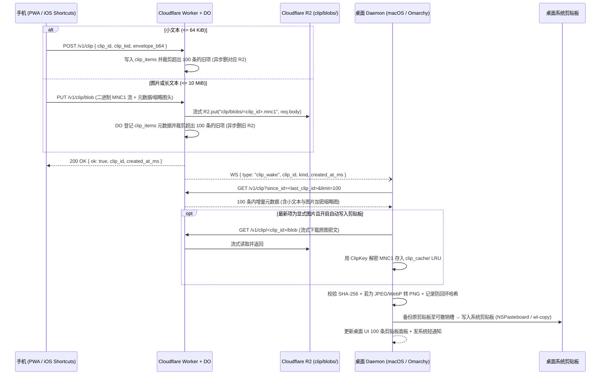
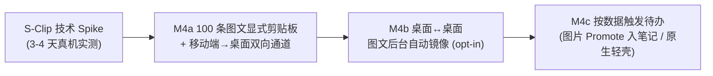

# 跨端剪贴板同步：可行性深度调研与迭代方案提案 (`clipboard-sync-proposal.md`)

> **文档状态**：`Decided（2026-11-27 拍板为 D8，Q1–Q6 全按默认；对应 `ADR-11` 为 `Proposed`，待 `S-Clip` 真机实测后转 `Accepted`）**。
>
> **单一事实来源说明**：2026-11-27 拍板后的正式工程契约已同步合入全仓规范——线格式 `MNC1`、AAD、`ClipKey` 与全端 DDL 以 [`data-structures.md`](./data-structures.md) 为准；同步与防回环语义以 [`sync-protocol.md`](./sync-protocol.md) 为准；错误码、CLI、本地 Daemon、云端 `/v1/clip*` 与 WASM 契约以 [`interface-contracts.md`](./interface-contracts.md) 为准；安全承诺、四态令牌与敏感过滤以 [`threat-model.md`](./threat-model.md) 为准；Cloudflare 流式 R2 与配额实现以 [`cloudflare-cloud-architecture.md`](./cloudflare-cloud-architecture.md) 为准；测试门禁以 [`eval-framework.md`](./eval-framework.md) 为准。本文保留作为可行性调研、竞品对比、移动端三梯队交互说明与决策追溯归档，若与上述正式规范存在细微表述差异，一律以对应 SSOT 规范为准。
>
> **写作基线**：基于 `main` @ `v0.2.0`（M1 / M2 / M3 已全部合入并上线生产 Cloudflare Worker，详见 [总架构设计方案 (`architecture-proposal.md`)](./architecture-proposal.md) 与 [第一性原理审查 §9](../review/2026-11-24-first-principles-review.md)）。文中所有体积、延迟、行数与成本数字均按 `AGENTS.md` 规范标注 `[保证]` / `[目标]` / `[估算]` / `[已测]`。

---

## 目录

0. [结论摘要（TL;DR）](#0-结论摘要tldr)
1. [背景复盘与可行性判定](#1-背景复盘与可行性判定)
2. [同类成熟项目与行业实现深度调研](#2-同类成熟项目与行业实现深度调研)
3. [与现有架构的五大冲突与根治设计](#3-与现有架构的五大冲突与根治设计)
4. [专项设计：移动端向桌面方向的同步处理（文本 + 图片）](#4-专项设计移动端向桌面方向的同步处理文本--图片)
5. [数据结构、线格式与接口契约草案](#5-数据结构线格式与接口契约草案)
6. [分阶段迭代路线图（S-Clip → M4a → M4b → M4c）](#6-分阶段迭代路线图s-clip--m4a--m4b--m4c)
7. [已拍板的决策记录（2026-11-27，D8）](#7-已拍板的决策记录2026-11-27d8)

---

## 0. 结论摘要（TL;DR）

**可行性结论：有条件可行——支持纯文本 + 位图图片（PNG / JPEG / WebP / GIF），并将历史保留上限扩展到 100 条完全可行，但必须放弃「把全部剪贴板塞进 DO SQLite」的做法，升级为「DO 存 100 条轻元数据 + Cloudflare R2 流式存加密原图」的分离架构。**

| 同步方向 / 形态 | 是否可行 | 真实可达体验（文本 + 图片） | 决定性边界 |
| --- | :---: | --- | --- |
| **桌面 ↔ 桌面（macOS ↔ Omarchy）显式快传（L1）** | **✅ 完全可行** | CLI `mynote clip push/pull`、快捷键或 Web UI 显式发送文本与截图，小文本 `150–400 ms` `[目标]`、图片按带宽流式到达系统剪贴板 | macOS `pbcopy`/`pbpaste` 不支持图片，从 M4a 起必须改用原生 `NSPasteboard`；Omarchy 侧 `wl-copy`/`wl-paste` 原生支持图片 |
| **桌面 ↔ 桌面后台自动镜像（L2）** | **✅ 可行（须默认关闭、显式开启）** | Mac 复制文本或截屏后自动同步到 Omarchy，反之亦然 | 必须解决无限回环、密码管理器敏感标记过滤、macOS 避读超大未压缩 `public.tiff` 及 Hyprland `cliphist` 共存四道工程硬关 |
| **桌面 → 移动端（iOS / Android）** | **✅ 完全可行（前台按需）** | 打开 PWA 拉取 100 条轻元数据与图片缩略图（`< 2 MiB` `[估算]` 秒开），点击按需下载原图并一键写入手机系统剪贴板 | iOS Safari 写入 `image/png` 必须在点击回调同步传入 Promise（不可先 `await`）；不可在后台静默写入手机剪贴板 |
| **移动端 → 桌面（iOS / Android → Mac / Omarchy）** | **✅ 显式触发可行，❌ 后台自动不可行** | Android 通过系统分享菜单（PWA `share_target` 原生支持文本 + 图片文件）2 步直达 `mynote-wasm` 加密直传；iOS 文本与压缩图（`≤ 1.5 MiB`）走 Shortcuts + Scriptable 不切屏直推，无损大图（最高 `10 MiB`）走主屏 PWA 的 `mynote-wasm` 原生速度加密 | iOS 与 Android 10+ 均由操作系统沙箱禁止后台监听剪贴板；iOS 后台快捷指令存在内存与纯 JS 加密大图的性能瓶颈，必须在 S-Clip 真机实测压缩阈值 |

**核心架构取舍（六条硬决定）**：

1. **DO 轻元数据 + R2 流式大对象分离（支撑图片 + 100 条的关键前提）**：
   - DO SQLite `clip_items` 保留最近 **100 条**（默认 TTL 同步由 24 小时放宽至 **7 天**，否则普通个人 24 小时内难以用满 100 条），仅内联 `≤ 64 KiB` 的小文本与 `≤ 16 KiB` 的图片加密缩略图；
   - 所有图片本体与 `> 64 KiB` 的长文本（单条硬上限 **`10 MiB`** `[目标]`）以原始二进制 `MNC1` 流直写现有 R2 桶的独立前缀 `clip/blobs/<clip_id>.mnc1`（不做 Base64 膨胀、Worker 直接流式转发不触碰 `128 MB` 内存上限、不受 `archives/ops/` 的 Bucket Lock 约束）。
2. **与笔记主日志物理隔离**：`clip_items` 与 `clip/blobs/` 绝不写入 `ops`、`block_keys`、FTS5、Markdown 镜像、手机 `MNP1` 快照或 R2 永久归档，不触发 20 块/天碎纸阈值；文本剪贴板支持显式「转存为笔记块（Promote）」，图片剪贴板先支持「复制到剪贴板 / 保存到本地文件」（待正式笔记 `blobs/` 附件落地后再开放图片 Promote）。
3. **四态令牌范围守住 D1**：绝不将手机升级为 `read-write`；新增 `read+clip`（手机 PWA 可读笔记 + 读写剪贴板，所有笔记与密钥写路由仍返回 `403`）与 `clip-write`（专供 iOS / Android 快捷指令的单向只写令牌，连笔记和历史剪贴板都不可读）。
4. **正面化解 F-06（DO 30 天 PITR 矛盾）**：图片本体不进 DO SQLite，**物理 0 进入 DO 30 天 PITR**；小文本与元数据使用与 `SMK` / `VKEK` 隔离的独立可轮换密钥 `ClipKey`（`MNC1`），执行 `mynote clip rotate-key` 并丢弃旧 `ClipKey` 后，DO PITR 中的旧密文即刻不可解；敏感一次性文本（`≤ 256 KiB`）另支持 `--ephemeral` 纯内存 WS 广播模式（零 SQLite 写入、零 R2 写入、无在线桌面明确报错）。
5. **位图白名单防 XSS（守住 T4 / SEC-06）**：图片通道严格限定 `image/png`、`image/jpeg`、`image/webp`、`image/gif`，**严禁将 `image/svg+xml` 按图片渲染**（SVG 一律按纯文本同步）；前端使用 `Blob` + `URL.createObjectURL`，完全落在现有 CSP `img-src 'self' data: blob:` 内，不放宽 CSP。
6. **预算仍在免费与原套餐红线内**：`cloud-cf/src/` 增量约 `180–240 LOC` TS `[估算]`（总计约 `870–930 LOC` TS，不改写 M1–M3 同步核）；100 条混合图片与文本在 R2 的活跃存储约 `100–300 MiB`（极端全图最坏 `1 GiB`），远低于 R2 `10 GB/月` 免费额度与 \$0 出口流量费，整体维持约 \$5/月 `[估算]` Workers Paid 零额外支出。

---

## 1. 背景复盘与可行性判定

### 1.1 历史回溯：为什么此前移除了 `ephemeral_clips`，以及现在为何重新评估？

在 `main` @ `31931a2` 的早期草稿中，项目曾规划过 `ephemeral_clips` 表与 `mynote clip push/pull`。2026 年 11 月 24 日的第一性原理审查（[`review/2026-11-24-first-principles-review.md`](../review/2026-11-24-first-principles-review.md)）出于两项充分理由将其移除：

1. **规范自相矛盾（F-06）**：旧方案声称瞬态剪贴板「绝不进入 30 天 PITR」，却将其写入 DO SQLite 表——而 Cloudflare SQLite DO 的 30 天 PITR 覆盖整库 SQLite 页面，无法排除单张表。
2. **里程碑聚焦（D1）**：当时代码量为 0，首要目标是尽快做出能卸载 Heynote + iCloud 的最小可用版本；手机定位为只读 + 复制，桌面 → 手机的复制需求暂由块顶复制按钮覆盖。

**当前变化**：截至 `v0.2.0`，M1、M2、M3 的全部工程实现、Plane A 确定性门禁与 Cloudflare 生产部署均已落地。此时重新评估剪贴板同步，已不再拖慢核心笔记主线，同时出现了三个原方案未覆盖的真实痛点：

- **macOS ↔ Omarchy 跨生态割裂**：Apple 通用剪贴板无法到达 Omarchy（Arch + Hyprland），跨桌面传命令、日志与截图仍须绕道。
- **移动端 → 桌面方向缺失**：手机看到文章链接、验证码、调试报错或截图时，无法直接送进 macOS / Omarchy 的系统剪贴板。
- **图片 + 短期多条回溯刚需**：日常开发与沟通中截图占比极高，且经常需要回溯前几天复制过的多条文本或图片（保留 100 条远比仅留最近 20 条实用）。

### 1.2 三层能力模型拆分

「剪贴板同步」在工程上对应三种复杂度、权限要求与失败模式完全不同的产品形态，必须严格拆分评估：

| 层级 | 产品形态 | 触发机制 | 安全与稳定性风险 |
| --- | --- | --- | --- |
| **L1：显式跨端剪贴板投递** | 用户主动按快捷键、点按钮、使用系统分享菜单或执行 `mynote clip push/pull` 发送文本或图片 | 明确用户意图 | 极低：无常驻监听、无密码管理器误抓、无回环风控难题 |
| **L2：桌面间后台自动镜像** | 桌面 Daemon 后台监听剪贴板变化，自动同步文本与截图到另一台桌面 | 自动捕获 | 中高：必须处理回环死循环、密码管理器敏感标记过滤、macOS 超大未压缩 TIFF 过滤、Wayland 客户端竞争与大剪贴板限流 |
| **L3：移动端后台静默双向镜像** | 手机任意复制自动同步到桌面，桌面复制自动写入后台手机剪贴板 | 后台静默 | **系统物理不可行**：被 iOS 与 Android 10+ 沙箱严格禁止 |

### 1.3 各平台操作系统硬约束矩阵（含图片能力核查）

判断可行性的唯一依据是各目标操作系统与 Cloudflare 平台的真实协议和权限边界（均经一手文档与工程实践核验）：

| 平台 | 文本 / 图片读写与监听能力 | 敏感内容识别标准 | 关键工程暗坑 |
| --- | --- | --- | --- |
| **macOS** | **读/写文本与图片均可行**：通过 `NSPasteboard.generalPasteboard()` 定时轮询 `changeCount`（无原生变更回调）并读写 `public.utf8-plain-text` / `public.png` / `public.tiff`。**注意：`pbcopy` / `pbpaste` 不支持图片** | `org.nspasteboard.ConcealedType`、`TransientType`、`AutoGeneratedType`、`com.agilebits.onepassword` | ① macOS 截图常同时放入 `public.png`（2–5 MiB）与未压缩 `public.tiff`（20–40 MiB），**必须优先读 `public.png`**，仅无 PNG 时才回退读取 TIFF 并在本机转 PNG 压缩；② `com.apple.is-remote-clipboard` 是 Apple 通用剪贴板的懒拉取占位符，后台轮询直接读取内容会强行触发 AWDL 远端拉取造成卡顿与耗电；③ 仅读写剪贴板不需要辅助功能（Accessibility）权限 |
| **Omarchy（Arch + Hyprland / Wayland）** | **读/写文本与图片均可行**：`wl-copy --type image/png` / `wl-paste --type image/png` 以及 `ext-data-control-v1` / `wlr-data-control-unstable-v1`（Hyprland 原生支持）均原生支持任意 MIME 图片 | MIME 类型 `x-kde-passwordManagerHint`（值为 `secret`），必须在读取数据流前先检查 offer 的 MIME 列表 | ① 同时运行多个抢占持久化所有权的 data-control 守护进程（如 `cliphist` + `wl-clip-persist` + 另一个持久化进程）会引发竞争、剪贴板清空与 XWayland 粘贴失灵；② 后台写入进程退出会令剪贴板消失，必须正确持有或交接 selection source |
| **iOS（16 / 17 / 18+）** | **❌ 禁止后台监听与后台写入**；前台 PWA 支持 `navigator.clipboard.write([new ClipboardItem({ 'image/png': promise })])` 写入 PNG 图片，以及 `<input type="file" accept="image/*">` / 原生粘贴读图 | 仅原生 App 可用 `UIPasteboard.setItems(..., options: [.localOnly, .expirationDate])` | ① Web 侧调用 `navigator.clipboard.read()` / `readText()` 读取其他 App 剪贴板每次都弹系统「允许粘贴（Allow Paste）」气泡，且 PWA 无「始终允许」系统开关；② Safari `ClipboardItem` 写图片**必须在点击回调同步传入 Promise**，先 `await fetch()` 再 `write()` 必抛 `NotAllowedError`，且仅原生接受 `image/png`；③ iOS Safari PWA **不支持 Web Share Target API**；④ iOS Shortcuts 的 `data:text/html` + `crypto.subtle` 因 opaque origin（`isSecureContext === false`）且 iOS 17/18 收紧后台脚本而不可靠；⑤ Sindre Sorhus 的 `Actions` App 已闭源，其 `Encrypt File` 属黑盒格式不可互通；⑥ iOS Shortcuts 后台扩展（含 Scriptable）内存受 Jetsam 严管，纯 JS 加密 5–10 MiB 原图或做 Base64 膨胀极易超时或 OOM |
| **Android（10+）** | **❌ 禁止后台读取剪贴板**（除非前台、默认输入法或高危 Root/ADB/无障碍 Hack）；**✅ Chrome 已安装 PWA 原生支持 Web Share Target API 接收文本与图片文件** | Android 13+ 支持 `ClipDescription.EXTRA_IS_SENSITIVE` | Android Chrome `share_target` 的 `POST multipart/form-data` 需由 Service Worker 暂存文件进 Cache Storage 后 `303` 重定向到前端读取，随后由 `mynote-wasm` 加密上传并立即删除临时缓存（确保不违反 `SEC-08` 长期留存明文红线） |
| **Cloudflare Workers + DO + R2** | SQLite DO 单行上限 **8 MB**；WebSocket 单帧上限 **32 MiB**；Worker 单实例内存硬上限 **128 MB**；Free/Pro 单请求体上限 **100 MB**；R2 支持 `R2.put(key, req.body)` 零缓冲流式写入与 `10 GB/月` 免费存储 + \$0 出口流量 | DO 30 天 PITR 覆盖全部 SQLite 表且不可按表排除；R2 `clip/blobs/` 前缀不受 `archives/ops/` Bucket Lock 影响 | 即使 DO 单行支持 8 MB，把 100 条图片直接塞进 DO SQLite 也会触发列表接口 JSON 响应撑爆 Worker 128 MB 内存、30 天 PITR 暴涨与 8 MB 以上截图写入失败，必须做 DO + R2 分离 |

### 1.4 最终可行性结论与 Non-Goals

- **可行且值得纳入 M4 迭代**：以 **L1（100 条文本 + 位图图片显式跨端剪贴板，含移动端 → 桌面入口）** 为首期核心，辅以 **L2（桌面 ↔ 桌面可选后台自动镜像，默认关闭）**。
- **明确 Non-Goals（不做，防范围蔓延）**：
  - 不追求非越狱 iOS / 非 Root Android 的「后台静默无感监听剪贴板」；
  - 不做通用重型剪贴板管理器（不替代 Maccy / `cliphist` 的富文本 HTML、OCR、多级文件夹与模拟 `Cmd+V` 自动粘贴回填）；
  - 不支持任意大文件（视频、压缩包、PDF）同步，仅支持纯文本与位图图片（`≤ 10 MiB`），SVG 按纯文本同步不走图片通道；
  - 不为剪贴板单独开发原生 iOS / Android App（守住 C1 一人可维护与 C2 成本预算）。

---

## 2. 同类成熟项目与行业实现深度调研

以下调研 8 类代表性开源与商业方案，重点拆解它们在**加密、图片与历史条数处理、桌面监听，以及移动端向桌面同步**上的真实做法与得失。

### 2.1 代表项目横向对比矩阵

| 项目 | 开源与技术栈 | 传输架构与大对象策略 | 端到端加密 | 桌面监听（macOS / Wayland） | 移动端 → 桌面方案（文本 + 图片） | 关键优缺点与对 `my-note` 的启示 |
| --- | --- | --- | :---: | --- | --- | --- |
| **SyncClipboard**（`Jeric-X/SyncClipboard`） | 开源；C# / Avalonia + Docker 服务端 | 中心化 REST / WebDAV（仅同步最新一条 + 可选文件对象） | ❌ 默认明文（依赖 HTTPS / 自托管） | 桌面托盘常驻轮询/监听，支持图片 | **iOS：官方 Shortcuts 模板**（手动 / 分享菜单 / 背面轻点传文本与图片）；**Android：AutoX.js / HTTP Request Shortcuts** | **最大启示**：证明 iOS Shortcuts 挂载系统分享菜单与快捷动作可以同时覆盖文本与图片。<br>**反面教训**：纯 Shortcuts 缺少原生互通加密原语，导致其默认向服务端明文传输，直接违背 `my-note` 的 G4 零知识红线。 |
| **ClipCascade**（`Sathvik-Rao/ClipCascade`） | 开源；Python 桌面 + Java 服务端 + Android APK | 中心化 WebSocket（P2S，服务端配消息上限）+ 可选 WebRTC（P2P 传大图/文件） | ✅ AES-256-GCM | 桌面原生监听进程，支持图片与文件 | Android 专用 APK（受 Android 10+ 后台限制）；**无 iOS 原生支持** | **启示**：WebSocket 仅适合通知与小消息，大图片若硬塞 WebSocket 会放大中继内存与带宽；`my-note` 用现成的 R2 做二进制大对象存储比自建 WebRTC 信令更简单可靠。 |
| **KDE Connect / GSConnect** | 开源；C++ / Qt + Android / iOS 原生 App | 局域网 UDP 发现 + TLS 点对点直连 | ✅ 局域网 TLS（需同网段） | Wayland 下依赖 `wlr-data-control` / KWin / GNOME 扩展，缺失工具时常静默失败 | Android 10+ 改为**通知栏 / 快捷磁贴手动点「发送剪贴板」**；图片通常改走「共享文件」；iOS 必须切到前台 | **启示**：即便拥有原生移动 App，主流社区项目在 Android 10+ 与 iOS 上也不得不回归显式一键发送；局域网方案在跨网/蜂窝场景不可用。 |
| **CrossPaste** | 开源客户端 / 商业云中继；多端原生 | QR 配对 + E2EE 盲中继 + 可选局域网，支持文本与图片历史 | ✅ AES-256-GCM 零知识 | 原生支持 macOS / Linux / Windows，支持图片 | 独立原生 iOS / Android App，通过 Share Sheet / 前台交互发送 | **启示**：QR 配对 + 零知识中继与 `my-note` 同构；但维护全端原生应用（含 iOS App Store 发布）远超个人单仓库 C1 预算。 |
| **LocalSend** | 开源；Flutter 全端 | 局域网 UDP 组播 + HTTPS 证书固定 | ✅ 传输层 TLS | 仅显式发送/接收文本与图片，不监听剪贴板 | 原生 App 分享菜单直接选文本或图片发送 | **启示**：「显式投递箱」定位清晰、零误抓隐私；局限是仅限同局域网且无法离线暂存。 |
| **PasteNow / PastePal** | 商业闭源；纯 Swift 原生 | Apple CloudKit（元数据记录 + CKAsset 存大图，与 DO + R2 同构！） | 依赖 iCloud 容器 | 原生 `NSPasteboard` + 过滤敏感 UTI | 深度利用 iOS Share Extension、自定义键盘、小组件 | **启示**：CloudKit 的「结构化索引记录 + 大图片资产（Asset）分离按需下载」正是 100 条图文历史不卡顿的教科书模式；局限是锁死 Apple 生态，不支持 Omarchy 与 Android。 |
| **EcoPaste / CopyQ / Maccy** | 开源；Rust+Tauri / C++ Qt / Swift | 纯本地（SQLite 存索引 + 本地文件存图片） | 本地存储 | **行业标杆**：过滤 `ConcealedType`、`TransientType`、`com.apple.is-remote-clipboard`、`x-kde-passwordManagerHint`，优先读 PNG 避开未压缩 TIFF | 无 | **核心工程借鉴**：本地同样应「SQLite 存索引 + 本地缓存目录存原图文件」，避免把几十张 5 MiB PNG 塞进本地 SQLite 拖慢数据库与 WAL。 |
| **Apple Universal Clipboard** | 闭源系统特权（Handoff） | 蓝牙 BLE 广播元数据 + AWDL / Wi-Fi Direct 懒拉取 | Apple 端到端系统级 | 系统级特权，仅在粘贴瞬间拉取数据 | iPhone ↔ Mac 近场自动无感（支持文本与图片） | **关键警示**：第三方 macOS 监听器必须默认识别并忽略 `com.apple.is-remote-clipboard`，否则会替用户强行触发跨设备 AWDL 拉取图片造成明显卡顿与耗电。 |

### 2.2 提炼给 `my-note` 的 5 条决定性工程结论

1. **100 条图文历史必须采用「索引与大对象分离」**：无论 CloudKit（Record + Asset）还是 EcoPaste（SQLite + 文件目录），成熟方案都把图片原体从主表剥离。在 `my-note` 的 Cloudflare 架构上，对应形态就是 **DO SQLite 存 100 条索引与缩略图 + R2 流式存加密原图**。
2. **所有跨平台工具在移动端都必须接受「显式触发」**：设计目标不是违背系统沙箱去追求移动端后台监听，而是把显式操作压低到 1–2 步，并区分小文本/压缩图（快捷指令不切屏）与无损大图（PWA WASM 加密）。
3. **验证拆穿三类常见伪方案**：① iOS Shortcuts `data:text/html` + `crypto.subtle` 已因非安全上下文与 iOS 17/18 后台限制失效；② `webapp://` 冷启丢参数不可靠；③ 闭源工具 App 的黑盒加密动作不可作为长期互通协议。可靠加密源只有两处：**PWA HTTPS 上下文内的 `mynote-wasm`**，以及 **Scriptable 内原生 Keychain + `Uint8Array` 纯同步 JS `XChaCha20-Poly1305`**。
4. **支持图片后，macOS 必须走原生 `NSPasteboard`**：`pbcopy`/`pbpaste` 只能处理文本，无法满足图片同步，且无法读取 `ConcealedType` 与 `com.apple.is-remote-clipboard` UTI 标记。
5. **现有基建已备齐全部组件**：`my-note` 已有常驻桌面 Daemon、Cloudflare DO + R2（含零出口流量费与流式 API）、WebSocket Hibernation 与 `mynote-wasm`，扩展图文剪贴板无需新增任何外部服务。

---

## 3. 与现有架构的五大冲突与根治设计

按「从第一性原理重新审视（Redesign from First Principles）」方法，以下逐一暴露「100 条图文剪贴板同步」与 `my-note` 现有架构红线的 5 处正面冲突，并给出结构性解法。

### 3.1 冲突 1：100 条图文高频流 ⚔️ 笔记永久 OpLog、DO 内存与反丢数不变量（G1 / D2′）

- **问题**：
  1. 若写进笔记 `ops` / `block_keys`，每天复制数十条文本与截图会污染 FTS5、Markdown 镜像、R2 永久归档，并撞上 D2′ 的 20 块/天碎纸阈值与手机只读边界；
  2. 若单独建表但把 100 张原图（均值 `1–3 MiB`）直接塞进 DO SQLite `clip_items`：列表接口 `GET /v1/clip?limit=100` 一旦用 JSON Base64 返回将高达 `200–300 MiB`，直接打爆 Worker **128 MB 内存上限**与手机 Safari 内存，且单张 `> 8 MB` 截图会触发 DO 单行上限报错。
- **根治设计：双层物理隔离（DO 轻索引表 + R2 流式大对象）**
  - **DO SQLite `clip_items`（保留最近 100 条，默认 TTL 7 天）**：
    - `≤ 64 KiB` 纯文本：密文直接内联在 `inline_envelope`（列表一次拉齐，零二次请求）；
    - 图片与 `> 64 KiB` 长文本：DO 只存加密元数据 + 可选加密缩略图（`≤ 16 KiB` WebP/JPEG）+ `r2_key` 指针；100 条在 DO 中的总占用控制在 **`< 2 MiB`** `[估算]`，一次拉取 100 条列表响应 `< 2 MiB` `[估算]`。
  - **R2 `clip/blobs/<clip_id>.mnc1`（单条硬上限 `10 MiB` `[目标]`）**：
    - 复用现有 `ARCHIVE_BUCKET`（R2 仅对 `archives/ops/` 前缀开了 Bucket Lock，对 `clip/blobs/` 完全不锁定）；
    - 写入与下载均走原始二进制流（`req.body` → `R2.put`、`R2.get` → `Response(obj.body)`），零 Base64 膨胀、Worker 内存占用仅数 KB；
    - 超过 100 条被挤出队列、用户主动删除或 7 天 TTL 到期时，DO 同步删除 `clip_items` 行并调用 `R2.delete(r2_key)`；另在 R2 控制台为 `clip/blobs/` 配置 **8 天前缀生命周期规则**清理极端异常产生的孤儿对象。
  - **与笔记严格隔离**：`clip_items` 与 `clip/blobs/` 绝不写入 `ops`、`block_keys`、FTS5、Markdown 镜像、手机 `MNP1` 快照或 R2 每日 op 归档；桌面与 CLI 对文本剪贴板提供显式「转存为笔记块（Promote）」，对图片剪贴板提供「复制到系统剪贴板」与「另存为本地文件」。

### 3.2 冲突 2：移动端向桌面发送 ⚔️ 手机只读令牌安全边界（D1 / T6 / T8）

- **问题**：D1 拍板手机固定持有 `scope = read` 令牌，保证手机丢失后攻击者写不进、删不掉任何笔记。若为支持手机发剪贴板而把手机改为 `read-write`，该防线将彻底失效。
- **根治设计：四态最小权限令牌范围（`devices.scope`）**

| `scope` | 典型载体 | 读笔记 / 快照 / 密钥表 | 写笔记 / 密钥 / 碎纸 / 设备管理 | 读剪贴板（`GET /v1/clip*`） | 发剪贴板（`POST /v1/clip`、`PUT /v1/clip/blob`） | 丢失或泄露后的最大影响面 |
| --- | --- | :---: | :---: | :---: | :---: | --- |
| `read` | 纯只读 PWA（向后兼容） | ✅ | ❌ `403` | ✅（可选） | ❌ `403` | 仅可读取未碎纸 Tier 1 笔记 |
| `read+clip` | **手机 PWA（启用剪贴板时）** | ✅ | ❌ `403` | ✅ | ✅ | 仍**写不进、删不掉任何一条笔记或密钥**；仅可读写剪贴板通道 |
| `clip-write` | **iOS Shortcuts / Scriptable / Android 快捷发送器** | ❌ `403` | ❌ `403` | ❌ `403` | ✅ | **连笔记和历史剪贴板都完全读不到**；最坏只能往剪贴板收件箱投递垃圾，一条 `device revoke` 秒级切断 |
| `read-write` | macOS / Omarchy 桌面 | ✅ | ✅ | ✅ | ✅ | 完整桌面权限（现有行为不变） |

### 3.3 冲突 3：瞬态隐私承诺 ⚔️ Cloudflare DO 30 天 PITR 与 WebSocket Hibernation（F-06）

- **问题**：DO SQLite 的 30 天 PITR 覆盖整库且不可排除单表；若全放 DO 内存，WebSocket Hibernation 休眠会清空内存变量导致短暂离线设备收不到。
- **根治设计：天然分层 + 独立可轮换 `ClipKey` + 纯内存直推**
  1. **图片与大文本本体（存 R2）**：根本不进 DO SQLite，**物理 0 进入 DO 30 天 PITR**！超 100 条淘汰、用户删除或 7 天到期执行 `R2.delete` 即从服务端消失。
  2. **100 条元数据与小文本（存 DO SQLite `clip_items`）**：使用与 `SMK` / `VKEK` 物理隔离的 32 B 随机对称密钥 **`ClipKey`**（标识符 `clip_kid`，由当前 `SMK` 封装存入 `key_material(kind='clip_key')`）。与永久保留的 `SMK` 不同，**旧 `ClipKey` 永不保留**：执行 `mynote clip rotate-key` 会生成全新 `ClipKey'`、清空 `clip_items` 与对应 `clip/blobs/*` 并让各端销毁旧密钥，使 DO 30 天 PITR 中的旧密文即刻不可解密（未轮换前仍诚实声明受 DO 30 天 PITR 覆盖）。
  3. **真瞬态在线直推模式（`ephemeral: true`，仅限 `≤ 256 KiB` 一次性验证码 / 敏感短串）**：服务端收到 `ephemeral === true` 时**零 SQLite 写入、零 R2 写入**，直接经 `this.ctx.getWebSockets()` 向在线 `read-write` 桌面广播密文帧并返回 `{ delivered_to: N }`；无在线桌面时返回 `409 NO_ONLINE_DESKTOP`，绝不悄悄写入数据库。

### 3.4 冲突 4：桌面图文监听 ⚔️ 密码安全、超大 TIFF、回环风暴与 Wayland 共存

启用桌面端后台自动镜像（L2，默认关闭）或显式图文剪贴板读写时，强制编码以下 6 条护栏：

1. **双重防回环（Echo Loop Prevention）**：
   - 写入本机系统剪贴板前记录 `(last_applied_blake3, applied_at_ms)` 并附带来源标记（macOS 自定义 UTI `dev.mynote.synced-clip`；Wayland 自定义 MIME `application/x-mynote-synced`）；
   - 注意图片的编码非确定性：当把 JPEG/WebP 解码转成 PNG 写入系统剪贴板时，记录的是**实际写入系统剪贴板的那份 PNG 字节的 `blake3`**，而非原始 JPEG 字节的哈希，防止转码后哈希对不上触发回环！
2. **密码管理器与敏感标记硬过滤（不可关闭）**：
   - **macOS**：先读 `NSPasteboard` 的类型列表，命中 `org.nspasteboard.ConcealedType`、`TransientType`、`AutoGeneratedType`、`com.agilebits.onepassword`、`dev.mynote.vault-secret` 或默认忽略的 `com.apple.is-remote-clipboard` 时，**连内容都不读取**，直接跳过；
   - **Omarchy / Wayland**：先查 `ext-data-control-v1` / `wlr-data-control` offer 的 MIME 列表，命中 `x-kde-passwordManagerHint`、`application/x-mynote-vault-secret` 或 `application/x-mynote-synced` 时直接跳过；
   - **本应用自身写入配合**：桌面 UI 复制 Tier 2 Vault 内容时主动附带上述敏感标记。
3. **macOS 避坑：优先读 `public.png`，严禁盲推未压缩 `public.tiff`**：
   - macOS 截图常同时提供 `public.png` 与数十 MB 的无压缩 `public.tiff`。Daemon 必须优先读取 `public.png`；仅当剪贴板仅有 `public.tiff`（例如部分旧软件复制的图像）时，在本机解码重编码为 PNG（或超 `10 MiB` 时拒绝/提示压缩），绝不把原始 TIFF 直接上传。
4. **位图白名单与高危文本拦截**：
   - 图片 MIME 仅允许 `image/png`、`image/jpeg`、`image/webp`、`image/gif`，拒绝 `image/svg+xml` 进入图片通道（防 XSS）；
   - 后台自动监听捕获的文本复用 `mynote_core::vault::detect_secret_pattern`，命中高危凭据特征时拒绝自动上传并弹本地提示，须用户显式执行 `mynote clip push --ephemeral`。
5. **Wayland 与 `cliphist` 零冲突原则**：
   - Daemon 仅以只读观察者身份订阅变更，不做持久化抢占；仅在收到远端新项时执行一次显式写入（附带 `application/x-mynote-synced`）。
6. **体积、本地缓存与频率上限**：
   - 单条纯文本或图片密文硬上限 **`10 MiB`** `[目标]`（`≤ 64 KiB` 文本内联 DO，其余走 R2）；
   - 桌面本地图片缓存置于 `~/.local/share/mynote/clip_cache/`（与 `mynote.db` 分离，防止图片撑大 SQLite WAL 与 `VACUUM INTO` 备份！），并按 **100 条 / 256 MiB** LRU 自动淘汰；
   - 后台自动监听防抖 `250 ms` `[目标]`，客户端与服务端限频（例如每分钟 ≤ 30 条，图片每分钟 ≤ 10 张）。

### 3.5 冲突 5：复杂度预算（C1）与成本预算（C2）核验（100 条图文口径）

| 预算维度 | 当前基线（v0.2.0） | 100 条图文剪贴板增量 | 合并后落点 | 风险评估 |
| --- | --- | --- | --- | --- |
| **`cloud-cf/src/` 代码量** | `690 LOC` TS `[已测]` | `+180–240 LOC` TS `[估算]`（含 `PUT /v1/clip/blob`、`GET /v1/clip/:id/blob` 与 R2 淘汰清理） | 约 `870–930 LOC` TS `[估算]` | 低：零侵入现有 `ops` / `shred_marks` / `phone_snapshots` 与归档逻辑 |
| **`mynote-core` 同步核** | `2,871 LOC` Rust `[已测]` | `+200–300 LOC` Rust `[估算]`（独立 `clip.rs`，不改 `sync.rs`） | 同步核不变，新增独立模块 | 极低：不增加现有 DST 状态机复杂度 |
| **手机 PWA WASM 体积** | `346 KiB` gzip -9 `[已测]`（目标 `< 350 KiB`） | `+3–6 KiB` gzip `[估算]`（复用已编入的 `XChaCha20-Poly1305`，图片缩略图用浏览器原生 Canvas 生成不进 WASM） | 约 `349–352 KiB` `[估算]` | **需在 S-Clip-2 实测**；若略超 `350 KiB` 须做导出裁剪或显式评估预算线 |
| **DO 请求与存储（Paid \$5/月）** | 月请求 ~3 万次、存储 ~220 MB/年 `[估算]` | 日均 50 文本 + 50 图片 ≈ 9,000 请求/月（< 1% 额度）；100 条元数据 + 缩略图 `< 2 MiB` `[估算]` | 仍在 \$5/月 套餐内 | 零额外费用 `[估算]` |
| **R2 存储与请求（10 GB 免费）** | 归档与快照 10 年内约 2.5 GB `[估算]` | 100 条活跃图片均值 1–3 MiB ≈ **`100–300 MiB`**（极端全图 10 MiB 最坏 `1 GiB` `[保证]`）；月 Class A ~1,500 次（0.15%）、Class B ~5,000 次（0.05%）、出口流量 **\$0** | 远低于 `10 GB/月` 免费额度 | **\$0 额外费用** `[估算]` |

---

## 4. 专项设计：移动端向桌面方向的同步处理（文本 + 图片）

### 4.1 为什么「移动端 → 桌面」支持图片后难度会跃升？

纯文本（几 KB）和图片（`2–10 MiB`）在手机端（尤其是 iOS）面对的是两套截然不同的资源约束：

1. **Android 端天然顺畅**：Android Chrome PWA 的 `share_target` 原生支持接收图片文件（`multipart/form-data`），直接进入浏览器安全上下文调用 **`mynote-wasm`（Rust 编译 WASM，原生速度加密 5 MiB 图片仅需约 `20–50 ms` `[估算]`）**，并用原生 `<canvas>` 生成 `≤ 16 KiB` 缩略图后二进制流直传 R2。
2. **iOS 端的两个真实瓶颈（必须直面，不可粉饰）**：
   - **瓶颈 A（纯 JS 加密大图在后台快捷指令的内存与耗时红线）**：Scriptable 在 iOS Shortcuts 后台扩展中运行纯同步 JS `XChaCha20-Poly1305` 加密几 KB 文本只需 `< 5 ms`；但面对一张 **5–10 MiB 的 iPhone 48MP 照片或截屏**，纯 JS 加密耗时与内存峰值（尤其是如果错误地转了 Base64 字符串）极易触发 iOS 后台扩展超时或 Jetsam 内存强杀。
   - **瓶颈 B（桌面 → iOS 复制图片的手势锁与 PNG 限制）**：iOS Safari 要求 `navigator.clipboard.write([new ClipboardItem({ 'image/png': promise })])` 在点击回调同步传入 Promise，且只原生支持 `image/png`。

### 4.2 移动端三梯队发送架构（文本 + 图片分流）

为同时保住「零第三方依赖无损发大图」与「iOS 1–2 步不切屏快传」，采用**分流式三梯队架构**，全端共享同一套 `MNC1` 密文格式与 `/v1/clip*` 接口：



#### 梯队 1：升级现有 PWA（Android 全能主力 + iOS 零依赖无损大图主力）

1. **Android Chrome PWA —— `share_target` 同时支持文本与图片文件（2 步直达）**：
   - 在 `web/public-pwa/manifest.webmanifest` 中配置：
     ```json
     "share_target": {
       "action": "/clip-share",
       "method": "POST",
       "enctype": "multipart/form-data",
       "params": {
         "title": "title",
         "text": "text",
         "url": "url",
         "files": [
           {
             "name": "image",
             "accept": ["image/png", "image/jpeg", "image/webp", "image/gif", ".png", ".jpg", ".jpeg", ".webp", ".gif"]
           }
         ]
       }
     }
     ```
   - `web/public-pwa/sw.js` 拦截 `POST /clip-share`：将表单中的文本或图片 `File` 临时存入专用短期 Cache（如 `mynote-share-handoff`）后立刻返回 `303 See Other` 跳至 `/?clip_share=1`；前端页面读取后**立即删除该临时 Cache 条目**（绝不违反 `SEC-08` 持久缓存明文红线），随后经 `mynote-wasm` 加密并通过 `PUT /v1/clip/blob` 二进制直传 R2。
2. **iOS / Android 通用 PWA 100 条剪贴板面板**：
   - **发送文本（规避 iOS 16+ 弹窗）**：顶部放置原生 `<textarea>`，轻点后点系统原生的「粘贴」即可触发上传，零 `Allow Paste` 跨应用确认气泡。
   - **发送无损原图（最高 `10 MiB`）**：提供「粘贴剪贴板图片（监听 `onpaste` 的 `clipboardData.files`）」与「相册 / 截屏选图（`<input type="file" accept="image/png,image/jpeg,image/webp,image/gif">`）」两个入口——利用 **`mynote-wasm`（Rust 原生速度）**直接加密原图，并由浏览器 `<canvas>` 生成 `≤ 16 KiB` WebP/JPEG 缩略图（若原图超过 `10 MiB`，在前端提示并可选一键缩放到 `10 MiB` 内发送）。
   - **从桌面复制图片到 iOS 剪贴板（规避 Safari `NotAllowedError`）**：点击某张图片的「复制图片」按钮时，**在 `click` 事件处理器内同步构造 Promise 并直接传给 `navigator.clipboard.write([new ClipboardItem({ 'image/png': pngBlobPromise })])`**（Promise 内部完成 `GET /v1/clip/:id/blob` → `mynote-wasm` 解密 → 若为 JPEG/WebP 则经离屏 `<canvas>` 转 `image/png`）。

#### 梯队 2：iOS 极速不切屏通道（Shortcuts + Scriptable，负责文本与压缩截图快传）

- **为何坚持 Scriptable 而不用已闭源的 `Actions` 黑盒加密？**
  - 已核实 Sindre Sorhus 的 `Actions` App 已不再开源，其 `Encrypt File` 封装格式不受我们控制；而 **Scriptable** 免费、支持 iOS 原生 **Keychain**（避免把令牌与 `ClipKey` 明文写进快捷指令文件），且支持原生 `Data.fromBytes` 发送纯二进制 HTTP 请求体（避免 Base64 带来的 33% 膨胀和翻倍字符串内存）。
- **发文本（Share Sheet / Action Button / 控制中心 / 背面轻点）**：
  - Share Sheet 直接接收选中文本或链接（**0 次剪贴板弹窗**）；Action Button / 控制中心调用 `Get Clipboard`；Scriptable 约 `3–4 KB` 纯同步 JS `XChaCha20-Poly1305` 耗时 `< 5 ms` `[估算]`，经 `clip-write` 令牌后台静默 `POST /v1/clip`。
- **发图片（前置原生缩放 + 二进制原地加密 + S-Clip 实测把关）**：
  - iOS Shortcuts 收到分享的图片或剪贴板图片后，**先调用 iOS 系统原生硬件加速的 `Resize Image`（长边限制 `1920 px`）+ `Convert Image`（转 JPEG 质量 `80%` 或 PNG）**，把 8–12 MiB 的 HEIC/原图压到 **`200 KiB – 1.5 MiB`**（并消除桌面 Linux 不兼容的 HEIC 格式！）；
  - 再交由 Scriptable 用 `Uint8Array` 原地跑纯 JS `XChaCha20-Poly1305` 生成标准 `MNC1` 二进制流，通过 `Request` 直接以 `application/octet-stream` 推送至 `PUT /v1/clip/blob`（**严禁转 Base64**）；
  - **诚实准出门槛**：若 S-Clip-1 真机实测表明 Scriptable 后台加密 `1.5 MiB` 图片超过 `1.5 s` 或偶发 Jetsam 终止，则自动收紧 Shortcuts 图传阈值（例如仅限 `≤ 512 KiB` 快速截图，或裁定 Shortcuts 专职发文本、大图统一走梯队 1 PWA `mynote-wasm`），绝不交付脆弱功能。

#### 梯队 3：明确不纳入主线的备选路径

- **极薄原生 iOS Companion App（SwiftUI + Share Extension + App Intent + `UIPasteControl`）**：原生 `CryptoKit` 加密 10 MiB 原图仅需数毫秒且零 Jetsam 风险，但引入 Xcode 工程与 Apple 开发者账号（\$99/年）或 7 天重签成本，违背 C1 / C2；仅在梯队 1 + 梯队 2 真实使用后被证明明显不够用时再作为独立外挂仓评估。
- **macOS 通用剪贴板桥接**：默认强制关闭（忽略 `com.apple.is-remote-clipboard`），理由同 §1.3。

### 4.3 桌面端图文接收、缓存与防覆盖时序



**桌面落地体验细节**：

1. **按需下载原图（不浪费流量与磁盘）**：收到新历史列表时只拉取轻元数据与缩略图；仅对「最新到达且需自动写入系统剪贴板的图片」或「用户在 100 条列表里主动点击预览/复制/保存的图片」才流式拉取 R2 原图并写入本地 LRU 缓存 `~/.local/share/mynote/clip_cache/`（上限 `256 MiB`）。
2. **图片写入系统剪贴板格式统一**：若收到的图片为 `image/jpeg` 或 `image/webp`，桌面端写入系统剪贴板前自动转为无损 `image/png`（确保 macOS 与 Wayland 上所有编辑器、终端、聊天软件 `Cmd/Ctrl+V` 100% 识别），同时保留原始编码文件在缓存供「另存为」使用。
3. **防覆盖撤销**：覆写系统剪贴板前将桌面原有的文本或图片备份到内存「上一条被覆盖剪贴板」槽位，支持 `mynote clip undo` 一键恢复。
4. **敏感项保护**：`ephemeral: true` 条目写入桌面剪贴板时附加敏感标记（macOS `TransientType` + `ConcealedType` / Wayland `x-kde-passwordManagerHint=secret`），防第三方历史管理器持久保存。

---

## 5. 数据结构、线格式与接口契约草案

> 以下定义均为 `Proposed` 草案；待 §7 拍板后分别合入 [`data-structures.md`](./data-structures.md) 与 [`interface-contracts.md`](./interface-contracts.md)（单一事实来源）。

### 5.1 线格式 `MNC1`（统一支撑元数据、小文本与二进制原图流）

严格沿用 `crates/mynote-core/src/crypto.rs` 现有的 45 字节统一信封头：`magic (4B = "MNC1") || version (1B = 0x01) || clip_kid (16B) || nonce (24B) || aead_ciphertext (含 16B Tag)`，加密算法统一为 `XChaCha20-Poly1305`。

- **AAD（唯一草案）**：
  ```text
  "MNC1" || 0x01 || clip_kid (16B) || clip_id (16B) || device_id.as_bytes() || flags (1B)
  ```
  - `flags` 位定义：
    - `bit 0`（`0x01`）：`ephemeral`（`1` = 纯内存瞬态直推，`0` = 常规 100 条队列）；
    - `bit 1`（`0x02`）：`payload_type`（`0` = JSON 元数据/小文本帧，做 `pad256`；`1` = R2 原始二进制大对象帧，直接加密原始图片或大文本字节，不做 JSON 包装与 Base64 膨胀）。
- **元数据 / 小文本 JSON 载荷（`payload_type = 0`，`ClipMetaV1`）**：
  ```json
  {
    "v": 1,
    "kind": "image",
    "mime": "image/png",
    "source_mode": "explicit",
    "created_at_ms": 1795600000000,
    "text": null,
    "blob": {
      "byte_size": 1842310,
      "sha256_hex": "a1b2c3...",
      "width": 1920,
      "height": 1080,
      "thumb_mime": "image/webp",
      "thumb_b64": "<可选，<= 12 KiB 缩略图>"
    }
  }
  ```
  - 当 `kind === "text"` 且正文 `≤ 64 KiB` 时，`text` 直接内联正文、`blob` 为 `null`；
  - 当 `kind === "text"` 且正文 `> 64 KiB` 时，`text` 仅放前 240 字摘要预览，`blob` 指向 R2 完整密文（`thumb_b64` 为 `null`）；
  - 当 `kind === "image"` 时，`mime` 严格限定为 `image/png | image/jpeg | image/webp | image/gif`，R2 `blob` 存完整原图密文（解密后校验 `sha256_hex` 与 DO 元数据完全一致，防止跨条目替换）。
  - **为什么不用 MsgPack + zstd？**：① 图片（PNG/JPEG/WebP）本身已高度压缩，再跑 zstd 零收益反增 CPU；② 元数据用紧凑 UTF-8 JSON 使 iOS Scriptable 零第三方编码依赖。

### 5.2 `ClipKey` 密钥生命周期与轮换

- **生成与分发**：首台桌面启用剪贴板时生成 32 B 随机 `ClipKey` 与 16 B `clip_kid`，用当前 `SMK` 封装存入 `key_material(kind = 'clip_key')`，经 `/v1/keys` 分发给桌面与 `read+clip` PWA。
- **不进入统一恢复包**：剪贴板是 7 天 / 100 条短期临时数据，零设备恢复时直接新建 `ClipKey` 即可，不增加 24 词恢复包负担。
- **主动轮换**：`mynote clip rotate-key` 生成全新 `ClipKey'`、覆盖 `key_material`、清空 DO `clip_items` 并批量删除 R2 `clip/blobs/` 下的旧对象，各端销毁旧 `ClipKey`。轮换后 DO 30 天 PITR 中的历史密文立即可证明无法解密。

### 5.3 云端 DO SQLite 增量表结构、R2 前缀与端点草案

在 `cloud-cf/src/index.ts` 中新增以下隔离结构（完全不动 `ops` / `block_keys` / `shred_marks` / `phone_snapshots` 与 R2 每日归档逻辑）：

```sql
-- 1. devices.scope 约束扩展（向后兼容旧行）
-- scope IN ('read', 'read+clip', 'clip-write', 'read-write')

-- 2. key_material.kind 约束扩展
-- kind IN ('keyring', 'vault_header', 'clip_key')

-- 3. 独立剪贴板环形索引表（保留最近 100 条 / 默认 7 天 TTL，严禁进入 R2 归档与手机快照）
CREATE TABLE IF NOT EXISTS clip_items (
    clip_id        TEXT PRIMARY KEY,          -- 26B ULID（严格时间有序）
    clip_kid       TEXT NOT NULL,             -- 26B ULID
    device_id      TEXT NOT NULL,
    kind           TEXT NOT NULL CHECK (kind IN ('text', 'image')),
    created_at_ms  INTEGER NOT NULL,
    expires_at_ms  INTEGER NOT NULL,          -- 默认 created_at_ms + 7 * 86_400_000 (7 天)
    meta_envelope  BLOB NOT NULL,             -- MNC1 (payload_type=0, 含小文本或图片元数据+缩略图, <= 96 KiB)
    r2_key         TEXT,                      -- NULL 表示内联小文本；非 NULL 时为 'clip/blobs/<clip_id>.mnc1'
    blob_bytes     INTEGER                    -- R2 密文字节数（上限 <= 10 MiB + 信封开销）
);
CREATE INDEX IF NOT EXISTS idx_clip_items_expires ON clip_items (expires_at_ms);
```

**新增端点清单**：

| 端点 | 允许的 `scope` | 语义与行为 |
| --- | :---: | --- |
| `POST /v1/clip` | `read-write`, `read+clip`, `clip-write` | 提交 `≤ 64 KiB` 小文本（或 `ephemeral: true` ≤ `256 KiB` 瞬态直推）。`ephemeral === true` 时零 SQLite/R2 写入、直接 WS 广播在线桌面（无在线桌面返 `409 NO_ONLINE_DESKTOP`）；否则幂等插入 `clip_items`、裁剪超出 **100 条**的旧项（同步删除被挤出旧项的 `r2_key`）、重算 DO Alarm、广播 `{ type: "clip_wake", clip_id, kind, created_at_ms }` |
| `PUT /v1/clip/blob` | `read-write`, `read+clip`, `clip-write` | **流式上传图片或大文本密文**（请求体为原始二进制 `MNC1` `payload_type=1` 流，上限 `10.5 MiB`；请求头带 `X-Clip-Id`、`X-Clip-Kid`、`X-Clip-Kind` 与 Base64 编码的加密元数据 `X-Clip-Meta-B64` ≤ `32 KiB`）。Worker 校验鉴权与大小后**流式 `R2.put("clip/blobs/<clip_id>.mnc1", req.body)`**，再向 DO 事务登记 `clip_items` 并裁剪超出 100 条的旧项（若 DO 登记失败则立即删掉刚上传的孤儿 R2 对象）；最后广播 `clip_wake` |
| `GET /v1/clip?since_id=<ulid>&limit=100` | `read-write`, `read+clip`, `read` | 分页拉取最多 100 条未过期剪贴板轻元数据（含内联小文本与图片缩略图，`clip-write` 返 `403`） |
| `GET /v1/clip/:clip_id/blob` | `read-write`, `read+clip`, `read` | 经 DO 校验 `clip_id` 存在且未过期后，**直接流式返回 R2 加密二进制本体**（`Content-Type: application/octet-stream`），Worker 零内存缓冲 |
| `DELETE /v1/clip` / `DELETE /v1/clip/:clip_id` | `read-write`, `read+clip` | 主动清空全部或单条剪贴板记录，并同步删除对应 R2 `clip/blobs/*` 对象，广播 `{ type: "clip_cleared" }` |

- **DO Alarm 复用 + R2 生命周期清理**：现有 `rescheduleAlarm` 纳入 `SELECT MIN(expires_at_ms) FROM clip_items`，到期自动删行并 `R2.delete(r2_key)`；R2 `clip/blobs/` 前缀额外配置 **8 天生命周期规则**自动清扫任何网络异常遗留的孤儿大对象。每日 R2 笔记归档任务严格跳过 `clip_items`。

### 5.4 CLI 与桌面配置草案

- **CLI 子命令**（沿用统一 `--json` 信封、退出码与 UDS `apply` 单写入方契约）：
  - `mynote clip push [--stdin | --text <str> | --file <image-path>] [--ephemeral] [--wait-sync]`：无参数时默认读取本机系统剪贴板（自动识别文本或位图图片：macOS 经 `NSPasteboard`、Linux 经 `wl-paste`）并加密推送；支持 `--file` 直接把本地截图/图片推入跨端剪贴板；
  - `mynote clip pull [clip_id] [--apply | --raw | --out <path>]`：拉取最新（或指定）剪贴板项，`--apply` 写入系统剪贴板（支持文本与 PNG 图片），`--out <path>` 将图片保存为文件；
  - `mynote clip history [--limit 100] [--kind text|image]`：查看最近 100 条摘要（返回类型、大小、宽高或截断预览，保护 Agent Token 预算）；
  - `mynote clip promote [clip_id] [--buffer <name>] [--lang <lang>]`：将文本剪贴板项转存为正式笔记块（图片项返回明确提示引导使用 `--out` 保存，待 `blobs/` 附件落地后开放）；
  - `mynote clip undo`：恢复上次覆写前的本机剪贴板内容；
  - `mynote clip rotate-key`：轮换 `ClipKey` 并清空云端 `clip_items` 与 `clip/blobs/*`；
  - `mynote device add --name <name> --scope read+clip|clip-write`：签发手机 PWA 或快捷指令专用配对码。
- **桌面 Daemon 配置（`~/.config/mynote/config.toml`）**：
  ```toml
  [clipboard]
  enabled = true                     # 是否启用剪贴板同步通道（M4a 默认开启显式接收）
  max_items = 100                    # 环形队列上限（服务端与本地一致，上限 100）
  ttl_days = 7                       # 常规条目云端保留天数
  auto_apply_explicit = true         # 收到手机 / CLI 显式发送项（含图片）时自动写入系统剪贴板
  auto_watch_desktop = false         # M4b 桌面后台自动监听，默认关闭（opt-in）
  auto_watch_images = true           # M4b 开启后台监听时是否同步截图（仍受 10 MiB 与敏感标记约束）
  auto_apply_mirror = "inbox-only"   # "auto-apply" | "inbox-only"
  ignore_universal_clipboard = true  # macOS 默认忽略 com.apple.is-remote-clipboard
  ephemeral_auto_clear_sec = 60      # 敏感瞬态项写入剪贴板后尝试自动清空秒数
  max_blob_bytes = 10485760          # 单条图片 / 长文本 10 MiB 硬上限
  local_cache_max_bytes = 268435456  # 本地 clip_cache/ LRU 上限 256 MiB
  ```

### 5.5 拟新增的质量与安全门禁（待拍板后经独立 `[eval-only]` PR 接入）

- **`INV-CLIP-ISOLATION`**：验证 100 条图文剪贴板写入 0 次修改 `ops` / `block_keys` / `phone_snapshots` / R2 `archives/` / 本地 FTS5 / Markdown 镜像；超 100 条淘汰与到期 Alarm 均准确删除对应 R2 `clip/blobs/*` 对象；`ephemeral: true` 在 `workerd` 实测 0 次 SQLite 与 R2 写入。
- **`SEC-09`（图文剪贴板权限、防 XSS 与零泄露取证）**：
  - `clip-write` 令牌访问 `GET /v1/clip*`、`/v1/sync/*`、`/v1/keys*`、`/v1/snapshots/state` 全部返回 `403`；
  - `read+clip` 令牌访问所有笔记写与碎纸路由全部返回 `403`；
  - 尝试以 `image/svg+xml` 伪造图片上传被拒绝（`400 INVALID_ARGUMENT`）；
  - `ClipKey` 轮换后，新密钥无法解开旧元数据与旧 R2 大对象；
  - 桌面模拟收到含 `ConcealedType` / `x-kde-passwordManagerHint` / 密钥正则特征的剪贴板事件时 0 次出站；
  - 图文 Echo Loop 自动化测试：含 JPEG → PNG 转码写入的系统剪贴板互推 100 次，网络消息数恒为 1。

---

## 6. 分阶段迭代路线图（S-Clip → M4a → M4b → M4c）

延续本项目「先限时 Spike 拿真机证据，再冻结契约、分阶段交付可验证切片」的工程纪律：



### S-Clip：限时技术 Spike（3–4 天 `[估算]`，隔离于 `spikes/`）

在修改正式 `crates/`、`cloud-cf/` 或 `web/` 之前，先在真机上拿到 5 项硬证据：

| Spike 验证项 | 要回答的问题 | 准出证据 |
| --- | --- | --- |
| **S-Clip-1：iPhone Scriptable 纯 JS `MNC1`（文本 + 压缩图）** | Scriptable 运行 `Uint8Array` 纯同步 JS `XChaCha20-Poly1305` 加密文本与 `500 KiB` / `1.5 MiB` 压缩图片后，能否被 Rust `mynote-core` 100% 校验并解密？在真实 iPhone Share Sheet 与 Action Button 下的真实耗时、内存稳定性（是否触发 Jetsam）及是否弹 `Allow Paste`？ | 真机耗时/日志记录 + JS↔Rust 黄金向量通过；据此锁定 Shortcuts 压缩上限 |
| **S-Clip-2：PWA WASM 体积与 iOS Safari 图片剪贴板** | ① `mynote-wasm`（`pwa` feature）加入 `MNC1` 加密/解密后 gzip -9 是否仍 `< 350 KiB`？② 真实 iPhone 主屏 PWA 同步 Promise `ClipboardItem({ 'image/png': promise })` 能否稳定把桌面截图写入 iOS 剪贴板？ | 实测 WASM 字节数 + 真机 WebKit 往返验证 |
| **S-Clip-3：macOS 原生 `NSPasteboard` 图文与 UTI 过滤** | Rust 接入 `NSPasteboard`（优先读 `public.png` 避开 `public.tiff`、写入 PNG、过滤 `ConcealedType` 与 `com.apple.is-remote-clipboard`）的依赖体积增量，以及仅检类型列表时是否确实不触发 Universal Clipboard 拉取？ | macOS 真机实测记录与二进制增量数据 |
| **S-Clip-4：Omarchy / Hyprland 图文与 `cliphist` 共存** | 真实 Hyprland + `cliphist` 环境下，`wl-copy --type image/png` 附带自定义 MIME 与 `wl-clipboard-rs` 只读监听是否产生竞争或 XWayland 粘贴故障？ | 真机共存测试记录 |
| **S-Clip-5：Cloudflare Worker 流式直传 R2 + 前缀生命周期** | `workerd` 与真实 CF 账号验证 `PUT /v1/clip/blob` 流式写 `10 MiB` 二进制密文至 R2 `clip/blobs/` 不触发内存超限，且 `clip/blobs/` 8 天前缀生命周期与 `archives/ops/` Bucket Lock 互不干扰。 | `workerd` 契约日志 + CF 控制台规则核验 |

### M4a：最小可用版本 —— 100 条图文显式跨端剪贴板 + 移动端 → 桌面可用（零后台监听器）

- **范围**：
  - `mynote-core` 新增 `clip` 模块（`MNC1` 元数据/二进制双载荷加解密、`ClipKey` 轮换、`ClipMetaV1`、位图 MIME 白名单）；
  - `cloud-cf/` 新增 `clip_items` 100 条环形索引表、`read+clip` / `clip-write` scope、`POST /v1/clip`、`PUT /v1/clip/blob`、`GET /v1/clip`、`GET /v1/clip/:id/blob`、`DELETE /v1/clip*`、R2 淘汰清理与 `workerd` `SEC-09` 契约测试；
  - `mynote-cli` / Daemon 接入 macOS 原生 `NSPasteboard` 与 Linux `wl-copy`/`wl-paste`，新增 `mynote clip push/pull/history/promote/undo/rotate-key`、`clip_cache/` LRU、桌面 UI 100 条图文收件箱（缩略图网格/列表、预览、复制、另存为、转存文本块）；
  - 手机 PWA 新增 100 条图文剪贴板 Tab（Android `share_target` 文本+图片文件、iOS 原生粘贴与选图经 `mynote-wasm` 无损加密上传、iOS Safari 同步 Promise 一键复制 PNG）；
  - 仓库提供 Scriptable 加密脚本与 iOS Shortcuts（文本 + 前置压缩图片）配置模板。
- **准出条件**：`workerd` 与 Rust 全门禁绿灯；真实 iPhone（PWA 原图 + Shortcuts 文本/压缩图）→ Mac / Omarchy 端到端实测通过；100 条淘汰与 R2 清理零孤儿；`read+clip` 与 `clip-write` 令牌越权访问笔记均返回 `403`。

### M4b：桌面 ↔ 桌面图文后台自动镜像（默认关闭、显式 opt-in）

- **范围**：
  - macOS Daemon 激活 `NSPasteboard.changeCount` 轮询器（支持文本与 PNG 截图，默认忽略 `public.tiff` 以外的巨型未压缩图与 `com.apple.is-remote-clipboard`）；
  - Omarchy Daemon 激活 `ext-data-control-v1` / `wlr-data-control` 只读观察者；
  - 接入 `detect_secret_pattern` 自动拦截、含图片转码哈希的双重防回环、`10 MiB` 与速率保护，以及桌面 UI 一键暂停/恢复监听开关。
- **准出条件**：Mac ↔ Omarchy 连续 2 周日常使用零回环死循环、零密码管理器泄露、与 `cliphist` 零冲突。

### M4c：按数据触发的远期增强（不预设时间表）

| 机制 | 触发条件 |
| --- | --- |
| **图片剪贴板一键 Promote 为正式笔记块** | 正式笔记的 `blobs/` 加密附件机制落地后，可复用同一套 R2 加密对象机制将剪贴板图片转为永久笔记块附件 |
| **`MNCB` 非对称公钥单向信封** | 对「Shortcuts 密钥与 CF 账号同时失守」的极端组合风险提出更高要求 |
| **极薄原生 iOS Companion App**（Share Extension + App Intent + `UIPasteControl`） | 连续使用 M4a 后，Scriptable 压缩图限制或单步操作体验仍成为高频痛点，且愿意承担 Apple 开发者账号（\$99/年）与 Swift 维护成本 |

---

## 7. 已拍板的决策记录（2026-11-27，D8）

> [!NOTE]
> 2026-11-27 拍板：**Q1–Q6 全部按推荐默认值通过（记作 D8，局部修订 D1 → D1′）**，对应正式规范已同步至 `review/`、`docs/`、`README.md` 与 `AGENTS.md`。以下保留原决策表供追溯。

| # | 决策问题 | 拍板结果（默认值） | 同步落位 |
| --- | --- | --- | --- |
| **Q1** | 是否局部修订 D1，新增仅作用于 `/v1/clip*` 的 `read+clip` 与 `clip-write` 令牌范围？ | **已决（选 A）**：批准局部修订 D1 → D1′，保持手机对笔记写、密钥与碎纸路由仍全部 `403`，仅开放物理隔离的剪贴板通道 | [`threat-model.md`](./threat-model.md) §7.1、[`data-structures.md`](./data-structures.md) §5、[`interface-contracts.md`](./interface-contracts.md) §4.1 |
| **Q2** | 100 条剪贴板的云端 TTL 与单张图片上限设定？ | **已决（选 A）**：默认 **7 天 TTL**、单条硬上限 **`10 MiB`**，DO 存 100 条轻索引（`≤ 64 KiB` 小文本内联 + `≤ 16 KiB` 缩略图），图片与长文本流式存 R2 `clip/blobs/`（8 天前缀生命周期） | [`data-structures.md`](./data-structures.md) §5、[`cloudflare-cloud-architecture.md`](./cloudflare-cloud-architecture.md) §3.3 |
| **Q3** | iOS 侧「移动端 → 桌面」图文分流策略？ | **已决（选 A）**：梯队 1（PWA `mynote-wasm` 最高 `10 MiB` 无损原图 + 文本）+ 梯队 2（iOS Shortcuts + Scriptable 不切屏发文本及前置缩放 `≤ 1.5 MiB` 截图，以 `S-Clip-1` 真机实测为准），不立项原生 Swift App | [`architecture-proposal.md`](./architecture-proposal.md) §5.2 / §7、[`threat-model.md`](./threat-model.md) §9 |
| **Q4** | `clip-write` 快捷指令加密模式选择？ | **已决（选 A）**：全端统一对称 `MNC1`（独立可轮换 `ClipKey`，与 `SMK`/`VKEK` 物理隔离、不入恢复包；敏感一次性短串走 `≤ 256 KiB` 零写库 `--ephemeral` 纯内存 WS 直推） | [`data-structures.md`](./data-structures.md) §3.2 / §3.3 / §3.8、[`threat-model.md`](./threat-model.md) §2.3 / §9 |
| **Q5** | 桌面收到手机显式发来的文本/图片时，是否默认直接写入系统剪贴板？ | **已决（选 A）**：显式发送项默认自动写入系统剪贴板（覆盖前保留内存可撤销槽 `mynote clip undo` 并弹轻通知）；桌面后台自动镜像默认仅进收件箱可配置 | [`sync-protocol.md`](./sync-protocol.md) §11、[`interface-contracts.md`](./interface-contracts.md) §2.3 / §3.2 |
| **Q6** | 迭代节奏划分？ | **已决（选 A）**：先 `S-Clip`（3–4 天真机 Spike）→ `M4a`（100 条图文显式同步 + 移动端 → 桌面）→ `M4b`（桌面后台自动镜像，默认关闭 opt-in）→ `M4c` | [`architecture-proposal.md`](./architecture-proposal.md) §7 / §8（`ADR-11`）、[`eval-framework.md`](./eval-framework.md) §10 |
