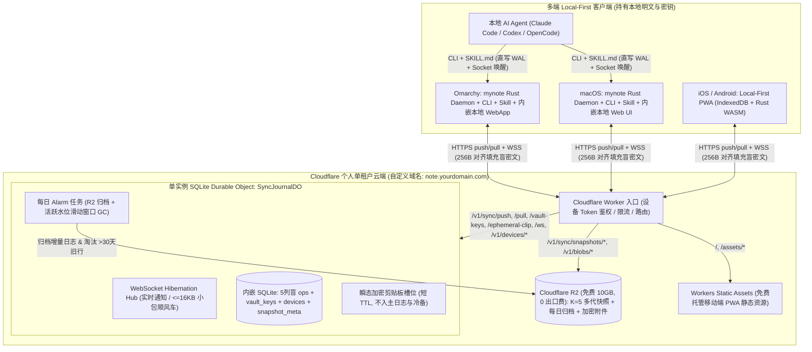

# 基于 Cloudflare 技术栈的自部署云端架构：深度评估与设计方案

> 本文档是 [总架构设计方案 (`architecture-proposal.md`)](./architecture-proposal.md) 的云端专项设计，并与 [同步协议规范 (`sync-protocol.md`)](./sync-protocol.md)、[安全与威胁模型规范 (`threat-model.md`)](./threat-model.md) 配套执行。结合已确定的核心取舍——**云端自部署在 Cloudflare 技术栈，且不考虑云端 MCP 与本地 MCP（Agent 统一走本地 CLI + Skill）**——本方案聚焦于构建一个**存储层 100% 零知识端到端加密（E2EE）、零运维、亚秒级推送、个人成本 \$0/月**的极简同步中继与 PWA 托管架构。

---

## 目录

1. [概念辨析与架构红利：为什么「Cloudflare + 全量 E2EE 哑中继」是绝配](#1-概念辨析与架构红利为什么cloudflare--全量-e2ee-哑中继是绝配)
2. [Cloudflare 核心组件选型评估（为什么是 DO SQLite + R2，而不是 D1 / KV）](#2-cloudflare-核心组件选型评估为什么是-do-sqlite--r2而不是-d1--kv)
3. [基于 Cloudflare 的推荐云端架构蓝图](#3-基于-cloudflare-的推荐云端架构蓝图)
4. [存储零知识与代码分发信任模型](#4-存储零知识与代码分发信任模型)
5. [2026 成本与配额精算（个人单用户场景）](#5-2026-成本与配额精算个人单用户场景)
6. [Cloudflare 专属工程暗坑与防御清单（必看）](#6-cloudflare-专属工程暗坑与防御清单必看)
7. [技术栈与开发语言划分（Worker 用 TS，本地核用 Rust）](#7-技术栈与开发语言划分worker-用-ts本地核用-rust)
8. [逃生舱设计（反厂商锁定）](#8-逃生舱设计反厂商锁定)
9. [分阶段落地路线（M0 → M3）](#9-分阶段落地路线m0--m3)

---

## 1. 概念辨析与架构红利：为什么「Cloudflare + 全量 E2EE 哑中继」是绝配

先厘清一个本质问题：**自部署在 Cloudflare（Self-Deployed Single-Tenant PaaS）≠ 自有物理机 VPS**。虽然代码和账号完全属于你个人，但 TLS 终结、V8 运行时、DO SQLite 落盘与 R2 磁盘仍由 Cloudflare 运维托管。

当明确**放弃云端 MCP / 云端明文搜索**之后，云端存储边界瞬间变得干净——**云端不需要解密任何一条笔记或业务元数据**，从而在吃满 Cloudflare 红利的同时把信任面压缩到最小：

### 1.1 获得的巨大红利
- **零服务器运维**：无需维护 Linux VPS、系统补丁、Nginx/Caddy 证书续期、systemd 重启、硬盘故障或自建数据库备份。一条 `wrangler deploy` 即可把 **PWA 静态站点 + 加密同步 API + WebSocket 亚秒级提醒 + 持久化 SQLite + R2 冷备** 全部上线。
- **接近 \$0 的单用户成本**：SQLite-backed Durable Objects（DO）自 2025 年起已开放至 Workers Free Plan，配合免费无限流量的 Workers Static Assets 与 10GB 免费 R2，个人 3–5 台设备完全落在免费额度内。
- **天然单写者强一致性**：单用户映射单个 Durable Object，天然获得单 `epoch` 内全局单调递增的 `server_seq`，比传统无状态 Serverless + 外置数据库更契合「不可变追加操作日志（Append-Only OpLog）」。
- **内置 30 天时间点恢复（PITR）**：SQLite Durable Object 原生支持 30 天内任意书签时间点回滚，提供额外的底层防误操作兜底。

### 1.2 仍需正视的工程挑战
1. **中国大陆网络可达性**：`*.workers.dev` 在中国大陆默认不可直连或极不稳定，**必须绑定个人自定义域名**；跨境 WebSocket 偶发重置不可避免，因此 **WebSocket 仅作为轻量通知/小包加速通道，可靠交付必须建立在幂等 HTTP `push/pull` 之上**。
2. **计费与平台硬上限**：Durable Objects 涉及 Requests、Duration（GB-s）、SQLite Rows Read/Write、Storage 多个计费维度（免费版单 DO 硬上限 **1 GB**，超限写报错 `SQLITE_FULL`；单条 SQL 最多 **100 个绑定参数**；二级索引额外计入写入行数），必须在协议与存储回收上精确受控。
3. **厂商特性绑定**：Durable Objects SQLite 与 Hibernation WebSocket 是 Cloudflare 专属原语，必须在协议层收敛到极简标准化接口，随时可迁回个人 VPS/NAS。

---

## 2. Cloudflare 核心组件选型评估（为什么是 DO SQLite + R2，而不是 D1 / KV）

| Cloudflare 组件 | 适用角色 | 评估结论 | 核心原因 |
| --- | --- | :---: | --- |
| **SQLite-backed Durable Objects (DO)** | **核心同步引擎（30 天滑动窗口热盲日志 + 单调序号 + WS 实时广播）** | **✅ 核心首选** | 1. 单用户一个 DO 实例（`idFromName("primary")`）= 严格单线程串行写入，原子分配 `server_seq`，零分布式锁； 2. SQLite 与计算同机共置（零网络跳数），免费版单对象 1GB / 付费版 10GB； 3. 支持 **WebSocket Hibernation API**，空闲连接不计 Duration 费用； 4. 原生 **30 天 PITR** + **Alarm 定时器**（自动执行 R2 归档与活跃水位滑动窗口 GC）。 |
| **Cloudflare R2** | 多世代加密快照（`K=5`）+ 每日归档日志包 + 加密图片附件 | **✅ 强烈推荐** | 永久免费 **10 GB 存储 + 0 出口流量费（Zero Egress）**，S3 协议兼容；将多代全量快照与超过 30 天的历史日志归档放在 R2，彻底保护 DO SQLite 永不触碰 1 GB 硬上限。 |
| **Workers Static Assets** | 托管移动端 **PWA 前端静态资源** | **✅ 强烈推荐** | 静态资源请求与存储**永久免费且不限流量**；替代独立的 Pages 项目，让 **PWA + Sync API + DO 合并在同一个 Worker 内一键部署**。 |
| **Cloudflare D1** | 托管分布式 SQLite | **❌ 不推荐** | D1 底层本身就是一个 SQLite DO，但经过了额外网络跳数且**不支持 WebSocket 实时广播**；单用户场景下直接用 SQLite DO 更少一层、延迟更低且原生支持跨设备实时推送。 |
| **Cloudflare KV** | 全局最终一致键值存储 | **❌ 不需要** | 最终一致性（高达 60 秒延迟）会破坏同步日志顺序与幂等性；且不做云端 OAuth/MCP 后，连 Session 缓存都无需引入 KV，架构组件再减一。 |

> **关键认知纠正（为什么 Loro 2026 博客放弃了 DO，而我们反而最适合 DO？）**
> Loro 团队在 2026 年的工程复盘中放弃 DO，是因为他们做的是**多租户高频协同 SaaS**，且试图在 DO 内存中加载整棵 CRDT 文档树做版本比对，导致内存与 SQLite 读写费用飙升。
> 而我们的场景是 **个人单用户（3–5 台设备）+ 5 列盲加密追加日志（服务端零业务解析）+ WebSocket Hibernation**：DO 每次被唤醒只在同步事务内插入盲密文并执行 1 次轻量 WS 广播（耗时 `< 5ms`），随即重新休眠，**完美踩中 Durable Objects 成本最低、延迟最稳的甜区**！

---

## 3. 基于 Cloudflare 的推荐云端架构蓝图

整个云端只需部署 **1 个极简 Cloudflare Worker（约 300–350 行 TypeScript，单仓库 `wrangler.jsonc` 一键发布）**，承载全部云端职责：

### 同步链路的核心设计哲学：「HTTP 为可靠真相，WebSocket 为零成本唤醒」

参考开源项目 `durable-sync`（2026 年专门针对 Cloudflare DO 打造的离线同步库）的实战教训，并针对**「跨设备复制粘贴（高实时性 + 可靠性优先）」**场景做专项优化，采用 **混合双通道**：

1. **数据主通道（HTTP `POST /v1/sync/push` & `GET /v1/sync/pull?since=seq`）—— 可靠性底线**：
   - 负责所有真实操作日志的可靠传输、批次提交（单次最多 500 ops）、幂等去重（按 `op_id`）、事后加锁墓碑擦除（`purge_op_ids[]`）与游标追赶。
   - 即使在电梯/地铁/跨境弱网断连后，也能在 App 回到前台（`visibilitychange` / `pageshow` / `focus` / `online`）时 100% 确定性补齐。
2. **实时提醒通道（DO WebSocket Hibernation）—— 亚秒级跨端复制粘贴**：
   - 客户端在线时保持一条极轻的 Hibernatable WebSocket（开启 `ctx.setWebSocketAutoResponse(new WebSocketRequestResponsePair("ping", "pong"))`，心跳在边缘直接回复，**0 唤醒计费**）。
   - **差异化刷盘策略**：普通连续打字防抖 `400–500ms` 并在本地 Outbox 合并同一块连续编辑；而检测到 **粘贴事件（`paste`）/ 窗口失焦（`blur`）/ CLI `mynote clip push`** 时走**快车道（`0–100ms` 立即触发 HTTP `push`）**。
   - **小载荷顺风车优化（可靠性严格优先）**：当单条 op 密文 `<= 16 KB`（99% 的跨设备复制粘贴片段都远小于此）时，DO 写入 SQLite 后直接通过 Hibernatable WebSocket 向其他在线设备广播 `{ type: "op", seq, epoch, op }`（半个 RTT 即可落盘，无需再多一轮 `pull`）。**严格一致性兜底**：接收端检查 `seq === local_seq + 1` 才直接应用；一旦发现跳号（`seq > local_seq + 1`）或 `epoch` 不一致，立即丢弃顺风车帧并回退至确定性的 HTTP `GET /v1/sync/pull?since=local_seq`，保证**速度可以降级，序号绝不缺失**。

| 跨设备复制粘贴链路 | 目标 P95 端到端延迟 | 实测体验与保障机制 |
| --- | :---: | --- |
| **Mac ↔ Omarchy（双端 Daemon 常驻）** | **150 – 350 ms** | 粘贴即推，另一端后台 Daemon 毫秒级落入 SQLite；甚至无需切窗口，热键触发 `mynote clip pull` 直入系统剪贴板（`wl-copy` / `pbcopy`） |
| **桌面 → iOS / Android PWA（亮屏唤醒）** | **250 – 500 ms** | iOS 锁屏后后台 WS 会被系统挂起，故 PWA 切回前台瞬间立即并发触发 HTTP `pull` + WS 重连，打开即见最新粘贴块并提供一键复制按钮 |
| **弱网 / 跨境抖动 / 离线恢复** | 断连自动重试 | 顶栏与块头展示诚实状态灯（`✓ 已同步` / `↑ 同步中` / `◌ 离线待同步`），未收到 DO 明确 JSON ack 前永不清本地 Outbox |

---

## 4. 存储零知识与代码分发信任模型

明确「不做云端 MCP、Agent 全走本地 CLI + Skill」之后，原先纠结的 **E2EE ⚔️ 云端 MCP 悖论**彻底消失。为避免虚假安全感，我们严格区分**「被动存储泄露」**与**「主动前端代码分发」**两道信任边界（详见 [安全与威胁模型规范 (`threat-model.md`)](./threat-model.md)）：

1. **对被动存储与备份泄露 100% 零知识（含业务元数据隐藏）**：
   - DO SQLite `ops` 表仅存 `(seq, op_id, device_id, created_at, envelope)` 5 列；`entity_id`、`op_type`、`parent_op_ids`、`hlc` 与业务载荷全部做 **256B 阶梯填充**后由 `Sync Master Key (SMK)` 执行 `XChaCha20-Poly1305` 加密；加密块内层再由独立 `BDEK` 二次加密，包裹密钥独立存于可变表 `vault_keys`。
   - 即使云端数据库磁盘快照或 R2 冷备桶外泄，攻击者拿到的只有带 AAD 绑定的等阶梯填充密文，连「哪个块被频繁修改或加锁」都无法分辨。
2. **诚实界定 Web 代码分发边界（桌面免疫 vs 移动 PWA 加固）**：
   - **桌面端（macOS / Omarchy）100% 运行本地单二进制内嵌 UI（`rust-embed`）**，永不从云端加载任何 JS/WASM，因此即使 Cloudflare 账号失守也无法向桌面端投毒。
   - **移动端 PWA 的前端静态资源由同一 Cloudflare Worker 下发**：若攻击者夺取了你的 Cloudflare 账号写权限，理论上可篡改静态资源向下次打开的手机端窃密。因此，**移动端信任模型诚实表述为「对云端存储零知识；对代码分发信任你本人的 Cloudflare 账号」**——部署规范强制要求 Cloudflare 账号开启 **FIDO2 硬件安全密钥 2FA**，日常仅使用最小权限 Scoped API Token 发布。
3. **设备级独立鉴权、零泄露二维码配对与丢失轮换**：
   - DO `devices` 表按设备维护独立 `SHA-256(device_token)` 与同步水位；
   - 主设备执行 `mynote device add` 生成 `https://note.yourdomain.com/#pair=<...>` 二维码，利用浏览器绝不向服务端发送 URL `#fragment` 的标准特性，3 秒将 `device_token` 与 `SMK` 零服务器泄露地传给手机 PWA（PWA 以不可导出 WebCrypto 密钥包裹存入 IndexedDB）；
   - 设备遗失时执行 `mynote device revoke` 秒级断连，并配合 `mynote sync rotate-smk` 轮换新一代 `smk_kid` 保障前向安全。

---

## 5. 2026 成本与配额精算（个人单用户场景）

结合 [同步协议规范 (`sync-protocol.md`)](./sync-protocol.md) 中的 **本地出站合并（Outbox Coalescing）+ 混合确定性压缩载荷（`FULL_ZSTD` / `SPAN_PATCH`）+ DO 30 天滑动窗口 GC**，按 **1 名重度开发者、4 台设备、经本地防抖合并后日均上云 300–500 条操作（单条 256B 对齐后均值 ~1.2 KB）、持续使用 3 年** 精确重算：

| 资源项 | 个人日均 / 总量真实精算 | Workers Free 免费额度 | Workers Paid (\$5/月) 额度 | 落点评估 |
| --- | --- | --- | --- | --- |
| **Workers Static Assets (PWA)** | 每日几十次页面加载 | **免费 & 无限请求/存储** | 免费 & 无限 | **\$0** |
| **DO Requests** | ~800–1,200 次/日（WS 20:1 折算） | **100,000 次/日** | 100 万次/月 | 仅占免费额度 **~1%** |
| **DO Duration** | 开启 Hibernation，~30–50 GB-s/日 | **13,000 GB-s/日** | 400,000 GB-s/月 | 仅占免费额度 **< 0.4%** |
| **DO SQLite 行读写** | 写 ~1,200 行/日（**含 `UNIQUE(op_id)` 索引翻倍**：500 ops × 2 rows + 水位更新），读 ~10,000 行/日 | **写 10 万行/日，读 500 万行/日** | 写 5,000 万行/月，读 250 亿行/月 | 仅占免费额度 **1.2%** |
| **DO SQLite 热存储** | **30 天滑动窗口热日志 ≈ 15–25 MB**（超 30 天或达 **700 MB** 自动归档 R2 并截断） | **单 DO 硬上限 1 GB**，账户 5 GB | 单 DO 10 GB，含 5 GB-月 | 常态仅占 **~2%**，彻底根除 `SQLITE_FULL` |
| **R2 存储与流量** | `K=5` 多代快照 + 3 年全量归档日志包（~650 MB）+ 加密图片 ≈ **0.7–1.5 GB** | **10 GB/月 + 0 出口费** | 同左 | **\$0**（占免费额度 `< 15%`） |

**结论**：
- 正常重度使用下，**全程稳定落在 \$0/月免费额度内**（仅需自有自定义域名约 \$10/年），且因 DO 实施 30 天滑动窗口 GC，单 DO 存储恒定维持在数十 MB，绝不会随使用年限线性膨胀撞上免费版 1 GB `SQLITE_FULL` 墙。
- 若希望彻底解除 Free Plan 日配额硬上限，可按需开启 **\$5/月 Workers Paid** 并配置 **Spending Limit**。

---

## 6. Cloudflare 专属工程暗坑与防御清单（必看）

以下 7 条均为 Cloudflare Workers + Durable Objects 生产环境中的真实丢数、运行报错或账单陷阱，已在协议规范中强制编码防御：

1. **【防丢数红线 #1】Cloudflare Access / 代理的 `res.ok === true` 静默丢数据陷阱**：
   - *事故复盘*（源自 `durable-sync` 真实线上丢数事故）：若同步 API 挂在 Cloudflare Access 等登录网关后，Session 过期会返回 `302` 重定向至登录 HTML 页；浏览器 `fetch()` 默认跟随重定向并返回 `HTTP 200 (res.ok === true)`。如果客户端看到 `res.ok` 就清空本地 Outbox，**这批离线笔记会被永久删除且毫无报错**！
   - *强制防御*：
     1. API 使用独立设备 Bearer Token（不走会 302 到 HTML 登录页的 Cookie 代理），并强制 `redirect: "manual"` + 校验 `Content-Type: application/json`；
     2. 只有当响应 JSON 明确包含 `{ ok: true, epoch: "<uuid>", acked: [{ op_id, seq }, ...] }` 时，才允许按 `acked` 列表逐条更新本地状态！

2. **【防丢数红线 #2】DO 重置 / PITR 回滚后的 `epoch` 并集对账状态机**：
   - *场景*：使用 Cloudflare 30 天 PITR 回滚 DO 或迁移自托管服务器后，服务端 `head_seq` 回退或更换 `journal_epoch`；且离线补推的旧操作在新 `epoch` 下会拿到全新的 `server_seq`。
   - *强制防御*（详见 [`sync-protocol.md` 第 6 节](./sync-protocol.md#6-epoch-变更与-pitr-回滚后的并集对账状态机)）：客户端检测到 `epoch` 变化或 `head_seq < local_seq` 时立即冻结常规上行，拉取远端全集与本地 `sync_ops` **按 `op_id` 求集合并集（严禁先清空本地表！）**，清除旧 `server_seq` 映射后按内生不可变的 **`(hlc, op_id)`** 重新物化（保证主块与冲突分支永不因重排而翻转），最后补推远端缺失的 `op` 或上传创世快照。

3. **【防运行时崩溃 & 计费翻倍 #3】DO SQLite 单语句 100 绑定参数上限与二级索引行写计费**：
   - *平台硬约束*：Cloudflare SQLite DO **每条 SQL 查询最多只允许 100 个绑定参数**，且每个二级索引每更新一行都会额外计入 1 次 `rowsWritten`。若一次批量 `push` 500 条 op 拼成单条多值 `INSERT`，会直接因超过 100 参数上限抛错失败！
   - *强制防御*：
     1. 批量插入必须在 `ctx.storage.transactionSync(() => { ... })` 同步事务内单行循环执行（5 参数/次 `<< 100`，进程内 SQLite 500 次循环仅需 `~1–2 ms`）；
     2. `ops` 表以 `seq INTEGER PRIMARY KEY` 复用内置 `rowid`（零额外索引写入），仅建 `UNIQUE(op_id)` 一个二级索引（严格控制在 `2 rows written / op`），严禁乱建多余二级索引。

4. **【防账单爆炸 #4】严防破坏 WebSocket Hibernation**：
   - 必须使用 `ctx.acceptWebSocket(server)` 而非旧版 `server.accept()`；
   - 必须使用 `ctx.setWebSocketAutoResponse(...)` 处理应用层心跳；
   - 不要在 DO 中保留未 resolve 的悬挂 Promise 或使用会阻断休眠的第三方 APM/Sentry 包装器；
   - DO 被休眠回收后内存变量会清空，连接元信息（如 `device_id`）必须通过 `ws.serializeAttachment(...)` 持久化在 WebSocket 附件中。

5. **【防限额击穿 #5】客户端 Single-Flight + 本地合并 + 指数退避**：
   - 禁止每次敲键盘发一次 DO 请求！本地写入 SQLite 是即时的，同步上行采用 **普通编辑防抖 400–500ms 本地合并 / 粘贴快车道 0–100ms + 单飞锁（Single-Flight，同一时刻最多一个同步请求在途）+ 失败指数退避（1s → 2s → 4s → 最大 60s）**。

6. **【防单点灾难 & 防爆盘 #6】DO Alarm 每日 R2 冷备归档 + 活跃水位滑动窗口 GC**：
   - 利用 `ctx.storage.setAlarm()` 每 24 小时将新增密文日志归档写入 R2（`archives/YYYY-MM-DD-seq-A-B.bin`，严格跳过瞬态剪贴板），随后清理 `seq <= min(活跃设备水位, 次新快照 covers_seq)` 且满 30 天（或超 700 MB 警戒线）的老旧 DO 行。
   - 你的笔记同时拥有 **4 重独立物理副本**：macOS 本地 SQLite + Omarchy 本地 SQLite + Cloudflare DO SQLite（含 30 天 PITR）+ Cloudflare R2 多代快照与归档冷备。

7. **【网络体验 #7】自定义域名 + WebSocket 降级**：
   - 绝不使用 `*.workers.dev` 作为生产同步域名，务必绑定自定义域名并开启合理的 TLS/HTTP3；
   - 桌面与移动端在 WebSocket 断开时自动静默降级为「写后即推 + 切前台即拉 + 60 秒低频轮询」，保证弱网环境下体感完全无感。

---

## 7. 技术栈与开发语言划分（Worker 用 TS，本地核用 Rust）

| 模块 | 推荐技术栈 | 理由 |
| --- | --- | --- |
| **云端 Worker (`cloud-cf/`)** | **TypeScript + Wrangler + SQLite DO + R2** | 1. Cloudflare 的 `ctx.storage.sql` 与 WebSocket Hibernation 是 **TypeScript 一等公民**，`workers-rs` 在新 API 与本地 `miniflare` 调试体验上明显滞后； 2. 盲密文中继仅约 **300–350 行极简 TS**，无需在云端跑任何密码学或业务合并逻辑，部署与维护成本趋近于零。 |
| **本地无 I/O 核心与存储 (`crates/`)** | **Rust**（Sans-I/O `mynote-core` + `rusqlite` + `clap`） | 1. `mynote-core` 纯同步状态机零异步依赖，桌面二进制 `<12–15MB`、无头守护内存 `<15–20MB`、`zeroize` 安全擦除； 2. 同一套协议状态机、加解密（`Argon2id` + `XChaCha20-Poly1305` + `BLAKE3`）与 Layer 1 格式化器编译为 **WASM**，直接喂给移动端 PWA（配极简 IndexedDB，无需引入沉重的 `sqlite-wasm`）！ |
| **Web / PWA 前端 (`web/`)** | **TypeScript + 按块虚拟化 CM6 + Pele 纯 SVG + `mynote-wasm`** | 编译产物同时服务两处： - 通过 `rust-embed` 嵌进桌面 `mynote` 单二进制（服务 macOS / Omarchy，永不加载远端代码）； - 通过 **Workers Static Assets** 部署到 Cloudflare（服务 iOS / Android PWA）。 |

---

## 8. 逃生舱设计（反厂商锁定）

因为架构是 **Local-First + 盲密文标准化接口契约**，未来脱离 Cloudflare 的成本极低：

### 标准化同步与密钥中继契约（Cloudflare 与自建 VPS 100% 通用）

| 接口 | 作用 |
| --- | --- |
| `POST /v1/sync/push` | 幂等追加盲加密 `ops[]`（支持携带 `purge_op_ids[]` 原地墓碑擦除），返回 `{ ok, epoch, acked, head_seq }` |
| `GET /v1/sync/pull?since=<seq>&limit=<n>` | 游标增量拉取密文日志并推进本设备 `last_pulled_seq` 水位；超保留窗口时提示走快照追赶 |
| `PUT / GET /v1/sync/snapshots` | 上传（带 `prev_snapshot_id` CAS 校验，保留 `K=5` 代）或获取 R2/本地加密压缩快照 |
| `PUT / DELETE / GET /v1/sync/vault-keys` | 同步或物理销毁可变包裹密钥表 `vault_keys` 与多槽位 `vault_key_slots` |
| `PUT / GET / DELETE /v1/sync/ephemeral-clip` | 短 TTL 瞬态加密剪贴板槽位（阅后即焚，不入持久日志与冷备） |
| `GET /v1/sync/ws` & `/v1/blobs/:sha256` & `/v1/devices/*` | 实时顺风车通知、内容寻址加密附件存取、设备配对注册与吊销 |

**随时脱离 Cloudflare 的 3 步逃生路径**：
1. 你的 Mac 和 Omarchy 本机永远存着 **100% 完整的本地 SQLite 数据库与物化状态**；
2. 仓库内可随时提供一个极简的 Rust 独立服务端实现上述接口（本地 SQLite + 本地文件目录）；
3. 迁回自建 VPS 或家用 NAS 时，只需修改各端 `sync_url`，首次重连检测到新 `epoch` 后自动触发第 6 节的**集合并集对账与创世快照上传**，零停机无缝迁移。

---

## 9. 分阶段落地路线（M0 → M3）

摒弃原先过于激进的「2 周 + 2 周」排期，按风险前置与严格模拟验证原则重切为四个扎实里程碑：

- **M0 — 本地桌面核心、CLI 体系与 Heynote 无痛迁移**
  - 完成 `mynote-core`（Sans-I/O 模型、Fractional Indexing、Layer 1/2 格式化器）、`mynote-store`（SQLite WAL + FTS5 + `secure_delete`）、L0–L3 渐进帮助 CLI（直写 WAL + Unix Socket 唤醒）、按块虚拟化 CM6 基础桌面 UI（含跨块光标桥接与本地 `HttpOnly` 鉴权）以及 **`mynote import heynote`（`∞∞∞` 分隔符切块导入工具）**。
- **M1 — Cloudflare 零知识同步底座与确定性故障模拟门禁**
  - **同步第一天即内置 Tier 1 `SMK` 盲信封加密**（绝不先上明文云同步），落地 `cloud-cf/`（5 列盲 `ops` + WebSocket Hibernation + R2 `K=5` 多代快照 + 活跃水位滑动窗口 GC + `epoch` 并集对账）与跨端剪贴板快车道；
  - **硬性准出门槛**：通过 `proptest` 确定性网络故障模拟套件（随机断网、乱序、并发编辑/删除、PITR `epoch` 回滚、快照截断慢设备追赶下 100% 收敛且零字符丢失）。
- **M2 — Tier 2 块级保险库（Vault）与移动端 Local-First PWA**
  - 落地客户端内存级 Tier 2 加解密（Daemon 零明文）、`vault_key_slots` 多槽位包裹（主口令 + 24 词恢复码 + WebAuthn PRF）、可变 `vault_keys` 真删除碎纸、事后加锁 `wal_checkpoint(TRUNCATE)` + `purge_op_ids` 擦除、瞬态加密剪贴板，以及移动端 PWA（`mynote-wasm` + 极简 IndexedDB + URL `#fragment` 扫码配对）。
- **M3 — Markdown / Pele 图表极致复制与高阶体验打磨**
  - 落地 Markdown 源码/预览双模切换、双格式富文本/纯文本剪贴板、代码块与 GFM 表格一键 TSV 复制、默认集成 **Obsidian `Pele` 纯 SVG 引擎**（零 `<foreignObject>` 完美兼容 Safari Copy PNG 与 CSS 变量换肤）、按 `actor` 时间旅行恢复与可选只读 Markdown 镜像。

