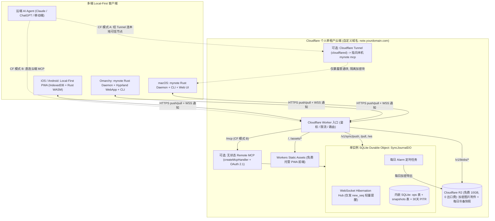

# 基于 Cloudflare 技术栈的自部署云端架构：深度重新评估与设计方案

> 本文档是 [总架构设计方案 (`architecture-proposal.md`)](./architecture-proposal.md) 的云端专项深度评估。针对「**倾向自托管（单租户个人部署），但云端基础设施选定 Cloudflare 技术栈**」这一方向，结合 2026 年 Cloudflare Workers 生态现状（SQLite Durable Objects Free Tier、WebSocket Hibernation、Workers Static Assets、R2、无状态 `createMcpHandler` 与 Cloudflare Tunnel），对信任边界、组件选型、成本预算、工程暗坑与防锁定逃生舱进行全面重评。

---

## 目录

1. [概念辨析与核心挑战：自部署在 Cloudflare ≠ 自有 VPS](#1-概念辨析与核心挑战自部署在-cloudflare--自有-vps)
2. [Cloudflare 核心组件选型评估（为什么是 DO SQLite + R2，而不是 D1 / KV）](#2-cloudflare-核心组件选型评估为什么是-do-sqlite--r2而不是-d1--kv)
3. [基于 Cloudflare 的推荐云端架构蓝图](#3-基于-cloudflare-的推荐云端架构蓝图)
4. [E2EE × Remote MCP 悖论在 Cloudflare 栈下的两种破局模式](#4-e2ee--remote-mcp-悖论在-cloudflare-栈下的两种破局模式)
5. [2026 成本与配额精算（个人单用户场景）](#5-2026-成本与配额精算个人单用户场景)
6. [Cloudflare 专属工程暗坑与防御清单（必看）](#6-cloudflare-专属工程暗坑与防御清单必看)
7. [技术栈与开发语言调整建议（Worker 用 TS，本地核用 Rust）](#7-技术栈与开发语言调整建议worker-用-ts本地核用-rust)
8. [逃生舱设计（反厂商锁定）](#8-逃生舱设计反厂商锁定)
9. [更新后的分阶段落地路线](#9-更新后的分阶段落地路线)

---

## 1. 概念辨析与核心挑战：自部署在 Cloudflare ≠ 自有 VPS

先泼一盆必要的冷水，把架构边界讲透：

### 1.1 获得的巨大红利
- **零服务器运维**：无需维护 Linux VPS、系统安全补丁、Nginx/Caddy 证书续期、systemd 重启、硬盘故障或自建数据库备份。一条 `wrangler deploy` 即可把 **PWA 静态站点 + 同步 API + 实时推送 + 持久化 SQLite + 对象存储 + 远端 MCP** 全部上线。
- **接近 \$0 的单用户成本**：SQLite-backed Durable Objects（DO）自 2025 年起已开放至 Workers Free Plan，配合免费无限流量的 Workers Static Assets 与 10GB 免费 R2，个人多端使用几乎完全落在免费额度内。
- **天然单写者强一致性**：单用户映射单个 Durable Object，天然获得全局单调递增的 `server_seq`，比传统无状态 Serverless + 外置数据库更契合「不可变追加操作日志（Append-Only OpLog）」。
- **内置 30 天时间点恢复（PITR）**：SQLite Durable Object 原生支持 30 天内任意书签时间点回滚，等于云端白送了一层防误删保险。

### 1.2 必须正视的新增挑战
1. **信任边界变化（Self-Deployed PaaS ≠ 物理主权自托管）**：
   - 虽然代码部署在你自己的 Cloudflare 账号下（单租户隔离、无第三方 SaaS 业务方），但 **TLS 终结、V8 运行时、DO SQLite 落盘与 R2 磁盘仍由 Cloudflare 托管运营**。
   - 因此，上一版中「在自己私人 VPS 上明文存普通块（模式 B）」的隐私假设需要重新审视——你必须明确判断：**是否接受将非敏感的临时普通块托付给你的个人 Cloudflare 账号（类似信任 GitHub Private Repo）？**
2. **网络可达性挑战（中国大陆网络环境）**：
   - `*.workers.dev` 在中国大陆默认不可直连或极不稳定，**必须绑定个人自定义域名**。
   - 跨境链路上 WebSocket 长连接偶发丢包/重置不可避免，因此 **WebSocket 只能作为「有新数据的轻量通知通道」，可靠交付必须建立在幂等 HTTP `push/pull` 之上**。
3. **计费模型隐蔽性与失控风险**：
   - Durable Objects 涉及 Requests、Duration（GB-s）、SQLite Rows Read/Write、Storage 多个维度（且 DO SQLite 存储已于 2026 年 1 月正式启用计费）。若客户端同步逻辑写出死循环重试，或误用了无法休眠的 WebSocket API，可能触发免费限额拒绝服务或付费账单激增。
4. **厂商特性绑定风险**：
   - Durable Objects SQLite、Hibernation WebSocket、Workers OAuth Provider 都是 Cloudflare 专属原语。必须在协议层做极简抽象，留好迁移回个人 VPS/NAS 的「逃生舱」。

---

## 2. Cloudflare 核心组件选型评估（为什么是 DO SQLite + R2，而不是 D1 / KV）

| Cloudflare 组件 | 适用角色 | 评估结论 | 核心原因 |
| --- | --- | :---: | --- |
| **SQLite-backed Durable Objects (DO)** | **核心同步引擎（热 OpLog + 单调序号 + WS 通知 + 可选状态视图）** | **✅ 核心首选** | 1. 单用户一个 DO 实例（`idFromName("primary")`）= 严格单线程串行写入，原子分配 `server_seq`，零分布式锁； 2. SQLite 与计算同机共置（零网络跳数），免费版单对象 1GB / 付费版 10GB； 3. 支持 **WebSocket Hibernation API**，空闲连接不计 Duration 费用； 4. 原生 **30 天 PITR** + **Alarm 定时器**（可自动每日导出备份到 R2）。 |
| **Cloudflare D1** | 托管分布式 SQLite | **❌ 同步主存不推荐** | D1 底层本身就是一个 SQLite DO，但经过了额外网络跳数且**不支持 WebSocket 实时广播**；在单用户场景下直接用 SQLite DO 延迟更低、架构更少一层、且同时拥有 WS 推送能力。（仅当未来扩展为多用户公有 SaaS 且需要跨用户全局 SQL 查询时才考虑 D1）。 |
| **Cloudflare KV** | 全局最终一致键值存储 | **❌ 严禁用于同步数据** | 最终一致性（高达 60 秒延迟）会破坏同步日志顺序与幂等性；仅适合配合 `@cloudflare/workers-oauth-provider` 存放 OAuth 短期 Token/Session。 |
| **Cloudflare R2** | 加密附件（粘贴图片）+ 每日加密冷备份 / 快照 | **✅ 强烈推荐** | 永久免费 **10 GB 存储 + 0 出口流量费（Zero Egress）**，S3 协议兼容；大体积图片与压缩快照放在 R2 既省 DO SQLite 空间，又方便随时 `rclone` 拖回本地冷备。 |
| **Workers Static Assets** | 托管移动端/桌面端 **PWA 前端静态资源** | **✅ 强烈推荐** | 静态资源请求与存储**永久免费且不限流量**；替代独立的 Pages 项目，让 **PWA + Sync API + DO + MCP 合并在同一个 Worker 内一键部署**。 |
| **Cloudflare Workers (`createMcpHandler`)** | 远端 MCP（Streamable HTTP + OAuth 2.1） | **✅ 视信任模式选用** | 2026 年官方已弃用较重的有状态 `McpAgent`，主推**无状态 `createMcpHandler`** + `@cloudflare/workers-oauth-provider`，直接通过 DO RPC 读写数据，无需额外常驻 MCP DO。 |
| **Cloudflare Tunnel (`cloudflared`) + Access** | 零知识模式下的本地边缘 MCP 暴露 / Zero Trust 鉴权 | **✅ 强烈推荐（尤其模式 A）** | 免费！若坚持云端全量 E2EE，可用 `cloudflared` 将本机（Mac/Omarchy/家用小主机）上的 `mynote mcp` 安全穿透出去供云端 Agent 调用，同时全程不脱离 Cloudflare 生态。 |

> **关键认知纠正（为什么 Loro 2026 博客放弃了 DO，而我们反而最适合 DO？）**
> Loro 团队在 2026 年的工程复盘中放弃 DO，是因为他们做的是**多租户高频协同 SaaS**，且试图在 DO 内存中加载整棵 CRDT 文档树做版本比对，导致内存与 SQLite 读写费用飙升。
> 而我们的场景是 **个人单用户（3–5 台设备）+ 哑追加操作日志（服务端不做 CRDT 合并计算）+ WebSocket Hibernation**：DO 每次被唤醒只执行 1 条 SQL 插入与 1 次轻量 WS 通知（耗时 `< 5ms`），随即重新休眠，**完美踩中 Durable Objects 成本最低、体验最好的甜区**！

---

## 3. 基于 Cloudflare 的推荐云端架构蓝图

整个云端只需部署 **1 个 Cloudflare Worker（单仓库 `wrangler.jsonc` 一键发布）**，即可同时承载静态 PWA、增量同步 API、WebSocket 实时提醒、定时 R2 备份与可选远端 MCP：

### 同步链路的核心设计哲学：「HTTP 为可靠真相，WebSocket 为零成本唤醒」

参考开源项目 `durable-sync`（2026 年专门针对 Cloudflare DO 打造的离线同步库）的实战教训，并针对**「跨设备复制粘贴（高实时性 + 可靠性优先）」**场景做专项优化，采用 **混合双通道**：

1. **数据主通道（HTTP `POST /v1/sync/push` & `GET /v1/sync/pull?since=seq`）—— 可靠性底线**：
   - 负责所有真实操作日志的可靠传输、批次提交（单次最多 500 ops）、幂等去重（按 `op_id`）与游标追赶。
   - 即使在电梯/地铁/跨境弱网断连后，也能在 App 回到前台（`visibilitychange` / `pageshow` / `focus` / `online`）时 100% 确定性补齐。
2. **实时提醒通道（DO WebSocket Hibernation）—— 亚秒级跨端复制粘贴**：
   - 客户端在线时保持一条极轻的 Hibernatable WebSocket（开启 `ctx.setWebSocketAutoResponse(new WebSocketRequestResponsePair("ping", "pong"))`，心跳在边缘直接回复，**0 唤醒计费**）。
   - **差异化刷盘策略**：普通连续打字防抖 `400–500ms` 合并推送；而检测到 **粘贴事件（`paste`）/ 窗口失焦（`blur`）/ CLI `mynote clip push`** 时走**快车道（`0–100ms` 立即触发 HTTP `push`）**。
   - **小载荷顺风车优化（可选，可靠性严格优先）**：当单条 op 密文 `<= 16 KB`（99% 的跨设备复制粘贴片段都远小于此）时，DO 写入 SQLite 后直接通过 Hibernatable WebSocket 向其他在线设备广播 `{ type: "op", seq, epoch, op }`（半个 RTT 即可落盘，无需再多一轮 `pull`）。**严格一致性兜底**：接收端检查 `seq === local_seq + 1` 才直接应用；一旦发现跳号（`seq > local_seq + 1`）或 `epoch` 不一致，立即丢弃顺风车帧并回退至确定性的 HTTP `GET /v1/sync/pull?since=local_seq`，保证**速度可以降级，序号绝不缺失**。

| 跨设备复制粘贴链路 | 目标 P95 端到端延迟 | 实测体验与保障机制 |
| --- | :---: | --- |
| **Mac ↔ Omarchy（双端 Daemon 常驻）** | **150 – 350 ms** | 粘贴即推，另一端后台 Daemon 毫秒级落入 SQLite；甚至无需切窗口，热键触发 `mynote clip pull` 直入系统剪贴板（`wl-copy` / `pbcopy`） |
| **桌面 → iOS / Android PWA（亮屏唤醒）** | **250 – 500 ms** | iOS 锁屏后后台 WS 会被系统挂起，故 PWA 切回前台瞬间立即并发触发 HTTP `pull` + WS 重连，打开即见最新粘贴块并提供一键复制按钮 |
| **弱网 / 跨境抖动 / 离线恢复** | 断连自动重试 | 顶栏与块头展示诚实状态灯（`✓ 已同步` / `↑ 同步中` / `◌ 离线待同步`），未收到 DO 明确 JSON ack 前永不清本地 Outbox |

---

## 4. E2EE × Remote MCP 悖论在 Cloudflare 栈下的两种破局模式

切换到 Cloudflare 后，两种模式的差异比传统 VPS 更加清晰，建议二选一：

### CF 模式 A：全量零知识 E2EE on Cloudflare + `cloudflared` 边缘 MCP（隐私最大化）

- **数据形态**：
  - DO SQLite 中的所有 `ops.payload` 与 R2 中的图片/快照，**100% 为客户端 `XChaCha20-Poly1305` 密文**（普通块用 `SMK` 加密，加密块再套一层 `Vault Key` 加密）。
  - **Cloudflare 看不到你任何一条笔记的任何一个字**。
- **远端 MCP 怎么实现？**
  - 不在 Cloudflare Worker 上解密数据；而是在你常开的一台设备（Mac / Omarchy / 家中 Mac Mini 或树莓派）上运行 `mynote mcp --http`，通过 **Cloudflare Tunnel (`cloudflared`) + Cloudflare Access / OAuth** 映射到 `mcp.yourdomain.com`。
  - 边缘节点本地已解封 `SMK`（可服务普通块），但**不持有 `Vault Key`**（加密块对远端 Agent 永远不可见）。
- **优缺点**：
  - ✅ 隐私最高：Cloudflare 仅充当盲存储与加密中继，彻底消除对云厂商的信任焦虑。
  - ✅ 后端极其简单：Cloudflare Worker 只需 ~300 行 TypeScript，永不需要理解块结构、搜索或格式化逻辑。
  - ⚠️ 代价：只有当你那台挂了 `cloudflared` 的本地机器开机在线时，手机外的远端云端 Agent 才能连上 Remote MCP（本地 Agent 与多端笔记同步则始终 24/7 可用）。

### CF 模式 B：Cloudflare 单租户分级信任 + 原生边缘 `createMcpHandler`（24/7 云端体验最大化）

- **数据形态**：
  - **普通块（临时草稿、待办、非涉密代码片段）**：通过 HTTPS 同步至你个人账号下的 DO SQLite，同时维护一份物化视图表（`blocks` + SQLite `FTS5` 索引），服务端可读可搜。
  - **加密块（API Key、密码、私密记录）**：**强制 100% 客户端 `Vault Key` 端到端加密**，服务端与云端 MCP 仅见密文与 `public_hint`，永远无法解密。
- **远端 MCP 怎么实现？**
  - 直接在同一个 Cloudflare Worker 中挂载官方无状态 **`createMcpHandler`** + **`@cloudflare/workers-oauth-provider`**（OAuth 2.1 + 细粒度 Scope）。
  - 任何云端 AI Agent（Claude、ChatGPT、手机端 Agent）**7×24 小时全球边缘毫秒级直连**你的普通笔记，随时检索/写入草稿，而加密块从 Schema 层面硬隔离。
- **优缺点**：
  - ✅ 真正 24/7 永不下线的云端 Remote MCP & Open REST API，无需任何家用机器开机。
  - ✅ 移动端 PWA 可以按需拉取或调用边缘全文检索，首次打开速度更快。
  - ⚠️ 代价：需要信任你自己的 Cloudflare 账号存放普通非敏感临时笔记（敏感内容必须手动点一下「锁定加密块」）。

> **建筑师决策建议**：
> **推荐先按「CF 模式 A」设计同步协议外壳，但保留 `enc_mode: "sync-e2ee" | "plain-normal"` 字段！**
> 为什么？因为 **CF 模式 A 在 MVP/V1 阶段代码量更少、无须在云端维护双套 SQLite Schema/FTS5，同时给你 100% 的零知识安全感**；如果你后续真的有强烈需求让云端 AI 在你电脑关机时也能读普通笔记，只需在 DO 里增加物化视图与 `createMcpHandler` 路由即可平滑开启模式 B（加密块始终不受影响）。

---

## 5. 2026 成本与配额精算（个人单用户场景）

按 **1 名重度开发者、4 台设备（Mac + Omarchy + 手机 + 备用机）、每天产生 1,000 次编辑同步操作与 50 次查询、持续使用 3 年** 估算：

| 资源项 | 个人日均/总量估算 | Workers Free 免费额度 | Workers Paid (\$5/月) 额度 | 落点评估 |
| --- | --- | --- | --- | --- |
| **Workers Static Assets (PWA)** | 每日几十次页面加载 | **免费 & 无限请求/存储** | 免费 & 无限 | **\$0** |
| **DO Requests** | ~1,500 次/日（WS 20:1 折算） | **100,000 次/日** | 100 万次/月 | 仅占免费额度 **1.5%** |
| **DO Duration** | 开启 Hibernation，~50 GB-s/日 | **13,000 GB-s/日** | 400,000 GB-s/月 | 仅占免费额度 **0.4%** |
| **DO SQLite 行读写** | 写 ~3,000 行/日，读 ~20,000 行/日 | **写 10 万行/日，读 500 万行/日** | 写 5,000 万行/月，读 250 亿行/月 | 仅占免费额度 **< 3%** |
| **DO SQLite 存储** | 3 年纯文本 OpLog ≈ 30–100 MB | **1 GB/DO，5 GB 账户总计** | 10 GB/DO，含 5 GB-月 | 仅占免费额度 **< 10%** |
| **R2 存储与流量** | 图片附件 + 每日冷备 ≈ 0.5–2 GB | **10 GB/月 + 0 出口费** | 同左 | **\$0** |
| **Cloudflare Tunnel / Access** | 个人 1 用户 | **免费（Access 免费 50 席位）** | 同左 | **\$0** |

**结论**：
- 正常使用下，**全程 \$0/月**（只需有一个自己的域名，约 \$10/年）。
- 唯一需要考虑升至 **\$5/月 Workers Paid** 的场景：若你想消除 Free Plan 到达日限额时硬拒绝的风险、或希望单 DO 突破 1GB、以及使用付费版更高的 CPU 时间限制；开启 Paid 时**务必在控制台设置 Spending Limit（例如 \$10 封顶 + \$5 邮件告警）**。

---

## 6. Cloudflare 专属工程暗坑与防御清单（必看）

以下 6 条均为 Cloudflare Workers + Durable Objects 生产环境中真实发生过的数据丢失或账单爆炸案例，必须在编码规范中强制落地：

1. **【防丢数红线 #1】Cloudflare Access 的 `res.ok === true` 静默丢数据陷阱**：
   - *事故复盘*（源自 `durable-sync` 真实线上丢数事故）：若 API 挂在 Cloudflare Access 鉴权后，Session 过期时 Access 会返回 `302` 重定向至登录 HTML 页；浏览器 `fetch()` 默认跟随重定向并返回 `HTTP 200 (res.ok === true)`。如果客户端看到 `res.ok` 就清空本地 Outbox，**这批离线笔记会被永久删除且毫无报错**！
   - *强制防御*：
     1. 同步请求必须校验 `Content-Type: application/json` 且设置 `redirect: "manual"`（或对 API 使用独立 Bearer/JWT 鉴权绕开 HTML 登录页重定向）；
     2. 只有当响应 JSON 明确包含 `{ ok: true, epoch: "<uuid>", acked: ["op_1", ...] }` 时，才允许按 `acked` 列表逐条移除本地 Outbox！

2. **【防丢数红线 #2】DO 重置 / PITR 回滚后的 `epoch` 游标失配**：
   - *场景*：若未来使用 Cloudflare 30 天 PITR 将 DO 回滚到 2 天前，此时 DO 的 `head_seq` 变为 800，而客户端本地游标仍停在 `last_synced_seq = 950`。若不做校验，客户端后续请求 `pull?since=950` 将永远返回空数组，导致**永久静默失联**！
   - *强制防御*：DO 初始化时生成一个持久化 `journal_epoch`（UUID）。每次 `push/pull` 必带 `epoch`；一旦客户端发现服务端 `epoch` 变更或 `server_head_seq < local_cursor`，立即触发**安全对账（重放并补推本地存在但服务端缺失的 `op_id`）**，永不丢数据。

3. **【防账单爆炸 #3】严防破坏 WebSocket Hibernation**：
   - 必须使用 `ctx.acceptWebSocket(server)` 而非旧版 `server.accept()`；
   - 必须使用 `ctx.setWebSocketAutoResponse(...)` 处理应用层心跳；
   - 不要在 DO 中保留未 resolve 的悬挂 Promise 或使用会阻断休眠的第三方 APM/Sentry 包装器；
   - DO 被休眠回收后内存变量会清空，连接元信息（如 `device_id`）必须通过 `ws.serializeAttachment(...)` 持久化在 WebSocket 附件中。

4. **【防限额击穿 #4】客户端 Single-Flight + 批量推送 + 指数退避**：
   - 禁止每次敲键盘发一次 DO 请求！本地写入 SQLite 是即时的，同步上行采用 **防抖 500ms + 批量合并（一次 `push` 打包多条 ops）+ 单飞锁（Single-Flight，同一时刻最多一个同步请求在途）+ 失败指数退避（1s → 2s → 4s → 最大 60s）**。

5. **【防单点灾难 #5】DO Alarm 每日加密冷备到 R2**：
   - 尽管 DO 自带 30 天 PITR，仍应利用 DO 的 `ctx.storage.setAlarm()` 每 24 小时执行一次轻量校验：若有新 `server_seq`，将增量/全量密文日志打包写入 R2（`backups/YYYY-MM-DD-seq-N.bin`）。
   - 这样你的笔记同时拥有 **4 重独立物理副本**：macOS 本地 SQLite + Omarchy 本地 SQLite + Cloudflare DO SQLite（含 30 天 PITR）+ Cloudflare R2 冷备归档。

6. **【网络体验 #6】自定义域名 + WebSocket 降级**：
   - 绝不使用 `*.workers.dev` 作为生产同步域名，务必绑定自定义域名并开启合理的 TLS/HTTP3；
   - 桌面与移动端在 WebSocket 断开时自动静默降级为「写后即推 + 切前台即拉 + 60 秒低频轮询」，保证弱网环境下体感完全无感。

---

## 7. 技术栈与开发语言调整建议（Worker 用 TS，本地核用 Rust）

选定 Cloudflare 作为云端后，需要重新审视「云端是否也要用 Rust (`workers-rs`)」：

| 模块 | 推荐技术栈 | 理由 |
| --- | --- | --- |
| **云端 Worker (`cloud-cf/`)** | **TypeScript + Wrangler + SQLite DO + R2** | 1. Cloudflare 的 `ctx.storage.sql`、WebSocket Hibernation、`createMcpHandler`、`@cloudflare/workers-oauth-provider` 全部是 **TypeScript 一等公民**，`workers-rs` 在新特性与本地 `miniflare` 调试体验上明显滞后； 2. 在模式 A 下云端只是 ~300 行极简哑中继，用 TS 写维护成本极低且零编译等待； 3. 若需复用加密/校验逻辑，TS Worker 也可直接按需加载 Rust 编译出的 WASM。 |
| **桌面单体核心 (`core/` + `cli/`)** | **Rust**（单二进制 `<15MB`） | 1. 本地 Daemon + CLI + SQLite WAL/FTS5 + Local MCP + `zeroize` 内存安全擦除； 2. 同一套加密（`Argon2id` + `XChaCha20-Poly1305`）与 Layer 1 格式化器编译为 **WASM**，直接喂给 Cloudflare 托管的移动端 PWA，消除双端密码学实现差异！ |
| **Web / PWA 前端 (`web/`)** | **TypeScript + CodeMirror 6 + SolidJS/Preact + `core-wasm`** | 编译产物同时产出两处： - 通过 `rust-embed` 嵌进桌面 `mynote` 单二进制（服务 macOS / Omarchy）； - 通过 **Workers Static Assets** 部署到 Cloudflare（服务 iOS / Android PWA）。 |

---

## 8. 逃生舱设计（反厂商锁定）

「把云端建在 Cloudflare」最让人顾虑的是**未来是否会被绑死**。因为我们的架构是 **Local-First**，配合极简同步契约，迁移成本极低：

### 标准化 5 接口同步契约（Cloudflare 与自建 VPS 100% 通用）

| 接口 | 作用 |
| --- | --- |
| `POST /v1/sync/push` | 幂等追加 `ops[]`，返回 `{ ok, epoch, acked, head_seq }` |
| `GET /v1/sync/pull?since=<seq>&limit=<n>` | 游标增量拉取，返回 `{ ok, epoch, ops, head_seq, has_more }` |
| `PUT / GET /v1/sync/snapshot` | 上传/获取客户端生成的最新加密压缩快照（新设备冷启动加速） |
| `GET /v1/sync/ws`（可选） | 极简提醒通道，只推 `{ type: "notify", head_seq, epoch }` |
| `PUT / GET /v1/blobs/:sha256` | 内容寻址加密附件存取（CF 走 R2，VPS 走本地目录或 MinIO） |

**随时脱离 Cloudflare 的 3 步逃生路径**：
1. 你的 Mac 和 Omarchy 本机永远存着 **100% 完整的本地 SQLite 数据库与历史操作日志**（无需从 Cloudflare 导出也能保有全部数据）；
2. 仓库内可保留一个极简的 Rust/Go 独立服务端实现上述 5 个接口（约 300 行代码 + 本地 SQLite）；
3. 未来某天想迁回自建 VPS 或家用 NAS，只需启动该二进制并在各端把配置中的 `sync_url` 从 `https://note.yourdomain.com` 改为新地址，首次重连检测到新 `epoch` 后自动完成全量对账上传。

---

## 9. 更新后的分阶段落地路线

结合 Cloudflare 栈后，**Phase 1 上线云端同步的门槛大幅降低**（省去了配置 VPS、Docker、Nginx、SSL、定时数据库备份的全部运维工作）：

- **Phase 0（MVP，约 2 周）— 桌面端先替代 Heynote**
  - Rust 单二进制 `mynote`（SQLite WAL + FTS5 + Block 模型 + CLI + Layer 1/2 格式化）+ 内嵌 CodeMirror 6 Web UI；
  - 跑通 macOS 与 Omarchy（Hyprland Special Workspace）。
- **Phase 1（V1，约 2–3 周）— Cloudflare 同步 + 块级加密 + 移动端 PWA**
  - 新增 `cloud-cf/`：TypeScript Worker + `SyncJournalDO`（SQLite + WebSocket Hibernation + 每日 R2 备份 Alarm）+ Workers Static Assets 托管 PWA；
  - `core-wasm` 编译输出给 PWA，落地 **Tier 1 同步 E2EE + Tier 2 块级 Vault 加密**（支持 WebAuthn PRF 生物识别解锁）；
  - 落地本地 `mynote mcp` 与 `SKILL.md`（对加密块硬隔离）。
- **Phase 2（V2，按需扩展）— 远端 Agent / MCP 与极致体验**
  - 根据你最终敲定的模式：
    - 若选 **CF 模式 A**：一键配置 `cloudflared` 暴露本机/边缘节点 MCP；
    - 若选 **CF 模式 B**：在 `cloud-cf/` 中直接启用 `createMcpHandler` + `@cloudflare/workers-oauth-provider`（仅读取普通块物化视图，硬隔离加密块）；
  - 可选追加：R2 加密图片粘贴、macOS 极薄 WKWebView 全局热键壳、非加密块 Loro/Yjs 字符级 CRDT 升级。
