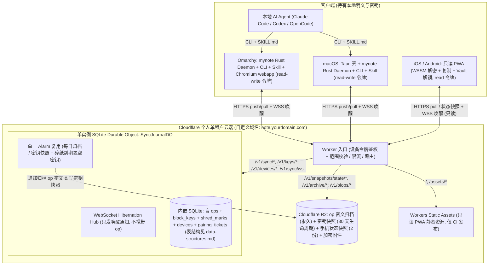

# 基于 Cloudflare 技术栈的自部署云端架构：深度评估与设计方案

> 2026-11-24 修订：依据 [第一性原理审查 §9](../review/2026-11-24-first-principles-review.md) 的决策 D1–D7 更新。

> 本文档是 [总架构设计方案 (`architecture-proposal.md`)](./architecture-proposal.md) 的云端专项设计，并与 [数据结构规范 (`data-structures.md`)](./data-structures.md)、[全链路接口契约 (`interface-contracts.md`)](./interface-contracts.md)、[同步协议规范 (`sync-protocol.md`)](./sync-protocol.md)、[安全与威胁模型规范 (`threat-model.md`)](./threat-model.md) 配套执行。结合已确定的核心取舍——**云端自部署在 Cloudflare 技术栈，且不考虑云端 MCP 与本地 MCP（Agent 统一走本地 CLI + Skill）**——本方案聚焦于构建一个**存储层零知识端到端加密（E2EE，服务端不持有任何解密密钥）、零运维、桌面间亚秒级唤醒、个人成本约 \$5/月（Workers Paid）**的极薄同步中继与只读 PWA 托管架构。
>
> **本文档是「云端实现」的单一事实来源**；表结构、线格式与 AAD 只在 [`data-structures.md`](./data-structures.md) 定义，同步语义只在 [`sync-protocol.md`](./sync-protocol.md) 定义，安全承诺只在 [`threat-model.md`](./threat-model.md) 定义，本文只引用不重复。

---

## 目录

1. [概念辨析与架构红利：为什么「Cloudflare + 全量 E2EE 哑中继」是绝配](#1-概念辨析与架构红利为什么cloudflare--全量-e2ee-哑中继是绝配)
2. [Cloudflare 核心组件选型评估（为什么是 DO SQLite + R2，而不是 D1 / KV）](#2-cloudflare-核心组件选型评估为什么是-do-sqlite--r2而不是-d1--kv)
3. [基于 Cloudflare 的推荐云端架构蓝图与极薄服务端职责](#3-基于-cloudflare-的推荐云端架构蓝图与极薄服务端职责)
4. [存储零知识与代码分发信任模型](#4-存储零知识与代码分发信任模型)
5. [2026 成本与配额精算（Workers Paid，个人单用户场景）](#5-2026-成本与配额精算workers-paid个人单用户场景)
6. [Cloudflare 专属工程暗坑与防御清单（必看）](#6-cloudflare-专属工程暗坑与防御清单必看)
7. [技术栈与开发语言划分（Worker 用 TS，本地核用 Rust）](#7-技术栈与开发语言划分worker-用-ts本地核用-rust)
8. [逃生舱设计（反厂商锁定）](#8-逃生舱设计反厂商锁定)
9. [测试：真实 Worker 契约测试与 DST 共用场景](#9-测试真实-worker-契约测试与-dst-共用场景)
10. [分阶段落地路线（云端切片）](#10-分阶段落地路线云端切片)
11. [已移除 / 推迟的机制（2026-11-24）](#11-已移除--推迟的机制2026-11-24)

---

## 1. 概念辨析与架构红利：为什么「Cloudflare + 全量 E2EE 哑中继」是绝配

先厘清一个本质问题：**自部署在 Cloudflare（Self-Deployed Single-Tenant PaaS）≠ 自有物理机 VPS**。虽然代码和账号完全属于你个人，但 TLS 终结、V8 运行时、DO SQLite 落盘与 R2 磁盘仍由 Cloudflare 运维托管。

当明确**放弃云端 MCP / 云端明文搜索**之后，云端存储边界瞬间变得干净——**云端不需要解密任何一条笔记**，从而在吃满 Cloudflare 红利的同时把信任面压缩到最小（服务端仍可见的少量元数据见 [§4](#4-存储零知识与代码分发信任模型)）：

### 1.1 获得的巨大红利
- **零服务器运维**：无需维护 Linux VPS、系统补丁、Nginx/Caddy 证书续期、systemd 重启、硬盘故障或自建数据库备份。**PWA 静态站点 + 加密同步 API + WebSocket 唤醒 + 持久化 SQLite + R2 归档** 由同一个 Worker 承载，**只经 CI 流水线发布**（见 [§4](#4-存储零知识与代码分发信任模型)）。
- **可预期的低成本**：采用 **Workers Paid（约 \$5/月）**（D4）。SQLite DO 单对象上限 10 GB、账户总存储不限，套餐内含额度对本项目而言远未触及（[§5](#5-2026-成本与配额精算workers-paid个人单用户场景)），**配额不再是设计约束**，因此不做任何 DO GC。
- **天然单写者强一致性**：单用户映射单个 Durable Object，天然获得单 `epoch` 内全局单调递增的 `server_seq`，比传统无状态 Serverless + 外置数据库更契合「不可变追加操作日志（Append-Only OpLog）」。
- **内置 30 天时间点恢复（PITR）**：SQLite Durable Object 原生支持 30 天内任意书签时间点回滚，提供额外的底层防误操作兜底。注意：PITR 同样会保留已碎纸密钥的旧页面，因此它计入「彻底删除」的时间上界（见 [`threat-model.md`](./threat-model.md)）。

### 1.2 仍需正视的工程挑战
1. **中国大陆网络可达性**：`*.workers.dev` 在中国大陆默认不可直连或极不稳定，**必须绑定个人自定义域名**；跨境 WebSocket 偶发重置不可避免，因此 **WebSocket 只作为唤醒通知通道，可靠交付必须建立在幂等 HTTP `push/pull` 之上**。
2. **计费与平台硬上限**：Durable Objects 涉及 Requests、Duration（GB-s）、SQLite Rows Read/Write、Storage 多个计费维度。仍需遵守的硬约束：单 DO 上限 **10 GB**（Paid；超限写报错 `SQLITE_FULL`，读与删除仍可用）、单条 SQL 最多 **100 个绑定参数**。二级索引会额外计入写入行数，但在 Paid 额度下已不构成约束（INV-SYNC-6「每 op 恰好 2 行」放宽，需要索引就加）。支出侧用 Spend Management 告警兜底（[§5.2](#52-spend-management支出告警配置建议)）。
3. **厂商特性绑定**：Durable Objects SQLite、Hibernation WebSocket 与 DO Alarm 是 Cloudflare 专属原语，必须在协议层收敛到极简标准化接口，随时可迁回个人 VPS/NAS（[§8](#8-逃生舱设计反厂商锁定)）。

---

## 2. Cloudflare 核心组件选型评估（为什么是 DO SQLite + R2，而不是 D1 / KV）

| Cloudflare 组件 | 适用角色 | 评估结论 | 核心原因 |
| --- | --- | :---: | --- |
| **SQLite-backed Durable Objects (DO)** | **核心同步引擎（全量盲 op 日志，不做 GC + 单调序号 + WS 唤醒 + 密钥表 `block_keys` / 碎纸标记 `shred_marks`）** | **✅ 核心首选** | 1. 单用户一个 DO 实例（`idFromName("primary")`）= 严格单线程串行写入，原子分配 `server_seq`，零分布式锁； 2. SQLite 与计算同机共置（零网络跳数），Paid 单对象 10 GB； 3. 支持 **WebSocket Hibernation API**，空闲连接不计 Duration 费用； 4. 原生 **30 天 PITR** + **Alarm 定时器**（每日 R2 归档 / 密钥快照，碎纸到期置空密钥）。 |
| **Cloudflare R2** | op 密文每日归档（永久、只追加）+ 密钥表每日快照（30 天生命周期）+ 手机「当前状态快照」（保留 2 份）+ 加密图片附件 | **✅ 强烈推荐** | **10 GB/月免费存储 + 0 出口流量费（Zero Egress）**（以官方定价页为准），S3 协议兼容；**生命周期规则**可按前缀自动删除密钥快照，正好实现「密文永久、密钥可删」（D2′）。 |
| **Workers Static Assets** | 托管手机端**只读 PWA 前端静态资源** | **✅ 推荐（注意信任边界）** | 静态资源请求不计费；让 **PWA + Sync API + DO 合并在同一个 Worker 内发布**。代价：手机端代码由 Cloudflare 下发，是一道独立信任边界（[§4](#4-存储零知识与代码分发信任模型)）。 |
| **Cloudflare D1** | 托管分布式 SQLite | **❌ 不推荐** | D1 底层本身就是一个 SQLite DO，但经过了额外网络跳数且**不支持 WebSocket 实时唤醒**；单用户场景下直接用 SQLite DO 更少一层、延迟更低。 |
| **Cloudflare KV** | 全局最终一致键值存储 | **❌ 不需要** | 最终一致性（高达 60 秒延迟）会破坏同步日志顺序与幂等性；且不做云端 OAuth/MCP 后，连 Session 缓存都无需引入 KV，架构组件再减一。 |

> **关键认知纠正（为什么 Loro 2026 博客放弃了 DO，而我们反而适合 DO？）**
> Loro 团队在 2026 年的工程复盘中放弃 DO，是因为他们做的是**多租户高频协同 SaaS**，且试图在 DO 内存中加载整棵 CRDT 文档树做版本比对，导致内存与 SQLite 读写费用飙升。
> 而我们的场景是 **个人单用户（2 台桌面写入 + 1 台只读手机）+ 盲加密追加日志（服务端零业务解析）+ WebSocket Hibernation**：DO 每次被唤醒只在同步事务内插入盲密文并向其他在线设备发 1 条唤醒通知（耗时 `< 5 ms` [估算]），随即重新休眠，正好落在 Durable Objects 成本最低、延迟最稳的区间。

---

## 3. 基于 Cloudflare 的推荐云端架构蓝图与极薄服务端职责

整个云端只需部署 **1 个 Cloudflare Worker（约 500–800 行 TypeScript [估算]，单仓库 `wrangler.jsonc`，只由 CI 发布）**，承载全部云端职责：

### 3.1 极薄服务端职责清单（F-12）

服务端**只做以下事情**，其余逻辑（合并、冲突、物化、加解密、自检、回收站 UI）全部在客户端。线格式与表结构见 [`data-structures.md`](./data-structures.md)，协议语义见 [`sync-protocol.md`](./sync-protocol.md)。

| # | 职责 | 服务端行为要点 |
| --- | --- | --- |
| 1 | **令牌与范围校验** | 每台设备独立令牌，DO 只存 `SHA-256(device_token)`；令牌范围 `read` / `read-write`（D1）。`read` 令牌对 `push`、密钥记录创建、碎纸请求 / 撤销 / 确认、状态快照发布一律返回 **403**；可读 `pull`、密钥表、状态快照、WS 唤醒。吊销后立即拒绝一切 HTTP/WS 请求。 |
| 2 | **幂等追加** | `push` 在 `ctx.storage.transactionSync` 内逐条插入；以 `op_id` 去重，重复提交返回原 `seq`；只有事务提交后才返回明确 JSON ack（[§6 #1](#6-cloudflare-专属工程暗坑与防御清单必看)）。op 一旦写入**永不修改、永不删除**。 |
| 3 | **分配 `seq`** | 单 DO 单线程，`seq` 在当前 `epoch` 内严格单调递增。 |
| 4 | **按 `seq` 分页** | `pull?since=<seq>&limit=<n>` 返回 `(since, since+n]` 区间与 `head_seq`；因为不做 GC，任意 `since` 都可直接拉取，无「超保留窗口」分支。 |
| 5 | **`epoch`** | DO 首次初始化（或 PITR 回滚 / 迁移后重建）时生成新的 `journal_epoch`，每个响应都带上；客户端据此触发并集对账（[§6 #2](#6-cloudflare-专属工程暗坑与防御清单必看)）。 |
| 6 | **WS 唤醒（只发通知）** | `push` 提交后向其他在线设备发送 `{ type: "wake", epoch, head_seq }`，**不携带 op**；客户端收到后走 HTTP `pull`。WS 断开不影响正确性。 |
| 7 | **`block_keys` 存储** | 密钥记录**只创建、不修改**：同一 `key_id` 重复提交且内容相同 → 幂等成功；内容不同 → 409。服务端只看到随机 `key_id`、`wrap_gen` 与 `MNR1` 密文，**不解析记录、看不到 `block_id` / `tier`**；轮换时只接受 `wrap_gen` 更大的重新封装。提供全量列表供客户端每次同步全量比对与每日自检。 |
| 8 | **`shred_marks` 存储与校验** | 接收碎纸标记；**强制最短宽限期**：拒绝 `not_before < now + T_grace_min` 的请求（INV-GRACE）；撤销（`state → cancelled`）只在 `now < not_before` 且密钥尚未置空时接受，之后返回 `410 KEY_SHREDDED`（客户端改走「用新密钥重新加密上传」，见 [`sync-protocol.md`](./sync-protocol.md)）。 |
| 9 | **批量阈值** | 滚动 24 小时内新建碎纸标记超过 `N` 个时，超出部分 `state = pending_confirm`，**不开始计时**；收到确认请求后转为 `scheduled`，记录 `confirmed_at`，`not_before` 取 `max(原值, 确认时刻 + T_grace_min)`。`state ∈ {pending_confirm, scheduled, cancelled, executed}`，字段见 [`data-structures.md`](./data-structures.md)。 |
| 9a | **密钥竞态校验** | push 中每个 op 携带明文 `key_id`，DO 存入 `ops.key_id`（建索引 `idx_ops_key`）。同一批按「密钥记录 → 撤销 → 标记 → op」顺序在一个事务内校验并原子提交：(a) 新标记的 `key_id` 下存在 `seq > seen_seq` 的 op → `SHRED_STALE`；(b) op 引用有 `pending_confirm` / `scheduled` 标记的 `key_id`，且同批未先撤销 → `KEY_PENDING_SHRED`；(c) op 引用 `executed` 或不存在的 `key_id` → `KEY_SHREDDED` / `KEY_UNKNOWN`。任一失败整批回滚，不分配 `seq`。规则语义见 [`sync-protocol.md`](./sync-protocol.md) §5.6。 |
| 10 | **DO alarm 到期置空密钥** | alarm 触发时，对所有「已确认、未撤销、`not_before ≤ now`」的标记，把对应 `block_keys.wrapped_key` 置空并记录置空时间；处理须幂等（alarm 至少执行一次、可能重试）。 |
| 11 | **每日归档** | 同一 alarm 每日把新增 op 密文追加归档到 R2、写一份密钥表快照（[§3.3](#33-r2-布局归档快照与生命周期)）。 |
| 12 | **手机状态快照存储** | 接收桌面发布的状态快照，按 `covers_seq` 单调接受，保留最近 2 份（[§3.3](#33-r2-布局归档快照与生命周期)）。 |
| 13 | **一次性领取配对** | `POST /v1/devices`（`read-write`）暂存「桌面用一次性包裹密钥加密的 Tier 1 密钥环 + 新签发令牌」，**TTL 10 分钟**；`POST /v1/devices/pair-claim` 凭 128 位随机 `pair_id` 领取，**首次领取即删除**，再次领取或过期返回 404。服务端从不接触包裹密钥；`read` 令牌不能发起配对。形状见 [`interface-contracts.md`](./interface-contracts.md) §4.2 (6)。 |

**参数**（Q7–Q9 已按默认拍板）：`T_grace` = 7 天（客户端默认值）；`T_grace_min` = 24 小时；`N` = 20 块/天。`T_grace_min` 与 `N` 以 Worker 环境变量配置，**只能经 CI 部署修改**，持有设备令牌的攻击者无法调低。

> [!NOTE]
> 服务端看不到内容，**也区分不了请求来自 UI 还是 CLI**（二者用同一台设备的令牌）。「CLI 只能删进回收站、缩短宽限期 / 清空回收站只能在 UI 交互确认」由本地 Daemon 强制（见 [`interface-contracts.md`](./interface-contracts.md)）；服务端能构造性保证的是：任何碎纸请求都至少有 `T_grace_min` 的可撤销窗口，且超出批量阈值的部分在确认前不会计时。

**alarm 复用**：每个 DO 只有一个 alarm。每次处理完毕后重新设定为 `min(下一次每日任务时刻, 最早一个待到期 not_before)`；DO 启动（含 PITR 回滚后）时也重算一次，保证到期标记不会被漏掉。

### 3.2 同步链路的核心设计哲学：「HTTP 为可靠真相，WebSocket 为零成本唤醒」

参考开源项目 `durable-sync`（2026 年专门针对 Cloudflare DO 打造的离线同步库）的实战教训，并针对**「桌面间跨设备复制粘贴（高实时性 + 可靠性优先）」**场景做专项优化，采用 **混合双通道**：

1. **数据主通道（HTTP `POST /v1/sync/push` & `GET /v1/sync/pull?since=seq`）—— 可靠性底线**：
   - 负责所有真实操作日志的可靠传输、批次提交（单次最多 500 ops）、幂等去重（按 `op_id`）与游标追赶。
   - 即使在跨境弱网断连后，也能在窗口回到前台（`visibilitychange` / `pageshow` / `focus` / `online`）时确定性补齐：未收到明确 ack 的 op 留在本地 outbox 重试。
2. **唤醒通道（DO WebSocket Hibernation）—— 桌面间亚秒级**：
   - 客户端在线时保持一条极轻的 Hibernatable WebSocket（开启 `ctx.setWebSocketAutoResponse(new WebSocketRequestResponsePair("ping", "pong"))`，心跳在边缘直接回复，不唤醒 DO）。
   - **差异化刷盘策略**（桌面）：普通连续打字防抖 `400–500 ms` 并在本地 outbox 合并同一块连续编辑；检测到 **粘贴事件（`paste`）/ 窗口失焦（`blur`）/ CLI 写入** 时走**快车道（`0–100 ms` 立即触发 HTTP `push`）**。
   - **只发唤醒通知**：DO 提交后只广播 `{ type: "wake", epoch, head_seq }`；接收端发现 `head_seq > local_seq` 即走 HTTP `pull`。相比「WS 携带 op」多一次 pull 往返，但服务端更薄、只有一条数据路径；是否改为携带 op 由数据触发（[§11](#11-已移除--推迟的机制2026-11-24)）。

| 跨设备复制粘贴链路 | 目标 P95 端到端延迟 | 体验与保障机制 |
| --- | :---: | --- |
| **Mac ↔ Omarchy（双端 Daemon 常驻）** | **150 – 400 ms** [目标] | 粘贴即推 → WS 唤醒 → 另一端 Daemon pull 落入 SQLite |
| **桌面 → iOS / Android 只读 PWA（亮屏）** | **300 – 600 ms** [目标] | iOS 锁屏后后台 WS 会被系统挂起，故 PWA 切回前台时立即 HTTP `pull` + WS 重连，打开即见最新块并提供一键「复制」按钮 |
| **弱网 / 跨境抖动 / 离线恢复** | 断连自动重试 | 顶栏与块头展示诚实状态灯（`✓ 已同步` / `↑ 同步中` / `◌ 离线待同步`），未收到 DO 明确 JSON ack 前不清本地 outbox（仅桌面有 outbox） |

### 3.3 R2 布局、归档、快照与生命周期

| R2 前缀 | 内容 | 写入方 | 保留策略 |
| --- | --- | --- | --- |
| `archives/ops/` | 每日新增 op 密文（`MNA1`，按 `epoch` + `seq` 区间确定性命名，键格式见 [`data-structures.md`](./data-structures.md)） | DO alarm | **永久、只追加**。Worker **不暴露任何删除 / 覆盖接口**；写前检查对象是否已存在，存在则跳过（重试幂等）。可选启用 R2 Bucket Lock 进一步防删 [待 S0 验证] |
| `archives/keys/` | 每日 `block_keys` + `shred_marks` 全量快照（已置空的密钥不含 `wrapped_key`） | DO alarm | **R2 生命周期规则：创建 30 天（`T_snap`）后自动删除**。最新一份总包含全部活跃密钥，恢复不受影响 |
| `snapshots/state/` | 手机引导用「当前状态快照」（每块全部叶子版本 + 字段 LWW 结果 + `covers_seq`；块内容仍用各自 BDEK 加密；不含已碎纸块） | 任一桌面（`read-write` 令牌） | 按 `covers_seq` **单调接受**（不大于当前最新则拒绝，无 CAS 链）；**只保留最近 2 份**，由 Worker 在接受新快照后删除更旧的 |
| `blobs/` | 加密图片附件（按密文哈希寻址） | 桌面 | 附件用**所属块当前的 BDEK** 加密，随该密钥一起纳入碎纸范围：密钥置空后附件密文不可解密。附件对象本身不删除（与 op 归档一致，只删密钥） |

- 状态快照的发布时机（每日或尾部 op 超过阈值）与手机应用尾部 op 的规则由 [`sync-protocol.md`](./sync-protocol.md) 定义；状态快照**只给手机读**，不参与桌面因果判定，出错的后果只是手机显示不对、重新拉取即可。
- 密钥快照的删除依赖 R2 生命周期规则的异步执行，实际删除可能比 30 天略晚 [待 S0 验证]；彻底删除的时间上界（`T_grace + max(PITR 30 天, T_snap)` ≈ 37 天）的承诺措辞以 [`threat-model.md`](./threat-model.md) 为准。

### 3.4 恢复（restore）路径

| 场景 | 路径 |
| --- | --- |
| **DO 误操作 / 数据损坏（30 天内）** | DO PITR 回滚 → 新 `epoch` → 各桌面按 `op_id` 并集对账，把 DO 缺失的 op 与密钥记录补推回去（[§6 #2](#6-cloudflare-专属工程暗坑与防御清单必看)）。 |
| **DO 整体丢失 / 迁移** | 新建 DO（新 `epoch`）→ 任一桌面全量补推 op 历史与 `block_keys` / `shred_marks`；手机等待下一份状态快照。 |
| **零设备（所有桌面都丢失）** | 新桌面 + **统一恢复包** → `mynote restore --from-archive`：下载 `archives/ops/` 全部归档（加上 DO 中尚未归档的尾部）与最新的 `archives/keys/` 快照（或 DO 中的实时密钥表）→ 用恢复包解开密钥环、再解开各块 BDEK → 重建本地库 → 重新配对设备。零设备时没有可用的设备令牌，需通过 CF 账户（强 2FA）签发 R2 只读访问凭据或经 CI 写入新设备令牌哈希；CLI 细节见 [`interface-contracts.md`](./interface-contracts.md)。 |

INV-RECOVERY（零设备 + 恢复包 → 恢复全部未删除数据）作为 M1 准出门禁，定义见 [`eval-framework.md`](./eval-framework.md)。

---

## 4. 存储零知识与代码分发信任模型

明确「不做云端 MCP、Agent 全走本地 CLI + Skill」之后，原先纠结的 **E2EE ⚔️ 云端 MCP 悖论**彻底消失。为避免虚假安全感，我们严格区分**「被动存储泄露」**与**「主动前端代码分发」**两道信任边界。**本节只描述云端实现的事实，安全承诺的正式措辞以 [`threat-model.md`](./threat-model.md) 为准。**

1. **对被动存储与备份泄露零知识**：
   - DO 与 R2 中只有密文：op 信封只带 `key_id`、不带密钥；块内容由各块 BDEK 加密，BDEK 由 SMK（Tier 1）或 VKEK（Tier 2）包裹后存于 `block_keys`。服务端不持有 SMK / VKEK / 恢复包。信封字节布局、填充与 AAD **只在 [`data-structures.md`](./data-structures.md) 定义**。
   - 服务端为执行职责必然可见的元数据：`op_id`、`seq`、设备、时间、密文长度（已填充）、`key_id`（op 与密钥记录上都有，用于竞态校验）、`wrap_gen`、`not_before`、碎纸标记的状态与时间。`block_id` 与 `tier` 只在 `MNR1` 密文内，服务端**看不出**哪把密钥属于哪个块、哪些块在 Vault 中（时序侧信道见 [`threat-model.md`](./threat-model.md)）。
2. **诚实界定 Web 代码分发边界（桌面不受影响 vs 手机 PWA 受影响）**：
   - **桌面端（macOS Tauri 壳 / Omarchy Chromium webapp）加载的是本地二进制内嵌的前端资源**，不从云端加载 JS/WASM，因此 Cloudflare 账号失守不能向桌面端投毒。
   - **手机 PWA 的前端静态资源由同一 Cloudflare Worker 下发**：若攻击者夺取 Cloudflare 账号写权限或部署流水线，可篡改静态资源，在你下次打开手机端时窃取 SMK，或在你输入 Vault 口令时截获它（D7）。因此手机端（Tier 1 与 Tier 2）的保证**不覆盖 CF 账户 / 部署流水线被攻破**的情形，详见 [`threat-model.md`](./threat-model.md)。
   - **缓解（部署规范，强制）**：
     - Cloudflare 账号开启 **FIDO2 硬件安全密钥 2FA**；
     - **部署只从 CI 走**：Worker 与静态资源只由 CI（GitHub Actions）用最小权限的 Scoped API Token 发布，本机不保留可发布的凭据，不做本地 `wrangler deploy`；
     - Service Worker 缓存固定版本，更新时在 UI 显示版本号与变更提示。
3. **设备级独立鉴权、配对与丢失处置**：
   - DO `devices` 表按设备维护独立令牌哈希与令牌范围；手机配对时只发放 `read` 令牌，丢失或被入侵时写不进、也删不掉任何东西（但仍能解密未碎纸的 Tier 1 内容）。
   - 配对流程（iOS 主流程为「粘贴配对码」或 PWA 内 `getUserMedia` 扫码）与配对凭据传递方式见 [`threat-model.md`](./threat-model.md)；
   - 设备遗失时执行 `mynote device revoke` 立即断连，并按 [`threat-model.md`](./threat-model.md) 的流程做密钥环轮换（重新包裹密钥表）。

---

## 5. 2026 成本与配额精算（Workers Paid，个人单用户场景）

按 **1 名重度开发者、2 台桌面写入 + 1 台只读手机、经本地防抖合并后日均上云 300–500 条操作（全量载荷、填充后均值约 1.2 KB）** 估算（与审查附录 A 同口径）。套餐额度来自审查附录 B 的核验，以官方定价页为准。

| 资源项 | 个人用量 | Workers Paid (\$5/月) 套餐内含 / 上限 | 落点评估 |
| --- | --- | --- | --- |
| **Workers Static Assets (PWA)** | 每日几十次页面加载 | 静态资源请求不计费 | **\$0** |
| **DO Requests** | ~1,000 次/日 ≈ 3 万次/月 [估算]（WS 消息按 20:1 折算） | 100 万次/月 | 约 3% |
| **DO Duration** | 开启 Hibernation，~30–50 GB-s/日 [估算] | 400,000 GB-s/月 | < 0.4% |
| **DO SQLite 行写** | 约 1,000–1,500 行/日 ≈ 3–4.5 万行/月 [估算]（每 op 2–3 行，INV-SYNC-6 已放宽） | 5,000 万行/月 | 约 0.06–0.09% |
| **DO SQLite 行读** | pull 约 1 万行/日；密钥表全量比对：5,000 块 × 300 次同步/日 ≈ 150 万行/日 [估算]；合计约 4,500 万行/月 | 250 亿行/月 | 约 0.2% |
| **DO SQLite 存储** | op 日志约 **220 MB/年**；密钥表约「块数 × 250 B」（5,000 块 ≈ 1.25 MB）[估算] | 单 DO **10 GB**、账户不限；含 5 GB-月，超出按量计费 | **不做 GC 约可用 45 年** [估算]；约 20 年后才超出 5 GB-月内含额度 [估算] |
| **R2 存储** | op 归档约 220 MB/年；密钥快照 30 份 × ~1.25 MB；状态快照 2 份 × 数 MB–数十 MB；加密图片 [估算] | 10 GB-月免费（以官方定价页为准） | 10 年内约 2.5 GB [估算]，**\$0** |

**结论**：
- 固定成本约 **\$5/月**（Workers Paid）+ 自定义域名约 \$10/年；正常使用下不会产生超额费用 [估算]。
- 存储随年限线性增长但远低于 10 GB 单 DO 上限，因此**不做 DO GC、不做 R2 多代快照**。若某天单 DO 用量逼近数 GB，再按数据触发重新评估。

### 5.1 规模估算依据

- 日上行：500 ops × 1.2 KB ≈ 0.6 MB/日 ≈ 220 MB/年 [估算]；10 GB ÷ 220 MB/年 ≈ 45 年 [估算]。
- 大块成本：300 KB JSON 经 zstd 压缩后约 30–60 KB；每天对大块做 50 次全量推送约 1.5–3 MB/日 [估算]，仍在量级之内，因此不需要 `SPAN_PATCH`。
- 新桌面全量 pull（第 1 年末）约 220 MB [估算]，桌面可接受；手机改用状态快照引导（[§3.3](#33-r2-布局归档快照与生命周期)）。

### 5.2 Spend Management（支出告警）配置建议

Cloudflare 于 2026-11-13 推出 Spend Management（beta），可分别为 Workers 与 Durable Objects 设置账户级支出上限与告警（审查附录 B）。M1 部署时配置：

- **建议只开告警**（例如月度超额达 \$5 / \$20 时通知）。
- 若要设 DO 拦截上限，**务必设得很宽松**：一旦触发拦截，DO 的 SQL 写入、stub 调用与 alarm 都会被拒绝，后果是：
  - 同步停摆（数据仍在各桌面本地 outbox 中，不会丢失）；
  - **每日归档与碎纸 alarm 停止**，碎纸实际生效时间相应推迟、超出约 37 天的上界——拦截期间需人工关注。
- DO 上限不含存储费与订阅费；**R2 不在 Spend Management 覆盖范围内**，需在账单通知或定期用量检查中另行关注（本项目用量极小）。
- 告警配置本身纳入 S0 的 echo 中继 spike 验证。

---

## 6. Cloudflare 专属工程暗坑与防御清单（必看）

以下各条均为 Cloudflare Workers + Durable Objects 生产环境中的真实丢数、运行报错或账单陷阱，已在协议规范中强制编码防御：

1. **【防丢数红线 #1】Cloudflare Access / 代理的 `res.ok === true` 静默丢数据陷阱**：
   - *事故复盘*（源自 `durable-sync` 真实线上丢数事故）：若同步 API 挂在 Cloudflare Access 等登录网关后，Session 过期会返回 `302` 重定向至登录 HTML 页；浏览器 `fetch()` 默认跟随重定向并返回 `HTTP 200 (res.ok === true)`。如果客户端看到 `res.ok` 就清空本地 outbox，**这批离线笔记会被永久删除且毫无报错**！
   - *强制防御*：
     1. API 使用独立设备 Bearer Token（不走会 302 到 HTML 登录页的 Cookie 代理），并强制 `redirect: "manual"` + 校验 `Content-Type: application/json`；
     2. 只有当响应 JSON 明确包含 `{ ok: true, epoch: "<uuid>", acked: [{ op_id, seq }, ...] }` 时，才允许按 `acked` 列表逐条更新本地状态！密钥记录与碎纸标记的提交同样以明确 ack 为准——「换钥」时必须先拿到新 op 与新密钥记录的 ack，才能对旧密钥发碎纸。

2. **【防丢数红线 #2】DO 重置 / PITR 回滚后的 `epoch` 并集对账**：
   - *场景*：使用 Cloudflare 30 天 PITR 回滚 DO 或迁移自托管服务器后，服务端 `head_seq` 回退或更换 `journal_epoch`；且离线补推的旧操作在新 `epoch` 下会拿到全新的 `server_seq`。
   - *强制防御*（状态机定义见 [`sync-protocol.md`](./sync-protocol.md)）：客户端检测到 `epoch` 变化或 `head_seq < local_seq` 时立即冻结常规上行，按 `op_id` 求集合并集（**严禁先清空本地表**），再补推远端缺失的 op。
   - *密钥表同样要对账*：PITR 可能让 DO 丢失较新的密钥记录（桌面需按 2P-Set 补推，INV-KEY-LIVENESS），也可能让已置空的密钥「复活」——由于碎纸标记在各桌面也有副本，补推后 DO 启动时重算 alarm 会再次置空。

3. **【防运行时崩溃 #3】DO SQLite 单语句 100 绑定参数上限**：
   - *平台硬约束*：Cloudflare SQLite DO **每条 SQL 查询最多只允许 100 个绑定参数**。若一次批量 `push` 500 条 op 拼成单条多值 `INSERT`，会直接因超过 100 参数上限抛错失败！
   - *强制防御*：批量插入必须在 `ctx.storage.transactionSync(() => { ... })` 同步事务内单行循环执行（每次只绑定少量参数，进程内 SQLite 500 次循环约 1–2 ms [估算]）。二级索引在 Paid 额度下不再严格限制（INV-SYNC-6 已放宽），但仍只建查询真正需要的索引。

4. **【防账单爆炸 #4】严防破坏 WebSocket Hibernation**：
   - 必须使用 `ctx.acceptWebSocket(server)` 而非旧版 `server.accept()`；
   - 必须使用 `ctx.setWebSocketAutoResponse(...)` 处理应用层心跳；
   - 不要在 DO 中保留未 resolve 的悬挂 Promise 或使用会阻断休眠的第三方 APM/Sentry 包装器；
   - DO 被休眠回收后内存变量会清空，连接元信息（如 `device_id`、令牌范围）必须通过 `ws.serializeAttachment(...)` 持久化在 WebSocket 附件中。

5. **【防限额击穿 #5】客户端 Single-Flight + 本地合并 + 指数退避**：
   - 禁止每次敲键盘发一次 DO 请求！本地写入 SQLite 是即时的，同步上行采用 **普通编辑防抖 400–500 ms 本地合并 / 粘贴快车道 0–100 ms + 单飞锁（Single-Flight，同一时刻最多一个同步请求在途）+ 失败指数退避（1s → 2s → 4s → 最大 60s）**。

6. **【防单点灾难 #6】DO Alarm：每日 R2 归档 + 密钥快照 + 碎纸到期置空**：
   - 利用 `ctx.storage.setAlarm()` 每 24 小时把新增 op 密文追加归档到 R2 `archives/ops/`、写一份密钥快照到 `archives/keys/`；同一个 alarm 也负责碎纸到期置空（[§3.1](#31-极薄服务端职责清单f-12)）。**不删除任何 DO 行。**
   - alarm 是「至少一次」语义：归档按 `seq` 区间确定性命名、写前检查存在性；置空按 `key_id` 幂等。
   - 未删除的笔记同时拥有多份独立副本：macOS 本地 SQLite + Omarchy 本地 SQLite + Cloudflare DO SQLite（含 30 天 PITR）+ R2 op 归档与密钥快照 + 本地 `VACUUM INTO` 备份。

7. **【网络体验 #7】自定义域名 + WebSocket 降级**：
   - 不使用 `*.workers.dev` 作为生产同步域名，务必绑定自定义域名并开启合理的 TLS/HTTP3；
   - WebSocket 断开时自动静默降级：桌面「写后即推 + 切前台即拉 + 60 秒低频轮询」，手机「切前台即拉」。

8. **【防同步停摆 #8】Spend Management 拦截会同时停掉 alarm**：
   - 拦截触发后 DO SQL 写入、stub、alarm 全部被拒，归档与碎纸都会推迟。因此只开告警或设宽松上限（[§5.2](#52-spend-management支出告警配置建议)）。

---

## 7. 技术栈与开发语言划分（Worker 用 TS，本地核用 Rust）

| 模块 | 推荐技术栈 | 理由 |
| --- | --- | --- |
| **云端 Worker (`cloud-cf/`)** | **TypeScript + Wrangler + SQLite DO + R2** | 1. Cloudflare 的 `ctx.storage.sql`、WebSocket Hibernation 与 DO Alarm 是 **TypeScript 一等公民**，`workers-rs` 在新 API 与本地 `miniflare` 调试体验上明显滞后； 2. 盲密文中继约 **500–800 行 TS** [估算]，不在云端跑任何密码学或业务合并逻辑； 3. 「两份实现」的风险用 [§9](#9-测试真实-worker-契约测试与-dst-共用场景) 的契约测试兜住。 |
| **本地无 I/O 核心与存储 (`crates/`)** | **Rust**（Sans-I/O `mynote-core` + `rusqlite` + `clap`） | 1. `mynote-core` 纯同步状态机零异步依赖，`zeroize` 安全擦除； 2. 解密、Argon2id 与渲染所需部分编译为 **WASM** 供手机只读 PWA 使用（体积与 iPhone 上的 Argon2id 耗时由 S0 实测）。 |
| **Web / PWA 前端 (`web/`)** | **TypeScript + `mynote-wasm`**（桌面另含编辑器） | 编译产物服务两处： - 嵌入桌面本地二进制（macOS Tauri 壳 / Omarchy Chromium webapp 加载同一份资源，永不加载远端代码）； - 手机只读子集（解密、渲染、复制、Vault 解锁，无编辑器）由 **CI** 部署到 **Workers Static Assets**（信任边界见 [§4](#4-存储零知识与代码分发信任模型)）。 |

---

## 8. 逃生舱设计（反厂商锁定）

因为架构是 **Local-First + 盲密文标准化接口契约**，未来脱离 Cloudflare 的成本极低：

### 标准化同步与密钥中继契约（Cloudflare 与自建 VPS 通用）

语义以 [`sync-protocol.md`](./sync-protocol.md) 为准，请求 / 响应形状以 [`interface-contracts.md`](./interface-contracts.md) §4 为准；下表只列云端需要实现的端点与令牌范围。

| 接口 | 令牌范围 | 作用 |
| --- | :---: | --- |
| `POST /v1/sync/push` | `read-write` | 幂等追加盲加密 `ops[]`（每条带明文 `key_id`），可同批携带密钥记录 / 撤销 / 碎纸标记，按 §3.1 #9a 校验并原子提交；返回 `{ ok, epoch, acked, head_seq }` |
| `GET /v1/sync/pull?since=<seq>&limit=<n>` | `read` | 按 `seq` 分页拉取密文日志 |
| `GET /v1/sync/ws` | `read` | WebSocket 唤醒通知（只含 `epoch`、`head_seq`，不携带 op） |
| `GET / POST /v1/keys` | 读：`read`；写：`read-write` | 拉取 / 追加 `block_keys` 记录（只创建不修改） |
| `POST /v1/keys/shred`、`/cancel`、`/confirm` | `read-write` | 发起碎纸标记（校验 `T_grace_min`、批量阈值）/ 撤销 / 确认超阈值的待确认项 |
| `GET / PUT /v1/snapshots/state` | 读：`read`；写：`read-write` | 获取 / 发布手机状态快照（`covers_seq` 单调，保留 2 份） |
| `GET /v1/archive/*` | `read-write` | 列出 / 下载 op 归档与最新密钥快照（供 `restore --from-archive`；**无删除接口**） |
| `/v1/blobs/:sha256` | 读：`read`；写：`read-write` | 加密附件存取（用所属块 BDEK 加密，无删除接口） |
| `POST / GET /v1/devices`、`DELETE /v1/devices/:id` | `read-write` | 发起一次性领取配对（暂存加密密钥环 + 令牌，TTL 10 分钟）/ 列出 / 吊销设备 |
| `POST /v1/devices/pair-claim` | 无需令牌（凭 `pair_id`） | 一次性领取：首次领取即删除暂存记录，再次领取或过期返回 404 |

**随时脱离 Cloudflare 的 3 步逃生路径**：
1. Mac 和 Omarchy 本机始终存着完整的本地 SQLite 数据库（全量 op 历史、密钥表与物化状态）；
2. 仓库内可随时提供一个极简的 Rust 独立服务端实现上述接口（本地 SQLite + 本地文件目录代替 R2、定时器代替 DO alarm），并**跑同一套契约测试**（[§9](#9-测试真实-worker-契约测试与-dst-共用场景)）；
3. 迁回自建 VPS 或家用 NAS 时，只需修改各端 `sync_url`，首次重连检测到新 `epoch` 后自动触发 [§6 #2](#6-cloudflare-专属工程暗坑与防御清单必看) 的集合并集对账，桌面补推全量历史与密钥表。

---

## 9. 测试：真实 Worker 契约测试与 DST 共用场景

针对 F-12「DST 证明的是模型，而不是线上代码」：Rust 侧 DST 里的模拟服务端与 TypeScript Worker 是两份实现，因此**同一套场景文件**要同时驱动两边。门禁的正式定义见 [`eval-framework.md`](./eval-framework.md)。

- **运行环境**：在 workerd / miniflare（如 `@cloudflare/vitest-pool-workers`）中运行**真实 Worker 代码**，包括 SQLite DO、Hibernation WebSocket、DO alarm 与本地 R2 模拟；时间与 alarm 由测试驱动推进。
- **共用场景**：场景文件（请求序列 + 期望响应）放在仓库共享目录；Rust DST 用它驱动模拟服务端，契约测试用同一文件以 HTTP/WS 驱动真实 Worker，断言响应一致。
- **必须覆盖的场景**：
  - 幂等重推（同一 `op_id` 返回同一 `seq`）、分页边界、`epoch` 变更（重置 DO 后新 `epoch`）；
  - `read` 令牌对 `push` / 密钥创建 / 碎纸 / 撤销 / 确认 / 状态快照发布返回 403；吊销令牌被拒；
  - **INV-GRACE**：`not_before < now + T_grace_min` 被拒；滚动 24 小时内第 `N+1` 个碎纸标记进入待确认且不计时，确认后 `not_before` 正确；
  - **密钥竞态**：`SHRED_STALE`（标记的 `seen_seq` 落后于该 `key_id` 下最新 op）、`KEY_PENDING_SHRED`（引用待删密钥的 op 被拒；同批先撤销则接受）、`KEY_SHREDDED` / `KEY_UNKNOWN`；任一失败整批回滚、不分配 `seq`；同批「密钥记录 → op」可被接受；
  - **一次性领取配对**：10 分钟 TTL 到期删除、首次领取即删除（第二次 404）、`read` 令牌发起配对返回 403；
  - alarm：未到期不置空、到期置空、已撤销不置空、重复触发幂等、DO 重启后重算 alarm；到期后撤销返回 `410 KEY_SHREDDED`；
  - `block_keys` 只创建不修改（同内容幂等、不同内容 409）；
  - 归档：按 `seq` 区间追加、重试不重复、**任何删除 / 覆盖归档的请求都不存在对应路由**；密钥快照内容与已置空状态一致；
  - 状态快照：`covers_seq` 不增则拒绝、只保留 2 份；
  - WS 唤醒帧不包含 op 内容；
  - INV-RECOVERY 端到端：从（模拟）R2 归档 + 最新密钥快照 + 恢复包恢复全部未删除数据。
- R2 生命周期规则与 Spend Management 无法在 miniflare 中模拟，由 S0 在真实 CF Paid 账户上验证一次并记录。

---

## 10. 分阶段落地路线（云端切片）

总路线图以 [`architecture-proposal.md`](./architecture-proposal.md)（审查 §9.11）为准，此处只列云端需要交付的部分：

- **S0 — echo 中继 spike（CF Paid，约 100 行 [估算]）**：令牌范围（`read` / `read-write`）、WebSocket Hibernation、Spend Management 告警、DO alarm 定时置空、R2 生命周期规则、R2 Bucket Lock 可用性。
- **M1 — 桌面双端 E2EE 同步底座**：
  - `cloud-cf/`：幂等 push / 分页 pull / `epoch` / WS 唤醒；`block_keys` 存储与全量列表（BDEK + 信封 `key_id` 是 M1 线格式）；**无快照、无 GC**；
  - R2 每日 op 密文归档（永久）+ 密钥快照（30 天生命周期）+ `restore --from-archive` 读接口；
  - 只从 CI 部署；部署时配置 Spend Management 告警；
  - 门禁：真实 Worker 契约测试（与 DST 共用场景）、INV-RECOVERY。
- **M2 — 手机只读 + Vault + 碎纸**：
  - 令牌范围落地、手机状态快照接口（`covers_seq` 单调、保留 2 份）、PWA 静态资源经 CI 发布（Service Worker 固定版本 + 版本号）；
  - `shred_marks`：`T_grace_min` 校验、批量阈值与确认、撤销、DO alarm 到期置空（对 M1 期间删进回收站的块追溯执行）；INV-GRACE 进契约测试门禁。
- **M3 — 渲染与打磨**：云端无新增职责。

---

## 11. 已移除 / 推迟的机制（2026-11-24）

依据 [第一性原理审查](../review/2026-11-24-first-principles-review.md)：

- **DO 活跃水位滑动窗口 GC、700 MB 警戒线**：已移除。Paid 单 DO 10 GB，约 45 年无需 GC [估算]（§9.5、§9.7，D4）。
- **R2 `K=5` 多代快照 + `prev_snapshot_id` CAS、`snapshot_meta`**：已移除，改为只给手机读的状态快照（无 CAS、保留 2 份）（§9.2、§9.7，D1）。
- **`purge_op_ids` 原地墓碑擦除**：已移除。op 密文永不删除，删除只通过加密碎纸作用于密钥（§9.3，D2′）。
- **瞬态加密剪贴板（`ephemeral_clips`、`/v1/sync/ephemeral-clip`）**：已移除，由手机「复制」按钮取代（§9.2，D1）。
- **`vault_keys` / `vault_key_slots` 同步端点、`MNK1`、`key_seq`**：已移除，由独立密钥表 `block_keys` + `shred_marks`（2P-Set）取代（§9.3，D2′）。
- **WebSocket 携带 op（≤16 KB 顺风车）**：推迟；WS 只发唤醒通知。触发条件：跨端粘贴 p95 > 1 s 且瓶颈确认在多出的那次 pull（§9.11、F-12）。
- **手机 Local-First 写路径（outbox、push、冲突合并）**：已移除，手机为只读 PWA（§9.2，D1）。
- **`SPAN_PATCH` 载荷**：已移除，op 只用全量载荷（§9.4，D3）。
- **「Workers Free \$0/月」成本前提**：已改为 Workers Paid 约 \$5/月 + 支出告警（§9.5，D4）。
- **iOS 上以系统相机扫 URL `#fragment` 二维码为配对主流程**：已改为粘贴配对码或 PWA 内扫码（F-15、§9.2）。
- **本地 `wrangler deploy` 发布**：改为只从 CI 部署（§9.10，D7）。
