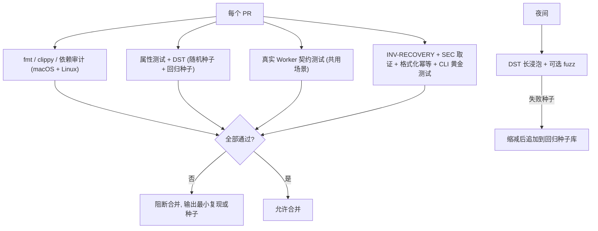

# 质量门禁与测试规范 (`eval-framework.md`)

> 2026-11-24 修订：依据 [第一性原理审查 §9](../review/2026-11-24-first-principles-review.md) 的决策 D1–D7 更新。

> 本文档是 `my-note` **测试门禁的单一事实来源**。评测与自动爬山不是本项目的研究目标（D6），所以这里只保留**确定性、可在 CI 中零方差复现**的质量手段，用来守护两件不可逆的事：**G1 永不静默丢数**、**G4 安全承诺不被破坏**。所有手段都要在一个人的维护预算内可持续。线格式、同步协议、安全承诺、云端实现与 CLI 契约分别以 [data-structures.md](./data-structures.md)、[sync-protocol.md](./sync-protocol.md)、[threat-model.md](./threat-model.md)、[cloudflare-cloud-architecture.md](./cloudflare-cloud-architecture.md)、[interface-contracts.md](./interface-contracts.md) 为准，本文只定义「怎么测、测到什么程度算过」。

---

## 目录

1. [原则与门禁总览](#1-原则与门禁总览)
2. [同步核心：属性测试与确定性模拟（DST）](#2-同步核心属性测试与确定性模拟dst)
3. [真实 Worker 契约测试与 INV-GRACE](#3-真实-worker-契约测试与-inv-grace)
4. [INV-RECOVERY：零设备端到端恢复](#4-inv-recovery零设备端到端恢复)
5. [安全取证测试（SEC）与 INV-SHRED-BOUND](#5-安全取证测试sec与-inv-shred-bound)
6. [格式化幂等与 Heynote 导入差分](#6-格式化幂等与-heynote-导入差分)
7. [CLI 黄金测试](#7-cli-黄金测试)
8. [可选：线格式解析 fuzz](#8-可选线格式解析-fuzz)
9. [CI 编排、仓库布局与执行纪律](#9-ci-编排仓库布局与执行纪律)
10. [里程碑门禁矩阵（S0 → M3）](#10-里程碑门禁矩阵s0--m3)
11. [已移除 / 推迟的机制（2026-11-24）](#11-已移除--推迟的机制2026-11-24)

---

## 1. 原则与门禁总览

### 1.1 原则

1. **只用确定性门禁**：任何门禁都不依赖 LLM 评分、统计置信区间或重试取胜。失败即阻断，并且必须给出**最小复现输入**或 `u64` 种子。
2. **测线上代码，而不只是模型**：同步核心的 DST 证明的是 Rust 模型；服务端是 TypeScript Worker，所以必须用**同一套场景**再对真实 Worker 跑一遍（F-12，见 §3）。
3. **准出仍以「双桌面日常使用 4 周零丢数」为主**：测试让这件事更可信，但不能替代它（审查 §9.9）。
4. **诚实语义**：删除优先（D2′）意味着「宽限期内可找回、到期后在有界时延内不可恢复」。取证断言必须按这个语义写，不能写成「加锁后立即零残留」这类做不到的承诺。

### 1.2 方法来源

| 实践来源 | 吸收的机制 | 在 `my-note` 中的落点 |
| --- | --- | --- |
| **TigerBeetle VOPR / FoundationDB — 协议感知 DST** | 单 `u64` 种子驱动虚拟时钟与全内存故障网络，秒级跑完大量分区、乱序、崩溃与回滚组合 | `mynote-core::sim` 中的 `SimCluster`（§2.2） |
| **Anthropic — *Claude Code Verification Playbook*** | 属性测试（`proptest`）+ 差分测试 + 端到端测试三角互补；「改动不能修改自己的检查」；连续失败 3 次升级人工 | 属性测试（§2.1）、DST 与真实 Worker 差分（§3）、执行纪律（§9.3） |

### 1.3 门禁总览

| 门禁 | 守护目标 | 手段 | 进入门禁 |
| --- | --- | --- | --- |
| 合并逻辑属性测试 | G1 | `proptest`：任意顺序 / 重复 / 丢失重传 → 各端相同；重复应用幂等；密钥表 2P-Set 合并律 | M1 |
| 同步核心 DST | G1 | `SimCluster` + 故障算子；不变量 INV-SYNC-1/2/3/5、INV-KEY-LIVENESS | M1 |
| 真实 Worker 契约测试 | G1 / G4 | workerd / miniflare 中运行真实 Worker，与 DST 共用场景文件 | M1（INV-GRACE 随 M2） |
| INV-RECOVERY | G1 | 零设备 + 恢复包 → 恢复全部未删除数据 | M1 |
| SEC 取证 + INV-SHRED-BOUND | G4 | 金丝雀字节扫描桌面数据库 / WAL / FTS / 备份 / 镜像，以及手机 IndexedDB / Cache Storage | M1 部分，M2 全套 |
| 格式化幂等与导入差分 | G1 | `format(format(x)) = format(x)`；Heynote 导入逐块比对 | M1（Layer 2 随 M3） |
| CLI 黄金测试（约 10 个） | Agent 可用性 / G1 | 断言 `--json` 结构、退出码、错误码与数据库终态 | M1 |
| 线格式解析 fuzz | G1 / G4 | `cargo-fuzz`，可选、不阻断 | 可选 |
| 双平台 CI | 全部 | GitHub Actions macOS + Linux；`fmt`、`clippy`、依赖审计 | M1 |



---

## 2. 同步核心：属性测试与确定性模拟（DST）

同步协议本身（全量载荷 op、多叶子并列、手动合并、字段 LWW、Update-Wins、epoch 并集对账、密钥表 2P-Set）定义在 [sync-protocol.md](./sync-protocol.md)；本节只规定验证方式。路径 γ（D3）去掉了 `SPAN_PATCH`、GC、快照 CAS、HLC 拒收与 Lock-Wins 特例，状态空间因此小了很多，故障算子与不变量相应收缩。

### 2.1 属性测试（`proptest`）

对 `mynote-core` 的纯函数合并逻辑直接做属性测试，不经过网络模拟：

1. **收敛**：任意 op 集合以任意顺序、任意重复、任意丢失后重传的方式应用到多个副本，最终物化状态（叶子集、展示版本、字段 LWW 结果、块排序、回收站状态）字节级相同。
2. **幂等**：同一 op 重复应用任意次，状态不变。
3. **展示版本确定性**：同一块多个叶子时，展示版本恒为 `(hlc, op_id)` 最大者，与到达顺序和本地时钟无关；HLC 取任意值（含大幅偏差）时 op 都被接受，只影响展示顺序。
4. **手动合并**：`parents` = 全部当前叶子的 `UPDATE`（`RESOLVE` 为其别名）使叶子数收敛为 1；若期间有新的并发 op，则它保留为新叶子，不被吞掉。
5. **密钥表 2P-Set 合并律**：合并满足交换律、结合律、幂等律；合并结果 = 已创建密钥并集 − 已到期且未撤销的碎纸标记；**合并本身永远不移除密钥**，只有到期的碎纸标记才会。
6. **加锁渲染**：任一叶子为加锁版本时，整块按加锁渲染，并带「存在未加锁的并发版本」标记。

### 2.2 `SimCluster` DST

在 `mynote-core::sim` 中实现零系统时钟、零真实 I/O、完全由单 `SimSeed(u64)` 调度的虚拟集群（若干桌面 + 模型服务端；M2 起加入只读手机）。

**故障算子库**：

- **网络**：分区（含非对称分区）、乱序、重复投递、丢包后重传、WebSocket 唤醒通知丢失、HTTP `502` 与 Access `302` 伪 `200 HTML` 拦截页。
- **客户端**：写本地 SQLite 后、push 前崩溃重启；离线并发编辑同一块（产生多叶子）；并发 `UPDATE` 与 `DELETE`；`LOCK`（换钥）与明文 `UPDATE` 交错；手动合并与新的并发编辑交错；并发 `SET_META`（字段 LWW）；任意时钟偏差。
- **密钥表**：op 与其密钥记录分别、以任意先后到达；换钥流程在「新 op 已写 / 新密钥已写 / 服务端已确认 / 碎纸标记已发」之间任一步崩溃或断网。
- **云端**：PITR 回滚到 `seq − K` 并更换 `journal_epoch`；切换到全新空 DO；（M2）碎纸标记的创建、撤销、到期 alarm 与离线编辑交错，批量阈值触发暂停。

**每步 / 终态检查的不变量**：

- **`INV-SYNC-1`（强最终收敛）**：恢复全连通并完成一轮 push / pull 后，所有未吊销桌面的 Buffer 序列、块排序 `(position, id)`、每块的**叶子集与展示版本**、字段 LWW 结果、加锁渲染状态、回收站状态，以及合并后的密钥表，全部字节级一致。
- **`INV-SYNC-2`（零字符静默蒸发）**：测试生成器为每个已在本地提交的 `CREATE` / `UPDATE` 分配唯一指纹 `tag_i`。在任意时刻，只要该版本没有被因果后继显式覆写，`tag_i` 必须能从某个当前叶子（或回收站中的块）读到。唯一允许的「不可读」路径是：用户显式 `DELETE` 或换钥 → 宽限期届满且未撤销 → 碎纸。并且：
  - 宽限期内出现对已删块的并发编辑 → 块复活、碎纸标记自动撤销，`tag_i` 可读；
  - 旧钥已碎纸后才上线的离线编辑 → 用新密钥重新加密上传，`tag_i` 可读。
  - 除此之外出现第三种消失路径即判失败。
- **`INV-SYNC-3`（跨 `epoch` 并集单调）**：注入 PITR 回滚或切换全新空 DO 时，客户端本地已有的 `op_id` 集合满足 $|S_{\text{after}}| \ge |S_{\text{before}}|$，对账完成后服务端恢复回滚窗口内全部已提交 op。
- **`INV-SYNC-5`（篡改即拒收）**：随机翻转 op 密文、信封或密钥记录的任意 1 比特，或调包 AEAD 绑定的字段（绑定集合以 [data-structures.md](./data-structures.md) 的 AAD 定义为准）→ 客户端返回 `INTEGRITY_ERROR`、不应用该 op、不产生空块覆盖，其余 op 照常同步。
- **`INV-SYNC-6`（已放宽，非门禁）**：Workers Paid 下行写配额不再是设计约束（D4）。DST 只记录每 op 的 DO 行写数并写入测试报告；超过 10 行 / op [目标] 时 CI 告警，但不阻断。
- **`INV-SYNC-7`（手机只读视图一致，M2）**：手机由「当前状态快照 + `covers_seq` 之后的尾部 op」得到的叶子集与字段 LWW 结果，与桌面基于完整历史的物化结果一致（已碎纸块除外）；快照按 `covers_seq` 单调接受；损坏的快照被拒绝并重新拉取，桌面状态不受任何影响。
- **`INV-KEY-LIVENESS`（密钥活性）**：
  - 没有进入碎纸流程（不存在已到期且未撤销的碎纸标记）的块，其所有叶子引用的 `key_id` 在每台桌面和 DO 上都存在且可解包；
  - 引用了尚未到达的 `key_id` 的 op 被保留并等待密钥，绝不按空内容物化；
  - 换钥时，旧钥的碎纸标记只能在服务端确认新 op 与新密钥记录之后发出——在任一步注入崩溃，都不得出现「旧钥将被碎纸而新版本未上云」；
  - 注入密钥缺失或损坏时，每日自检必须告警，并禁止该设备继续发起碎纸。

**种子沉淀**：夜间浸泡发现的失败种子经 `proptest` 缩减后，永久追加到 [`evals/seeds/regression_seeds.txt`](../evals/seeds/regression_seeds.txt)，此后每次提交必跑。

---

## 3. 真实 Worker 契约测试与 INV-GRACE

**问题**（F-12）：DST 里的服务端是 Rust 模型，线上服务端是 TypeScript Worker。两份实现意味着 DST 只证明了模型。

**做法**：服务端保持极薄（职责清单以 [cloudflare-cloud-architecture.md](./cloudflare-cloud-architecture.md) 为准），并让 DST 与契约测试**共用同一套场景文件**：

1. 场景文件描述：设备动作序列、可在 HTTP 层表达的故障（重复提交、断连重试、切换新 DO + 改 epoch）、虚拟时间推进，以及服务端可观察的预期结果。
2. 同一场景分别驱动：(a) `SimCluster` 的模型服务端；(b) workerd / miniflare（如 `@cloudflare/vitest-pool-workers`）中运行的**真实 Worker**。两边的可观察轨迹——响应体、分配的 `seq`、epoch、状态码、密钥表与碎纸标记内容——必须逐项相等（差分测试）。
3. 只能在内存中表达的故障（任意乱序投递等）只在 DST 中跑；PITR 在契约测试中用「换新 DO 实例 + 导入历史前缀 + 更换 epoch」近似。
4. Worker 的时间源在测试构建中可注入；alarm 用测试工具直接触发（如 `runDurableObjectAlarm`），不依赖真实等待。

**必须覆盖的服务端行为**：幂等追加（同一 `op_id` 重复 push 不重复分配 `seq`）、`seq` 分配与按 `seq` 分页、epoch 变更、设备令牌范围（`read` 令牌的 push 与碎纸请求一律 `403`）、WebSocket 唤醒只发通知不带 op、密钥表与碎纸标记存储及全量比对、每日 op 密文归档与密钥表快照写入 R2（miniflare 的 R2 模拟）、（M2）手机状态快照的 `covers_seq` 单调接受与「只保留最近 2 份」。

**一次性领取配对**（M1 契约测试）：暂存记录 10 分钟 TTL 到期删除；首次领取即删除，第二次领取返回 `404`；`read` 令牌发起配对 → `403`；领取接口无需令牌但只凭 128 位 `pair_id`。

**`INV-GRACE`（M2，与碎纸执行器同时进入门禁）**：

- 服务端拒绝任何 `not_before < now + T_grace_min` 的碎纸请求；
- 同一自然日内超过批量阈值 N 的碎纸请求，超出部分进入暂停态、不开始计时，直到桌面 UI 确认；
- 宽限期内被撤销的碎纸标记，到期时 alarm 不执行；
- alarm 只置空「已到期且未撤销」的密钥，并且重复触发幂等；
- `read` 令牌发起碎纸 → `403`；
- **密钥竞态校验**（与 DST 共用场景）：
  - 标记的 `seen_seq` 落后于该 `key_id` 下最新 op → `SHRED_STALE`，不落库；
  - 引用 `pending_confirm` / `scheduled` 密钥的新 op → `KEY_PENDING_SHRED`；同批先撤销再推送 → 接受（Update-Wins 复活）；
  - 引用已执行碎纸或不存在的 `key_id` → `KEY_SHREDDED` / `KEY_UNKNOWN`；
  - 任一校验失败整批回滚，不分配 `seq`；同批「新密钥记录 + 引用它的 op」被接受。

参数取值（`T_grace`、`T_grace_min`、N 等）以 [threat-model.md](./threat-model.md) 为准；测试按参数符号编写，并在默认取值下运行。

---

## 4. INV-RECOVERY：零设备端到端恢复

**断言**：从**零台设备**出发，只凭统一恢复包（24 词）+ R2 中的 op 密文归档 + 最新密钥表快照，执行 `mynote restore --from-archive`，能恢复全部**未删除**数据：块集合、每块叶子集、字段 LWW 结果与原集群字节级一致；回收站中、宽限期未满的块同样可恢复；已碎纸的块不可读（符合 D2′）。

**测试步骤**（全部在本地模拟环境中完成，R2 用 miniflare 模拟）：

1. 用 DST 场景生成一段包含多叶子、加锁、删除、换钥的历史，产出每日归档与密钥快照；
2. 删除全部设备的本地数据与 DO 状态；
3. 恢复包 → Root Seed → `recovery_sk` → 解封恢复密钥环（全部 SMK 代际与 VKEK）→ 读最新密钥快照 → 重放 op 归档；
4. 与第 1 步保存的期望状态逐块比对。

**变体**：密钥环轮换之后恢复（早于轮换的归档仍由旧 SMK 代际解开，旧代际永久保留）；最新密钥快照缺失时回退到上一份并如实报告缺口；本地 `VACUUM INTO` 备份恢复。恢复包与密钥环的格式以 [threat-model.md](./threat-model.md) 与 [data-structures.md](./data-structures.md) 为准。

---

## 5. 安全取证测试（SEC）与 INV-SHRED-BOUND

针对 [threat-model.md](./threat-model.md) 中的每条安全承诺建立白盒取证测试。金丝雀写法统一为：块中写入唯一 32 B 标记 `MYNOTE_CANARY_<hex>` 以及低熵、可压缩的重复串；扫描时对原始字节与 zstd 解压结果都做匹配。

| 测试编号 | 验证目标 | 手段 | 通过标准 | 门禁 |
| --- | --- | --- | --- | --- |
| **`SEC-01`** | 先写后锁 = 换钥 + 碎纸旧 Tier 1 密钥 | 写入含金丝雀的明文块，多次更新制造历史版本与 FTS 索引，再加锁（换到 VKEK 包裹的新 DEK）；推进虚拟时间越过宽限期 | **宽限期内**：可撤销，旧版本可读（预期行为）。**到期后**：本地数据库、`-wal`、`-shm`、FTS、本地备份、Markdown 镜像中金丝雀命中数为 `0`；旧 Tier 1 `key_id` 在所有桌面与 DO 中已置空。op 日志与 R2 归档中的密文按设计保留，但已无可用密钥解开 | M2 |
| **`INV-SHRED-BOUND`** | 碎纸到期后的有界不可恢复 | 对普通块执行 `DELETE` → 回收站 → 宽限期届满 → alarm 置空 → 各端执行本地删除（`PRAGMA secure_delete` + WAL checkpoint）；同时运行只读手机 | 本地数据库、WAL、FTS、本地备份、Markdown 镜像、手机 IndexedDB / Cache Storage 中均找不到该密钥与对应明文；解密历史 op 返回「密钥已碎纸」错误（错误码以 [interface-contracts.md](./interface-contracts.md) 为准）；下一份手机状态快照不含该块 | M2 |
| **`SEC-03`** | 常驻 Daemon 零 Tier 2 明文 | 在前端 / WASM 解锁并编辑加密块、触发格式化与保存，拦截全部本地 API 请求体与外部格式化子进程的 `execve` / `stdin` | Daemon 进程内存与 HTTP 载荷中零明文、零 VKEK；外部 CLI 格式化器被调用次数为 `0` | M2 |
| **`SEC-04`** | 填充往返无损 | `proptest` 遍历 `0 B` 至 `512 KiB` 随机长度（含全 `0x00`、全 `0x80` 边界）往返填充 / 去填充（填充规则以 [data-structures.md](./data-structures.md) 为准） | 精确还原原始字节，密文负载长度符合填充粒度 | M1 |
| **`SEC-05`** | 本地 Daemon 跨源与票据重放防御 | 构造 `Host: attacker.com`（DNS Rebinding）、缺失 / 伪造 `Origin` 的写请求与本地 WebSocket 握手、重放已消费的一次性票据 | 全部返回 `401` 或 `403`，零状态变更 | M1 |
| **`SEC-06`** | Markdown / `Pele` 零 XSS、零外带 | 输入 OWASP XSS 向量库、恶意外链图片、含伪造 `<foreignObject>` 与 `<script>` 的 Mermaid 文本，经渲染管线在无头浏览器 CSP 沙盒中加载 | 渲染 DOM 中 `<script>`、`<iframe>`、`<foreignObject>`、`on*` 属性数为 `0`；外部网络请求数为 `0` | M3 |
| **`SEC-08`** | 手机 PWA 不落盘秘密 | Playwright WebKit 中运行只读 PWA：浏览含加锁块的库、解锁 Vault、复制，然后切后台 / 闲置；导出 IndexedDB 与 Cache Storage 全部内容扫描 | IndexedDB / Cache Storage 中零 Tier 2 明文、零 VKEK；`visibilitychange` 与闲置超时后自动上锁，内存会话被清除 | M2 |

补充说明：

- 加锁块不进入 FTS 索引（「加密零召回」），由 `SEC-01` 的 FTS 扫描覆盖。
- iPhone 真机上的 Vault 解锁耗时（目标约 1–2 s [目标]）属于 M2 准出时的人工实测，不进 CI。
- 代码管不到的副本（OS 级备份、手动冷备、剪贴板、丢失后一直离线的手机缓存）不在取证范围内，口径见 [threat-model.md](./threat-model.md)。

---

## 6. 格式化幂等与 Heynote 导入差分

1. **Layer 1 内置格式化双定律**（`proptest` 随机语法树 + 真实开源片段语料）：
   - **幂等律**：对任意合法输入 $x \in \{\text{JSON, SQL, YAML, XML, Markdown}\}$，断言
     $$\text{format}(\text{format}(x)) = \text{format}(x)$$
   - **语义等价**：格式化前后分别送入独立解析器（如 `serde_json::Value`、`yaml-rust2`、`roxmltree`、`sqlparser-rs`），断言语义结构等价；对语法残缺的输入（如粘贴了一半的 JSON），断言返回 `FORMAT_SYNTAX_ERROR`（退出码 `7`），原块字节与 `head_op_id` 不变。
2. **Layer 2 外部 CLI 熔断故障注入**（随 M3 的 Layer 2 格式化进入门禁）：用假桩子进程模拟 5 种异常——① 非零退出码但 `stdout` 有半截输出；② 退出码 `0` 但 `stdout` 为 0 字节；③ 非法 UTF-8；④ 超过 `timeout_ms`；⑤ 尝试读取敏感环境变量。断言全部触发熔断并返回退出码 `7`，数据库零覆写。
3. **Heynote 导入差分**：
   - 黄金语料覆盖：文件首部没有 `∞∞∞` 前导块、代码中含字符串字面量 `"∞∞∞json"`、`\r\n` 与 UTF-8 BOM 混排、空块、未知语言标识回退，以及一个约 25 MiB、上百块的单文件；
   - 差分不变量：按 Heynote 分隔规则的参考解析器切出的块序列 $(l_i, c_i)$，与 `mynote import heynote` 落库后的块序列逐块比对，块数、语言映射与正文字符零差异。

---

## 7. CLI 黄金测试

用约 10 个脚本化场景替代原 Plane B「Agent 能否正确使用 CLI」的目标：Agent 能否用对 CLI，取决于输出结构、退出码和错误码是否稳定、可预期，而这些都能确定性地断言。

**形式**：每个场景（存放于 `evals/golden/`）= 一个在隔离目录中运行的 Shell 脚本（重定向 `HOME` / `XDG_*`，无外网）+ 一份规范化后的期望输出快照（ULID、时间戳等易变字段替换为占位符）。断言三件事：`--json` 输出结构与快照一致、退出码与错误码正确、数据库终态正确。命令名、`--json` 信封、退出码与错误码均以 [interface-contracts.md](./interface-contracts.md) 为准，契约变更时同步更新快照。

| 编号 | 场景 | 关键断言 |
| --- | --- | --- |
| `G01` | `add` 分别从参数和 `stdin` 写入 | 退出码 `0`；`--json` 信封结构正确并返回新 `block_id`；`op_id` 由 core 生成，调用方无需传入 |
| `G02` | `ls` / `search --json` | 列表与摘要结构正确；搜索结果不含加锁块正文 |
| `G03` | `get` 原文输出 | 输出与写入内容字节级相等 |
| `G04` | 用过期的 `--expected-head` 执行 `update` | 退出码 `4`（`HEAD_MISMATCH`），`details.actual_head` 正确，数据库不变 |
| `G05` | 非交互 `stdin` 为 0 字节时 `update` 非空块 | 退出码 `2`（`EMPTY_STDIN_REFUSED`），原块不变 |
| `G06` | 无 Daemon、无网络时 `add` | 退出码 `0`，`meta.sync_state = "pending_offline"`，恰好新增 1 个 op；抓包确认非显式联网命令零外发 DNS / TCP |
| `G07` | 断网时 `sync` | 退出码 `6`（`SYNC_OFFLINE`），`retryable = true` |
| `G08` | `delete` 后尝试从 CLI 清空回收站或缩短宽限期 | 块进入回收站且可撤销；清空 / 缩短操作被拒绝：无论是否 TTY 都返回 `UI_CONFIRMATION_REQUIRED`（退出码 `2`），回收站状态不变 |
| `G09` | 同一块存在两个叶子 | `get --json` 返回展示版本并列出其他叶子；提交 `parents` = 全部叶子的 `update` 后叶子数为 1 |
| `G10` | 非 TTY 访问加锁块 | 退出码 `5`（`BLOCK_LOCKED`），`stdout` / `stderr` 中零明文 |
| `G11` | `format` 过滤器输入残缺 JSON | 退出码 `7`（`FORMAT_SYNTAX_ERROR`），零副作用 |

此外两项廉价的静态检查一并进入黄金测试：`--help-json` 与 `clap` 命令树零漂移（无未文档化的参数）；`skill/SKILL.md` 的 token 数不超过 [interface-contracts.md](./interface-contracts.md) 规定的预算。

---

## 8. 可选：线格式解析 fuzz

用 `cargo-fuzz` 对以下解析入口做覆盖引导 fuzz：op 信封、密钥记录与碎纸标记、填充 / 去填充、手机状态快照、Heynote 文件解析。断言：不 panic、不越界、不无限循环，非法输入一律返回结构化错误。成本低但**不阻断合并**：只在夜间运行，发现的崩溃输入缩减后作为普通单元测试固化。

---

## 9. CI 编排、仓库布局与执行纪律

### 9.1 GitHub Actions 编排

- **平台矩阵**：`macos-latest`（aarch64）与 `ubuntu-latest` 同时运行；Worker 契约测试与 Playwright WebKit 测试至少在 Linux 上运行。
- **静态检查**：`cargo fmt --check`、`cargo clippy -- -D warnings`、Rust 与 npm 依赖审计（如 `cargo deny` / `cargo audit`）、TypeScript 类型检查。

| 层级 | 触发时机 | 耗时 | 内容 | 失败策略 |
| --- | --- | :---: | --- | --- |
| **本地** | `pre-commit` | < 10 s [目标] | 单元测试、回归种子集、黄金测试快照校验 | 阻断提交 |
| **PR** | 每个 PR | < 10 min [目标] | 静态检查；属性测试；DST（约 500 个随机种子 [目标] + 全部回归种子）；真实 Worker 契约测试；INV-RECOVERY；SEC 取证；格式化幂等与导入差分；CLI 黄金测试 | 任一失败阻断合并 |
| **夜间** | 定时 | 30–60 min [目标] | DST 长浸泡（约 100,000 个种子 [目标]）；可选 fuzz | 失败种子自动开 Issue 并缩减入库；里程碑准出前必须清零 |

### 9.2 仓库布局

```text
my-note/
├── crates/mynote-core/src/sim/   # SimCluster 与故障算子
├── tests/scenarios/              # DST 与真实 Worker 契约测试共用的场景文件
├── tests/fixtures/               # Heynote 脏语料、XSS / 注入向量
├── fuzz/                         # cargo-fuzz 目标（可选）
└── evals/
    ├── README.md                 # 目录说明
    ├── seeds/
    │   └── regression_seeds.txt  # DST 失败种子回归库（已退役机制的种子标 RETIRED，不再运行）
    ├── golden/                   # 约 10 个 CLI 黄金测试脚本与期望快照（§7，M1 创建）
    └── archive/                  # 已推迟的 Plane B 资产，不被任何门禁引用
        ├── climb-spec.toml
        ├── cases/                # 原 B 类用例
        └── schemas/              # 原 eval-case / scorecard Schema
```

`evals/archive/` 的归档说明见 [evals/README.md](../evals/README.md)；若 §11 的触发条件出现，再从这里取回。

### 9.3 执行纪律

1. **改动不能修改自己的检查**：放宽断言、删除测试、调高阈值或更新黄金快照，必须单独提交，并在提交信息中写明理由；不得与业务改动混在同一个提交里。
2. **失败必须可复现**：任何门禁失败都要给出最小复现命令或 `SimSeed(u64)`，禁止用重试、`sleep` 或扩大超时来凑绿。
3. **三次失败升级**：编码 Agent 在同一门禁上连续 3 次修改仍未通过时，停止第 4 次尝试，输出：最小复现、3 次尝试各自的根因假设与反证、判断属于「实现缺陷」「契约冲突」还是「测试本身有误」，交由人决定。

---

## 10. 里程碑门禁矩阵（S0 → M3）

路线图以 [architecture-proposal.md](./architecture-proposal.md) 为准（审查 §9.11）。

| 里程碑 | 必须绿灯的门禁 | 非 CI 的准出条件 |
| --- | --- | --- |
| **S0 技术 spike** | 无门禁；spike 代码不进主干。产出性能基线，用于把 §10.1 的 [目标] 改为 [已测] | — |
| **M1 替换 Heynote + iCloud** | 属性测试；DST（INV-SYNC-1/2/3/5、INV-KEY-LIVENESS）；真实 Worker 契约测试（push / pull / epoch / 令牌范围 / WS 唤醒 / 密钥表 / 归档）；INV-RECOVERY；`SEC-04`、`SEC-05`；Layer 1 格式化幂等与 Heynote 导入差分；CLI 黄金测试；双平台 CI | 热键唤出 < 100 ms [目标]（实测）；Mac 与 Omarchy 日常使用 4 周零丢数；Heynote 卸载 |
| **M2 手机只读 + Vault + 碎纸** | 新增：INV-GRACE；INV-SHRED-BOUND；`SEC-01`（换钥语义）；`SEC-03`；`SEC-08`（手机 IndexedDB / Cache Storage）；INV-SYNC-7；DST 加入碎纸 / 撤销 / 到期与离线编辑交错 | iPhone 真机 Vault 解锁约 1–2 s [目标]（实测）；手机自动上锁人工验证 |
| **M3 渲染与打磨** | 新增：`SEC-06`；Layer 2 外部格式化熔断 | — |

### 10.1 观测指标（不阻断）

以下数字在 S0 实测之前都只是 [目标]，CI 只记录趋势、不阻断合并；实测后可按需改为门禁：

| 指标 | 测量方法 | 值 |
| --- | --- | --- |
| 桌面单体二进制体积 | Linux `x86_64` / macOS `aarch64` release 构建（strip 后，含内嵌 Web UI） | < 15 MiB [目标] |
| WASM 与首屏包体积 | `mynote-wasm`（`wasm-opt -Oz` + gzip）与 `web/` 首屏 JS/CSS（gzip，不含懒加载的 `Pele` chunk） | WASM < 350 KiB [目标]；首屏 < 220 KiB [目标] |
| 无头 Daemon 常驻内存 | 导入 5,000 块后静置，采样 RSS | < 20 MiB [目标] |
| CLI 本地读写延迟 | 10,000 块 WAL 库上连跑 200 次 `add` 与 `ls --json` | P95 < 15 ms [目标] |
| DO 行写数 | DST 统计（INV-SYNC-6） | ≤ 10 行 / op [目标] |

---

## 11. 已移除 / 推迟的机制（2026-11-24）

依据 [第一性原理审查](../review/2026-11-24-first-principles-review.md)：

- **Plane B 统计评测（B1–B5 任务族、45/55/25 分集、`pass^3`、Bootstrap CI、McNemar、Detection Floor、Cohen's Kappa、跨模型家族评委、一页四数计分卡）**：推迟，评测不是研究目标，个人项目维护成本远高于收益；**触发条件：CLI 黄金测试都通过，但仍观察到 Agent 系统性用错 CLI**（§9.9、§9.11、F-13）。
- **自动爬山（`mynote-eval climb`、`evals/climb-spec.toml`）与任何以 LLM 评分为门禁的测试**：移出路线图（§9.9、§9.11）。
- **`INV-SYNC-4`（加锁块与 `kid` 同轮可见）**：删除，`MNK1` / `key_seq` 已由独立密钥表全量比对取代，「op 先到、密钥后到」改由 INV-KEY-LIVENESS 覆盖（§9.3、§9.7）。
- **`INV-SYNC-6` 的「每 op ≤ 2.5 行写 + 绑定参数上限」硬门禁**：放宽为观测指标，Workers Paid 下配额不再是约束（§9.5、D4）。
- **`INV-SYNC-5` 中「回退到第 K−1 代快照」**：删除，不再有 R2 多代快照（§9.5、§9.7）。
- **DST 中的 `SPAN_PATCH`、R2 快照 `CAS_MISMATCH`、DO 滑动窗口 GC 截断、「快照截断后慢设备追赶」算子**：删除，对应机制已移出（§9.4、§9.5、§9.7）。
- **HLC 漂移钳制 / 拒收相关断言、Lock-Wins 特例断言**：删除，HLC 只决定展示顺序，加锁版本是普通叶子（§9.4）。
- **`SEC-01` 中的 `purge_op_ids` 擦除与「DO `ops` 表零明文」断言**：改为「换钥 + 碎纸旧钥」语义，op 密文永不删除（§9.3）。
- **`SEC-02`（可变 `vault_keys` 的 `vault shred`）**：由 INV-SHRED-BOUND 与 INV-GRACE 取代（§9.3）。
- **`SEC-07`（`mynote update` 自升级验签 / 防降级 / 回滚）**：删除，分发交给包管理器（F-14）。
- **瞬态加密剪贴板（`ephemeral_clips`、`clip push --ephemeral`）相关测试**：删除，手机复制按钮取代（§9.2、D1）。
- **Passkey PRF 槽位测试**：推迟，WebAuthn PRF 仍未进入路线图（§9.10）。
- **Suite A4 FTS 检索评测集（100 组用例、`Recall@5` / `MRR@5` 阈值）**：推迟，不在 §9.9 门禁清单内；加锁块零召回由 `SEC-01` 覆盖；触发条件：日常使用中搜索漏召回成为明显痛点。
- **Suite A5 体积 / 内存 / 延迟硬红线**：降为 §10.1 的不阻断观测指标，S0 实测前这些数字都未经测量（F-16）。
- **「M1 硬准出 = 100,000 种子浸泡零失败」**：改为「每 PR 随机种子 + 全部回归种子零失败，且夜间浸泡无未关闭失败」（§9.9）。

---

## 参考文献

1. TigerBeetle Engineering, *Protocol-Aware Deterministic Simulation Testing (VOPR)*, 2024–2026.
2. Anthropic Engineering, [*How the Claude Code team thinks about verification*](https://claude.dev/blog/how-the-claude-code-team-thinks-about-verification/), Nov 2026.

以下文献支撑已推迟的 Plane B 与自动爬山，保留备查（触发条件见 §11）：

3. Lance Martin (Anthropic), [*Automating eval design and hillclimbing with Claude*](https://claude.dev/blog/automating-eval-design-and-hillclimbing/), Sep 2026.
4. Sergii Makarevych (`@sermakarevich`), [*Evals: how to know whether an AI system actually works (Level 0–8)*](https://x.com/sermakarevich/status/2106453816757354947), 2026.
5. Anthropic Research, [*Demystifying evals for AI agents*](https://www.anthropic.com/research/demystifying-evals-for-ai-agents), Jan 2026.
6. Andrej Karpathy, [`autoresearch` — Autonomous experimentation with immutable evaluation harnesses](https://github.com/karpathy/autoresearch), Mar 2026.
