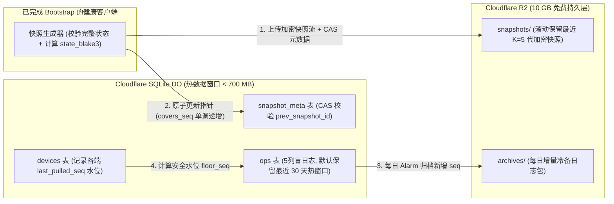
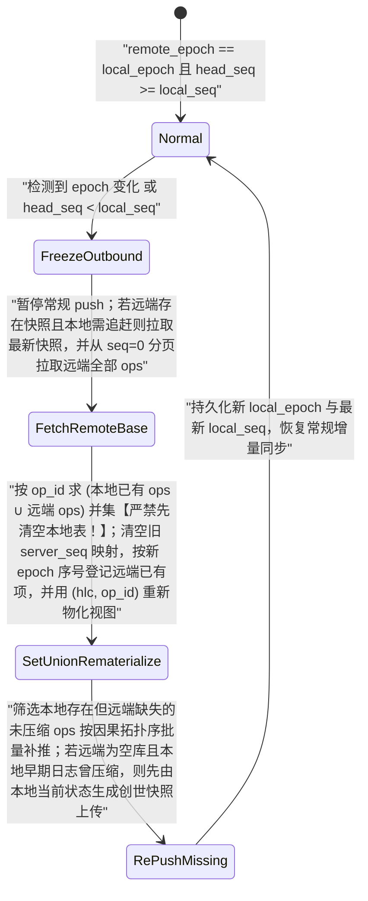

# 同步协议与确定性物化规范 (`sync-protocol.md`)

> 本文档是 [总架构设计方案 (`architecture-proposal.md`)](./architecture-proposal.md) 与 [Cloudflare 云端专项架构 (`cloudflare-cloud-architecture.md`)](./cloudflare-cloud-architecture.md) 的形式化同步协议子规范，旨在将「永不静默丢数（Anti-Wipe by Construction）」收敛为无歧义的线格式、因果合并规则、存储回收机制与确定性模拟测试契约。

---

## 目录

1. [核心不变量与 Sans-I/O 状态机边界](#1-核心不变量与-sans-io-状态机边界)
2. [操作日志线格式、盲信封与混合确定性载荷](#2-操作日志线格式盲信封与混合确定性载荷)
3. [防「空 UPDATE」与未引导态硬护栏](#3-防空-update与未引导态硬护栏)
4. [确定性冲突投影与字段级因果合并规则](#4-确定性冲突投影与字段级因果合并规则)
5. [R2 多世代快照、DO 活跃水位滑动窗口 GC 与配额精算](#5-r2-多世代快照do-活跃水位滑动窗口-gc-与配额精算)
6. [`epoch` 变更与 PITR 回滚后的并集对账状态机](#6-epoch-变更与-pitr-回滚后的并集对账状态机)
7. [CLI 与本地 Daemon 共享 WAL 协作协议](#7-cli-与本地-daemon-共享-wal-协作协议)
8. [确定性模拟与属性测试准出门槛（M1 Gate）](#8-确定性模拟与属性测试准出门槛m1-gate)

---

## 1. 核心不变量与 Sans-I/O 状态机边界

### 1.1 协议级五大防丢不变量

1. **只追加与显式因果前置**：对已有实体的变更必须显式声明因果父操作集合 `parent_op_ids`；不存在无因果前置的静默覆盖。
2. **引导前写隔离（Bootstrap Gate）**：当本地设备 `bootstrap_completed == false` 时，严禁对任何远端已有实体发出 `UPDATE / MOVE / LOCK / UNLOCK / DELETE / RESOLVE` 操作；未完成首次引导前用户在本地新建的草稿仅允许以全新 ULID 发出 `CREATE`。
3. **非明文态编译期写阻断**：处于「未水化」「解密失败」或「保险库锁定」内存态的块，在类型系统层面不具备构造正文 `UPDATE` 操作的入口。
4. **纯函数冲突物化**：多端离线并发编辑同一块正文时，主分支与冲突兄弟（Conflict Siblings）是操作集合的**纯函数确定性投影**，绝不自动派生新的冲突创建操作，避免多设备雪崩式重复建块。
5. **快照只做加速，GC 受水位与多代快照双重约束**：客户端生成的盲快照存入 R2 且保留多世代历史；Durable Object（DO）热日志仅在低于所有活跃设备已拉取水位且已被已验证快照与冷备覆盖后才执行滑动窗口回收。

### 1.2 `mynote-core` 的 Sans-I/O 纯同步状态机解耦

为同时服务桌面原生二进制与移动端浏览器 WASM，同时规避跨 `wasm-bindgen` 的异步 Trait 胶水复杂度与移动端重存储负担，`mynote-core` 采用 **Sans-I/O 纯同步状态机**设计：

```rust
pub fn step(
    state: &EngineSnapshot,
    event: SyncEvent,
) -> Result<(Vec<StoreMutation>, Vec<SyncCommand>), ProtocolError>;
```

- **桌面端（`mynote-store`）**：使用 `rusqlite`（`WAL` + `FTS5` + `secure_delete`），在单个本地 SQLite 事务内原子落盘 `Vec<StoreMutation>`。
- **移动端 PWA（`web/` + `mynote-wasm`）**：**不引入 `sqlite-wasm + OPFS`**（避免额外增加 ~400 KB gzip WASM 体积、Dedicated Worker 强制异步桥接开销以及 iOS Safari 下多标签页 OPFS `SyncAccessHandle` 独占锁冲突）。个人 Scratchpad 规模（通常数百至数千块、几 MB 数据）直接在浏览器端使用 **3 张极简 IndexedDB 对象表（`buffers`、`blocks`、`sync_ops`）** 持久化，内存检索耗时 `< 2 ms`。

---

## 2. 操作日志线格式、盲信封与混合确定性载荷

### 2.1 服务端盲存储表结构（元数据零知识收口）

冲突检测与物化全部在客户端完成，因此云端 DO SQLite 的 `ops` 表仅保留定序与幂等去重所必需的 **5 个最小列**，将 `entity_type`、`entity_id`、`op_type`、`parent_op_ids`、`hlc`、`actor` 全部封入端到端加密信封内，防止服务端观测「哪个块在何时被频繁编辑或加锁」：

```sql
CREATE TABLE IF NOT EXISTS ops (
    seq        INTEGER PRIMARY KEY,         -- 映射 SQLite 内置 rowid，不产生额外二级索引行写入
    op_id      TEXT NOT NULL UNIQUE,        -- ULID，幂等去重键（产生 1 行二级索引写入）
    device_id  TEXT NOT NULL,               -- 发送设备 ID
    created_at INTEGER NOT NULL,            -- 服务端接收毫秒时间戳（用于 30 天滑动窗口 GC）
    envelope   BLOB                         -- SMK 加密信封；事后加锁触发墓碑擦除时置为 NULL
);
```

> [!IMPORTANT]
> **严禁在 DO `ops` 表上添加多余二级索引**：Cloudflare DO SQLite 按「主表写入行 + 每个被更新二级索引行」计费。上述结构中 `seq` 复用 `rowid`，仅有 `UNIQUE(op_id)` 一个二级索引，确保每条操作严格只消耗 **2 rows written**；且单次批量推送（上限 500 条）必须在 `ctx.storage.transactionSync()` 内通过单行预编译语句循环插入，严格规避 DO SQL **单语句最多 100 个绑定参数**的硬限制。

### 2.2 Tier 1 同步盲信封结构（Envelope v1）

序列化为紧凑二进制（MessagePack / CBOR）后，先执行 **256 字节阶梯对齐填充（Bucket Padding）** 消除短密文长度侧信道，再以 `Sync Master Key (SMK)` 执行 `XChaCha20-Poly1305` 加密：

- **AEAD 算法**：`XChaCha20-Poly1305`（24 字节随机 Nonce + 16 字节认证 Tag）
- **关联认证数据（AAD）**：`"mynote-sync-v1" || smk_kid || op_id || device_id`（防止服务端跨操作或跨设备调包密文）
- **信封外层头（明文可见，置于 `envelope` 前缀）**：` envelope_version (u8 = 1) || smk_kid (16B) || nonce (24B) || aead_ciphertext `

解密并去除填充后的内部结构（`InnerOpV1`）：

```json
{
  "v": 1,
  "entity_type": "block",
  "entity_id": "01JXYZ...",
  "op_type": "UPDATE",
  "parent_op_ids": ["01JABC..."],
  "hlc": "2026-11-24T12:00:00.123Z-0001-devA",
  "actor": "human",
  "payload_encoding": "FULL_ZSTD",
  "payload": "<bytes>"
}
```

| `op_type` | 适用实体 | 作用语义 |
| --- | --- | --- |
| `CREATE` | `buffer` / `block` | 创建新 Buffer 或新块（`parent_op_ids` 为空数组 `[]`） |
| `UPDATE` | `buffer` / `block` | 更新 Buffer 名称/排序，或更新块正文（携带 `parent_op_ids: [expected_head]`） |
| `SET_META` | `block` | 独立更新块的标量元数据（`position`、`lang`、`buffer_id`、`public_hint`） |
| `LOCK` | `block` | 将块切换或创建为 Tier 2 Vault 加密态（载荷为 `{ kid, tier2_ciphertext }`） |
| `UNLOCK` | `block` | 用户显式解除块级保险库锁，恢复为 Tier 1 同步态明文块 |
| `RESOLVE` | `block` | 手动合并并发正文分叉（`parent_op_ids` 指向被收敛的多个并发叶子 `op_id`） |
| `DELETE` | `buffer` / `block` | 软删除墓碑（携带当前已知叶子 `parent_op_ids`） |

### 2.3 混合确定性载荷编码（`FULL_ZSTD` + `SPAN_PATCH`）与本地合并

为兼顾**单记录自包含抗损性**与**大块（如 300 KB JSON）高频编辑带宽成本**，明确拒绝模糊文本补丁（如无校验 `diff-match-patch`），采用以下三级策略：

1. **本地出站合并（Local Outbox Coalescing）**：
   - 普通打字防抖窗口（`400–500 ms`）及同一块尚未成功推送出站（`server_seq IS NULL`）期间的连续正文编辑，若中间未穿插冲突分叉或锁状态切换，直接在本地 Outbox 中合并为单条最新 `op`（继承最早未推送父指针 `parent_op_ids`）。
   - 粘贴（`paste`）、失焦（`blur`）与 `mynote clip push` 走 `0–100 ms` 快车道立即刷出。
2. **`FULL_ZSTD`（默认自包含路径）**：
   - **触发条件**：正文 `< 4 KB` 的所有块、**所有处于 `is_locked = 1` 的加密块**、`CREATE` / `RESOLVE` / `UNLOCK` 操作，以及大块每连续 **20 次** `SPAN_PATCH` 后的强制全量检查点。
   - **编码方式**：对完整UTF-8 正文（或 Tier 2 密文体）执行 `zstd` 压缩。任意单条 `FULL_ZSTD` 操作无需依赖历史增量链即可独立恢复全文。
3. **`SPAN_PATCH`（大块明文精确区间补丁路径）**：
   - **触发条件**：仅当块未加锁（`is_locked = 0`）、正文 `>= 4 KB` 且距离最近一次 `FULL_ZSTD` 祖先步数 `< 20` 时启用。
   - **编码结构**（整体经 `zstd` 压缩）：
     ```json
     {
       "base_op_id": "01JABC...",
       "base_blake3": "<32B>",
       "edits": [
         { "byte_start": 1204, "byte_end": 1250, "insert_utf8": "\"status\": \"ok\"" }
       ],
       "post_blake3": "<32B>"
     }
     ```
   - **硬校验准则**：应用端在 `base_op_id` 对应全文（必先验 `base_blake3`）上按字节偏移顺序执行替换，结果必须满足 `blake3(output) == post_blake3` 且为合法 UTF-8；一旦失配立即报错中止并保留原状态告警，**绝不静默拼出损坏文本**。

---

## 3. 防「空 UPDATE」与未引导态硬护栏

针对 Heynote + iCloud 最典型的「未水化/异常回退把空字符串当成新内容写回并覆盖全端」故障路径，实施四道防线：

1. **引导门禁（Bootstrap Gate）**：新安装或清空缓存的客户端初始 `bootstrap_completed = false`。在此状态下只能执行引导拉取（`snapshot` + `pull`）；在首次完整拉取至服务端 `head_seq` 之前，状态机拒绝生成任何指向远端已有实体的修改或删除操作。
2. **内存态强类型隔离**：
   ```rust
   pub enum BlockBodyState {
       Plaintext(String),
       Locked { kid: KeyId, public_hint: Option<String>, tier2_blob: Vec<u8> },
       DecryptFailed { op_id: OpId, reason: CryptoError },
       Unhydrated,
   }
   ```
   仅 `BlockBodyState::Plaintext` 可传入编辑器读写管线与 `UPDATE` 构造器；`DecryptFailed` 在 UI 中渲染为只读错误卡片并提供密钥诊断入口，绝不回退为空字符串 `""`。
3. **UI 挂载与手敲语义区分**：CodeMirror 6 实例仅在事务携带显式用户编辑事件（`input.*`、`delete.*`、`move.*`）时置位脏标记；切换 Buffer、异步水化与预览切换严禁触发保存。用户在编辑器内主动执行 `Cmd+A` + `Backspace` 属于合法显式交互，直接放行，不弹窗打断心流（误删可通过本地/云端 OpLog 秒级一键恢复）。
4. **外部管道与格式化器零字节熔断（高危自动化入口拦截）**：
   - **Layer 2 外部格式化器**（如 `jq`、`biome`、`gofmt`）：若原块非空而子进程 `stdout` 为 `0 bytes`、退出码非 `0` 或超时，无条件丢弃输出并报错；
   - **CLI 管道更新**：`mynote block update <id>` 从非 TTY `stdin` 读到 `0 bytes` 且目标块当前长度 `> 0` 时，默认拒绝写入并返回退出码 `2` 及 `hint: "Pass --allow-empty to intentionally clear block content, or use 'mynote block delete'"`。

---

## 4. 确定性冲突投影与字段级因果合并规则

### 4.1 混合逻辑时钟（HLC）漂移约束

每条操作携带 `hlc = (wall_ms, logical_counter, device_id)`。为防止某台设备系统时钟严重超前污染排序，客户端与服务端均实施 **最大前向漂移钳制（Max Forward Drift = 5 分钟）**：若收到的 `hlc.wall_ms > now_ms + 300_000`，拒绝接收或按本地规则钳制告警。

### 4.2 字段级因果拆分（消除假性全文冲突）

同一块的不同属性拆分为独立演进的合并通道，避免「设备 A 拖拽调整顺序，设备 B 同时修改正文」被误判为正文冲突：

| 字段域 | 关联操作类型 | 并发合并策略 | 胜出裁决键 |
| --- | --- | --- | --- |
| **标量寄存器域**（`position`、`lang`、`buffer_id`、`public_hint`） | `CREATE`、`SET_META` | 按字段独立 **LWW-Register** | `max(hlc, op_id)` 字典序 |
| **正文因果图域**（`content` / `tier2_ciphertext`） | `CREATE`、`UPDATE`、`LOCK`、`UNLOCK`、`RESOLVE` | 构建有向无环因果图（Causal DAG），保留全部未收敛极大元（Leaves） | 主分支取 `max(hlc, op_id)`，其余叶子按 `(hlc, op_id)` 降序投影为 Conflict Siblings |
| **删除生命周期域**（`deleted_at`） | `DELETE` vs 正文/元数据更新 | **Update-Wins（更新胜出自动复活）**：仅当 `DELETE.parent_op_ids` 因果支配当前全部正文叶子时块才处于软删除态；任何并发 `UPDATE`/`LOCK` 自动使块保持存活 | 因果偏序支配判定 |
| **加密单调域**（`is_locked`） | `LOCK` vs 并发明文 `UPDATE` | **Lock-Wins（安全单调优先）**：只要当前未合并叶子中存在任一 `LOCK` 分支，块主状态强制为 `is_locked = 1`；并发到达的明文 `UPDATE` 分支隔离为「待解锁合并冲突项」，绝不将已加锁主块降级回明文 | 安全格单调上界 |

### 4.3 为什么用内生 `(hlc, op_id)` 而非 `server_seq` 裁决主分支？

- `server_seq` 仅在单个 `journal_epoch` 内有效。一旦发生 DO 30 天 PITR 时间点回滚或通过逃生舱迁移至自建 VPS（产生新 `epoch`），离线补推的操作会获得全新的 `server_seq`，若依赖 `server_seq` 裁决会导致历史主块与冲突块发生翻转。
- `(hlc, op_id)` 在操作诞生瞬间即绑定在 AEAD 密文内，跨离线态、在线态与任意次 `epoch` 迁移均 **100% 不可变且全序唯一**。只要两台设备持有相同的操作集合，无需任何额外通信即可计算出比特级一致的主块与冲突兄弟列表。
- 当用户在 UI 或 CLI 中解决冲突时，发出一条 `RESOLVE` 操作（`parent_op_ids` 包含当前全部并发叶子 `[leaf_1, leaf_2, ...]`，载荷为 `FULL_ZSTD` 合并结果），使 DAG 极大元重新收敛为单一节点。

### 4.4 Fractional Indexing 并发防碰撞与重平衡

- **插入生成**：采用字典序分数索引（基数 Base62），在生成中点键后追加 **4 字符随机抖动后缀**，大幅降低两台离线设备在同一间隙插入块时产生相同 `position` 的概率。
- **全序平局决胜（Tie-breaker）**：所有列表查询统一执行 `ORDER BY position COLLATE BINARY ASC, id ASC`（块 `id` 为全局唯一 ULID），保证即便 `position` 完全相同，各端显示顺序依然严格一致。
- **超长重平衡**：当某块 `position` 长度超过 **64 字节**时，活跃客户端自动重算其前后相邻窗口（如 16 个块）的均匀分数键并批量发出 `SET_META(position)` 操作，通过 LWW 幂等收敛。

---

## 5. R2 多世代快照、DO 活跃水位滑动窗口 GC 与配额精算

### 5.1 快照加速与日志回收物理分离架构



1. **多世代 R2 快照（永不覆盖单点）**：
   - 快照二进制对象仅存储在 **Cloudflare R2**（不占用单 DO 1 GB SQLite 限额），保留最近 **`K = 5` 个历史世代**。
   - DO SQLite 仅维护 `snapshot_meta(snapshot_id PK, prev_snapshot_id, covers_seq, r2_key, byte_size, created_at)`。上传新快照时服务端强制原子校验：`prev_snapshot_id == current_head_snapshot_id` 且 `covers_seq > current_covers_seq`（无锁 CAS 解决多设备并发压缩竞争）。
   - 快照密文头内含 `{ version, covers_seq, buffer_count, block_count, rolling_op_hash, state_blake3 }`。新设备冷启动下载最新快照解密后必须验证 `state_blake3`；若校验失败，自动回退拉取上一世代快照（`K - 1`）并叠加增量日志。
2. **DO 活跃水位滑动窗口 GC**：
   - `devices` 表记录每台未吊销设备的 `last_pulled_seq` 与 `last_seen_at`（超过 30 天未连线的休眠备用机不阻塞水位推进，重连时自动走快照引导）。
   - 每日 DO Alarm 计算安全回收上限：
     $$\text{gc\_seq} = \min\big(\min_{d \in \text{ActiveDevices}} d.\text{last\_pulled\_seq},\; \text{snapshot}_{K-1}.\text{covers\_seq}\big)$$
   - 仅当某条日志同时满足 `seq <= gc_seq`、已写入 R2 `archives/` 冷备、且距离创建时间超过 **30 天**（或当 DO SQLite 已用空间达到 **700 MB 警戒线**时提前触发）才从 DO `ops` 表删除。
   - **长休眠设备无缝追赶**：若某台离线两个月的备用机请求 `pull?since=1200`，而当前 DO `min_retained_seq = 4500`，服务端返回 `{ ok: true, requires_snapshot_bootstrap: true, snapshot: latest_meta }`；客户端下载该快照后执行**本地并集重放（同第 6 节）**，既补齐远端最新状态，又不丢失该备用机离线期间本地新建的未推送操作。

### 5.2 修正后的存储与行读写配额精算

按 **1 名重度开发者、4 台设备、经本地防抖合并后日均上云 300–500 条同步操作（含偶发大块 `SPAN_PATCH` 与常规块 `FULL_ZSTD`，单条填充后均值 ~1.2 KB）、持续运行 3 年** 重新核算：

| 指标 | 真实核算值 | Cloudflare Workers Free 限额 | 安全裕度说明 |
| --- | --- | --- | --- |
| **DO SQLite 每日写入行数** | 500 ops × 2 rows/op（主表 `rowid` + `op_id` 唯一索引）+ 水位更新 ≈ **1,200 行/日** | **100,000 行/日** | 仅占免费限额 **1.2%** |
| **DO SQLite 常驻存储体积** | 30 天滑动窗口：15,000 ops × 1.2 KB ≈ **18 MB**（硬上限 700 MB 自动 GC） | **单 DO 1 GB**（Paid 10 GB） | 常态仅占 **< 2%**，彻底杜绝 `SQLITE_FULL` |
| **R2 快照与 3 年全量归档** | 5 代压缩快照（~15 MB）+ 3 年冷备日志流（~650 MB）+ 加密图片 ≈ **0.7–1.5 GB** | **10 GB 免费 + 0 出口流量费** | 仅占免费限额 **7%–15%** |

---

## 6. `epoch` 变更与 PITR 回滚后的并集对账状态机

当云端执行了 Cloudflare DO 30 天 PITR 回滚，或用户通过逃生舱切换到了全新的自托管同步服时，服务端 `journal_epoch` 改变（或出现 `server_head_seq < local_last_synced_seq`）。客户端必须进入以下确定性对账状态机：



**关键防丢红线**：对账本质是 **集合求并（Set Union by `op_id`）**，任何实现严禁在检测到新 `epoch` 时执行 `DELETE FROM blocks` / `DELETE FROM sync_ops` 清表重放——否则一旦误连上一台全新的空 Worker，本地全库笔记会被当场清空。

---

## 7. CLI 与本地 Daemon 共享 WAL 协作协议

桌面端采用 **「SQLite WAL 为唯一共享真相，Unix Domain Socket 仅做低延迟唤醒」** 的松耦合模型，确保无论后台 Daemon 是否存活，CLI 均可在 `< 5–15 ms` 内可靠完成：

1. **直接读写本地 SQLite WAL**：
   - 所有本地数据库连接初始化统一执行：
     ```sql
     PRAGMA journal_mode = WAL;
     PRAGMA synchronous = NORMAL;
     PRAGMA busy_timeout = 5000;
     PRAGMA foreign_keys = ON;
     PRAGMA secure_delete = ON;
     ```
   - 当用户或本地 Agent 运行 `mynote add` / `mynote ls` / `mynote block update` 时，CLI 直接在本地 SQLite 上开启短事务读写并写入 `sync_ops`（`server_seq = NULL`）。即使 `systemd` / `launchd` 守护进程未启动，CLI 依然 **100% 成功且零阻塞**。
2. **非阻塞唤醒与 `clip push` 直推兜底**：
   - 本地写事务提交后，CLI 以非阻塞方式向本地权限 `0600` 的 Unix Socket（Linux: `$XDG_RUNTIME_DIR/mynote/daemon.sock`；macOS: `~/Library/Application Support/mynote/run/daemon.sock`）发送轻量 `Poke` 帧，触发 Daemon 立即走快车道推送上云并向打开的 Web UI 广播刷新。
   - 若 Daemon 未运行：普通写命令直接返回成功（后台 Daemon 下次启动或定时轮询扫描 `WHERE server_seq IS NULL` 自动补推）；唯独 `mynote clip push`（跨端剪贴板）在检测到 Socket 未监听时，自动在当前 CLI 进程内直接执行一次 HTTP 推送，保证剪贴板即时上云。
3. **语义一致的退出码契约（消除离线假失败重试）**：
   - 本地落盘成功的常规写命令（`add`、`block update`、`buf`、`vault lock`）即使在断网或 Daemon 未运行时也**一律返回退出码 `0`**，通过 JSON 响应中的 `"meta": { "sync_state": "pending_offline" }` 如实告知同步状态，防止 Shell `set -e` 中断或诱导 Agent 误判失败反复重试造成重复块。
   - **退出码 `6`（`SYNC_OFFLINE`）** 仅在用户或脚本显式要求阻塞等待云端确认的联网命令（`mynote sync push`、`mynote sync pull`、`mynote clip push --wait-sync`）无法连通云端时返回。

---

## 8. 确定性模拟与属性测试准出门槛（M1 Gate）

「永不丢数」不能靠人工点测证明，必须在 `mynote-core` 中构建基于 **`proptest` + 确定性内存故障网络模拟器（`SimCluster`）** 的自动化验证套件，并作为 M1 里程碑合并的硬性 CI 门禁：

| 测试场景 | 随机注入的故障动作 | 强制通过的系统不变量断言（Invariants） |
| --- | --- | --- |
| **多端乱序与分区收敛** | 3–5 台虚拟设备随机断网、并发增删改移同一/不同块、网络包随机延迟/丢包/重复投递，最后恢复全连通 | **强最终一致性**：所有设备最终物化的 Buffer 列表、块顺序、`content` 与 `conflict_siblings` 集合 100% 比特级相等 |
| **零字符静默丢失** | 随机并发 `UPDATE` 与 `DELETE`、`LOCK` 与明文 `UPDATE`、大块连续 `SPAN_PATCH` 穿插离线分叉 | **因果全保留**：任意已本地提交的 `UPDATE` 正文，要么成为当前主块/已解决 `RESOLVE` 的因果祖先，要么完整出现在 `conflict_siblings` 中，绝无第三种消失路径 |
| **PITR 回滚与跨 `epoch` 存活** | 运行中途将模拟服务端随机回滚至历史序号 `seq - K` 并更换 `journal_epoch`，随后各设备陆续重连 | **回滚零丢数**：对账完成后服务端与所有客户端恢复全部回滚窗口内已提交操作，且主块与冲突分支排序不发生翻转 |
| **快照截断与慢设备追赶** | 触发多轮快照生成与 DO 滑动窗口 GC 截断旧 `seq`，随后唤醒一台停留在极早游标的离线设备（且携带离线新笔记） | **无缝追赶**：慢设备通过 R2 快照 + 尾部增量 + 本地并集重放后，远端历史与本地离线新块全部完整保留 |
| **坏快照与篡改密文防御** | 故意损坏最新一代快照哈希、篡改 `SPAN_PATCH` 字节或调包 AEAD `op_id` | **显式拒绝不写脏**：客户端精准捕获校验错误并回退至 `K-1` 代健康快照或阻断应用，绝不产生空块覆盖 |
