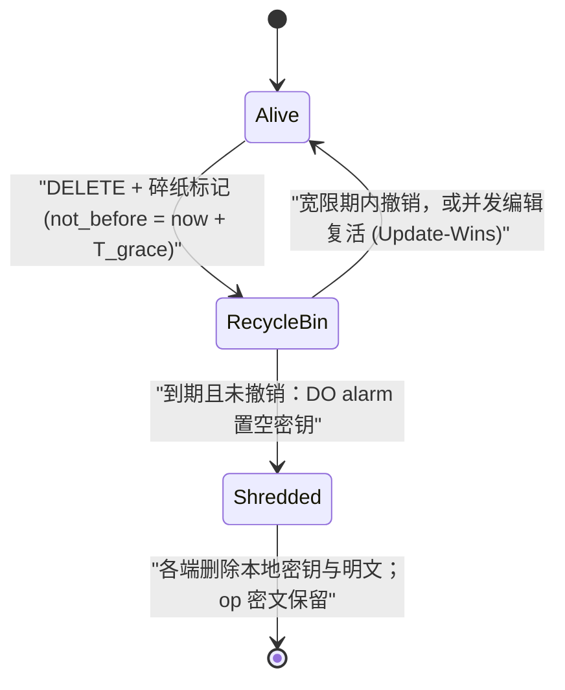
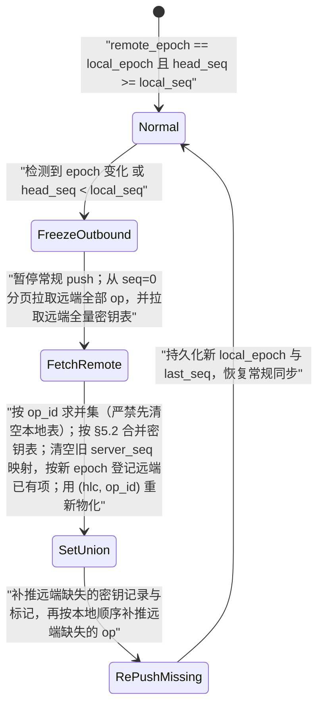

# 同步协议与确定性物化规范 (`sync-protocol.md`)

> 2026-11-24 修订：依据 [第一性原理审查 §9](../review/2026-11-24-first-principles-review.md) 的决策 D1–D7 更新。

> 本文档是 [总架构设计方案 (`architecture-proposal.md`)](./architecture-proposal.md) 与 [Cloudflare 云端专项架构 (`cloudflare-cloud-architecture.md`)](./cloudflare-cloud-architecture.md) 的形式化同步协议子规范，并与 [数据结构规范 (`data-structures.md`)](./data-structures.md)、[全链路接口契约 (`interface-contracts.md`)](./interface-contracts.md) 配套执行，将「永不静默丢数（Anti-Wipe by Construction）」与「删除优先、有界时延」收敛为无歧义的因果合并规则、密钥表同步规则、删除 / 碎纸协议与确定性模拟测试契约。
>
> **单一事实来源分工**：本文只定义**协议语义**。线格式、AAD、表结构与 DTO 字段一律以 [`data-structures.md`](./data-structures.md) 为准；端点与 CLI 参数以 [`interface-contracts.md`](./interface-contracts.md) 为准；Worker / DO / R2 的实现细节以 [`cloudflare-cloud-architecture.md`](./cloudflare-cloud-architecture.md) 为准；安全承诺与「代码管不到的副本」以 [`threat-model.md`](./threat-model.md) 为准；测试门禁以 [`eval-framework.md`](./eval-framework.md) 为准。

---

## 目录

1. [核心不变量与 Sans-I/O 状态机边界](#1-核心不变量与-sans-io-状态机边界)
2. [操作日志、服务端定序与 push / pull](#2-操作日志服务端定序与-push--pull)
3. [防「空 UPDATE」与未引导态硬护栏](#3-防空-update与未引导态硬护栏)
4. [路径 γ：多叶子版本、展示规则与字段级合并](#4-路径-γ多叶子版本展示规则与字段级合并)
5. [密钥表、删除与加密碎纸协议](#5-密钥表删除与加密碎纸协议)
6. [`epoch` 变更与 PITR 回滚后的并集对账状态机](#6-epoch-变更与-pitr-回滚后的并集对账状态机)
7. [CLI 与本地 Daemon 共享 WAL 协作协议](#7-cli-与本地-daemon-共享-wal-协作协议)
8. [确定性模拟与属性测试准出门槛（M1 Gate）](#8-确定性模拟与属性测试准出门槛m1-gate)
9. [手机只读引导：状态快照 + 尾部 op](#9-手机只读引导状态快照--尾部-op)
10. [R2 归档、密钥快照与从归档恢复](#10-r2-归档密钥快照与从归档恢复)
11. [已移除 / 推迟的机制（2026-11-24）](#11-已移除--推迟的机制2026-11-24)

---

## 1. 核心不变量与 Sans-I/O 状态机边界

### 1.1 协议级防丢不变量

1. **只追加与显式因果前置**：对已有实体的变更必须显式声明因果父操作集合 `parent_op_ids`；不存在无因果前置的静默覆盖。
2. **引导前写隔离（Bootstrap Gate，仅桌面）**：当本地设备 `bootstrap_completed == false` 时，禁止对任何远端已有实体发出 `UPDATE / SET_META / LOCK / UNLOCK / DELETE / RESOLVE` 操作；未完成首次引导前用户在本地新建的草稿仅允许以全新 ULID 发出 `CREATE`。手机是只读客户端（D1），不存在写路径，因此不需要该门禁。
3. **非明文态编译期写阻断**：处于「未水化」「解密失败」或「保险库锁定」内存态的块，在类型系统层面不具备构造正文 `UPDATE` 操作的入口。
4. **纯函数版本投影**：同一块的「展示版本」与「另一台设备的版本」是**可读 op 集合的纯函数确定性投影**（§4.2）；系统从不自动派生合并或建块操作，合并只能由用户显式提交。
5. **密文永久，删除只作用于密钥**：DO、R2 op 归档与桌面本地 `sync_ops` 中的 op 密文**不删除、不置空**。让数据变得不可读的唯一路径是 §5 的加密碎纸，且必须经过服务端强制的最短宽限期。
6. **时钟不决定接受**：任何 op 都不会因为 HLC 被拒收；HLC 只决定展示顺序与字段 LWW 胜者（§4.1）。
7. **快照不参与因果判定**：手机状态快照（§9）只用于手机只读引导；桌面之间的同步与因果判定始终基于完整 op 集合。

### 1.2 `mynote-core` 的 Sans-I/O 纯同步状态机解耦

为同时服务桌面原生二进制与手机浏览器 WASM，并规避跨 `wasm-bindgen` 的异步 Trait 胶水复杂度，`mynote-core` 采用 **Sans-I/O 纯同步状态机**设计：

```rust
pub fn step(
    state: &EngineSnapshot,
    event: SyncEvent,
) -> Result<(Vec<StoreMutation>, Vec<SyncCommand>), ProtocolError>;
```

- **`EngineSnapshot` 的协议语义**（类型定义见 [`data-structures.md`](./data-structures.md)）：它是 `step()` 所需的全部输入状态，由以下部分组成，**不含任何会被截断的派生物**：
  - 本机已知的全部 op（可读与不可读的都在，附带各自在当前 `epoch` 内的 `server_seq` 映射或「未推送」标记）；
  - 密钥表本地副本：密钥记录、碎纸标记及其状态、本机已执行碎纸的 `key_id` 墓碑集合（§5.2）；
  - 同步游标：`journal_epoch`、`last_seq`、上次比对的密钥表摘要；
  - 本机 HLC 状态与 `bootstrap_completed` 标记。
- **桌面端（`mynote-store`）**：使用 `rusqlite`（`STRICT` 表 + `WAL` + `FTS5` + `secure_delete`），在单个本地 SQLite 事务内原子落盘 `Vec<StoreMutation>`（DDL 见 [`data-structures.md`](./data-structures.md)）。
- **手机 PWA（`web/` + `mynote-wasm`）**：只读缓存。IndexedDB 中只保存「最新状态快照 + 尾部 op + 密钥表」，**没有 outbox、没有本地写路径**；缓存被 iOS 驱逐的后果只是下次重新下载（结构见 [`data-structures.md`](./data-structures.md)，引导流程见 §9）。

### 1.3 历史保留与「截断」的唯一来源

- **桌面本地 `sync_ops` 永久保留全部 op**，DO 不做 GC（D4），因此桌面上的因果判定永远基于完整历史，不存在「基底缺失」问题（审查 F-02）。
- 历史中唯一会变得「不可读」的部分，是密钥已被碎纸的 op（§5）。协议对它们的处理只有一条规则：**叶子计算只基于可读 op**（§4.2）；不可读 op 的密文继续保留，但不参与展示、不参与叶子计算。
- 引用了不可读或尚未收到的父 op 的新 op 照常生效；叶子判定是集合运算（「没有被任何可读 op 列为父」），与 op 到达顺序无关，因此仍然收敛。

---

## 2. 操作日志、服务端定序与 push / pull

### 2.1 服务端可见信息与盲存储边界

冲突检测、物化与删除判定全部在客户端完成。服务端（DO）对每条 op 只持有定序、幂等与碎纸校验所必需的信息：

| 服务端可见 | 用途 |
| --- | --- |
| `seq` | 当前 `epoch` 内的单调序号，用于分页拉取 |
| `op_id` | 幂等去重键 |
| `device_id` | 来源设备、令牌范围校验 |
| `key_id` | 该 op 正文所用的数据密钥 ID（随机 ULID）；用于 §5.6 的「密钥已知 / 未碎纸 / 未退役」校验 |
| 接收时间、信封密文 | 归档与审计 |

- `entity_type`、`entity_id`、`op_type`、`parent_op_ids`、`hlc`、`actor` 与正文全部在密文内；密钥表中的 `block_id` 与 `tier` 同样封在加密的密钥记录内部，服务端只看到随机 `key_id`、包裹后的记录密文与创建时间。
- **诚实的元数据泄露**：服务端能看出「哪些 op 共用同一把密钥（≈ 同一块）」、碎纸请求与执行的时刻、密钥总数。该残余风险在 [`threat-model.md`](./threat-model.md) 中登记。
- **信封布局与 AAD 只在 [`data-structures.md`](./data-structures.md) 定义一次**：AAD 必须绑定 `block_id`、`op_id`、`key_id` 与格式版本；本文不复述。`op_id` 由 core 在加密前生成，本地 API / CLI 无需也不能传入（审查 F-01）。
- 服务端从不解密、改写或置空信封；op 表结构见 [`data-structures.md`](./data-structures.md)，DO 实现见 [`cloudflare-cloud-architecture.md`](./cloudflare-cloud-architecture.md)。

### 2.2 op 类型语义

| `op_type` | 适用实体 | 作用语义 |
| --- | --- | --- |
| `CREATE` | `buffer` / `block` | 创建新 Buffer 或新块（`parent_op_ids = []`）；新块同时创建其首把数据密钥（§5.1） |
| `UPDATE` | `buffer` / `block` | 写入该块的一个新的**完整**版本。`parent_op_ids` = 本机当前看到的**全部叶子**；只有一个叶子时就是普通编辑，有多个叶子时就是**手动合并**（§4.2） |
| `SET_META` | `block` | 独立更新块的标量元数据（`position`、`lang`、`buffer_id`、`public_hint`），按字段 LWW，不进入正文版本图 |
| `LOCK` | `block` | 一个普通版本，只是正文改用 **VKEK 包裹的新数据密钥**加密（即换钥到 Tier 2，§5.5） |
| `UNLOCK` | `block` | 一个普通版本，正文改用 **SMK 包裹的新数据密钥**加密（换钥回 Tier 1） |
| `RESOLVE` | `block` | **`UPDATE` 的别名**：解码器必须接受，语义与「`parent_op_ids` 含多个叶子的 `UPDATE`」完全相同；新实现应直接发 `UPDATE` |
| `DELETE` | `buffer` / `block` | 软删除墓碑，`parent_op_ids` = 当前全部叶子；块进入回收站，同时由客户端提交碎纸标记（§5.4） |

- 不新增 op 类型：「清除历史」「先写后锁」都由上表中的普通 op 加上密钥表操作表达（§5.5）。
- 删除 Buffer = 对其中每个块发 `DELETE`（各自走碎纸流程与批量阈值）+ 对 Buffer 本身发 `DELETE`。

### 2.3 全量载荷与本地出站合并

1. **只用全量载荷**：每条正文 op 都携带该版本的完整正文（经 `zstd` 压缩，再以该块数据密钥加密）。任何一条可读 op 都能独立还原它所代表的版本 [保证]（构造性：不存在增量链）。附件（blob）同样用所属块的数据密钥加密，随块一起进入碎纸范围。
2. **本地出站合并（Local Outbox Coalescing）**：
   - 普通打字防抖窗口 `400–500 ms` [目标]；同一块尚未推送出站（`server_seq IS NULL`）期间的连续正文编辑，若中间未穿插新叶子到达或换钥，直接在本地 Outbox 中合并为单条最新 op：继承最早未推送 op 的 `parent_op_ids`，由 core 重新生成 `op_id` 并重新加密（被合并掉的 op 从未发布，无需保留）。
   - 正文 `> 64 KB` 的大块，防抖放宽到 `3–5 s` 或仅在失焦时推送 [目标]；规模估算（300 KB 块压缩后约 30–60 KB / 次）见审查 F-09，仍远低于配额 [估算]。
   - 粘贴（`paste`）、失焦（`blur`）与 CLI 写命令走 `0–100 ms` 快车道立即刷出 [目标]。
3. 重新引入增量载荷的触发条件（单条 op 体积 p95 > 64 KB，或日上行 > 50 MB）见审查 §9.11；在此之前不存在任何依赖历史基底的载荷。

### 2.4 push / pull / seq 与 WebSocket 唤醒

端点与 JSON 字段以 [`interface-contracts.md`](./interface-contracts.md) 为准（`/v1/sync` 负责 push / pull，`/v1/keys*` 负责密钥表）；本节只规定语义。

- **令牌范围**：桌面持 `read-write` 令牌；手机持 `read` 令牌，服务端对其 push、密钥表写入（含碎纸、撤销、确认）与快照上传一律返回 `403`（D1）。
- **push**（仅 `read-write`）：
  - 单批上限 500 条 op，连同本批的密钥表变更在**同一事务**内原子提交；批内处理顺序固定为「新密钥记录 → 碎纸标记变更（新建 / 撤销 / 确认）→ op」。
  - 按 `op_id` 幂等：已存在的 `op_id` 直接返回其原有 `seq`，不重复写入。
  - 逐条执行 §5.6 的密钥校验；任一条失败则整批拒绝，并返回失败的 `op_id` 与原因，客户端修正后重试。
  - 响应：`epoch`、每条 op 的 `(op_id, seq)`、`head_seq`、服务端密钥表摘要。
- **pull**（`read` 与 `read-write`）：按 `since=<seq>` 分页返回 `seq` 升序的 op，附带 `epoch`、`head_seq` 与密钥表摘要。客户端只在本地事务提交后才推进 `last_seq`。
- **seq 的地位**：`seq` 只是当前 `epoch` 内的分页游标，**从不参与因果判定或展示排序**（§4.4）。
- **WebSocket 只唤醒**：DO 在 push 事务提交后向其他连接广播 `{type: "wake", epoch, head_seq}`，**不携带 op**；客户端收到后走 HTTP pull。WebSocket 断开时退化为定时轮询，正确性不依赖 WebSocket。
- **常规同步一轮**：pull 至 `head_seq` → 比对密钥表摘要，不一致则做全量比对（§5.3）→ 处理碎纸状态变化（§5.4、§5.7）→ push 本地未推送 op 与密钥表变更。

---

## 3. 防「空 UPDATE」与未引导态硬护栏

针对 Heynote + iCloud 最典型的「未水化 / 异常回退把空字符串当成新内容写回并覆盖全端」故障路径，桌面端实施四道防线（手机无写路径，不适用）：

1. **引导门禁（Bootstrap Gate）**：新安装或清空缓存的桌面初始 `bootstrap_completed = false`。在此状态下只能执行引导：从 `seq = 0` 全量 pull 至服务端 `head_seq`，并完成一次密钥表全量比对；在此之前，状态机拒绝生成任何指向远端已有实体的修改或删除操作。桌面不使用快照引导（快照只给手机，§9）。
2. **内存态强类型隔离**：
   ```rust
   pub enum BlockBodyState {
       Plaintext(String),
       Locked { kid: KeyId, public_hint: Option<String>, tier2_blob: Vec<u8> },
       DecryptFailed { op_id: OpId, reason: CryptoError },
       Unhydrated,
   }
   ```
   仅 `BlockBodyState::Plaintext` 可传入编辑器读写管线与 `UPDATE` 构造器；`DecryptFailed` 在 UI 中渲染为只读错误卡片并提供密钥诊断入口，不会回退为空字符串 `""`。
3. **UI 挂载与手敲语义区分**：CodeMirror 6 实例仅在事务携带显式用户编辑事件（`input.*`、`delete.*`、`move.*`）时置位脏标记；切换 Buffer、异步水化与预览切换不触发保存。用户在编辑器内主动执行 `Cmd+A` + `Backspace` 属于合法显式交互，直接放行，不弹窗打断心流（误删可从该块的版本历史中恢复）。
4. **外部管道与格式化器零字节熔断（高危自动化入口拦截）**：
   - **Layer 2 外部格式化器**（如 `jq`、`biome`、`gofmt`）：若原块非空而子进程 `stdout` 为 `0 bytes`、退出码非 `0` 或超时，无条件丢弃输出并报错；
   - **CLI 管道更新**：`mynote block update <id>` 从非 TTY `stdin` 读到 `0 bytes` 且目标块当前长度 `> 0` 时，默认拒绝写入并返回退出码 `2` 及 `hint: "Pass --allow-empty to intentionally clear block content, or use 'mynote block delete'"`。

---

## 4. 路径 γ：多叶子版本、展示规则与字段级合并

### 4.1 混合逻辑时钟（HLC）：只用于展示排序

- 每条操作携带 `hlc = (wall_ms, logical_counter, device_id)`（编码见 [`data-structures.md`](./data-structures.md)）。收到远端 op 时按标准 HLC 算法把远端时钟合并进本地时钟。
- **不做漂移钳制，也不拒收**：所有版本都会被保留，HLC 只决定「先展示哪个版本」和字段 LWW 的胜者。
- 本地检测到远端 `wall_ms` 超前本机时钟过多（阈值 5 分钟）时，只在 UI 中提示「某台设备时钟偏差过大」。后果至多是时钟快的设备在展示顺序与 `position` / `lang` / `buffer_id` 上「胜出」，不会丢失任何版本。

### 4.2 版本集合（叶子）与展示规则

对块 `b`，记 `R(b)` 为本机当前**可读**（密钥可用且未碎纸）且 `entity_id = b` 的正文 op 集合（`CREATE / UPDATE / RESOLVE / LOCK / UNLOCK / DELETE`；`SET_META` 不在其中）：

- **叶子集** `L(b)` = `R(b)` 中没有被 `R(b)` 内任何 op 列为父的 op。
- **存活叶子** = `L(b)` 中非 `DELETE` 的叶子。
- **块状态**：
  - 存活叶子为空、且 `L(b)` 非空 → 块在**回收站**（§5.4）；
  - `R(b)` 为空 → 块对本机不可见（尚未收到，或已碎纸）；
  - 否则块存活。
- **展示版本**（块存活且无加锁叶子时）= 存活叶子中 `(hlc, op_id)` 最大者；其余存活叶子按 `(hlc, op_id)` 降序标记为「另一台设备的版本」。该投影只依赖 op 集合，各端一致。
- **加锁渲染规则（取代 Lock-Wins 特例）**：只要存活叶子中有任一 Tier 2（加锁）版本，整块按加锁态渲染：
  - 展示版本 = 加锁叶子中 `(hlc, op_id)` 最大者；
  - 若同时存在 Tier 1 叶子，始终显示「存在未加锁的并发版本」提示；这些明文版本默认折叠，**在 Vault 解锁后**才展开，并引导用户合并；
  - 本地 API / CLI 同样按加锁态返回，不默认输出未加锁并发版本的明文（字段见 [`interface-contracts.md`](./interface-contracts.md)）；手机采用相同规则（§9）。
- **手动合并**：用户在 UI 或 CLI 中编辑出合并结果后，提交一条 `parent_op_ids` = **当前全部叶子**（含 `DELETE` 叶子）的 `UPDATE`；若希望合并结果保持加锁，则提交同样父集合的 `LOCK`。合并 op 沿用展示版本的 `key_id`，目标层级不同时按 §5.5 换钥。合并后若某把 Tier 1 密钥已不再被任何存活叶子使用（例如被合并掉的明文并发版本），UI 提供「碎纸该明文版本」选项（§5.5）。
- **不会凭空消失**：任意已提交的正文版本，要么是存活叶子，要么是某个存活叶子的因果祖先（可在历史中查看），要么因用户明确的删除 / 换钥意图在宽限期后被碎纸——不存在第四种路径。

### 4.3 字段级合并域

同一块的不同属性拆分为独立演进的合并通道，避免「设备 A 拖拽调整顺序，设备 B 同时修改正文」被误判为正文冲突：

| 字段域 | 关联操作类型 | 并发合并策略 | 裁决键 |
| --- | --- | --- | --- |
| **标量寄存器域**（`position`、`lang`、`buffer_id`、`public_hint`） | `CREATE`、`SET_META` | 按字段独立 **LWW-Register** | `max(hlc, op_id)` 字典序 |
| **正文版本域**（`content` / Tier 2 密文） | `CREATE`、`UPDATE`、`RESOLVE`、`LOCK`、`UNLOCK` | 保留全部存活叶子并列展示，由用户手动合并（§4.2） | 展示顺序取 `(hlc, op_id)`；接受与否与时钟无关 |
| **删除生命周期域**（回收站） | `DELETE` vs 正文更新 | **Update-Wins（更新胜出自动复活）**：只有当 `DELETE` 因果支配全部正文叶子（即全部叶子都是 `DELETE`）时块才在回收站；任何并发的正文版本都使块保持存活。与碎纸的交互见 §5.7 | 因果偏序支配判定 |

### 4.4 为什么用内生 `(hlc, op_id)` 而非 `server_seq` 决定展示顺序？

- `server_seq` 仅在单个 `journal_epoch` 内有效。一旦发生 DO PITR 回滚或迁移至自建同步服（产生新 `epoch`），离线补推的操作会获得全新的 `server_seq`，若依赖 `server_seq` 排序会导致展示版本翻转。
- `(hlc, op_id)` 在操作诞生时即封在 AEAD 密文内，跨离线态、在线态与 `epoch` 迁移不可变且全序唯一 [保证]。只要两台设备持有相同的可读 op 集合，无需额外通信即可算出一致的展示版本与「另一台设备的版本」列表。

### 4.5 分数索引并发防碰撞

- **插入生成**：采用字典序分数索引（基数 Base62），在生成中点键后追加 **4 字符随机抖动后缀**，降低两台离线设备在同一间隙插入块时产生相同 `position` 的概率。
- **全序平局决胜（Tie-breaker）**：所有列表查询统一执行 `ORDER BY position COLLATE BINARY ASC, id ASC`（块 `id` 为全局唯一 ULID），保证即便 `position` 完全相同，各端显示顺序依然一致。
- **不做重平衡**：允许索引键随插入变长；个人规模下极少触及长度问题，而并发重平衡经逐字段 LWW 交错合并会打乱顺序（审查 F-18）。

---

## 5. 密钥表、删除与加密碎纸协议

> 依据 D2′（审查 §9.3）：**可靠防的是非本意的丢失，删除实现的是本意的丢失**。协议用「明确意图 + 服务端强制的宽限期」区分两者，并把「数据耐久性」（密文永久多副本）与「数据可读性」（可删除的密钥）拆开。

### 5.1 每块一把数据密钥（BDEK）——M1 线格式，不可推迟

- 每个块创建时生成一把数据密钥 **BDEK**；该块的 op 正文与附件都用当前 BDEK 加密。op 只携带 `key_id`，**不携带密钥**。
- Tier 1 的 BDEK 由 SMK 包裹，Tier 2 的由 VKEK 包裹；包裹后的密钥存放在独立的密钥表 `block_keys` 中（字段见 [`data-structures.md`](./data-structures.md)）。
- 一个块在生命周期内可以有多把密钥（每次换钥产生一把，§5.5）；每把密钥只属于一个块。
- 这是**线格式决策，必须从 M1 第一天采用**：M1 期间写入的 op 会进入永久归档，若直接用 SMK 加密，日后除了废掉整个 SMK 就无法单独删除某一块。碎纸执行器可以在 M2 再做，密钥间接层不能推迟。
- **一个实体一把密钥**：Buffer 同样在创建时生成自己的 Tier 1 数据密钥，Buffer 名称用它加密（排序键不含用户内容，不单独加密）；删除 Buffer 时对该密钥走与块相同的碎纸流程（§5.4）。字段见 [`data-structures.md`](./data-structures.md) 的 `BufferMeta`。

### 5.2 密钥表 `block_keys` 与 2P-Set 合并规则

密钥表与 op 日志**分开存储、分开同步**。桌面与 DO 各存一份；手机只读一份（§9）。

- **密钥记录**：`{key_id, block_id, tier, wrapped_key, created_hlc}`，其中 `block_id`、`tier` 与密钥本身都在加密记录内部。记录**只创建、不修改密钥身份**：同一 `key_id` 永远对应同一把明文密钥。
  - 密钥环轮换时会「重新包裹」密钥表（§10.3）：同一 `key_id` 的记录可以出现更高包裹代际的版本，合并时取包裹代际最大者；明文密钥不变。
- **碎纸标记** `shred_marks`：`{mark_id, key_id, not_before, requested_by, state, confirmed_at}`，`state ∈ {pending_confirm, scheduled, cancelled, executed}`，只引用 `key_id`。
  - 状态只能单向推进：`pending_confirm → scheduled → executed`，或从 `pending_confirm` / `scheduled` 进入 `cancelled`；`cancelled` 与 `executed` 都是终态。要再次删除已撤销的块，必须新建一个标记。
  - `executed` 只能由服务端在到期时写入（§5.4），它是「何时到期」的唯一裁判，客户端时钟不参与。
- **合并** = 所有已创建密钥记录的并集 − 状态为 `executed` 的标记所引用的密钥（2P-Set）。标记按 `mark_id` 求并集，状态取单向序中最靠后的值。
  - 合并本身永远不会「弄丢」密钥；只有到期执行的碎纸标记才会移除密钥。
  - 桌面在本地永久保留「已执行碎纸的 `key_id`」墓碑集合（每条十几字节），一旦移除就不会被任何来源（旧备份、PITR 回滚后的服务端、其他设备）重新加回。

### 5.3 密钥表同步：全量比对

- 体量约为「块数 × 250 B」[估算]，因此不维护增量游标（原 `key_seq` 已删除）。
- 每轮同步比对双方的密钥表摘要；不一致时拉取服务端全量密钥表，与本地按 §5.2 合并，再把服务端缺失的密钥记录与标记变更推上去。
- 新密钥记录必须在使用它的 op 之前（或同一批内、排在前面）被服务端收下；服务端拒收引用未知 `key_id` 的 op（§5.6），从而保证「云端每条 op 都有对应的密钥记录」。

### 5.4 删除流程：回收站 → 宽限期 → 碎纸执行



1. **删除**：桌面发 `DELETE`（`parent_op_ids` = 全部叶子），块进入回收站；同一批内为该块当前使用中的每把密钥提交碎纸标记，`not_before = now + T_grace`。服务端按 §5.6 校验，超出批量阈值的标记进入 `pending_confirm`，不计时。
2. **宽限期**：所有设备都能看到「即将彻底删除」列表（含 `not_before`）。宽限期内任何一台桌面都可以撤销：把标记置为 `cancelled`，并发一条 `UPDATE`（`parent_op_ids = [该 DELETE]`，内容为删除前的展示版本，仍用原密钥加密）使块回到存活态。撤销是安全方向，不受 UI / CLI 渠道限制；标记已 `executed` 后再撤销，服务端返回 `409`。
3. **执行**：到达 `not_before` 且标记仍为 `scheduled` 时，DO alarm 将该密钥记录的 `wrapped_key` 置空，标记置为 `executed`；之后的每日密钥快照不再包含该密钥。
4. **各端跟进**（下一次同步看到 `executed` 时）：
   - **本地复核**：若本机发现该密钥仍被某个**存活叶子**使用（违反 INV-KEY-LIVENESS，说明前面的防护有漏洞），则**暂不删除本地密钥**，先用新密钥把该叶子重新加密为新版本上传（§5.7 的抢救路径），并告警；
   - 否则：先处理本机 outbox 中引用该密钥的未推送 op（§5.7），再删除本地密钥与物化明文（块行、版本行、FTS 行、只读 Markdown 镜像文件），在 `PRAGMA secure_delete = ON` 下执行 FTS 合并与 `wal_checkpoint(TRUNCATE)`，并把 `key_id` 记入墓碑集合；
   - 手机丢弃该块的缓存与密钥；下一份状态快照也不再包含该块（§9）。
5. **密文保留**：DO、R2 op 归档与各桌面 `sync_ops` 中该块的 op 密文原样保留，只是已经没有密钥能解开。

### 5.5 换钥原语：清除历史 / 先写后锁 / 解锁

换钥 = 生成新数据密钥 BDEK′ → 用它重新加密**当前版本**，写一条新的普通 op（`UPDATE`、`LOCK` 或 `UNLOCK`，`parent_op_ids` = 全部叶子，携带新 `key_id`）→ 对旧密钥提交碎纸标记。不新增 op 类型。

| 场景 | 新 op | 新密钥包裹方 | 旧密钥 |
| --- | --- | --- | --- |
| 清除历史 | `UPDATE` | 同层级（SMK 或 VKEK） | 碎纸，`not_before ≥ now + T_grace_min` |
| 先写后锁 | `LOCK` | VKEK（Tier 2） | 碎纸旧 Tier 1 密钥；UI 默认 `T_grace`，可缩短到 `T_grace_min` |
| 解锁 | `UNLOCK` | SMK（Tier 1） | 默认保留（锁定期历史仍可凭 Vault 查看）；用户可选择一并清除 |
| 合并后清理明文并发版本 | 合并 op 本身 | 不变 | 对不再被存活叶子使用的 Tier 1 密钥碎纸 |

- **顺序约束**：必须先确认服务端已收下新 op 与新密钥记录（push 已 ack），再提交旧密钥的碎纸标记；同一批内提交时，批内顺序（§2.4）天然满足该约束。
- 宽限期过后，该块在换钥之前的全部历史不可读，当前内容不受影响。

### 5.6 防误删、防 bug、防 Agent 滥用

服务端看不到内容，但看得到 `key_id`、标记与 op 的密钥引用，因此以下校验由**服务端强制**（INV-GRACE 以真实 Worker 契约测试验证）：

1. **最短宽限期**：以服务端接收时刻 `t_recv` 为准，拒绝 `not_before < t_recv + T_grace_min` 的新标记；对已有标记的缩短请求同样不得早于其 `t_recv + T_grace_min`。被注入的 Agent 或有 bug 的客户端都做不到「立即删除」。
2. **批量阈值**：任意滚动 24 小时内新建标记超过 `N` 个时，超出部分进入 `pending_confirm`，不计时；桌面确认后进入 `scheduled`，`not_before = max(原值, 确认时刻 + T_grace_min)`。
3. **视图新鲜度**：新建标记时客户端须声明其已拉取到的 `seen_seq`；若该 `key_id` 下存在 `seq > seen_seq` 的 op，服务端以 `SHRED_STALE` 拒绝该标记，客户端必须先 pull、重新评估再提交。这保证标记创建者在决定删除 / 换钥时已经看到了该密钥下的全部版本。
4. **退役密钥拒收新 op**：对已有 `pending_confirm` / `scheduled` 标记的 `key_id`，服务端以 `KEY_PENDING_SHRED` 拒收引用它的新 op，除非同一批内先撤销了该标记（复活路径，§5.7）。
5. **已碎纸 / 未知密钥拒收**：引用 `executed` 或服务端不认识的 `key_id` 的 op 一律拒收（`KEY_SHREDDED` / `KEY_UNKNOWN`）。同一 push 批次按「密钥记录 → 标记 → op」顺序校验并原子提交，因此同批新建的密钥可被同批 op 引用。
6. **令牌范围**：`read` 令牌不能发起、撤销或确认碎纸（`403`）。

以下策略由**本地 Daemon / core 强制**（服务端无法区分 UI 与 CLI，因此这些只防误用，不防已攻破本机的同 UID 攻击者；后者仍受上面 1–6 约束，所有待删项在宽限期内可见、可撤销，见 [`threat-model.md`](./threat-model.md)）：

7. **CLI（Agent 的入口）只能把块删进回收站**，使用默认 `T_grace`；缩短宽限期、清空回收站（把待删标记缩短到下限）、确认 `pending_confirm` 标记只能在 UI 中交互确认。
8. **每日自检**：每台桌面每天检查一次——每个存活块的每个存活叶子，其密钥在本地可解包、服务端记录存在且未被标记退役；任何一项失败即告警，并**禁止本设备继续发起碎纸**，直到问题消除（INV-KEY-LIVENESS）。

### 5.7 与离线编辑的交互（Update-Wins）

离线设备在不知情时编辑了一个已被删除或正在换钥的块，上线后按以下规则处理本机 outbox 中引用旧密钥 `K` 的未推送 op（这些 op 从未发布，可以原地用新密钥重新加密而保留 `op_id`）：

| 上线时 `K` 的状态 | 块状态 | 处理 | 结果 |
| --- | --- | --- | --- |
| 有 `pending_confirm` / `scheduled` 标记 | 在回收站（删除意图） | 同一批内**先撤销该标记**，再推送该 op | 块复活（Update-Wins），碎纸自动撤销 |
| 有 `pending_confirm` / `scheduled` 标记 | 存活（换钥意图：清除历史 / 先写后锁） | 生成同层级新密钥 `K″`，用它重新加密该 op 后推送；**不撤销**标记 | 该版本作为并发版本出现；若并发于 `LOCK`，按加锁渲染并提示「存在未加锁的并发版本」 |
| 已 `executed` | 任意 | 生成新的 Tier 1（或原层级）密钥，重新加密本地明文版本后推送 | 删除与离线编辑交错不丢数据；块以新版本复活 |

- 若 push 时恰好遇到 alarm 已执行（服务端以 `KEY_SHREDDED` / 退役原因拒收），客户端重新 pull 后按上表第三行重试。
- 先写后锁场景下，用户把明文并发版本合并进加锁版本后，按 §5.5 末行碎纸 `K″` 即可。
- 以上规则与 §5.6 第 3–5 条共同保证：**没有任何一个存活版本会在其密钥被碎纸时仍未被重新加密**，INV-KEY-LIVENESS 由 DST 与属性测试覆盖。

### 5.8 参数与可承诺的时间上界

| 参数 | 默认值 | 谁强制 | 说明 |
| --- | --- | --- | --- |
| `T_grace` | 7 天 | 本地 core（默认值） | 回收站保留期；UI 可调长，或在交互确认后缩短至 `T_grace_min` |
| `T_grace_min` | 24 小时 | 服务端 [保证] | 任何碎纸标记距服务端接收时刻的最短间隔 |
| `N`（批量阈值） | 20 块 / 滚动 24 小时 | 服务端 [保证] | 超出部分进入 `pending_confirm` |
| `T_snap` | 30 天 | R2 生命周期规则 + 本地备份轮换 | 密钥表快照、本地 `VACUUM INTO` 备份、旧 SMK 代际的保留期 |
| DO PITR | 30 天 | 平台固有 | 不可配置 |

- **彻底不可恢复的上界**：自碎纸标记开始计时（`scheduled`）起，≤ `T_grace + max(DO PITR 30 天, T_snap)`；按默认值约 **37 天** [保证]。前提：数据目录已排除出 Time Machine（`tmutil addexclusion`）与 Omarchy 文件系统快照；各桌面在此期间至少联网同步一次（长期离线的桌面在重新联网后立即执行 §5.4 第 4 步）。
- 代码管不到的副本（OS 级备份、手动冷备、剪贴板、丢失后一直离线的手机缓存）在 [`threat-model.md`](./threat-model.md) 中诚实告知。

### 5.9 里程碑分期

- **M1**：BDEK + `key_id` + `block_keys` 线格式；密钥表同步（§5.3）；`DELETE` 进回收站、可撤销；服务端拒收未知 `key_id`；每日自检；INV-KEY-LIVENESS。M1 期间回收站中的块不会被碎纸。
- **M2**：碎纸标记、服务端校验（§5.6 第 1–4 条）、DO alarm 执行器、换钥（清除历史 / 先写后锁）、INV-SHRED-BOUND 与 INV-GRACE。上线时对 M1 期间已在回收站中的块追溯创建标记（`not_before` = 上线时刻 + `T_grace`）。

---

## 6. `epoch` 变更与 PITR 回滚后的并集对账状态机

DO 每次 PITR 恢复或迁移到新的同步服后，运维流程必须轮换 `journal_epoch`（步骤见 [`cloudflare-cloud-architecture.md`](./cloudflare-cloud-architecture.md)）。客户端检测到 `epoch` 变化，或兜底检测到 `server_head_seq < local_last_seq` 时，进入以下对账流程。由于没有 GC、没有快照，对账简化为「**全量拉取 → 并集 → 补推远端缺失的 `op_id` 与密钥记录**」：



- **关键防丢红线**：对账本质是 **集合求并（Set Union by `op_id`）**，任何实现都不得在检测到新 `epoch` 时执行 `DELETE FROM blocks` / `DELETE FROM sync_ops` 清表重放——否则一旦误连上一台全新的空 Worker，本地全库笔记会被当场清空。
- **补推范围**：本地存在而远端缺失的全部 op；但密钥已碎纸（在本地墓碑集合中）的 op 不补推——它们已不可读，R2 op 归档中也保有其密文。
- **碎纸不被回滚复活**：PITR 可能让服务端重新出现已执行碎纸的密钥或丢失后来创建的标记。客户端的墓碑集合保证本地不会重新取回这些密钥；若回滚丢失了仍在宽限期内的标记，客户端按正常流程重新提交（受 `T_grace_min` 约束）。服务端侧的这段残留由 §5.8 上界中的「DO PITR 30 天」覆盖。
- 原规范中「远端为空库且本地日志曾压缩则先上传创世快照」的分支随 GC 一并删除。

---

## 7. CLI 与本地 Daemon 共享 WAL 协作协议

桌面端采用 **「SQLite WAL 为唯一共享真相、同一时刻只有一个写入方、Unix Domain Socket 仅做低延迟唤醒与写请求转交」** 的模型，确保无论 Daemon（或内嵌 Daemon 的 macOS Tauri 壳）是否运行，CLI 都能独立完成读写（D5）。接口细节以 [`interface-contracts.md`](./interface-contracts.md) 为准。

1. **单写入方**：
   - 所有本地数据库连接初始化统一执行：
     ```sql
     PRAGMA journal_mode = WAL;
     PRAGMA synchronous = NORMAL;
     PRAGMA busy_timeout = 5000;
     PRAGMA foreign_keys = ON;
     PRAGMA secure_delete = ON;
     ```
   - Daemon 运行时，CLI 的写命令经 Unix Socket 交给 Daemon 执行（由 Daemon 生成 `op_id` 与 HLC、加密并写入 `sync_ops`）；读命令直接读 WAL。
   - Daemon 未运行时，CLI 自己以短事务直接写入本地 SQLite（`server_seq = NULL`），此时它就是唯一写入方；SQLite 的写锁与 `busy_timeout` 作为并发启动时的兜底。目标耗时 `5–15 ms` [目标]。
2. **非阻塞唤醒**：
   - 写事务提交后，CLI 以非阻塞方式向权限 `0600` 的 Unix Socket（Linux: `$XDG_RUNTIME_DIR/mynote/daemon.sock`；macOS: `~/Library/Application Support/mynote/run/daemon.sock`）发送轻量 `Poke` 帧，触发 Daemon 走快车道推送上云并刷新已打开的 UI。
   - 若 Daemon 未运行：普通写命令直接返回成功，Daemon 下次启动或定时扫描 `WHERE server_seq IS NULL` 时补推；显式的 `mynote sync` 在检测到 Socket 未监听时，在当前 CLI 进程内直接执行一轮完整同步（§2.4）。
3. **语义一致的退出码契约（消除离线假失败重试）**：
   - 本地落盘成功的常规写命令（`add`、`block update`、`buf`、`vault lock`、删除进回收站）即使在断网或 Daemon 未运行时也**一律返回退出码 `0`**，通过 JSON 响应中的 `"meta": { "sync_state": "pending_offline" }` 如实告知同步状态，防止 Shell `set -e` 中断或诱导 Agent 误判失败反复重试造成重复块。
   - **退出码 `6`（`SYNC_OFFLINE`）** 仅在用户或脚本显式要求等待云端确认的联网命令（`mynote sync push`、`mynote sync pull`）无法连通云端时返回。

---

## 8. 确定性模拟与属性测试准出门槛（M1 Gate）

「永不丢数」不能靠人工点测证明。`mynote-core` 中基于 **`proptest` + 确定性内存故障网络模拟器（`SimCluster`）** 的场景，同时以**同一份场景文件**驱动针对 workerd / miniflare 中真实 Worker 的契约测试（审查 F-12）。门禁的完整定义、编号与执行节奏以 [`eval-framework.md`](./eval-framework.md) 为准；下表只列出本协议要求的场景与不变量：

| 测试场景 | 随机注入的故障动作 | 必须成立的不变量 |
| --- | --- | --- |
| **多端乱序与分区收敛** | 2–4 台虚拟桌面随机断网、并发增删改移同一 / 不同块；网络包随机延迟、丢失、重复投递；最后恢复全连通 | **收敛**：所有桌面物化出的 Buffer 列表、块顺序、展示版本与「另一台设备的版本」集合逐字节相等；重复应用任意 op 幂等 |
| **零字符静默丢失** | 随机并发 `UPDATE` 与 `DELETE`、`LOCK` 与明文 `UPDATE`、离线分叉后合并 | **版本全保留**：任意已本地提交的正文版本，要么是存活叶子，要么是存活叶子的因果祖先，要么属于用户明确删除 / 换钥且已过宽限期的密钥（§4.2） |
| **时钟偏差** | 某台设备时钟随机超前或落后数分钟到数小时 | 不拒收任何 op；仍满足收敛与版本全保留，只有展示顺序与字段 LWW 胜者受影响 |
| **PITR 回滚与跨 `epoch` 存活** | 中途将模拟服务端回滚至历史序号并更换 `journal_epoch`，随后各设备陆续重连 | **回滚零丢数**：对账后服务端与所有客户端恢复回滚窗口内已提交的全部 op 与密钥记录；展示版本不翻转；已执行的碎纸不在任何客户端复活 |
| **密钥表收敛与存活（INV-KEY-LIVENESS）** | 随机并发创建密钥、换钥、提交 / 撤销 / 确认碎纸标记、推进模拟时钟触发 alarm、穿插离线编辑 | 各副本密钥表收敛到同一 2P-Set；没有进入碎纸流程的存活叶子，其密钥在所有副本中始终可用；§5.7 三种路径均不丢版本 |
| **宽限期与批量阈值（INV-GRACE，真实 Worker）** | 提交 `not_before` 过短的标记、单日超过 `N` 个标记、`read` 令牌尝试碎纸、陈旧 `seen_seq`、向退役密钥推送 op、`executed` 后撤销 | 服务端按 §5.6 拒绝或暂停；撤销已执行标记返回 `409` |
| **手机状态快照一致性** | 随机时刻发布状态快照，随后叠加尾部 op（含乱序到达） | 「快照 + 尾部 op」得到的叶子集与展示版本，与桌面基于完整历史的投影一致（已碎纸块除外） |
| **篡改密文防御** | 篡改信封字节、调包 `op_id` / `key_id`（AAD 不匹配）、损坏状态快照 | **显式拒绝不写脏**：精确报告校验错误，不产生空块覆盖；坏快照只影响手机显示，重新拉取即可 |

INV-SHRED-BOUND（碎纸到期后本地数据库、WAL、FTS、本地备份、手机缓存中无该密钥与明文）属于 SEC 取证测试，INV-RECOVERY 属于端到端恢复测试，均见 [`eval-framework.md`](./eval-framework.md)。

---

## 9. 手机只读引导：状态快照 + 尾部 op

手机是只读客户端（D1）：不编辑、不追加、没有 outbox 与合并 UI，持 `read` 令牌。为避免手机下载全量历史（第 1 年末约 220 MB [估算]），由桌面发布一份加密的「当前状态快照」。

### 9.1 快照的发布（任一桌面）

- **时机**：每日一次，或距上一份快照的尾部 op 超过 `N_tail`（默认 1,000 条 [目标]）时；发布方必须已完成引导并已 pull 至 `head_seq`，`covers_seq` 取其当前游标。
- **内容**：`epoch`、`covers_seq`、每个存活块的**全部存活叶子版本**（正文仍用各自的 BDEK 加密，不重新加密明文）、字段 LWW 结果、Buffer 列表，以及各叶子的 `parent_op_ids`（供手机处理乱序到达）。**不包含**回收站中的块与已碎纸的块。字节布局见 [`data-structures.md`](./data-structures.md)。
- **存放**：经 Worker 上传到 R2 `snapshots/state/`，只保留最近 **2 份**；**没有 CAS**——多台桌面并发发布时两份都会存在，手机取 `covers_seq` 最大者。实现见 [`cloudflare-cloud-architecture.md`](./cloudflare-cloud-architecture.md)。
- 快照**不参与桌面的任何因果判定**；即使出错，后果也只是手机显示不对，重新拉取即可，不会污染任何数据。

### 9.2 手机的引导与增量

1. 拉取与当前 `epoch` 相同、`covers_seq` 最大的快照；只按 `covers_seq` **单调**接受（比本地已有的旧则忽略）。若没有与当前 `epoch` 匹配的快照，则退化为从 `seq = 0` 全量 pull，直到桌面发布新快照。
2. 从 DO 读取全量密钥表（不从快照读取），按需解包密钥；碎纸后的密钥从此读不到，对应内容自然不可解密。
3. pull `covers_seq` 之后的尾部 op，并通过 WebSocket `wake` 持续增量。应用尾部 op 的规则只有一条：
   - 正文 op：把它的父 op 全部从叶子集中移除，并记入「已被引用」集合；若它自己的 `op_id` 不在「已被引用」集合中，则加入叶子集（这一步使乱序到达也能收敛）；
   - `SET_META`：按字段 `(hlc, op_id)` LWW；
   - 展示、回收站判定与加锁渲染沿用 §4.2。
4. 看到某密钥 `executed`：删除该块的缓存与密钥。

### 9.3 手机上的 Vault 与复制

- 手机可解锁 Vault（D7）：口令 → Argon2id（WASM）→ VKEK → 解开密钥表中对应块的数据密钥；VKEK 只在内存中，不写 IndexedDB / Cache Storage，切到后台或闲置后自动上锁。解锁不需要写权限。KDF 参数与信任边界见 [`threat-model.md`](./threat-model.md)。
- 每个块提供「复制」按钮，取代原瞬态加密剪贴板。

---

## 10. R2 归档、密钥快照与从归档恢复

### 10.1 每日 op 密文归档（永久、只追加）

- DO 每日 alarm 把新增 `seq` 范围内的 op（原样密文，含 `op_id`、`key_id`、`device_id`）写入 R2 `archives/ops/`。
- 归档**只追加、永久保留**，客户端没有任何删除接口；里面只有密文，碎纸只作用于密钥，因此「永久归档」与「彻底删除」不再冲突（审查 F-06）。

### 10.2 每日密钥表快照（`T_snap` 生命周期）

- DO 每日把密钥表（未碎纸的密钥记录与标记）写入 R2 `archives/keys/`，由 R2 生命周期规则在 `T_snap = 30` 天后自动删除。
- 最新一份快照总包含全部活跃密钥，因此从归档恢复不受生命周期影响；已执行碎纸的密钥从下一份快照起不再出现。

### 10.3 密钥环轮换与旧 SMK 代际

- 统一恢复包（24 词）→ Root Seed → X25519 恢复密钥对。设备只保存**恢复公钥**：每次生成新的 SMK 代际或 VKEK 时，设备用恢复公钥把它封装进恢复密钥环 `RecoveryKeyringV1` / `VaultHeaderV1.sealed_vkek`，**不需要用户重新输入 24 词**（格式见 [`data-structures.md`](./data-structures.md)，威胁分析见 [`threat-model.md`](./threat-model.md)）。
- 轮换 = 追加新 SMK 代际 + 用新代际重新包裹密钥表（§5.2 的包裹代际）+ 把新代际封装进恢复密钥环。轮换后提示用户运行 `mynote recovery drill` 验证恢复包仍可解开最新密钥环；**不需要重新抄写 24 词**。
- 旧 SMK 代际**永久保留**在恢复密钥环中：op 归档永久保存，其中的 `MNS1` 信封仍由旧代际加密。退役的 VKEK 在重新包裹完成后再保留 `T_snap`，之后删除。

### 10.4 `mynote restore --from-archive`

从零设备恢复（INV-RECOVERY）的协议流程；命令参数见 [`interface-contracts.md`](./interface-contracts.md)：

1. 输入统一恢复包 → Root Seed → `recovery_sk` → 解封恢复密钥环（得到全部 SMK 代际与 VKEK）；
2. 读取 R2 最新的密钥表快照，按 §5.2 合并（若 DO 仍可用，再与 DO 当前密钥表合并，碎纸以较新者为准）；
3. 读取全部 op 归档（若 DO 仍可用，再补上 DO 中尚未归档的尾部 op），按 `op_id` 求并集；
4. 密钥可用的 op 正常物化；密钥缺失（已碎纸）的 op 视为已删除，密文保留但不展示；
5. 设置 `bootstrap_completed = true`，若连接的是空服务端或新 `epoch`，按 §6 补推。

保证：从零设备 + 恢复包，能恢复全部**未删除**数据。本地 `VACUUM INTO` 备份按 `T_snap` 轮换，只读 Markdown 镜像随删除同步删除文件（见 [`architecture-proposal.md`](./architecture-proposal.md)）。

---

## 11. 已移除 / 推迟的机制（2026-11-24）

依据 [第一性原理审查](../review/2026-11-24-first-principles-review.md) §9：

- **`SPAN_PATCH` 增量载荷 + 每 20 步全量检查点**：❌ 移出路线图；基底缺失会导致不收敛（F-02），全量载荷在个人规模下体积可接受（§9.4、§9.11）。
- **R2 K=5 多世代快照 + `snapshot_meta` CAS + 桌面快照引导 + `requires_snapshot_bootstrap`**：✂️ 改为只给手机读的状态快照，见本文 [§9](#9-手机只读引导状态快照--尾部-op)（§9.2、§9.7）。
- **DO 活跃水位滑动窗口 GC（`devices.last_pulled_seq` 水位、700 MB 警戒线、慢设备快照追赶）**：❌ Workers Paid 单 DO 10 GB，不做 GC（§9.5）。
- **HLC 最大前向漂移钳制 / 拒收**：❌ 服务端看不到 HLC，客户端拒收会导致分歧或停滞；只做本地提示（F-03、§9.4）。
- **Lock-Wins 特例**：❌ `LOCK` 是普通版本，改为加锁渲染规则（§9.4）。
- **`purge_op_ids` / 信封置 `NULL` 墓碑擦除**：❌ op 密文永不删除，删除只作用于密钥（F-04、§9.3）。
- **`vault_keys` + `MNK1` + `key_seq` + INV-SYNC-4**：❌ 由独立密钥表 `block_keys`（2P-Set、全量比对）取代（§9.3、§9.7）。
- **瞬态加密剪贴板（`ephemeral_clips`、`mynote clip push`）**：❌ 手机复制按钮取代，且与 PITR 冲突（F-06、§9.2）。
- **分数索引重平衡**：❌ 并发交错乱序，个人规模几乎触发不到（F-18、§9.4）。
- **对账中的「创世快照」分支**：❌ 无压缩、无 GC 后不再需要（§4 审计表「epoch 并集对账 ✂️」）。
- **手机 outbox、本地写路径、冲突合并 UI、手机侧 Bootstrap Gate**：❌ 手机只读（§9.2）。
- **INV-SYNC-6「每 op 恰好 2 行写入」与 DO 绑定参数等配额精算**：✂️ 放宽并移交 [`cloudflare-cloud-architecture.md`](./cloudflare-cloud-architecture.md)（§9.5）。
- **WebSocket 携带 op 的快车道**：⏸ 按数据触发（跨端粘贴 p95 > 1 s，§9.11）。
