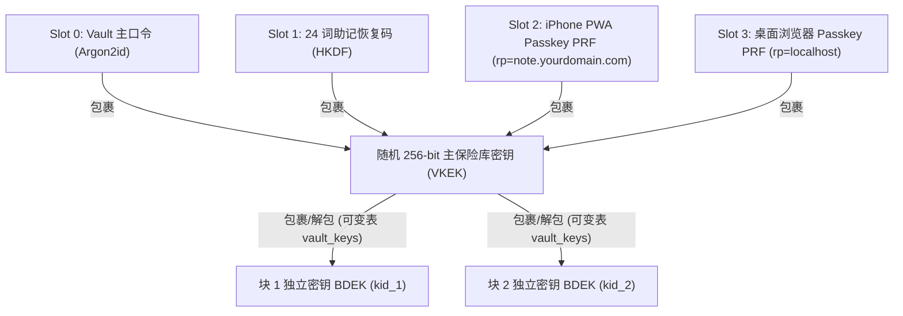

# 安全架构与威胁模型规范 (`threat-model.md`)

> 本文档是 [总架构设计方案 (`architecture-proposal.md`)](./architecture-proposal.md) 的安全与密码学专项规范，明确界定 `my-note` 在多端同步、块级保险库（Vault）、移动端浏览器 PWA、本地守护进程及同用户 AI Agent 交互场景下的**真实信任边界、密钥存放表、销毁语义与攻击面防护**，杜绝夸大或模糊的安全承诺。

---

## 目录

1. [安全目标、敌手画像与诚实信任矩阵](#1-安全目标敌手画像与诚实信任矩阵)
2. [分层密钥体系、跨端存储表与多槽位包裹（LUKS 模型）](#2-分层密钥体系跨端存储表与多槽位包裹luks-模型)
3. [可变密钥表、Crypto-Shredding 与瞬态加密剪贴板](#3-可变密钥表crypto-shredding-与瞬态加密剪贴板)
4. [「先写后锁」历史残留擦除协议与粘贴提示防线](#4-先写后锁历史残留擦除协议与粘贴提示防线)
5. [本地 Daemon 鉴权加固与同 UID Agent 隔离边界](#5-本地-daemon-鉴权加固与同-uid-agent-隔离边界)
6. [渲染层防 XSS / 防外带通道与严格 CSP 策略](#6-渲染层防-xss--防外带通道与严格-csp-策略)
7. [设备配对、吊销与密钥轮换预案](#7-设备配对吊销与密钥轮换预案)

---

## 1. 安全目标、敌手画像与诚实信任矩阵

任何端到端加密（E2EE）系统若不区分「被动存储泄露」与「主动代码分发篡改」，都会产生虚假安全感。下表列出本系统面对的 6 类现实威胁及其**精确防护保证与已知物理限制**：

| 敌手 / 威胁场景 | Tier 1 普通块保护能力 | Tier 2 保险库加密块保护能力 | 核心防御机制与诚实边界声明 |
| --- | --- | --- | --- |
| **T1：云端被动存储泄露**（DO SQLite 磁盘快照、R2 桶外泄、网络抓包） | **✅ 100% 零知识密文** | **✅ 双层加密零知识密文** | 出站前全量经 `SMK` 执行 `XChaCha20-Poly1305` + 256B 填充加密，业务元数据封入信封内；加密块内层再经独立 `BDEK` 加密。 |
| **T2：Cloudflare 账号被攻破（主动篡改 Worker 部署代码）** | **✅ 桌面端 100% 免疫**<br>**⚠️ 移动端 PWA 信任自有 CF 账号代码分发** | **✅ 桌面端 100% 免疫**<br>**⚠️ 移动端仅在被篡改期间输入口令/PRF 解锁时受影响** | **桌面端永不加载任何云端 JS/WASM**（只运行二进制内嵌 `rust-embed` 资源）。移动端 PWA 的静态资源由同一 CF Worker 下发——因此对 PWA 而言是**「对存储零知识，对代码分发信任你自己的 CF 账号」**。强制要求 CF 账号开启硬件 FIDO2 2FA 并仅用最小权限 Token 部署。 |
| **T3：浏览器中打开的外部恶意网页**（CSRF / DNS Rebinding / 跨源 WebSocket 探测 `127.0.0.1`） | **✅ 完全阻断** | **✅ 完全阻断** | 本地 Daemon 强制校验 `Host` 精确匹配、`Origin` 严格白名单，以及一次性交换签发的 `HttpOnly; SameSite=Strict` 256-bit 随机 Session Cookie（HTTP 与 WS 握手同等校验）。 |
| **T4：外部粘贴或模型生成的恶意 Markdown / Mermaid 内容**（Stored XSS / 外链图片信标泄密） | **✅ 完全阻断** | **✅ 完全阻断** | Markdown 禁原始 HTML + `DOMPurify` 白名单净化；Mermaid 默认使用零 DOM 依赖、纯 SVG 输出的 `Pele` 渲染器；全端启用锁死 `style-src` 与 `img-src` 的严格 CSP。 |
| **T5：被 Prompt Injection 劫持的本地同 UID AI Agent** | **⚠️ 可读取普通块**（符合设计预期，依赖乐观锁与审计回滚防破坏） | **✅ 密码学级硬隔离（即使 Web UI 正处于解锁态也无法窃取！）** | 同 UID 进程可读本地文件、可读 Daemon 凭据、可用 `script`/`expect` 伪造 PTY——因此 **`isatty` 与 `MYNOTE_ACTOR` 只是体验与审计护栏，绝非安全边界**。真正的硬隔离在于：**Tier 2 解密 100% 在当前交互客户端内存（Web UI WASM / 人类终端单次 CLI）执行，后台常驻 Daemon 永不持有 `VKEK` 与加密块明文**；Agent 不知道口令/PRF，面对本地 SQLite 与 Daemon 均只有密文。 |
| **T6：手机丢失或退役硬盘物理取证** | **✅ 吊销 Token + 轮换 `SMK` 保护后续笔记** | **✅ 静态密文 + 口令/PRF 未解锁不可读** | 丢失设备立即吊销 `device_token` 并轮换 `smk_kid`；底层 SSD 闪存磨损均衡层的物理块残留依赖操作系统全盘加密（macOS `FileVault` / Linux `LUKS`）。 |

---

## 2. 分层密钥体系、跨端存储表与多槽位包裹（LUKS 模型）

### 2.1 密码学原语基线（全端 Rust / WASM 统一实现）

- **口令密钥派生（KDF）**：`Argon2id`（桌面默认：`m = 64 MiB, t = 3, p = 1`；移动端 WASM 自适应下限不低于 `m = 32 MiB, t = 3, p = 1`，带 16 字节随机 Salt）
- **确定性子密钥扩展**：`HKDF-SHA256`
- **认证加密（AEAD）**：`XChaCha20-Poly1305`（256-bit 密钥、192-bit CSPRNG 随机 Nonce、128-bit Tag），Rust 侧全程包裹于 `zeroize::Zeroizing<[u8; 32]>`
- **内容与状态哈希**：`BLAKE3`

### 2.2 密钥角色与多端存放位置全表

| 密钥名称 | 用途 | macOS / Omarchy 桌面端存放位置 | 移动端 PWA 存放位置 | 本地常驻 Daemon 内存 | Cloudflare 云端 |
| --- | --- | --- | --- | --- | --- |
| **`SMK` (`smk_kid`)**<br>Sync Master Key | Tier 1 同步信封、R2 快照与加密附件的加解密 | OS Keychain（macOS） / Secret Service（Linux，如 GNOME Keyring / KeePassXC） | 由 IndexedDB 中 `extractable: false` 的 WebCrypto `AES-GCM` `CryptoKey` 包裹存储；运行时解包进 WASM 线性内存 | 持有（用于后台自动静默同步普通块） | **❌ 永不接触** |
| **`VKEK` (`vk_epoch`)**<br>Vault Key-Encrypting Key | 随机生成的 256-bit 主保险库密钥，用于包裹每个加密块的 `BDEK` | **不落盘明文**：仅以多槽位包裹密文存于 `vault_key_slots` 表；仅在 Web UI WASM 或单次 CLI 进程解锁期间驻留内存，5 分钟空闲/失焦即 `zeroize` | 同左（仅在用户触发口令或 Face ID WebAuthn PRF 解锁期间驻留页面 WASM 内存，切后台 `visibilitychange` 立即 `zeroize`） | **❌ 永不接触（零明文、零 VKEK）** | 仅同步被口令/恢复词包裹的密文槽位 |
| **`BDEK` (`kid`)**<br>Block Data Encryption Key | 每个加密块独立随机生成的 256-bit 内容加密密钥 | 由 `VKEK` 包裹后存于可变表 `vault_keys` | 同左 | 仅透传密文行 | 仅存包裹后密文行（支持真删除） |
| **`Device Token`** | 云端 Worker / DO 接入鉴权（每设备独立） | OS Keychain / `0600` 凭据文件 | IndexedDB（同包裹保护） | 持有 | 仅存 `SHA-256(token)` 哈希于 `devices` 表 |

> [!NOTE]
> **关于 PWA 中 WebCrypto `extractable: false` 包裹密钥的诚实边界说明**：
> 由于浏览器 WebCrypto API 原生不支持 `XChaCha20-Poly1305`，PWA 启动同步时必须调用 `crypto.subtle.decrypt()` 将 IndexedDB 中包裹的 `SMK` 还原为 `Uint8Array` 传入 `mynote-wasm`。这一机制能防止裸 `SMK` 明文直接躺在磁盘文件中（配合 `navigator.storage.persist()` 降低驱逐概率），但**不能防御同源 XSS 或恶意 Worker 代码更新**（同源脚本无需导出包裹密钥即可直接调用 `decrypt()` 获取 `SMK`）。因此防 XSS（第 6 节）与保护 CF 账号部署权（第 1 节 T2）才是 PWA 安全的真正根基。

### 2.3 `vault_key_slots` 多槽位包裹模型（解决多域名 / 多设备 WebAuthn PRF 问题）

WebAuthn `prf` 扩展输出的伪随机密钥严格绑定于 **RP ID（域名）与具体 Passkey 凭证 ID**——桌面本地 `localhost`、线上 PWA `note.yourdomain.com`、MacBook Touch ID 与 iPhone Face ID 派生出的对称密钥各不相同。

为此，系统借鉴 Linux LUKS 磁盘加密设计：初始化保险库时生成**随机 256-bit 主密钥 `VKEK`**，再通过 `vault_key_slots` 表允许多个解锁因子各自独立包裹同一把 `VKEK`：



- **注册新设备生物识别流程**：在新手机 PWA 或桌面浏览器上首次用 Vault 主口令解开 Slot 0 拿到内存态 `VKEK` 后，点击「启用本机生物识别解锁」触发一次带 `prf` 扩展的 WebAuthn 认证，用返回的 32 字节 PRF 输出经 `HKDF-SHA256` 派生槽位密钥包裹 `VKEK`，写入新增的 `webauthn_prf` 槽位。
- **平台兼容性标注**：iOS Safari 18+ 已完整支持**平台内置 Passkey（iCloud Keychain / Face ID / Touch ID）**的 WebAuthn PRF 扩展；但 iOS WebKit 目前仍不支持向**外接漫游硬件密钥（如 USB/NFC YubiKey）**透传 PRF 扩展——移动端硬件密钥用户自动回退使用 Vault 主口令解锁。

---

## 3. 可变密钥表、Crypto-Shredding 与瞬态加密剪贴板

### 3.1 修正「不可变日志内嵌 `wrapped_dek`」的结构矛盾

若将 `wrapped_dek` 直接放进不可变追加日志 `sync_ops` 中，删除块后历史日志里依然留有 `wrapped_dek`，所谓「删除密钥实现加密碎纸（Crypto-Shredding）」便成了空话。修正后的物理分离设计如下：

1. **`sync_ops` 中绝不出现 `wrapped_dek`**：加密块的 `LOCK` / `UPDATE` 操作载荷仅包含 `{ "kid": "01JKEY...", "nonce": "<24B>", "tier2_ct": "<bytes>" }`（其中 `AAD = "mynote-vault-v1" || entity_id || op_id || kid`）。
2. **独立可变表 `vault_keys`**：
   - 本地与云端 DO 单独维护可变表 `vault_keys(kid TEXT PRIMARY KEY, vk_epoch INTEGER, wrapped_dek BLOB, updated_at INTEGER)`（云端外层同样经 `SMK` 认证加密保护）。
   - 当用户对某个加密块执行「永久销毁（Shred）」时，客户端与云端对 `vault_keys` 执行物理 `DELETE FROM vault_keys WHERE kid = ?`（仅保留短周期防乱序复活的空墓碑 ID，不含任何密钥字节）。一旦 `BDEK` 被物理删除，即便 `sync_ops` 或历史冷备中仍留有 `tier2_ct`，没有 `BDEK` 也无法解密。
3. **修改 Vault 口令 vs 轮换 `VKEK` 的精确语义**：
   - **常规改口令（便捷更换）**：更新 Slot 0 的包裹密文并删除不再信任的旧槽位。对于尚未泄露过旧口令的场景，无需重写业务块。
   - **怀疑旧口令已泄露（强制撤销）**：生成全新 `VKEK_v2`（`vk_epoch + 1`），用新口令包裹，同时将当前存活块的 `BDEK` 轮换重加密并清除旧密钥记录。
   - **诚实披露底层 PITR 窗口**：Cloudflare SQLite DO 原生开启的 30 天时间点恢复（PITR）属于底层存储块级快照，无法在不销毁整库的前提下单独扣掉昨天某一行的历史镜像。因此对于写入了常规笔记库的加密块，若敌手**同时**掌握了旧 Vault 口令**且**在 30 天内夺取了你的 Cloudflare 控制台权限回滚 DO，理论上仍可找回未满 30 天的旧 `vault_keys` 行。

### 3.2 一次性敏感内容中转：独立瞬态通道（不入主日志、不入冷备）

针对开发者最高频的敏感跨端动作——**把临时验证码、一次性 Token 或私钥从电脑传到手机（`mynote clip push --lock --ephemeral`）**——既然明知只需要存活几分钟，就绝不应让它进入持久化 30 天 PITR 的主日志与每日 R2 冷备：

- **独立瞬态端点**：Worker / DO 提供专用瞬态槽位接口 `PUT / GET / DELETE /v1/sync/ephemeral-clip`（默认 `ttl_sec = 300`，最长不超过 1 小时）。
- **阅后即焚与零归档**：密文仅保存在 DO 瞬态存储/内存中并挂载到期 `setAlarm()` 自动覆写清除，默认支持「目标端首次 `clip pull` 成功后立即销毁」，且 **DO 每日 R2 冷备任务严格跳过瞬态剪贴板数据**；客户端复制后默认开启 30 秒自动清空系统剪贴板。

---

## 4. 「先写后锁」历史残留擦除协议与粘贴提示防线

在真实工作流中，用户常先随手粘贴一段含密钥的配置（产生普通块 `CREATE/UPDATE`），几秒后才点击「锁定此块」。此时明文已接触本地 SQLite / FTS5 / WAL 并可能已用 Tier 1 `SMK` 推上云端。系统在执行事后 `LOCK` 时强制运行以下四步清理协议：

1. **本地 SQLite + FTS5 + WAL 同步截断清理**：
   - 数据库连接常驻开启 `PRAGMA secure_delete = ON`；
   - 在同一个本地写事务内：清空 `blocks.content`、写入 `ciphertext`、将该块此前在本地 `sync_ops` 中的明文载荷置空、从 `blocks_fts` 删除对应行，并执行 `INSERT INTO blocks_fts(blocks_fts) VALUES('merge')` 清理倒排段残留；
   - 事务提交后立即执行 **`PRAGMA wal_checkpoint(TRUNCATE)`**，强制将脏页刷回主库并将 `.db-wal` 文件截断归零，消除追加式 WAL 帧中的历史明文残留。
2. **云端活跃日志即时墓碑置空（`purge_op_ids[]`）**：
   - 客户端推送 `LOCK` 操作时，在同一请求体中附带该块此前所有历史操作的 `purge_op_ids: ["01J...", ...]`；
   - 云端 DO 在 `transactionSync` 内执行 `UPDATE ops SET envelope = NULL WHERE op_id IN (...)`——**既保留了 `seq` 与 `op_id` 空壳（不破坏单调游标与幂等表），又在 100 ms 内立即从云端活跃 SQLite 库抹除了仅受 `SMK` 保护的历史密文**，无需苦等下一次全库压缩。
3. **UI 诚实状态反馈**：事后加锁完成后，块状态提示「本地与云端活跃历史已擦除（若该内容此前已同步，云端底层 PITR 与历史冷备将在保留期满后自然淘汰）」。
4. **粘贴入口前置识别（非阻塞提示，零延迟损耗）**：
   - 前端编辑器与 CLI 在粘贴瞬间本地匹配常见高危凭据特征（如 `sk-...`、`ghp_...`、`github_pat_...`、`AKIA[0-9A-Z]{16}`、`xox[baprs]-...`、`-----BEGIN .* PRIVATE KEY-----`、高熵 Bearer/JWT 串）；
   - 命中时在块顶弹出非阻塞轻提示条 **「检测到疑似密钥 · 一键加密锁定（`Cmd/Ctrl+Shift+L`）」**，既不拖慢日常跨设备快刷速度，又引导用户在第一时间转为加密块。

---

## 5. 本地 Daemon 鉴权加固与同 UID Agent 隔离边界

### 5.1 防御浏览器跨源攻击与 DNS Rebinding（`127.0.0.1` 接口加固）

由于浏览器内的 `WebSocket` 握手不受 CORS 预检保护，且攻击者可通过 DNS Rebinding 将恶意域名解析至 `127.0.0.1` 读取 HTTP 响应，本地 `mynote daemon` 的 Web 服务必须执行三层硬校验：

1. **严格绑定环回地址与校验 `Host` 头**：仅绑定 `127.0.0.1:<port>`（不绑 `0.0.0.0`）；中间件首先检查 `Host` 请求头必须精确等于 `127.0.0.1:<port>` 或 `localhost:<port>`，任何外部域名（DNS Rebinding 特征）一律在解析路由前直接返回 `403 Forbidden`。
2. **`Origin` 白名单强制校验（含 WebSocket Upgrade）**：所有状态变更请求、API 读取与 `/v1/local/ws` 握手请求必须携带 `Origin` 头，且精确匹配 `http://127.0.0.1:<port>`（或 `http://localhost:<port>`）。
3. **一次性启动票据换取 `HttpOnly` 随机 Session Cookie**：
   - Daemon 每次启动在内存中生成 256-bit 随机 `daemon_session_secret`，并将短期引导凭证写入本地 `0600` 权限目录（`$XDG_RUNTIME_DIR/mynote/ui-bootstrap`）；
   - `mynote open` / `omarchy-launch-webapp` 通过一次性短效置换端点 `/v1/local/auth/exchange` 换取 `Set-Cookie: mynote_session=<token>; HttpOnly; SameSite=Strict; Path=/` 后立即重定向至干净根路径 `/`（避免长效 Token 残留在浏览器历史记录或命令行参数 `ps aux` 中）；
   - 所有 `/v1/local/*` HTTP API 与 WebSocket 握手均强制校验该 Cookie。

### 5.2 同用户 UID 下本地 AI Agent 的真实安全边界

必须坦诚面对操作系统权限模型的客观事实：**运行在当前用户同一 UID 下的本地 AI Agent（如具备无沙盒 Shell 权限的编程助手）在技术上能够直接读取 `~/.local/share/mynote/` 下的 SQLite 文件、读取本地守护进程引导文件，也能通过 `script` 或 `expect` 伪造伪终端（PTY）绕过 `isatty()` 检测，更可以随意伪造环境变量 `MYNOTE_ACTOR`**。

因此，本系统的设计严格区分**「协作体验护栏」**与**「密码学真实防线」**：

- **体验与审计护栏（防误操作与防浅层 Prompt Injection，不防刻意提权代码）**：
  - CLI 默认对 `is_locked = 1` 的块只返回 `{ id, is_locked: true, public_hint, redacted: true }`，不输出密文信封；
  - `mynote vault unlock` / `mynote block get --decrypt` 强制直接打开 `/dev/tty` 读取口令并检测交互环境；
  - `MYNOTE_ACTOR` 仅用于 UI 展示「此修改来自 `agent:claude-code`」及支持按来源一键批量回滚，绝不作为权限校验凭据。
- **真正的密码学硬防线（防彻底沦陷的同 UID 恶意脚本窃取敏感块）**：
  - **加密块静态全密文**：本地 SQLite `blocks` 表与 `sync_ops` 表中只有 `XChaCha20-Poly1305` 密文，FTS5 与只读镜像完全不含加密块正文；
  - **常驻 Daemon 零明文（关键设计！）**：Tier 2 Vault 的口令派生（`Argon2id`）、WebAuthn PRF 调用、`VKEK` 解包与正文加解密 **100% 在当前前端页面的 WASM 内存（或人类亲手敲口令的那一次短生命周期 CLI 进程内存）中完成**。后台常驻的 `mynote daemon` 从头到尾只搬运 `tier2_ct` 密文字节流。
  - **结果**：哪怕你此刻正在浏览器窗口中解锁查看某个加密块，同一秒后台被网页 Prompt Injection 劫持的 Agent 即使读穿了本地 SQLite 和 Daemon Cookie，它从 Daemon 拿到的依然只有无法解开的密文信封！（在 Linux 默认开启 Yama `ptrace_scope=1` 与 macOS SIP/Hardened Runtime 下，普通同 UID 进程亦无法跨进程 `ptrace` 注入读取浏览器渲染器内存。）

---

## 6. 渲染层防 XSS / 防外带通道与严格 CSP 策略

由于桌面 Web UI 与移动端 PWA 内存中持有同步密钥及按需解锁的保险库明文，任何一次 Stored XSS 都等同于全库沦陷：

1. **Markdown 渲染净化**：默认禁用原始内联 HTML 解析，生成的 HTML 片段在挂载 DOM 前强制经过 `DOMPurify` 严格白名单过滤（禁 `script`、`iframe`、`object`、`form`、所有 `on*` 事件属性与 `javascript:` / `data:text/html` 协议）。
2. **零 `<foreignObject>` 纯 SVG 图表渲染**：
   - 默认采用经审计的零运行时依赖纯 SVG 渲染引擎 **[Pele](https://github.com/obsidianmd/pele)**（MIT）：同步将 Mermaid 源码编译为只含标准几何与 `<text>` 元素的纯 SVG 字符串，使用 CSS 变量响应深浅色主题；
   - 不依赖浏览器 DOM 计算布局，不生成 `<foreignObject>` HTML 子树（既消除了 HTML 注入面，又彻底解决了 Safari 下含 `<foreignObject>` 的 SVG 绘制到 `<canvas>` 调用 `toBlob()` 时触发 Tainted Canvas 报错无法复制 PNG 的顽疾），输出仍再经 `DOMPurify` SVG Profile 二次白名单校验。
3. **全端强制 HTTP Content-Security-Policy（CSP）响应头**：
   ```http
   Content-Security-Policy:
     default-src 'none';
     script-src 'self' 'wasm-unsafe-eval';
     style-src 'self';
     img-src 'self' data: blob:;
     font-src 'self';
     connect-src 'self' https://<your-sync-domain> wss://<your-sync-domain>;
     frame-ancestors 'none';
     base-uri 'none';
     form-action 'none';
   ```
   - `img-src` 严禁自动请求任意外部 `https://` URL，彻底阻断恶意 Prompt Injection 在笔记中插入 `` 静默外带上下文或暴露客户端 IP；外链图片统一渲染为显式链接或需用户手动点击加载。

---

## 7. 设备配对、吊销与密钥轮换预案

### 7.1 新设备零服务器泄露配对流程（URL `#fragment` 二维码）

1. 用户在已初始化的主设备（如 Mac 或 Omarchy）终端运行：
   ```bash
   mynote device add --name "iPhone-17"
   ```
2. 主设备向云端 DO 调用管理接口注册新设备记录，获取服务端签发的独立随机 `device_token` 与有效期 **60 秒**的一次性配对票据 `pair_id`（服务端仅存 `SHA-256(device_token)`）。
3. 主设备在终端直接渲染二维码（或一次性链接）：
   `https://note.yourdomain.com/#pair=<base64url(pair_id || device_token || smk_kid || SMK)>`
4. **关键安全特性**：根据 RFC 3986 标准，浏览器在发起 HTTP 请求时**永远不会将 `#` 之后的 URL Fragment 发送给服务器或写入服务端访问日志**！手机扫码打开已安装的 PWA（或引导添加至主屏幕后粘贴配对码），前端在本地读取 `location.hash` 后立即执行 `history.replaceState(null, "", "/")` 抹除地址栏痕迹，用不可导出 WebCrypto 密钥包裹保存 `SMK` 与 `device_token`，全程 3 秒无感完成零知识配对。（无摄像头环境仍支持手动输入 24 词助记恢复词 + 预签发 `device_token` 接入。）

### 7.2 设备丢失吊销与 `SMK` 轮换（Forward Secrecy for Lost Device）

当手机或笔记本遗失时，仅吊销 HTTP `device_token` 只能阻止丢失设备继续拉取新数据或写入垃圾数据，无法抹除丢失设备离线缓存中已有的旧 `SMK`。完整应急预案分两级执行：

1. **第 1 步（秒级止血 —— 吊销接入令牌）**：
   在任一存留设备上运行 `mynote device revoke <device_id>`，云端 DO 立即标记该设备 `revoked_at` 并断开其活跃 WebSocket，阻断一切后续同步请求。
2. **第 2 步（前向隔离 —— 轮换 `SMK`）**：
   运行 `mynote sync rotate-smk` 生成新一代 `SMK_v2`（`smk_kid` 更新），通过安全渠道分发给剩余受信任设备。此后所有新笔记与新快照均由 `SMK_v2` 加密，即使攻击者提取了丢失设备的离线存储或拦截后续流量，也无法解密失窃时间点之后的任何新增内容。（若历史普通块中也含有需防范失窃设备离线读取的内容，可进一步更换云端同步密钥并重加密生成新 `epoch` 快照。）
