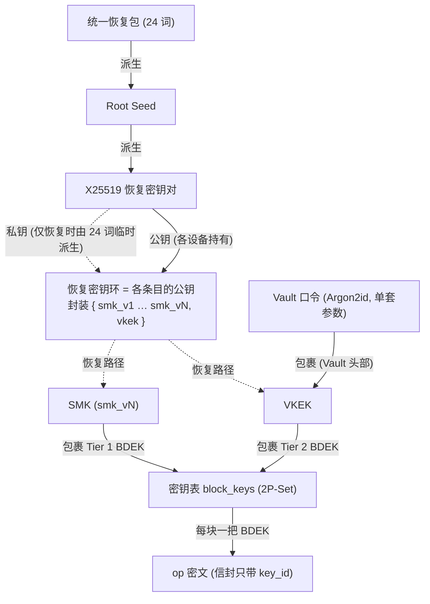

# 安全架构与威胁模型规范 (`threat-model.md`)

> 2026-11-28 修订：依据 [第一性原理审查 §9](../review/2026-11-24-first-principles-review.md) 的决策 D1–D10（含 2026-11-27 剪贴板同步拍板 D8 / D1′，以及 2026-11-28 Windows 一等桌面平台 D9 与 `wasmi` 优先双宿主插件体系 D10）更新。

> 本文档是 [总架构设计方案 (`architecture-proposal.md`)](./architecture-proposal.md) 的安全与密码学专项规范，也是本项目**安全承诺的单一事实来源**。它与 [数据结构规范 (`data-structures.md`)](./data-structures.md)、[同步协议 (`sync-protocol.md`)](./sync-protocol.md)、[全链路接口契约 (`interface-contracts.md`)](./interface-contracts.md) 配套执行，界定 `my-note` 在桌面多端同步、块级保险库（Vault）、只读手机 PWA、本地守护进程及同用户 AI Agent 交互场景下的**真实信任边界、密钥存放、删除语义与攻击面防护**。每条承诺都写明「防什么、不防什么」。
>
> **不在本文定义的内容**：信封字节布局、AAD、密钥表与 Vault 头部的字段结构只在 [`data-structures.md`](./data-structures.md) 定义；同步与碎纸的协议细节见 [`sync-protocol.md`](./sync-protocol.md)；服务端校验与 alarm 实现见 [`cloudflare-cloud-architecture.md`](./cloudflare-cloud-architecture.md)；测试门禁见 [`eval-framework.md`](./eval-framework.md)。

---

## 目录

1. [安全目标、敌手画像与诚实信任矩阵](#1-安全目标敌手画像与诚实信任矩阵)
2. [分层密钥体系、统一恢复包与跨端存放表](#2-分层密钥体系统一恢复包与跨端存放表)
3. [删除语义：回收站、宽限期与加密碎纸（删除优先的诚实承诺）](#3-删除语义回收站宽限期与加密碎纸删除优先的诚实承诺)
4. [「先写后锁」：换钥 + 碎纸旧密钥，与粘贴提示防线](#4-先写后锁换钥--碎纸旧密钥与粘贴提示防线)
5. [本地 Daemon 鉴权加固与同 UID Agent 隔离边界](#5-本地-daemon-鉴权加固与同-uid-agent-隔离边界)
6. [渲染层防 XSS / 防外带通道与严格 CSP 策略](#6-渲染层防-xss--防外带通道与严格-csp-策略)
7. [设备配对、令牌范围、吊销与密钥环轮换](#7-设备配对令牌范围吊销与密钥环轮换)
8. [手机端 Vault 解锁：仅内存会话、剪贴板与代码下发信任边界](#8-手机端-vault-解锁仅内存会话剪贴板与代码下发信任边界)
9. [独立 100 条图文剪贴板同步安全边界（D8，M4）](#9-独立-100-条图文剪贴板同步安全边界d8m4)
10. [Windows 一等平台与跨平台双宿主插件安全边界（D9 / D10，M5）](#10-windows-一等平台与跨平台双宿主插件安全边界d9--d10m5)
11. [已移除 / 推迟的机制（2026-11-24 / 2026-11-27 / 2026-11-28 修订）](#11-已移除--推迟的机制2026-11-24--2026-11-27--2026-11-28-修订)

---

## 1. 安全目标、敌手画像与诚实信任矩阵

任何端到端加密（E2EE）系统若不区分「被动存储泄露」与「主动代码篡改」、「读取」与「破坏」，都会产生虚假安全感。下表列出本系统面对的现实威胁及其**防护保证与已知限制**。「✅」表示在实现符合本规范、并通过 [`eval-framework.md`](./eval-framework.md) 对应门禁的前提下成立；「⚠️」表示部分防护或有明确前提。

| 敌手 / 威胁场景 | Tier 1 普通块 | Tier 2 保险库加密块 | 核心防御机制与诚实边界声明 |
| --- | --- | --- | --- |
| **T1：云端被动存储泄露**（DO SQLite 磁盘与 PITR、R2 归档 / 快照外泄、网络抓包） | **✅ 内容零知识**（元数据可见，见 §1.2） | **✅ 内容零知识** | 每个块的全部版本都由该块独立的数据密钥 **BDEK** 经 `XChaCha20-Poly1305` 加密并填充后出站；BDEK 本身只以被 `SMK`（Tier 1）或 `VKEK`（Tier 2）包裹的形式存入密钥表。信封与密钥记录格式见 [`data-structures.md`](./data-structures.md)。 |
| **T2：Cloudflare 账户或部署流水线被攻破**（主动篡改 Worker 代码、PWA 静态资源，删除或扣留云端数据） | **✅ 桌面端机密性不受影响**<br>**⚠️ 手机端不防** | **✅ 桌面端机密性不受影响**<br>**⚠️ 手机端不防**（D7） | 桌面 UI 只加载本地 `mynote` 二进制内嵌的前端资源，**不执行云端下发的代码**。手机 PWA 的代码由 Cloudflare 下发：被篡改的 JS 可读取手机已持有的 `SMK`，并在你下一次输入 Vault 口令时截获它（§8.4）。可用性：攻击者可删除 DO 与 R2 中的数据，此时依赖各桌面的本地库与本地备份（§3.5）。缓解：CF 账户强 2FA（建议硬件 FIDO2）、只从 CI 用最小权限 Token 部署、Service Worker 固定版本并在 UI 显示版本号。 |
| **T3：浏览器中打开的外部恶意网页**（CSRF / DNS Rebinding / 跨源 WebSocket 探测本地端口） | **✅ 阻断** | **✅ 阻断** | 本地 Daemon 只接受统一入口 `http://localhost:<port>`：校验 `Host` 精确匹配、`Origin` 严格白名单，以及一次性票据换取的 `HttpOnly; SameSite=Strict` 256-bit 随机 Session Cookie（HTTP 与 WS 握手同等校验），见 §5.1。 |
| **T4：外部粘贴或模型生成的恶意 Markdown / Mermaid / 剪贴板图片内容**（Stored XSS / SVG 注入 / 外链图片信标泄密） | **✅ 阻断** | **✅ 阻断** | Markdown 禁原始 HTML + `DOMPurify` 白名单净化；Mermaid 默认使用纯 SVG 输出的 `Pele` 渲染器；全端启用锁死 `style-src` 与 `img-src` 的严格 CSP（§6）；M4 剪贴板图片严格限定位图白名单（`image/png`、`image/jpeg`、`image/webp`、`image/gif`），**严禁 `image/svg+xml` 走图片渲染**，预览使用 `Blob` + `URL.createObjectURL` 不放宽 CSP（§9）。 |
| **T5：被 Prompt Injection 劫持的本地同 UID AI Agent（读取）** | **⚠️ 可读取普通块**（符合设计预期） | **⚠️ 防被动读取；不防持久化篡改** | 同 UID 进程可读本地文件、可读 Daemon 凭据与 Secret Service 中的 `SMK`、可用 `script` / `expect` 伪造 PTY——因此 **`isatty` 与 `MYNOTE_ACTOR` 只是体验与审计护栏，不是安全边界**。Tier 2 保证的是「**某一时刻的被动读取**」拿不到明文：常驻 Daemon、本地 SQLite、WAL、FTS、备份与镜像中只有密文。**不防**能持久化篡改执行环境的攻击者（替换用户可写的二进制、shell alias、`formatters.toml`、浏览器 profile / 扩展），它可以等你下一次输入口令。缓解：二进制由包管理器安装到用户不可写的位置；Agent 跑在沙箱 / 容器 / 独立 UID 下（§5.2）。 |
| **T6：手机 / 笔记本丢失，或退役硬盘被物理取证** | **⚠️ 设备缓存中未碎纸的内容可被读取**；后续内容靠吊销 + 密钥环轮换保护 | **✅ 静态密文；`VKEK` 不落盘**（⚠️ Vault 头部可被离线暴力破解口令） | 手机仅持有 `read` 或（M4 起）`read+clip` 令牌：**丢失后攻击者仍写不进、删不掉任何笔记或密钥**（D1′）；快捷指令发送器仅持单向 `clip-write` 令牌，连历史剪贴板与笔记都不可读（§7.1）。处置 = 吊销令牌 + 密钥环轮换（或对 `clip-write` 执行 `mynote clip rotate-key`，§7.3 / §9）。已离线的失窃设备上的缓存，吊销与碎纸都管不到。Vault 的 KDF 参数按 iPhone 定（§2.1），离线暴力破解成本由口令强度决定。SSD 磨损均衡层的物理残留依赖全盘加密（macOS `FileVault` / Linux `LUKS`）与 iOS 数据保护。 |
| **T7：二进制供应链**（包管理器分发） | **⚠️ 信任包管理器与维护者发布账号** | **⚠️ 同左** | 不再有自升级通道（`mynote update` 已删除）。分发交给 Homebrew tap / AUR / `cargo install`，完整性校验与回滚由包管理器负责；维护者 GitHub / 包仓库账号开启 2FA，发布产物只由 CI 构建。被篡改的二进制可以读取一切，这是所有本地软件的共同前提（§7.4）。 |
| **T8：被注入的 Agent 或有 bug 的客户端（破坏）**（批量删除、提交垃圾版本、发起碎纸） | **⚠️ 能删进回收站、能写新版本、能请求碎纸；做不到「立即抹除」** | **⚠️ 同左** | op 日志只追加、密文永不删除，垃圾版本可回退；唯一能让数据不可恢复的路径是加密碎纸，而它受**服务端强制的最短宽限期 `T_grace_min` = 24 小时**约束；另有批量阈值、CLI 只能删进回收站、只读令牌不能碎纸、每日密钥自检；所有待删项在宽限期内对全部桌面可见、可撤销；碎纸执行后的最后补救是 R2 中保留 `T_snap` 的历史密钥表快照。**诚实边界**：直接持有令牌与 `SMK` 的代码可绕过 CLI，并伪造「UI 确认」，服务端无法区分——**硬保证只有服务端强制的宽限期**（§3.6）。 |
| **T9：丢钥匙（自我丢数）**（密钥环、恢复包或密钥表丢失 / 被 bug 删除） | **⚠️ 依赖恢复包与密钥表的可靠性** | **⚠️ 同左，另需 Vault 口令或恢复包** | E2EE 引入了一种新的丢数方式。缓解：**一份统一恢复包**包裹整个密钥环（§2.2）；密钥表按 2P-Set 合并，合并本身不会丢失密钥；每日自检 + INV-KEY-LIVENESS；INV-RECOVERY 演练「零设备 + 恢复包 → 恢复全部未删除数据」；轮换后运行恢复演练验证恢复包有效。 |

### 1.2 服务端可见的元数据（不承诺隐藏）

盲服务端看不到内容，但能看到以下信息。本系统**不承诺**隐藏「何时写入、加锁或删除、哪些 op 编辑同一实体、一共有多少块」：

- 设备数量、每台设备的令牌范围（`read` / `read+clip` / `clip-write` / `read-write`）、连接与推送时间；
- op 的数量、填充后的体积档位、时间、来源设备，以及外层明文 `key_id`（用于服务端密钥竞态校验——由此可看出哪些 op 共用同一把数据密钥，大致对应同一块或同一 Buffer 在未换钥期间的编辑序列；不涉及 BDEK 的 `SET_META` / `DELETE` 为 `null`）；
- 密钥表的记录数与每条记录的上传时间，以及碎纸标记的 `key_id`、`not_before`、状态与发起设备——由此可推断块的大致数量和删除 / 换钥 / 加锁活动的时间（例如「新建一把密钥的同时碎纸另一把」暗示发生了一次换钥）；
- **（M4，D8）独立剪贴板通道元数据**：`clip_id`、`clip_kid`、来源 `device_id`、`kind`（`text` / `image`）、创建时间、过期时间、密文体积档位及是否走 R2 `clip/blobs/`——服务端**看不到**剪贴板明文正文、缩略图、图片内容、宽高或 MIME 细类。
- 服务端**看不到**：密钥记录对应哪个具体块 ID、属于 Tier 1 还是 Tier 2——`block_id` 与 `tier` 位于加密记录内部，服务端只见随机 `key_id`（格式见 [`data-structures.md`](./data-structures.md)）。因此服务端无法分辨哪把密钥属于 Vault 块。

---

## 2. 分层密钥体系、统一恢复包与跨端存放表

### 2.1 密码学原语基线（全端 Rust / WASM 统一实现）

- **口令密钥派生（KDF）**：`Argon2id`。**只用一套参数，按最弱设备（iPhone）来定**，参数与 16 字节随机盐存于 Vault 头部（格式见 [`data-structures.md`](./data-structures.md)）。具体数值由 S0 在 iPhone 上实测确定，目标是单次解锁约 1–2 s [目标]，且不触发 Safari 的内存问题；下限不低于 OWASP 推荐的 Argon2id 最低配置（`m = 19 MiB, t = 2, p = 1`）。按设备分别设参数需要多槽位包裹，已被否决（§9）。
- **确定性子密钥扩展**：`HKDF-SHA256`
- **认证加密（AEAD）**：`XChaCha20-Poly1305`（256-bit 密钥、192-bit CSPRNG 随机 Nonce、128-bit Tag），Rust 侧全程包裹于 `zeroize::Zeroizing<[u8; 32]>`。AAD 的唯一定义见 [`data-structures.md`](./data-structures.md)，其必须绑定 `block_id`、`op_id`、`key_id` 与格式版本；`op_id` 由 core 在加密前生成。
- **内容与状态哈希**：`BLAKE3`

### 2.2 统一恢复包与密钥环（F-05）

用户只需要保管**一份恢复包**（24 词）。



- **一份恢复包 → Root Seed → X25519 恢复密钥对**。恢复密钥环中的每个条目（各 `SMK` 代际、`vkek`）都以恢复**公钥**封装，随同步存储（DO 与 R2 中只有封装后的密文）。封装格式见 [`data-structures.md`](./data-structures.md)。
- **追加无需 24 词，解封必须 24 词**：各设备只存恢复公钥，可随时把新的 `SMK` 代际或 `VKEK` 封装后追加进恢复密钥环；恢复私钥只在恢复流程中由 24 词临时派生，不存于任何设备。
- **Vault 不再有第二套 24 词恢复码**：日常解锁用 Vault 口令（解开 Vault 头部中的 `VKEK`）；忘记口令时用同一份恢复包解封恢复密钥环取回 `VKEK`。
- **约束**：常驻 Daemon 只持有 Tier 1 的 `SMK` 代际（与恢复公钥），**不持有任何能解开 `VKEK` 的材料**（否则 T5 的 Tier 2 保证失效）。`VKEK` 的公钥封装在持有 `VKEK` 的交互进程（UI WASM / 单次 CLI）中完成。
- **轮换** = 生成新代际 → 以恢复公钥封装并追加进恢复密钥环 → 用新代际重新包裹密钥表。恢复包本身不变，**不需要重新抄写**；轮换后运行一次恢复演练，确认恢复包仍能解封新代际。旧 `SMK` 代际**永久保留**（R2 op 归档永久保存，其中的 `MNS1` 信封由当时的 `SMK` 代际加密；删除旧代际等于让归档不可读）；用旧代际封装的密钥表副本随 `T_snap` 自然淘汰。退役的 `VKEK` 只用于包裹 BDEK，在 `T_snap` 后移除。细节见 [`data-structures.md`](./data-structures.md)。
- **恢复公钥被替换的风险**：能持久化篡改本地文件的同 UID 攻击者（T5）可把恢复公钥换成自己的，使此后追加的条目封装给攻击者、而你的恢复包解不开。恢复演练能发现「解不开」；它同时也是 T5「不防持久化篡改」的一个实例。
- **INV-RECOVERY**（进 CI，定义见 [`eval-framework.md`](./eval-framework.md)）：从零设备出发，凭恢复包 + 本地导出的 R2 归档目录（`mynote restore --from-archive <local-dir>`），能恢复全部已归档且**未删除**的数据；若仅设备丢失而云端 DO 仍健在，直接凭部署级 `BOOTSTRAP_TOKEN` + 24 词从 DO 零丢失全量拉回。

### 2.3 密钥角色与多端存放位置全表

| 密钥 / 凭据 | 用途 | macOS / Omarchy / Windows（M5）桌面端 | 手机只读 PWA | 本地常驻 Daemon 内存 | Cloudflare 云端 |
| --- | --- | --- | --- | --- | --- |
| **统一恢复包 / Root Seed / 恢复私钥** | 解封恢复密钥环；灾难恢复 | **不落盘**：恢复包由用户离线保管（纸质 / 密码管理器）；Root Seed 与恢复私钥只在恢复 / 恢复演练流程中由 24 词临时派生 | 不参与 | **❌ 永不持有** | 仅存以恢复公钥封装的恢复密钥环密文 |
| **恢复公钥**（X25519） | 封装新 `SMK` 代际 / `VKEK` 并追加进恢复密钥环 | 本地存储（公开材料，无需保密，但须防篡改） | 不需要（手机不轮换、不建 Vault） | 持有 | 可存副本 |
| **`SMK`（`smk_vN`）**<br>Sync Master Key | 包裹 Tier 1 BDEK；加密 op 外层与状态快照 | OS Keychain（macOS） / Secret Service（Linux，如 GNOME Keyring / KeePassXC） / Windows Credential Manager 或用户态 DPAPI（M5，D9） | 由 IndexedDB 中 `extractable: false` 的 WebCrypto `AES-GCM` `CryptoKey` 包裹存储；运行时解包进 WASM 线性内存 | 持有（后台同步与物化 Tier 1 明文） | **❌ 永不接触明文** |
| **`VKEK`**<br>Vault Key-Encrypting Key | 包裹 Tier 2 BDEK | **不落盘明文**：只以「口令包裹（Vault 头部）」与「恢复公钥封装（恢复密钥环）」两种密文存在；仅在 UI WASM 会话或单次 CLI 进程解锁期间驻留内存，空闲 5 分钟 / 失焦即 `zeroize` | **仅内存**：永不写 IndexedDB / Cache Storage；`visibilitychange` 或闲置 N 分钟自动上锁（§8） | **❌ 永不接触** | 仅存上述两种包裹密文 |
| **`BDEK`（`key_id`）**<br>Block Data Encryption Key | 每块（及每 Buffer）一把，加密该实体全部版本 | 被 `SMK` 或 `VKEK` 包裹后存于本地密钥表 `block_keys` | 缓存密钥表副本（仍为包裹形式） | 只能解开 Tier 1 的 BDEK；Tier 2 的只透传包裹密文 | 存包裹密文与碎纸标记；到期由 DO alarm 置空（DO PITR 仍保留 30 天，见 §3.4） |
| **`ClipKey`（`clip_kid`）**<br>独立剪贴板对称密钥（M4，D8） | 加密独立剪贴板通道 `MNC1`（100 条索引、R2 原图与 `--ephemeral` 帧）；与 `SMK`/`VKEK` 物理隔离，**不入 24 词恢复包** | 由 `SMK` 封装存于 `key_material(kind='clip_key')`，运行时在内存解包；轮换即丢弃旧钥 | PWA：同 `SMK` 由不可导出 WebCrypto `CryptoKey` 包裹存入 IndexedDB；iOS Shortcuts：存于 **Scriptable 原生 Keychain** | 持有（解包与加解密独立剪贴板） | 仅存被 `SMK` 封装的 `key_material` 密文；**❌ 永不接触明文** |
| **`device_token`** | 云端接入鉴权（每设备独立，四态范围：`read` / `read+clip` / `clip-write` / `read-write`） | OS Keychain / Secret Service / Windows Credential Manager+DPAPI（Unix `0600` / Windows 当前用户专属 NTFS DACL）；`read-write` | PWA：IndexedDB 包裹保护（`read` 或 `read+clip`）；iOS Shortcuts：Scriptable Keychain（`clip-write`） | 持有 | 仅存 `SHA-256(token)` 与范围；所有非 `read-write` 令牌对笔记/密钥/碎纸写请求返回 `403`；`clip-write` 对全部 `GET` 返回 `403` |

> [!NOTE]
> **关于 PWA 中 WebCrypto `extractable: false` 包裹密钥的诚实边界说明**：
> 由于浏览器 WebCrypto API 原生不支持 `XChaCha20-Poly1305`，PWA 启动时必须调用 `crypto.subtle.decrypt()` 将 IndexedDB 中包裹的 `SMK` 还原为 `Uint8Array` 传入 `mynote-wasm`。这一机制能防止裸 `SMK` 明文直接躺在磁盘文件中，但**不能防御同源 XSS 或恶意 Worker / PWA 代码更新**（同源脚本无需导出包裹密钥即可直接调用 `decrypt()` 获取 `SMK`）。因此防 XSS（第 6 节）与保护 CF 账户部署权（T2、§8.4）才是 PWA 安全的真正根基。手机只读（D1）之后，存储被驱逐的后果只是重新下载，不再是丢数风险。

---

## 3. 删除语义：回收站、宽限期与加密碎纸（删除优先的诚实承诺）

### 3.1 承诺

**删除优先，有界时延，不牺牲可靠性**（D2′）。「可靠」防的是**非本意**的丢失，「删除」实现的是**本意**的丢失，机制上区分两者的只有**意图**和**时间**：

1. 删除只能由明确意图触发，并经过一段**可撤销的宽限期**；
2. 把耐久性与可读性拆开：**密文**永久、多副本保存；删除只作用于**可删除的密钥**（加密碎纸）。

由此：**没被删除的数据**，可靠性与「备份优先」相同；**被删除的数据**，宽限期内可以找回，宽限期过后在 §3.4 的时间上界内，从本系统代码控制的全部副本中变得不可恢复。

> [!IMPORTANT]
> 加密碎纸**收不回已经被复制走的东西**：在碎纸之前已经拿到过密钥和密文的人（包括 T5 / T6 中的攻击者），或 §3.5 中代码管不到的副本，不受本承诺约束。对令牌、密码类秘密，**轮换秘密本身**比任何删除都有效。

### 3.2 删除流程（协议细节见 [`sync-protocol.md`](./sync-protocol.md)）

1. **`DELETE`** → 块进入回收站（墓碑），M2 起同时对该块名下全部未碎纸密钥写入碎纸标记 `grace_ms = T_grace`。碎纸标记的状态为 `pending_confirm`（超出批量阈值、等待桌面 UI 确认，不计时）→ `scheduled`（计时中）→ `executed`（已到期执行），宽限期内可转为 `cancelled`。
2. **宽限期内**，任一桌面都可撤销（撤销碎纸标记、恢复块）；所有桌面都显示「即将彻底删除」与「待确认」列表及其到期时间。
3. **到期后**：
   - DO 用 alarm 把该密钥记录的 `key_record` 置空，标记置为 `executed`；
   - 各桌面看到服务端 `executed` 后删除本地密钥与物化明文（块内容、FTS 索引行、历史版本缓存），在 `PRAGMA secure_delete = ON` 下执行，并以 `PRAGMA wal_checkpoint(TRUNCATE)` 截断 WAL；只读 Markdown 镜像同步删除对应文件；
   - 手机丢弃该块缓存，下一份状态快照不再包含该块。
4. **op 日志与 R2 归档中的密文原样保留**，只是已经没有密钥能解开（图片附件功能推迟至待办，见 [`architecture-proposal.md`](./architecture-proposal.md) §7）。
5. **换钥原语**（用于「清除历史」与「先写后锁」）：用新 BDEK′ 重新加密当前版本、写一个普通新 op（带新 `key_id`），再对旧密钥发起碎纸。**碎纸旧钥之前，必须确认服务端已收下新 op 与新密钥记录（或同批置于 op 之后原子提交）**。不新增 op 类型。

### 3.3 参数（Q7–Q9 已按默认拍板）

| 参数 | 默认值 | 说明 |
| --- | --- | --- |
| `T_grace` | 7 天 | 普通删除的宽限期 |
| `T_grace_min` | 24 小时 | 服务端强制下限；「先写后锁」可在桌面 UI 中交互缩短到此值 |
| 批量阈值 N | 20 块 / 天 | 超出部分暂停，需桌面 UI 确认后才开始计时 |
| `T_snap` | 30 天 | R2 `history/` 历史密钥表快照、本地 `VACUUM INTO` 备份与退役 `VKEK` 的保留期（`SMK` 代际永久保留，见 §2.2） |
| DO PITR | 30 天 | Cloudflare SQLite DO 平台固有，不可配置 |

### 3.4 可承诺的时间上界

$$
T_{\text{不可恢复}} \le T_{\text{grace}} + \max(\text{DO PITR } 30\ \text{天},\ T_{\text{snap}}) \approx 7 + 30 = 37\ \text{天}
$$

- **组成**：宽限期内可撤销；到期后，DO PITR 仍可在 30 天内把密钥行回滚出来（需要 CF 控制台权限），R2 `latest.mnks` 次日覆写移除该密钥，早于到期的 `history/` 密钥表快照、本地 `VACUUM INTO` 备份与退役 `VKEK` 均按 `T_snap` 淘汰。
- **性质**：[保证]，前提是实现通过 INV-SHRED-BOUND，且只覆盖本系统代码控制的副本（不含 §3.5）。
- **起算点**：碎纸标记进入 `scheduled` 之时；被批量阈值暂停的请求从 UI 确认之时按 `grace_ms` 起算；离线桌面从它下一次同步之时起才开始清理本地副本。
- **平台延迟**：R2 生命周期规则的执行可能有约 1 天的延迟 [估算]，以平台文档与 S0 实测为准。

### 3.5 代码管不到的副本（诚实告知）

- **操作系统级备份**：Time Machine、btrfs / snapper 等文件系统快照——若用户未排除数据目录；
- **手动冷备**：用户自行拷贝的数据库、导出的 Markdown 镜像或备份文件；
- **剪贴板**：系统剪贴板、剪贴板管理器的历史、Apple「通用剪贴板」同步到其他设备的副本（§8.3）；
- **丢失后一直离线的手机缓存**，以及长期不联网的桌面（在它重新同步前）；
- **碎纸之前就已被复制走的密钥与密文**（见 §3.1 的 IMPORTANT）；
- SSD 闪存磨损均衡层的物理残留（依赖全盘加密）。

**默认措施**：初始化时把数据目录**排除出 Time Machine**（`tmutil addexclusion`），在 Omarchy 上把数据目录**排除出文件系统快照**（例如放进独立的 btrfs 子卷，快照不递归子卷）；每日自检报告排除状态。本系统的可靠性不依赖 OS 级备份，而是依赖 R2 op 归档、密钥表快照、本地 `VACUUM INTO` 备份与另一台桌面。

### 3.6 防误删、防 bug、防 Agent 滥用

| 防护 | 由谁强制 | 作用 | 能防住谁 |
| --- | --- | --- | --- |
| **最短宽限期**：拒绝 `not_before < now + T_grace_min` 的碎纸请求（盲服务端看得到 `key_id` 与 `not_before`） | 服务端 | 任何客户端都做不到「立即删除」 | **所有人**，包括持有令牌与 `SMK` 的恶意代码——这是唯一的硬保证 |
| **批量阈值**：每天超过 N 个碎纸请求，超出部分进入 `pending_confirm`，不计时 | 服务端 | 限制「一次删光」 | 所有人（数量上限）；但见下一行，确认动作本身可被伪造 |
| **只能在 UI 中确认**：确认 `pending_confirm`、缩短宽限期、清空回收站都只接受桌面 UI 的交互请求；CLI 只能把块删进回收站 | 本地 Daemon | 关掉 Agent 的主入口 | 通过 CLI / Daemon 行事的 Agent、有 bug 的客户端；**不防**绕过 Daemon、直接持令牌调用服务端的代码 |
| **令牌范围**：`read` 令牌的写请求（含碎纸与撤销）一律 403 | 服务端 | 手机丢失 / 被入侵时无法删除 | 持有手机令牌的攻击者 |
| **每日自检**：每个活跃块都必须有可用密钥，否则告警，并禁止该设备继续发起碎纸 | 本地 core | 尽早发现「密钥表与块不一致」的 bug | 有 bug 的客户端（T9） |
| **全端可见、可撤销**：待删 / 待确认列表与到期时间在所有桌面上显示 | 各桌面 UI | 给人留出发现和撤销的时间 | 所有人，前提是用户在宽限期内看到 |
| **最后补救**：R2 中早于碎纸时刻的密钥表快照保留 `T_snap`；客户端没有删除 R2 对象的凭据与端点 | 服务端 + R2 生命周期 | 碎纸执行后仍可经 `restore --from-archive` 找回 | 所有不掌握 CF 账户的人 |

**被注入 Agent 的破坏性路径**（T8）：Linux Secret Service 不对同 UID 进程做按应用 ACL，macOS 上 Agent 也可以直接调用 `mynote` 本身，所以应假定被注入的 Agent 能拿到 `SMK` 与 `read-write` 令牌。它能做的最坏的事是：删除块（进回收站）、写入垃圾新版本（历史仍在，可回退）、以最短宽限期发起碎纸并伪造批量确认。它做不到在 24 小时内让任何数据不可恢复，也删不掉 R2 中的 op 归档与密钥表快照。

### 3.7 与并发编辑的交互（Update-Wins 一致）

离线设备在不知情的情况下编辑了已删除的块：

- 它上线时块仍在宽限期内 → 并发编辑让块复活，碎纸标记自动撤销；
- 宽限期已过、旧钥已碎 → 它用新建的密钥重新加密本地明文并上传为新版本。

两种情况都不会静默丢数据；代价是「删除」可能被另一台桌面的离线编辑复活，UI 须提示，用户可再次删除。

### 3.8 对应门禁（定义见 [`eval-framework.md`](./eval-framework.md)）

- **INV-KEY-LIVENESS**：没进入碎纸流程的块，其密钥在所有副本中始终可用（DST + 属性测试）；
- **INV-SHRED-BOUND**：碎纸到期后，本地数据库、WAL、FTS、本地备份、手机缓存中都找不到该密钥与对应明文（SEC 取证测试）；
- **INV-GRACE**：服务端拒绝短于 `T_grace_min` 的碎纸请求，批量阈值生效（针对真实 Worker 的契约测试）；
- **INV-RECOVERY**：见 §2.2。

---

## 4. 「先写后锁」：换钥 + 碎纸旧密钥，与粘贴提示防线

在真实工作流中，用户常先随手粘贴一段含密钥的配置（普通块），几秒后才点击「锁定此块」。此时明文已经进入本地 SQLite / FTS5 / WAL，并且很可能已用 Tier 1 BDEK 加密推上云端、进入永久 op 归档。事后 `LOCK` 的诚实语义是：**从此以后不再以明文保存；此前的明文版本在明确的时间上界后不可恢复**。

1. **换钥**：生成一把由 `VKEK` 包裹的新 DEK，用它加密当前版本，写一个 `LOCK` op（带新 `key_id`）；确认服务端已收下新 op 与新密钥记录。
2. **碎纸旧 Tier 1 密钥**：对旧 `key_id` 发起碎纸，`not_before = now + T_grace`；用户可在桌面 UI 中交互缩短到 `T_grace_min`（24 小时），CLI 不能缩短。
3. **本地立即清理**：
   - 数据库连接常驻开启 `PRAGMA secure_delete = ON`；
   - 在同一个本地写事务内清除该块的物化明文（块内容、历史版本缓存）、从 `blocks_fts` 删除对应行，并执行 `INSERT INTO blocks_fts(blocks_fts) VALUES('merge')` 清理倒排段残留；
   - 事务提交后执行 **`PRAGMA wal_checkpoint(TRUNCATE)`**，截断 `.db-wal` 中的历史明文帧；
   - 本地 op 日志中用旧密钥加密的历史 op 原样保留，到期碎纸后不可读。
4. **UI 诚实状态反馈**：「已加锁。此前的明文版本将在 *<日期>* 之后从本系统控制的全部副本中不可恢复（宽限期 + 最长 30 天的备份窗口，见 §3.4）。若这是令牌或密码，已经同步或复制过的明文无法召回，请轮换该秘密本身。」
5. **并发的未加锁版本**：Lock-Wins 特例已取消。若任一叶子是加锁版本，整块按加锁渲染，并提示「存在未加锁的并发版本」。离线设备在不知情时写下的明文版本，若旧 Tier 1 密钥已被碎纸，会用一把新的 Tier 1 密钥重新加密上传（不丢数据）；用户合并进加锁版本后，需再对该明文版本的密钥执行碎纸。合并规则见 [`sync-protocol.md`](./sync-protocol.md)。
6. **粘贴入口前置识别（非阻塞提示）**：
   - 前端编辑器与 CLI 在粘贴瞬间本地匹配常见高危凭据特征（如 `sk-...`、`ghp_...`、`github_pat_...`、`AKIA[0-9A-Z]{16}`、`xox[baprs]-...`、`-----BEGIN .* PRIVATE KEY-----`、高熵 Bearer/JWT 串）；
   - 命中时在块顶弹出非阻塞轻提示条 **「检测到疑似密钥 · 一键加密锁定（`Cmd/Ctrl+Shift+L`）」**，引导用户在明文同步之前就转为加密块——这是唯一能让明文从未离开本机的时机。

---

## 5. 本地 Daemon 鉴权加固与同 UID Agent 隔离边界

### 5.1 防御浏览器跨源攻击与 DNS Rebinding（统一入口 `http://localhost:<port>`）

由于浏览器内的 `WebSocket` 握手不受 CORS 预检保护，且攻击者可通过 DNS Rebinding 将恶意域名解析至环回地址读取 HTTP 响应，本地 Web 服务必须执行三层硬校验：

1. **只监听环回地址，只认一个入口**：仅绑定环回接口（`127.0.0.1` 与 `::1`，不绑 `0.0.0.0`）；本地 UI 的唯一入口是 **`http://localhost:<port>`**。中间件首先检查 `Host` 请求头必须精确等于 `localhost:<port>`，其他任何值（DNS Rebinding 特征、`127.0.0.1:<port>`）一律在解析路由前返回 `403 Forbidden`。不使用 `127.0.0.1` 作为入口，是因为两者的 Cookie 互不相通，且 WebAuthn 的 RP ID 不能是 IP 地址。
2. **`Origin` 白名单强制校验（含 WebSocket Upgrade）**：所有状态变更请求、API 读取与 `/v1/local/ws` 握手请求必须携带 `Origin` 头，且精确匹配唯一白名单项 `http://localhost:<port>`（详见 [`interface-contracts.md`](./interface-contracts.md) §3.1）。
3. **一次性启动票据换取 `HttpOnly` 随机 Session Cookie**：
   - `mynote open` 与 macOS 可选纯 Swift 薄壳 [`apps/macos/MyNote.app`](../apps/macos/README.md) 均经 `0600 daemon.sock` 申请单次短效（10 秒）`ticket`，通过 `http://localhost:<port>/v1/local/auth/exchange?ticket=<ticket>` 换取 `Set-Cookie: mynote_local_session=<token>; HttpOnly; SameSite=Strict; Path=/` 后立即 `303` 重定向至干净根路径 `/`（避免长效凭证残留在浏览器历史记录或命令行参数 `ps aux` 中）；
   - 所有 `/v1/local/*` HTTP API 与 WebSocket 握手均强制校验该 Cookie。
4. **macOS 可选纯 Swift `WKWebView` 薄壳边界（D5″，`v0.3.2`）**：
   - `MyNote.app` 仅作展示层容器，**不访问 Keychain、`SMK` 或本地 SQLite**，亦不持有 `VKEK` 或加密块明文（Tier 2 解密仍全部留在 WebView 内的 `mynote-wasm` 线性内存，`orderOut` 隐藏窗口触发 `visibilitychange` 自动清零上锁）；
   - `WKNavigationDelegate` 与 `WKUIDelegate` 严格只放行 `http://localhost:<daemon_port>/*`，一切外部 `http(s)/mailto` 链接（含 `target="_blank"`）拦截并转交系统默认浏览器，拒绝其余协议导航；默认关闭 `webView.isInspectable`（仅显式 `--inspect` 开启）；
   - 因未配备 Apple Developer ID，GitHub Release 产物使用 ad-hoc 签名，首次安装需手动执行 `xattr -dr com.apple.quarantine /Applications/MyNote.app`；同 UID 攻击面与 §5.2 所述操作系统权限模型边界相同（`/Applications` 对 admin 组可写）。

### 5.2 同用户 UID 下本地 AI Agent 的真实安全边界

必须坦诚面对操作系统权限模型的客观事实：**运行在当前用户同一 UID 下的本地 AI Agent（如具备无沙盒 Shell 权限的编程助手）能够直接读取 `~/.local/share/mynote/` 下的 SQLite 文件、读取本地守护进程引导文件与 `0600` 凭据、从 Linux Secret Service 取得 `SMK`（无按应用 ACL），也能通过 `script` 或 `expect` 伪造伪终端（PTY）绕过 `isatty()` 检测，更可以随意伪造环境变量 `MYNOTE_ACTOR`**。

因此，本系统严格区分三件事：

- **体验与审计护栏（防误操作与浅层 Prompt Injection，不防刻意编写的恶意代码）**：
  - CLI 默认对 `is_locked = 1` 的块只返回 `{ id, is_locked: true, public_hint, redacted: true }`，不输出密文信封；
  - `mynote vault unlock` / `mynote block get --decrypt` 强制直接打开 `/dev/tty` 读取口令并检测交互环境；
  - CLI 只能把块删进回收站，不能缩短宽限期或清空回收站（§3.6）；
  - `MYNOTE_ACTOR` 仅用于 UI 展示「此修改来自 `agent:claude-code`」及支持按来源一键批量回滚，绝不作为权限校验凭据。
- **被动读取防线（Tier 2）**：
  - **加密块静态全密文**：本地 SQLite 块表（含数据库级 `CHECK` 约束）与 op 日志中只有密文，FTS5、只读镜像与本地备份不含加密块正文；
  - **常驻 Daemon 零明文**：Tier 2 口令派生、`VKEK` 解包与正文加解密只在当前前端页面的 `mynote-wasm` 线性内存（以不透明句柄 `WasmVaultSession` 封装，裸 `VKEK` 不进入无法确定性清零的 JS GC 堆）或人类亲手敲口令的单次短生命周期 CLI 进程内存中完成；处于解锁态的加密块**不外发给 Layer 2 外部 CLI 格式化子进程**（仅允许内置 WASM Layer 1 纯内存格式化）。常驻 Daemon 只搬运 Tier 2 的密文与包裹密钥；
  - **结果**：Agent 在某一时刻读穿本地 SQLite、WAL、备份和 Daemon，拿到的仍只有它解不开的密文。
- **不防的情形（操作系统权限模型决定，不是实现问题）**：能**持久化篡改执行环境**的同 UID 攻击者——替换用户可写的 `mynote` 二进制、在 shell rc 里加 alias、修改 `formatters.toml`、修改浏览器 profile 或安装恶意扩展——然后等你下一次输入 Vault 口令。对它，任何用户态密码学都无能为力。同理，它能以你的身份发起 §3.6 中的破坏性操作，只受服务端强制宽限期约束。

**缓解措施**：

1. **二进制由包管理器安装到用户不可写的位置**：Linux 上经 AUR / pacman 安装到 root 所有的 `/usr/bin`。注意 macOS 上 Homebrew 默认前缀 `/opt/homebrew` 归当前用户所有，`/Applications` 通常对 admin 组可写，`cargo install` 安装到 `~/.cargo/bin`，三者都能被同 UID 改写——在 macOS 上此项缓解较弱。
2. **Agent 跑在沙箱、容器或独立 UID 下**：这是对 T5 / T8 唯一有实效的缓解，推荐作为默认做法。
3. 不再提供自升级子系统，避免为了自升级而要求二进制用户可写（F-14）。

---

## 6. 渲染层防 XSS / 防外带通道与严格 CSP 策略

由于桌面 Web UI 与手机 PWA 内存中持有同步密钥及按需解锁的保险库明文，任何一次 Stored XSS 都等同于全库沦陷：

1. **Markdown 渲染净化**：默认禁用原始内联 HTML 解析，生成的 HTML 片段在挂载 DOM 前强制经过 `DOMPurify` 严格白名单过滤（禁 `script`、`iframe`、`object`、`form`、所有 `on*` 事件属性与 `javascript:` / `data:text/html` 协议）。
2. **零 `<foreignObject>` 纯 SVG 图表渲染**：
   - 默认采用零运行时依赖纯 SVG 渲染引擎 **[Pele](https://github.com/obsidianmd/pele)**（MIT）：同步将 Mermaid 源码编译为只含标准几何与 `<text>` 元素的纯 SVG 字符串，使用 CSS 变量响应深浅色主题；
   - 不依赖浏览器 DOM 计算布局，不生成 `<foreignObject>` HTML 子树（既消除了 HTML 注入面，也避开了 Safari 下含 `<foreignObject>` 的 SVG 绘制到 `<canvas>` 调用 `toBlob()` 时触发 Tainted Canvas 无法复制 PNG 的问题），输出仍再经 `DOMPurify` SVG Profile 二次白名单校验。
3. **全端强制 HTTP Content-Security-Policy（CSP）响应头**：
   ```http
   Content-Security-Policy:
     default-src 'none';
     script-src 'self' 'wasm-unsafe-eval';
     worker-src 'self';
     style-src 'self';
     img-src 'self' data: blob:;
     font-src 'self';
     connect-src 'self' https://<your-sync-domain> wss://<your-sync-domain>;
     frame-ancestors 'none';
     base-uri 'none';
     form-action 'none';
   ```
   - `img-src` 禁止自动请求任意外部 `https://` URL，阻断恶意 Prompt Injection 在笔记中插入 `` 静默外带上下文或暴露客户端 IP；外链图片统一渲染为显式链接或需用户手动点击加载。
   - 手机 PWA 的 CSP 响应头同样由 Cloudflare 下发：CF 账户被攻破时，CSP 也可被改写（T2、§8.4）。

---

## 7. 设备配对、令牌范围、吊销与密钥环轮换

### 7.1 设备令牌范围（D1′、D8）

| 范围 | 签发对象 | 允许 | 拒绝（`403`） |
| --- | --- | --- | --- |
| `read` | 纯只读手机 PWA（向后兼容） | 拉取 op、密钥表、状态快照、密钥环密文、Vault 头部、读剪贴板 | 笔记 push、密钥/碎纸写、状态快照上传、设备管理、写剪贴板 |
| `read+clip` | **手机 PWA（M4 启用剪贴板时）** | 同 `read`，外加读写 `/v1/clip*` 独立剪贴板通道 | **笔记 push、密钥/碎纸写、状态快照上传、设备管理仍全部 `403`**（保住 D1 手机零破坏笔记边界） |
| `clip-write` | **iOS Shortcuts / Scriptable / Android 快捷发送器（M4）** | 仅允许单向 `POST /v1/clip` 与 `PUT /v1/clip/blob` | **一切 `GET`（含 `GET /v1/clip*`、笔记、密钥、快照）与全部笔记/设备路由均 `403`** |
| `read-write` | 桌面（macOS / Omarchy / Windows [M5]） | 全部同步、剪贴板与设备管理操作；碎纸受 §3.6 的服务端校验约束 | — |

服务端只存 `SHA-256(token)` 与范围；手机的 Vault 解锁不需要笔记写权限。`clip-write` 配对票据仅封装 `{ device_token, device_id, sync_url, clip_kid, clip_key }`，**绝不包含 `SMK`**。

### 7.2 首台设备引导与新设备配对

0. **首台桌面引导**：首次部署后，在第一台桌面上凭部署环境变量 `BOOTSTRAP_TOKEN` 调用 `POST /v1/devices/bootstrap` 注册本机生成的 `device_token`（服务端只存 `SHA-256` 哈希），初始化统一恢复包与密钥环。
1. 在已初始化的桌面上运行 `mynote device add`，指定设备名与范围（手机固定为 `read`；参数见 [`interface-contracts.md`](./interface-contracts.md)）。
2. **桌面自行生成**新设备的独立随机 `device_token` 与一次性包裹密钥 `K_pair`：只把 `SHA-256(device_token)` 提交给服务端预注册（未认领前不激活鉴权），并用 `K_pair` 加密「Tier 1 `SMK` 代际 + 新 `device_token`」交给云端 DO 暂存（**TTL 10 分钟，首次领取即删除，超时未领同步清理预注册行**），以 128 位随机 `pair_id` 索引。**服务端从不接触明文 `device_token` 或 `K_pair`**。
3. 桌面显示**配对码**：只含 `pair_id`、一次性包裹密钥 `K_pair` 与服务端地址，**不含 `SMK` 与令牌**（格式见 [`data-structures.md`](./data-structures.md)），以二维码和文本两种形式显示。
4. **iOS 主流程**（F-15）：iOS 系统相机扫码会在 **Safari** 而不是已安装的主屏 PWA 中打开链接，两者存储隔离，因此**不以系统相机扫码为主流程**。改为：
   - **PWA 内扫码（推荐）**：在已安装的 PWA 中用 `getUserMedia` 调用摄像头扫描桌面上的二维码，配对码不经过任何第三方通道；
   - **粘贴配对码**：把文本配对码粘贴进 PWA。所用的传输通道（如「通用剪贴板」、AirDrop、消息应用）只在配对码失效前构成风险；PWA 在导入后提示清除剪贴板。
5. 新设备凭 `pair_id` 领取密文（服务端随即标记该设备已激活并删除暂存票据）、在本地用 `K_pair` 解开得到 `SMK` 与 `device_token`，PWA 再用不可导出的 WebCrypto 密钥包裹保存。若配对码以 URL `#fragment` 形式出现，浏览器不会把 `#` 之后的内容发送给服务器或写入访问日志（RFC 3986），前端读取后立即执行 `history.replaceState(null, "", "/")` 抹除地址栏痕迹。
6. 第二台桌面以 `read-write` 范围走同一流程接入。

> [!WARNING]
> **配对码泄露的影响有界**：配对码在被领取后或 10 分钟超时后即失效，此后泄露的配对码解不开任何东西（例外：同时掌握 CF 账户、能在 30 天内对 DO 做 PITR 回滚取回暂存密文的人）。由于 `device_token` 同样封在 `K_pair` 密文内，仅截获 `pair_id` 而无 `K_pair` 的攻击者拿不到有效令牌。**剩余风险**：同时截获完整配对码的攻击者在合法设备领取之前抢先领取——此时合法设备会领取失败（`404`），客户端必须告警；用户应在桌面上吊销该设备并重新配对（被抢先领走的 `SMK` 按 §7.3 处置）。

### 7.3 设备丢失：吊销 + 密钥环轮换

仅吊销令牌只能阻止丢失设备继续拉取新数据（对手机而言，它本来就写不进、删不掉），无法抹除其离线缓存中已有的 `SMK`、密钥表与密文。完整预案分两步：

1. **第 1 步（秒级止血 —— 吊销令牌）**：在任一存留桌面上运行 `mynote device revoke <device_id>`，云端 DO 立即标记该设备 `revoked_at_ms` 并断开其活跃 WebSocket，阻断一切后续同步请求。
2. **第 2 步（前向隔离 —— 密钥环轮换）**：生成新一代 `SMK`，按 §2.2 以恢复公钥封装后追加进恢复密钥环，重新包裹密钥表中的 Tier 1 密钥记录并上传；**轮换后运行恢复演练确认恢复包有效**（无需重新抄写）。其余未吊销的存留设备通过两条低复杂度路径之一获取新代际（见 [`sync-protocol.md`](./sync-protocol.md) §10.3）：(a) 在已轮换桌面上执行 `mynote device refresh <device_id>` 签发 10 分钟一次性刷新码供存留设备 `claim`（复用 `pairing_tickets`，不引入服务端可调包的长期设备公钥树，保住 T2 边界）；或 (b) 直接在存留桌面上执行 `mynote keyring unlock` 输入一次 24 词解封密钥环。旧 `SMK` 代际按 §2.2 永久保留（它可能已泄露，但只能解开轮换前的数据；轮换的目的是前向隔离）。

**诚实边界**：

- 丢失设备缓存中所有未碎纸的 Tier 1 内容都可能已被读取，无法召回。
- 轮换 `SMK` 保护的是此后新建的块与新的包裹；丢失设备已缓存了现存块的 BDEK，若攻击者日后又拿到这些块新版本的密文（例如 T1 / T2），仍能解密。对敏感块，应执行**换钥**（新 BDEK + 碎纸旧钥，§3.2）；大批量换钥会触发批量阈值，需在桌面 UI 确认。对令牌、密码类秘密，轮换秘密本身。
- Tier 2：`VKEK` 从不落盘，丢失的设备只有 Vault 头部和包裹密文；攻击者可离线暴力破解 Vault 口令（KDF 按 iPhone 定），因此 Vault 口令必须足够强。若怀疑口令已泄露，按 §7.4 处理。
- 丢失的是桌面时，它还持有 `read-write` 令牌与本地明文库：吊销与轮换同上，本地明文的机密性依赖 `FileVault` / `LUKS`。

### 7.4 修改 Vault 口令 vs 轮换 `VKEK`

- **常规改口令**：用新口令重新包裹 Vault 头部中的 `VKEK`，无需重写业务块。旧头部在 DO PITR 与 R2 密钥表快照中最多再存在约 30 天；在此期间，同时掌握旧口令和这些旧副本的人仍可解开旧头部。
- **怀疑口令已泄露**：生成新 `VKEK`，追加进密钥环并用它重新包裹全部 Tier 2 BDEK，同时更换口令。由于 op 归档永久保留密文，若攻击者已经拿到过旧的包裹 BDEK，仅轮换 `VKEK` 不足以保护现存内容——还需对敏感 Tier 2 块**换钥**并碎纸旧 BDEK，§3.4 的上界过后旧密文才不可读。

### 7.5 二进制分发与供应链

- `mynote update` 自升级子系统已删除（§9）。分发交给 Homebrew tap / AUR / `cargo install`，完整性校验与回滚由包管理器负责；用户可写安装位置的影响见 §5.2。
- 保留「Schema 迁移前 `VACUUM INTO` 备份」，见 [`interface-contracts.md`](./interface-contracts.md)。
- Agent 技能规范中不授权 AI 助手安装、升级或降级 `mynote` 二进制。

---

## 8. 手机端 Vault 解锁：仅内存会话、剪贴板与代码下发信任边界

### 8.1 流程（D7）

口令输入 → `Argon2id`（WASM，单套参数，§2.1）→ 解开 Vault 头部中的 `VKEK` → 解开密钥表中该块的 BDEK → 查看 / 复制。只读令牌即可完成，解锁不需要写权限。目标单次解锁约 1–2 s [目标]，由 S0 在 iPhone 上实测。

### 8.2 仅内存会话

- `VKEK` 与解密后的明文只存在于页面 WASM 线性内存（`WasmVaultSession` 不透明句柄），**永不写入 IndexedDB、Cache Storage 或 localStorage**；手机只缓存密文与包裹形式的密钥表。
- 页面切到后台（`visibilitychange`）或闲置 N 分钟后自动上锁并 `zeroize`。
- 由于 KDF 参数按 iPhone 定，桌面上的离线暴力破解成本并不比手机更高——口令强度是 Tier 2 静态安全的根本。

### 8.3 剪贴板告知

复制出来的秘密会留在 iOS 系统剪贴板中：Web 页面无法可靠地定时清空 iOS 剪贴板，Apple「通用剪贴板」还可能把它同步到你的 Mac（以及 Mac 上的剪贴板管理器）。复制 Tier 2 内容时 UI 必须提示这一点。这属于诚实告知，不是代码能解决的问题；桌面端任何「定时清空剪贴板」都只是体验优化，不作为安全保证。

### 8.4 新的信任边界：手机 PWA 代码由 Cloudflare 下发

桌面 UI 的代码来自本地二进制，而手机 PWA 的代码由 Cloudflare 下发。若 CF 账户或部署流水线被攻破，被篡改的 JS 可以读取手机持有的 `SMK`（Tier 1 自 D1 起即受此影响），并在你输入 Vault 口令时截获它（D7 使 Tier 2 也受影响）。因此：**Tier 2 在手机上不防 CF 账户被攻破**。缓解：

- CF 账户开启强 2FA（建议硬件 FIDO2），部署只从 CI 用最小权限 Token 走；
- Service Worker 缓存固定版本，更新时在 UI 显示版本号与变更提示，不静默替换；
- 对此顾虑较大的用户，可只在桌面上解锁 Vault。

### 8.5 推迟项与门禁

- **WebAuthn PRF 仍推迟**，口令是唯一的日常解锁路径；恢复路径并入统一恢复包（§2.2）。
- M2 准出门禁（定义见 [`eval-framework.md`](./eval-framework.md)）：手机端 SEC 取证（IndexedDB / Cache Storage 中无明文与 `VKEK`）、自动上锁测试、iPhone 解锁耗时实测。

---

## 9. 独立图文剪贴板同步安全边界（D8 / D8′，M4）

2026-11-27 拍板并经 2026-11-28 **D8′（方案 A）** 修订的独立剪贴板通道严格遵循「零虚假承诺、密钥隔离、与笔记主库物理解耦」原则：

### 9.1 DO 30 天 PITR 诚实边界与两种销毁机制（化解旧 F-06）

1. **图片与 `> 64 KiB` 长文本本体（存 R2 `clip/blobs/`，硬上限 `5 GiB`）**：不进入 DO SQLite，因此**物理 0 进入 DO 30 天 PITR**，且不受 `archives/ops/` 的 R2 Bucket Lock 约束；超 `1,000 条` 淘汰、用户删除、`POST /v1/clip/prune` 清理或 `30 天` 到期执行批量 `R2.delete(keys[])` 即从服务端消失（另挂 **31 天**前缀生命周期清扫异常孤儿对象）。触达 `5 GiB` 配额上限时 `PUT /v1/clip/blob` 返回 `507 CLIP_QUOTA_EXCEEDED` 拒绝写入，不自动静默删数据。
2. **云端 `1,000 条` 轻元数据与 `≤ 64 KiB` 小文本（存 DO SQLite `clip_items`，默认 `30 天` TTL）**：未轮换 `ClipKey` 前，已删除的条目仍受 Cloudflare 平台 30 天 DO PITR 覆盖；但因使用与 `SMK`/`VKEK` 物理隔离且**轮换不保留旧钥**的 `ClipKey`，一旦执行 `mynote clip rotate-key`，旧 `ClipKey` 在全端销毁并清空云端 `clip_items` 与 R2 `clip/blobs/*`，DO PITR 中的历史剪贴板密文立即可证明无法解密。**诚实边界**：`mynote clip rotate-key` 默认采用 `clear_clips_scope = "cloud"`，仅清空云端并**保留桌面已解密落盘的本地归档**；若需连同各桌面本地副本一并抹除，必须显式传入 `--wipe-local`（广播 `scope: "all"`）。
3. **纯内存瞬态直推（`--ephemeral`，限 `≤ 256 KiB` 敏感短串）**：服务端零 SQLite 写入、零 R2 写入、不受 5 GiB 配额限制，仅向在线 `read-write` 桌面 WS 转发；无在线桌面直接返回 `409 NO_ONLINE_DESKTOP`，绝不降级写库，做到真正的物理零 PITR。

### 9.2 桌面隐私与防泄露硬防线

- **密码管理器标记硬过滤（不可关闭）**：macOS 读取 `NSPasteboard` 类型列表，凡命中 `org.nspasteboard.ConcealedType`、`TransientType`、`AutoGeneratedType`、`com.agilebits.onepassword`、`dev.mynote.vault-secret` 及默认忽略的 `com.apple.is-remote-clipboard` 一律跳过且不读取正文；Omarchy / Wayland 检查 offer MIME 列表，命中 `x-kde-passwordManagerHint`、`application/x-mynote-vault-secret` 或 `application/x-mynote-synced` 直接跳过；Windows（M5-W2，D9）检查剪贴板格式列表，凡命中 `ExcludeClipboardContentFromMonitorProcessing`、`CanIncludeInClipboardHistory == 0`、`CanUploadClipboardDataToCloud == 0` 或 `dev.mynote.*` 标记一律跳过。
- **高危凭据自动拦截**：M4b 后台自动监听（默认关闭，opt-in）捕获的文本调用 `detect_secret_pattern`，命中高危凭据特征时拒绝自动上传，仅提示用户显式走 `mynote clip push --ephemeral`。
- **位图 MIME 白名单防 XSS（守住 T4 / SEC-06）**：图片通道只接受 `image/png`、`image/jpeg`、`image/webp`、`image/gif`，**严禁 `image/svg+xml` 按图片解析或渲染**（SVG 按纯文本同步）；桌面与 PWA 使用 `Blob` + `URL.createObjectURL` 展示图片，不放宽现有严格 CSP。
- **敏感瞬态写入剪贴板告知**：桌面收到 `ephemeral` 条目写入本机系统剪贴板时，主动附带 `TransientType` + `ConcealedType`（macOS）或 `x-kde-passwordManagerHint=secret`（Wayland）并支持可配定时清空（默认 60 秒）；与 §8.3 同口径，定时清空仅属体验优化而非绝对安全保证。

### 9.3 移动端快捷指令与 PWA 剪贴板信任边界

- **iOS Shortcuts + Scriptable（`clip-write` 单向通道）**：令牌与独立 `ClipKey` 存于 **Scriptable 原生 iOS Keychain**（避免硬编码在快捷指令文件内因分享泄露）；即使泄露，攻击者既无法调用 `GET /v1/clip*` 读取历史剪贴板，也无法读写任何笔记、密钥或碎纸标记（服务端一律 `403`），吊销设备并执行 `mynote clip rotate-key` 即可完全止损。
- **Android PWA `share_target` 临时缓存清理**：Service Worker 拦截系统分享的 `POST /clip-share` 后仅短暂暂存至专用 Cache，主页面读取并由 `mynote-wasm` 加密后**立即删除该明文缓存条目**，确保 `SEC-08` 稳态零明文落盘。
- **PWA 代码下发边界不变**：同 §8.4，手机 PWA 静态资源由 Cloudflare 下发，因此手机剪贴板同样不防 CF 账户 / 部署流水线被攻破（桌面本地二进制不受影响）。

---

## 10. Windows 一等平台与跨平台双宿主插件安全边界（D9 / D10，M5）

### 10.1 Windows 本地隔离原语（D9，M5-W1..W2）

- **Named Pipe 防抢注与防越权（`SEC-WIN-PIPE`）**：Windows 默认 Named Pipe DACL 允许本地其他用户或经 SMB 远程访问；`LocalIpc` 必须同时启用 `first_pipe_instance(true)`（防止恶意进程预先抢注同名管道劫持 `open_ticket` 与写请求）、显式 `SECURITY_ATTRIBUTES` + SDDL `D:P(A;;GA;;;OW)`（仅放行当前用户 SID，彻底排除 `Everyone`）、以及 `reject_remote_clients(true)`（阻断 SMB 远程管道）。
- **凭据与文件 ACL**：Windows 无 POSIX `0600`；设备凭据、`SMK` 与插件 `type = "secret"` 配置存 Windows Credential Manager（`CredWriteW` / `CredReadW` / `CredDeleteW`）或用户态 DPAPI（`CryptProtectData`）；SQLite、备份与缓存文件经 `SetNamedSecurityInfoW` 施加当前用户专属 NTFS DACL；交互口令直接打开 `CONIN$` 并关闭 `ENABLE_ECHO_INPUT`，避免管道重定向伪造。
- **防参数注入与进程树泄漏**：禁止通过 `cmd.exe` 执行 `.bat`/`.cmd` 入口（规避 BatBadBut / CVE-2024-24576）；所有外部子进程经 `CREATE_NO_WINDOW | CREATE_SUSPENDED` 绑定 Windows Job Object（`JOB_OBJECT_LIMIT_KILL_ON_JOB_CLOSE`）后恢复执行，确保超时或 Daemon 崩溃时由内核清理全部孙进程。

### 10.2 双宿主插件安全边界与诚实披露（D10，M5-P1..P4）

| 机制 | 防什么 | 诚实边界（不防什么） |
| --- | --- | --- |
| **Core WASM 零导入沙盒（`wasmi` + 桌面 `'self'` Web Worker）** | 加载期强制断言 `module.imports().is_empty()`（`INV-PLUGIN-ZERO-IMPORT`），使网络、文件系统与系统时钟外带在字节码层不可表达；`fuel_limit`、`16 MiB` `StoreLimits` 与 `worker.terminate()` 阻断死循环与内存炸弹（`INV-PLUGIN-RESOURCE-BOUND`）；解锁态 Tier 2 仅在前端独立 Worker 接收单块明文与 `.wasm` 字节，**常驻 Daemon 零明文、Worker 零 `VKEK`** | 若用户主动安装恶意 `.wasm` 插件且允许其在 Tier 2 块上运行，插件虽无法直接联网外带，但可通过返回的 `PluginResult` 文本诱导或篡改该单块展示内容；用户仍需审阅所装插件来源 |
| **Level 1 `exec` 辅助宿主（`oneshot` / `worker`）** | 类型系统层 `PluginRuntime::Exec` 不可表达 `tier2_capable = true`，Daemon 运行时对加锁块一律返 `423 BLOCK_LOCKED`；禁止插件直连 SQLite，所有写块经 `LocalIpc` 强制带 `expected_heads`、零字节熔断与 `actor = "plugin:<id>"`（一键可回滚），且无法调用需 UI `confirm_nonce` 的清空回收站接口；`reactor` 默认忽略插件自身触发的事件并实施滚动限流 | **不构成 OS 代码沙盒（同 §5.2 T5 诚实口径）**：`exec` 子进程运行于当前用户同 UID 下，可读取磁盘上普通用户文件或自行发起网络请求。文档与 UI 必须明示：仅安装自己编写、AI 生成后审阅过或完全信任的本地 `exec` 插件 |
| **6 种声明式 `PluginResult` 安全原语（`SEC-10`）** | 彻底禁止 Obsidian 式主 DOM / 任意 JS 注入，守住 §6 严格 CSP（仅明确 `worker-src 'self'`）；所有视图输出均经现有 `DOMPurify` Markdown / `Pele` 纯 SVG / `diff.ts` / 纯文本组件渲染 | 不防恶意脚本直接修改用户可写的浏览器配置或本机二进制（同 T5） |
| **严禁云同步自动分发可执行插件** | 守住 T2 / T8 基石：桌面端绝不执行云端同步流下发的代码，防止单点同步凭据或 Cloudflare 账户失守升级为全平台桌面自动 RCE | 插件代码需用户经独立 dotfiles / Git 仓库或包管理器手工同步与审计 |

---

## 11. 已移除 / 推迟的机制（2026-11-24 / 2026-11-27 / 2026-11-28 修订）

依据 [第一性原理审查](../review/2026-11-24-first-principles-review.md)：

- **`purge_op_ids` 云端历史置空**：已移除——op 密文永不删除，删除只作用于密钥（§9.3、F-04）。
- **「云端 PITR 与历史冷备将在保留期满后自然淘汰」的表述**：已移除——与永久 op 归档矛盾，改为 §3.4 的明确上界（§9.3、F-06）。
- **可变密钥表 `vault_keys` + `MNK1` 外层信封 + `key_seq` 水位 + INV-SYNC-4**：已移除，由只创建不修改的独立密钥表 `block_keys`（2P-Set）+ 碎纸标记取代（§9.3、§9.7）。
- **旧版写入 DO SQLite 且声称零 PITR 的 `ephemeral_clips`（`/v1/sync/ephemeral-clip`）**：已永久废弃（F-06）；2026-11-27 拍板 **D8**（2026-11-28 **D8′** 修订）改为 §9 的独立图文通道（云端 `1,000 条 / 30 天 / 5 GiB` + R2 原图 0 PITR + 桌面无限归档 + 可轮换 `ClipKey` + 零写库 `--ephemeral` WS 直推）。
- **`vault_key_slots` 多槽位包裹（LUKS 模型）与按设备自适应 KDF 参数**：已移除——单套 KDF 参数按 iPhone 定（§9.10）。
- **WebAuthn PRF 解锁**：推迟，触发条件见审查 §9.11（§9.10）。
- **Vault 独立的 24 词恢复码**：已并入统一恢复包（F-05、§9.10）。
- **`mynote update` 自升级子系统**（Ed25519 主备双钥、防降级、原子替换、Daemon 热交接、`update --rollback`）及 T7 中的相关威胁条目：已移除，改由包管理器分发（F-14、F-07）。
- **Lock-Wins 特例**：已移除，加锁版本作为普通叶子渲染并提示（§9.4）。
- **系统相机扫码作为 iOS 主配对流程**：已移除，改为 PWA 内扫码 / 粘贴配对码（F-15、§9.2）。
- **`127.0.0.1` 本地入口**：已移除，统一为 `http://localhost:<port>`（F-15）。
- **T5「密码学级硬隔离」措辞**：已改为「防被动读取，不防持久化篡改」（F-07）。
- **Obsidian 式主 DOM/JS 注入插件、经云同步自动分发可执行插件代码、`exec` 访问 Tier 2 明文、以及 Windows `.bat`/`.cmd` 入口**：2026-11-28 拍板 D9 / D10 明确禁止（§10）。
