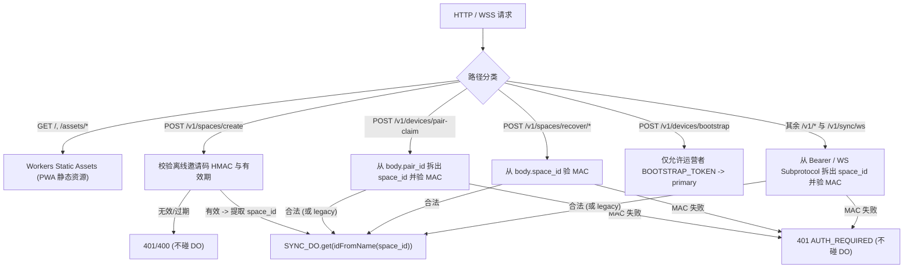

# `my-note` 受控无账号多租户（路线 B）与设备生命周期管理方案调研

> **文档分类与状态**：历史调研归档（`research/converted/`，`Converted`）。本报告已于 2026-11-28 完成源码级独立审查（修正 `F-MT-01`–`F-MT-07`）与 Q1–Q6 全量拍板（决策 **D11**，排入里程碑 **`M6`**，详见 [`review/2026-11-28-controlled-multi-tenant-and-device-review.md`](../../review/2026-11-28-controlled-multi-tenant-and-device-review.md)），并已完整转化为 [`docs/`](../../docs/README.md) 正式方案正文。**本文件仅保留原始调研留档供背景追溯，严禁直接作为开发实施依据；凡与正式规范存在差异之处（如 `cloud-cf/src/` 真实行数基线与 `<= 1,250` 行预算、受邀空间默认 `512 MiB / 500 条 / 14 天` 剪贴板配额、共享 R2 桶 31 天生命周期、首次启动 `UnclaimedFresh` 引导及单一 `SPACE_MASTER_SECRET` 派生等），一律以 `docs/` 正式规范正文为准。**
>
> **调研基线**：基于 `my-note` 现有代码与规范一手审计，覆盖 [index.ts](../../cloud-cf/src/index.ts)（931 行）、[wire.ts](../../cloud-cf/src/wire.ts)、[wrangler.jsonc](../../cloud-cf/wrangler.jsonc)、[crypto.rs](../../crates/mynote-core/src/crypto.rs)、[sync_client.rs](../../crates/mynote-cli/src/sync_client.rs)、[daemon.rs](../../crates/mynote-cli/src/daemon.rs)、[runner.rs](../../crates/mynote-cli/src/runner.rs)、[cloudApi.ts](../../web/src/pwa/cloudApi.ts)、[pwaApp.ts](../../web/src/pwa/pwaApp.ts)、[mynote-clip-push.js](../../deploy/ios-shortcuts/mynote-clip-push.js) 及 [cloudflare-cloud-architecture.md](../../docs/cloudflare-cloud-architecture.md)、[threat-model.md](../../docs/threat-model.md)、[interface-contracts.md](../../docs/interface-contracts.md)。

---

## 0. 结论先行与范围定义

路线 B 的目标是：**在不引入账号密码、邮箱、登录态或外部数据库（D1 / KV）的前提下，允许 5–50 名受邀亲友或小圈子成员共用同一套 Cloudflare Workers Paid 部署，各自拥有物理隔离的端到端加密空间，继续沿用一次性配对码添加多端设备，并补齐桌面 UI 层的设备查看与远程移除闭环。**

核心架构结论如下：

1. **零中央目录、零 KV / D1**：每个受邀空间映射一个独立的 `SyncJournalDO` 实例（actor-per-tenant 物理隔离）。通过**自路由令牌（Self-Routing Token）**与**自路由配对 ID**配合 Worker 边缘 HMAC 预校验，入口 O(1) 无状态路由，既不引入额外云组件，又能阻止伪造请求唤醒僵尸 DO。
2. **手机 PWA 与 iOS 快捷指令零协议改动**：[cloudApi.ts](../../web/src/pwa/cloudApi.ts) 与 [mynote-clip-push.js](../../deploy/ios-shortcuts/mynote-clip-push.js) 均把 `device_token` 和 `pair_id` 作为不透明字符串透传，且采用符合 RFC 6455 `tchar` 字符集的编码后，手机 PWA WASM 增量为 **`0 B` `[保证]`**，iOS 快捷指令 **`0 行` 协议改动 `[保证]`**，运营者既有的单租户 `primary` 空间与已配对设备也可平滑零停机兼容。
3. **补齐无账号多租户的「全设备丢失自救」缺口**：受邀成员不持有运营者的 `BOOTSTRAP_TOKEN`，也无法登录运营者的 Cloudflare 控制台。利用既有 24 词 `root_seed` 新增独立 HKDF 派生分支（Ed25519 空间所有权签名密钥对，严格与 X25519 加密密钥分离），可在全设备丢失且 DO 健在时通过签名挑战自助重连并吊销全部旧设备。
4. **设备查看与远程移除已有后端与 CLI 底座，重点补齐桌面 UI 与安全护栏**：云端 `GET /v1/devices`、`DELETE /v1/devices/:id`（含 WS `4401` 强制踢下线）与 CLI `mynote device ls / revoke` 已存在，但缺少桌面 UI 入口、本地 `confirm_nonce` 防护、设备在线态展示，以及**禁止吊销最后一台活跃 `read-write` 桌面**的防自锁硬约束。
5. **诚实成本与复杂度代价**：`cloud-cf/src/` 预计新增约 **160–220 行 TS** `[估算]`（总计约 `1,090–1,150 行`，需正式修订 C1 云端预算上限）；在为每个空间收敛剪贴板与日志硬配额并开启空闲 Alarm 跳过后，20 名轻中度亲友租户仍可落在 **约 \$5/月 `[估算]`** Workers Paid 套餐内。

### 明确非目标（严守边界）

- **不做**公网开放匿名注册（防止加密图床/网盘滥用击穿 R2 账单与触发合规风险）。
- **不做**账号体系、邮箱找回、OAuth、计费系统或运营者后台管理系统。
- **不做**跨空间笔记共享、多人实时协作或细粒度 ACL。
- **不做**手机 PWA 端的设备增删管理（坚持 D1′ 手机只读 / `read+clip` 最小权限边界，设备管理仅限 `read-write` 桌面）。
- **不新增**云端 `/v1/archive/*` 归档下载接口（DO 整体损毁时的 R2 归档恢复仍由运营者按 `<space_id>` 前缀导出交付）。

---

## 1. 现有代码基线审计（单租户耦合点定位）

逐文件审计当前仓库实现，现有单租户耦合面极窄，仅集中在以下 6 处：

| 组件 / 文件 | 现状（已核实源码） | 多租户 / 设备管理缺口 |
| --- | --- | --- |
| [index.ts](../../cloud-cf/src/index.ts#L917-L931) | Worker `fetch` 硬编码路由至 `env.SYNC_DO.idFromName("primary")` | 无法按空间分流；动态路由前需防伪造 `space_id` 唤醒僵尸 DO |
| [index.ts](../../cloud-cf/src/index.ts#L40-L45) | `SyncJournalDO` 构造函数无条件执行 `initSchema()` 与 `rescheduleAlarm()` | 若未做惰性初始化，任意非法请求触发动态 `idFromName()` 都会永久落盘空表并注册每日 Alarm |
| [index.ts](../../cloud-cf/src/index.ts#L388-L906) | R2 路径全局平铺：`archives/ops/<epoch>/...`、`archives/keys/latest.mnks`、`archives/keys/history/<date>.mnks`、`snapshots/state/<epoch>/...`、`clip/blobs/<clip_id>.mnc1` | 多空间并发写入会直接互相覆盖密钥快照与归档；路径调整必须保持 R2 静态前缀生命周期规则继续命中 |
| [index.ts](../../cloud-cf/src/index.ts#L436-L459) | 仅支持凭单一部署级 Secret `BOOTSTRAP_TOKEN` 调用 `POST /v1/devices/bootstrap` | 无法向受邀人安全分发一次性建空间权限，也无法让租户在全设备丢失后无管理员介入自救 |
| [index.ts](../../cloud-cf/src/index.ts#L835-L850) & [wrangler.jsonc](../../cloud-cf/wrangler.jsonc#L32-L40) | 已实现 `GET /v1/devices` 与 `DELETE /v1/devices/:id`（含 WS `4401` 踢下线）；剪贴板默认配额为 `1000` 条 / `30 天` / `5 GiB` | 未限制吊销最后一台活跃 `read-write` 桌面（存在自锁死穴）；未返回实时在线态；单租户 `5 GiB` 默认配额不适合多租户共享 `10 GB` R2 免费层 |
| [daemon.rs](../../crates/mynote-cli/src/daemon.rs#L1059-L1150) & `web/src/` | 本地 Daemon 路由表无 `/v1/local/devices*`；桌面 Web UI 无设备列表、配对二维码与远程移除界面（仅 CLI [runner.rs](../../crates/mynote-cli/src/runner.rs#L2425-L2586) 支持） | 亲友等非 CLI 重度用户无法在界面内完成空间初始化、扫码配对、查看设备与一键踢人 |

**关键兼容红利（已核实）**：
- [sync_client.rs](../../crates/mynote-cli/src/sync_client.rs#L167-L183) 定义的配对码 `mynote-pair:v1:<base64url({ u, p, k })>` 与 [crypto.rs](../../crates/mynote-core/src/crypto.rs#L715-L771) 的 `encrypt_pairing_ticket` / `decrypt_pairing_ticket` 均接受任意字符串 `pair_id`，并将其绑定进 `MNPR` AAD。
- [cloudApi.ts](../../web/src/pwa/cloudApi.ts#L203-L208) 与 [mynote-clip-push.js](../../deploy/ios-shortcuts/mynote-clip-push.js#L1145-L1147) 对 `pair_id` 和 `device_token` 均不做硬编码格式正则校验；WebSocket 握手使用 `Sec-WebSocket-Protocol: bearer.<token>`（[cloudApi.ts](../../web/src/pwa/cloudApi.ts#L458)），只要令牌只含 ASCII 字母、数字、`_`、`-`，即可严格满足 RFC 6455 `tchar` 字符集要求。

---

## 2. 受控无账号多租户核心架构设计

### 2.1 无状态自路由标识（Self-Routing Identifiers）

为避免引入中心路由数据库（KV 的最终一致性会破坏设备创建与吊销的即时性；全局目录 DO 会成为单点热点），将经过边缘 MAC 认证的 `space_id` 直接编码进令牌与配对 ID：

| 标识符 | 线格式规范 | 说明与防伪造机制 |
| --- | --- | --- |
| **`space_id`** | `sp_<16位小写base32随机>-<16位hex MAC>` | 随机熵 80-bit（足以覆盖百万级空间无碰撞）；MAC 为 `HMAC-SHA256(SPACE_ROUTING_KEY, "sp:" \|\| rand)[0..8]`（64-bit 截断），Worker 入口凭环境变量 Secret `SPACE_ROUTING_KEY` 无状态验签 |
| **`device_token`（新）** | `mnt_<space_id>_<64位hex随机>` | 总长约 105 字符，仅含 `[a-z0-9_-]`，完全兼容 HTTP `Bearer` 与 WS `Sec-WebSocket-Protocol: bearer.<token>`；Worker 拆出 `<space_id>` 验 MAC 后直达对应 DO |
| **`pair_id`（新）** | `pr_<space_id>_<32位hex随机>` | 仍装入 `mynote-pair:v1:` 的 `p` 字段并参与 `MNPR` AAD 认证；`POST /v1/devices/pair-claim` 由 Worker 拆出 `<space_id>` 验 MAC 后直达对应 DO，手机 PWA 与快捷指令零感知 |
| **既有单租户兼容（可选）** | `mnt_<64hex>` / `<32hex>` | 当环境变量 `ALLOW_LEGACY_PRIMARY="1"` 时，旧格式令牌与配对 ID 自动回落至 `idFromName("primary")`，运营者现有设备与数据零迁移、零停机 |

**入口路由流程（Worker Edge，DO 零唤醒拦截）**：



### 2.2 `SyncJournalDO` 惰性初始化（根治僵尸 DO 与 Alarm 放大）

对当前 [index.ts](../../cloud-cf/src/index.ts#L40-L45) 的构造函数做关键改造：

1. **禁止在 `constructor` 中无条件写库或注册 Alarm**：构造函数仅做轻量的只读探测（检查 `sqlite_master` 是否已有 `journal_meta` 且 `space_initialized = '1'`）。
2. **未初始化态短路**：若 `space_initialized != '1'`：
   - 仅放行携带有效邀请码（由 Worker 透传已校验声明头或由 DO 二次验签，推荐 **DO 内部同样验签** 落实纵深防御）的 `POST /v1/spaces/create`（以及 `primary` 空间的既有迁移路径）；
   - 其他任何请求直接返回 `401 AUTH_REQUIRED` 或 `404 NOT_FOUND`，**不执行任何 `CREATE TABLE` / `INSERT` / `setAlarm`**，保持该 DO 零持久存储。
3. **一次性激活**：`POST /v1/spaces/create` 在单事务内建表、写入 `space_id`、`space_initialized = '1'`、空间级配额（`max_devices`、`clip_quota_bytes`、`clip_max_items`、`ops_quota_bytes`）、首台桌面设备记录及 `owner_pk`（若启用 24 词自救），最后才注册 Alarm。

### 2.3 离线 HMAC 邀请码（无注册库、天然一次性防重放）

运营者无需搭建管理后台或数据库，通过本地 CLI 子命令（如 `mynote admin invite create`）读取本地保密的 `INVITE_SIGNING_KEY` 与 `SPACE_ROUTING_KEY`，离线生成邀请码：

- **格式**：`mynote-invite:v1:<base64url(payload_json)>.<base64url(hmac_sha256)>`
- **载荷字段**：
  ```json
  {
    "v": 1,
    "u": "https://note.yourdomain.com",
    "space_id": "sp_k8m2x9p4q7r1w3z5-a1b2c3d4e5f60718",
    "exp_ms": 1796130000000,
    "max_devices": 12,
    "clip_quota_bytes": 268435456,
    "clip_max_items": 200,
    "clip_ttl_ms": 604800000,
    "ops_quota_bytes": 268435456,
    "label": "family-alice"
  }
  ```
- **防重放机制（零额外表）**：每个邀请码绑定一个唯一的 `space_id`。受邀人首台桌面提交 `POST /v1/spaces/create` 后，目标 DO 的 `space_initialized` 变为 `'1'`；若同一邀请码被再次提交，目标 DO 直接返回 `409 SPACE_ALREADY_INITIALIZED`，无需维护全局「已用邀请码黑名单」。
- **有效期控制**：默认 `exp_ms = now + 72h`，超期未激活自动失效。
- **不携带任何数据密钥**：邀请码仅授予「在指定 `space_id` 初始化空空间并注册首台桌面」的一次性入场权，**不包含** `SMK`、`VKEK`、`ClipKey` 或 `BOOTSTRAP_TOKEN`。

### 2.4 R2 路径隔离与生命周期规则兼容

Cloudflare R2 Lifecycle Rules 仅支持**静态前缀匹配**，不支持通配符（如 `*/clip/blobs/`）。因此**严禁**将 `<space_id>` 放在对象键最前端，必须坚持**「类别前缀在前，`<space_id>` 在后」**：

| 数据类别 | 既有单租户路径（`primary` 保留兼容） | 多租户新空间路径 | R2 生命周期规则命中情况 |
| --- | --- | --- | --- |
| 每日 op 归档（永久只追加） | `archives/ops/<epoch>/<from>-<to>.mna1` | `archives/ops/<space_id>/<epoch>/<from>-<to>.mna1` | 无删除规则（与 `Bucket Lock` 兼容） |
| 最新密钥快照（每日覆写） | `archives/keys/latest.mnks` | `archives/keys/latest/<space_id>.mnks` | 无删除规则，碎纸执行次日覆写移除 |
| 历史密钥快照（30 天淘汰） | `archives/keys/history/<yyyy-mm-dd>.mnks` | `archives/keys/history/<space_id>/<yyyy-mm-dd>.mnks` | **仍命中 `archives/keys/history/` 30 天自动删除**，保住约 37 天删除上界 `[保证]` |
| 手机状态快照（保留 2 份） | `snapshots/state/<epoch>/<seq>-<id>.mnp1` | `snapshots/state/<space_id>/<epoch>/<seq>-<id>.mnp1` | 由 DO 事务主动裁剪至最新 2 份 |
| 独立剪贴板大对象（8 天兜底） | `clip/blobs/<clip_id>.mnc1` | `clip/blobs/<space_id>/<clip_id>.mnc1` | **仍命中 `clip/blobs/` 8 天自动清理**，物理 0 进入 DO PITR `[保证]` |

### 2.5 无账号全设备丢失自救（24 词派生空间所有权密钥）

受邀成员无 `BOOTSTRAP_TOKEN`。为避免其全部设备丢失后彻底无法重连健在的云端 DO，利用现有 24 词统一恢复包的 `root_seed`（[crypto.rs](../../crates/mynote-core/src/crypto.rs#L478-L487)）派生独立的 Ed25519 空间所有权身份密钥对：

1. **密钥职责严格分离**：
   - 既有加密派生：`HKDF-Expand(root_seed, "x25519-recovery")` → X25519 恢复密钥对（仅用于 `MNRS` 封装/解封 `SMK` 与 `VKEK`）。
   - 新增认证派生：`HKDF-Expand(root_seed, "ed25519-space-owner-v1")` → 32B Ed25519 种子 → `(owner_sk, owner_pk)`（仅用于向服务端证明空间所有权；`owner_sk` 永不落盘，仅在空间初始化或恢复流程中由 24 词临时派生并立即 `zeroize`）。
   - **WASM 体积守恒**：该派生仅编译进桌面 `mynote-core` / `mynote-cli`（feature-gated），手机只读 PWA 不参与空间恢复，`pkg-pwa` WASM 体积保持 **`0 B` 增量 `[保证]`**。
2. **用户离线保管物**：初始化空间时，桌面 UI 与 CLI 将「24 词恢复包」与一份公开的**空间定位串**（如 `mynote-space:v1:<base64url({ u, space_id })>`，不含任何密钥）一并展示在恢复卡片中，引导用户一起存入密码管理器或纸质备份。
3. **两步挑战-应答自救流程（无需运营者介入）**：
   - 步骤 1：`POST /v1/spaces/recover/challenge` 提交 `{ space_id }` → DO 检查 `owner_pk` 存在且未触发单空间限流（如每小时最多 5 次）→ 生成 32B 随机 `challenge_nonce` 与 `challenge_id`（TTL 5 分钟，单次有效，最多并存 3 条防止刷表）。
   - 步骤 2：新桌面在本地由用户输入的 24 词临时派生 `owner_sk`，对结构化域分隔消息签名：
     ```text
     msg = "mynote-space-recover-v1\0" || space_id || "\0" || challenge_id || "\0"
           || challenge_nonce_hex || "\0" || device_id || "\0" || token_sha256_hex
           || "\0" || (revoke_existing ? "1" : "0")
     ```
   - 步骤 3：`POST /v1/spaces/recover/bootstrap` 提交 `{ space_id, challenge_id, device_id, device_name, token_sha256_hex, revoke_existing, signature_b64 }` → DO 立即删除该 `challenge_id`（防重放），调用 Cloudflare Workers 原生 WebCrypto `crypto.subtle.verify("Ed25519", owner_pk, sig, msg)` 验签（**0 新增 JS 依赖**）→ 验签通过后注册新 `read-write` 设备、按需吊销旧设备并断开旧 WS → 新桌面拉取 `GET /v1/keys`，在本地用 24 词解封 `SMK` 密钥环并从 `seq = 0` 全量恢复。
4. **诚实安全与恢复边界**：
   - DO 只存公钥 `owner_pk`，T1 被动存储泄露无法伪造签名。
   - 若连 Cloudflare DO 也整体损毁，受邀成员需联系运营者导出 R2 中 `archives/ops/<space_id>/` 与 `archives/keys/latest/<space_id>.mnks`，再在本地离线执行现有 `mynote restore --from-archive <local-dir>`。

---

## 3. 查看已配对设备与远程移除配对设备设计

### 3.1 云端 API 增量增强（兼容既有契约）

云端 [index.ts](../../cloud-cf/src/index.ts#L811-L850) 已有 `GET /v1/devices`、`POST /v1/devices`、`POST /v1/devices/:id/refresh`、`DELETE /v1/devices/:id`。路线 B 下做以下小幅增量增强：

1. **`GET /v1/devices`（`read-write`）响应增强**：
   - 在保留现有字段的基础上，追加计算字段（零额外表结构）：
     - `status`: `"pending_claim" | "active" | "revoked"`
     - `online`: `boolean`（实时扫描 `this.ctx.getWebSockets()` 附件判断该 `device_id` 是否有活跃 WS 连接）
     - `is_current`: `boolean`（是否等于当前请求方 `auth.deviceId`）
     - `pending_ticket_expires_at_ms`: `number | null`（存在尚未认领的 `pair` 或 `refresh` 票据时返回过期时间）
   - 顶层附带 `space_quota` 摘要：`{ active_devices, max_devices, ops_bytes_used, ops_bytes_limit, clip_bytes_used, clip_bytes_limit }`。
2. **`DELETE /v1/devices/:id`（`read-write`）增加防自锁不变量（`INV-MT-NO-SELF-LOCKOUT`）**：
   - **硬规则 1（禁止删除最后一台活跃桌面）**：在 `transactionSync` 内检查吊销目标后剩余活跃 `read-write` 设备数（`scope = 'read-write' AND claimed_at_ms IS NOT NULL AND revoked_at_ms IS NULL`）；若归零，拒绝并返回 **`409 LAST_ADMIN_DEVICE_REFUSED`**，防止无账号空间陷入「只剩只读手机、无人可再配对新桌面」的死锁。
   - **硬规则 2（删除本机二次显式确认）**：若 `targetId === auth.deviceId`（且空间尚有其他活跃 `read-write` 设备），要求查询参数 `?confirm_self=true`，否则返回 `400 INVALID_ARGUMENT`。
   - **规则 3（取消未认领配对）**：若目标设备尚处于 `claimed_at_ms IS NULL`（配对码发出但对方未领，用户点「取消配对」），直接物理删除该 `pairing_tickets` 与未激活 `devices` 行，不污染已吊销历史列表。
   - **立即断连**：保留既有 `disconnectDeviceWs(targetId)`，向在线目标发送 `{ type: "device_revoked" }` 并以 Close Code `4401` 断连。
3. **`PATCH /v1/devices/:id`（`read-write`，可选）**：仅允许修改 `device_name`（1–64 字符），便于区分同名设备。

### 3.2 本地 Daemon 契约（`/v1/local/devices*`）与安全防线

桌面 Web UI 不能直接持有或把 `device_token` 暴露给前端 JS，全部设备管理请求经本地 Daemon（[daemon.rs](../../crates/mynote-cli/src/daemon.rs)）代理，并复用既有回收站 `confirm_nonce` 机制防护高危动作：

| 本地端点 | 鉴权与确认机制 | 功能与安全约束 |
| --- | --- | --- |
| `GET /v1/local/devices` | `Host` + `Origin` + `HttpOnly` Session Cookie | 代理拉取云端设备列表与空间配额，附带本机 `current_device_id`、`space_id`（脱敏展示）与同步状态；断网时返回 `503 SYNC_OFFLINE` |
| `POST /v1/local/devices/actions/prepare` | 同上 | 接受 `{ action: "add" \| "refresh" \| "revoke" \| "cancel_ticket" \| "rename", ... }`，返回绑定当前浏览器 Session 的一次性 60 秒 `confirm_nonce` 与确认摘要 `summary`（包含目标设备名、`scope`、影响范围） |
| `POST /v1/local/devices/actions/commit` | 同上 + 强制消费有效 `confirm_nonce` | 执行已确认动作：<br>• `add` / `refresh`：由 Daemon 内存中的 `SMK` / `ClipKey` 加密生成一次性票据，**仅在本次响应中返回一次 `pairing_code` 供前端渲染二维码**，不写入 SQLite、不写本地日志；<br>• `revoke`：调用云端 `DELETE /v1/devices/:id`，响应返回建议的后续换钥动作（`recommended_followup: "keyring_rotate" \| "clip_rotate" \| "both" \| "none"`） |

> **安全边界说明**：与 [interface-contracts.md](../../docs/interface-contracts.md#L237-L238) 一致，`confirm_nonce` 配合 `HttpOnly` Cookie 阻止仅拥有 CLI 入口的同 UID AI Agent 静默生成配对码或踢掉其他设备；它不宣称防御能持久化篡改二进制或浏览器环境的同 UID 恶意代码（T5）。

### 3.3 桌面 UI 交互闭环与诚实引导

1. **「设备与同步」管理面板（仅桌面端提供）**：
   - **设备清单**：按状态分组展示「当前活跃设备」「等待认领的配对」「已移除历史（折叠）」。每行显示设备名、`本机` 标识、在线状态点、角色徽标（`桌面全权限` / `手机读写剪贴板+只读笔记` / `手机纯只读` / `快捷指令仅发送`）、最近活跃时间与同步进度。
   - **添加设备向导**：按目标设备类型提供 3 个预设卡片（`添加另一台电脑` → `read-write`、`添加手机 PWA` → `read+clip`、`添加 iOS 快捷指令` → `clip-write`），确认后在模态框内以**纯本地 SVG**（零外部请求，严守 `SEC-06` CSP）展示二维码、文本配对码、10 分钟倒计时，以及「立即作废」按钮。
   - **抢领异常自查提示**：手机/新电脑配对返回 `404` 时，提示用户直接打开已激活桌面的「设备与同步」面板核对是否存在陌生设备并一键移除。
2. **远程移除弹窗：区分意图、诚实告知边界**：
   - 弹窗内让用户选择移除原因：
     - **淘汰 / 正常解绑旧设备**：立即吊销云端令牌并断开连接；
     - **设备丢失 / 怀疑被盗**：吊销令牌后，在结果页按被移除设备的 `scope` 明确给出后续止血步骤：
       - `read-write` / `read` / `read+clip` → 提示执行 `mynote keyring rotate`（并说明：轮换保护后续新数据；对敏感块需单独换钥并碎纸旧钥；随后可在设备列表为存留手机一键生成刷新码）；
       - `clip-write` / `read+clip` → 提示执行 `mynote clip rotate-key` 立即清空云端剪贴板并换钥；
       - 固定展示诚实声明：「远程移除只能阻断该设备继续访问云端，**无法抹除已离线设备本地已缓存的历史内容**。」

### 3.4 被移除设备收到 `DEVICE_REVOKED` / WS `4401` 时的差异化处理

| 被移除端类型 | 收到 `401 DEVICE_REVOKED` 或 WS `4401` 后的行为 | 原因 |
| --- | --- | --- |
| **桌面端（macOS / Linux / Windows）** | **严禁自动删除本地 SQLite 笔记与镜像！** 立即停止云端同步循环与 WS 重连、清除失效云令牌，顶部常驻醒目告警条提示「当前设备已被远程移除，本地笔记完整保留」，提供「重新配对」与「导出/备份」指引 | 严守 **G1 永不静默丢数**，防止误点移除或服务端故障导致本地数据蒸发 |
| **手机只读 PWA** | 立即断开 WS、清零内存中的 `VKEK` 与 `ClipCodec`（[pwaApp.ts](../../web/src/pwa/pwaApp.ts#L483-L491) 已实现），并可配置在收到服务端明确 `DEVICE_REVOKED` 时**自动清除 IndexedDB 中缓存的包裹 `SMK`、`ClipKey` 与块密文**（手机本就是只读派生视图，清除无丢数风险） | 对正常淘汰/借用旧机是良好的清理习惯；但文档明确声明此行为仅作礼貌清理，不作为防离线取证的安全承诺 |
| **iOS 快捷指令 (`clip-write`)** | 弹窗提示令牌已失效，引导清理 Scriptable Keychain 并重新贴配对码 | `clip-write` 本身不含 `SMK` 且无历史读取权 |

---

## 4. 成本、配额与 Alarm 优化精算（5–50 名受邀亲友场景）

以 [cloudflare-cloud-architecture.md](../../docs/cloudflare-cloud-architecture.md#L196-L209) 单用户估算口径（日均 300–500 ops、100 条剪贴板活动）为基础，按 **20 名活跃受邀用户**（轻中度混合，平均为重度个人用量的 50%）测算 Cloudflare Workers Paid（\$5/月）资源落点：

| 资源项 | 20 租户估算总量 | Workers Paid（\$5/月）套餐内含 | 落点评估 |
| --- | --- | --- | --- |
| **Workers Static Assets (PWA)** | 每日数百次页面加载 | 静态资源免费 | **\$0** `[估算]` |
| **DO Requests** | ~40 万次/月 `[估算]` | 100 万次/月 | 约 40%，套餐内 `[估算]` |
| **DO Duration** | ~10,000–15,000 GB-s/月 `[估算]`（Hibernation 开启） | 400,000 GB-s/月 | < 4%，套餐内 `[估算]` |
| **DO SQLite 行写** | ~45 万行/月 `[估算]` | 5,000 万行/月 | < 1%，套餐内 `[估算]` |
| **DO SQLite 行读** | ~4.6 亿行/月 `[估算]` | 250 亿行/月 | < 2%，套餐内 `[估算]` |
| **DO SQLite 存储** | 20 空间 × ~110 MB/年 ≈ **2.2 GB/年** `[估算]` | 含 **5 GB-月**（超出约 \$0.20/GB-月） | 前 2 年套餐内；第 3 年起按每空间 `256 MiB` 硬顶封顶，极限总计约 5 GB（超额费用 `< \$1/月`） `[估算]` |
| **R2 存储与请求** | 20 空间 ×（归档 + 活跃剪贴板均值 100–250 MiB）≈ **3–6 GB** `[估算]`；月 Class A < 3 万次（3%） | **10 GB-月** + 100 万 Class A + 1,000 万 Class B 免费 | 若收敛每空间剪贴板配额至 `256 MiB`，20 人满载也控制在免费层内 `[估算]` |

### 必须配套的两项防失控工程优化

1. **多租户默认空间配额收敛**（由邀请码写入目标 DO `journal_meta`，允许运营者按人微调）：
   - `max_devices` = `12`（防滥发设备行）
   - `clip_max_items` = `200`（单租户 `wrangler.jsonc` 现状为 `1000`）
   - `clip_ttl_ms` = `7 天`（单租户 `wrangler.jsonc` 现状为 `30 天`）
   - `clip_quota_bytes` = `256 MiB`（单租户现状为 `5 GiB`，必须下调以守住 10 GB R2 免费层）
   - `ops_quota_bytes` = `256 MiB`（`POST /v1/sync/push` 写入前检查累计 `ops` 密文字节，超限返回 `507 SPACE_QUOTA_EXCEEDED`，绝不拖垮整个账户的 DO 存储账单）
2. **空闲空间 Alarm 零空转优化**：
   - 现状 [index.ts](../../cloud-cf/src/index.ts#L883-L907) 每天 Alarm 触发时，即使当天没有任何新 op 或密钥变化，也会重写一遍 `latest.mnks` 和 `history/<date>.mnks`。
   - 改为在 `journal_meta` 记录 `last_archived_keys_digest`：仅当 `head_seq > last_archive_seq` 或 `keys_digest !== last_archived_keys_digest` 时才写 R2 归档与密钥快照；**完全无变更且无待到期碎纸/票据/剪贴板的空间，不重复注册下一次日常 Alarm**，直到下一次 `push` / `keys` / `clip` / `devices` 写入时由 `rescheduleAlarm` 重新激活。这样即使有 50 个长期不活跃的亲友空间，后台闲置成本严格归零。

---

## 5. 新增威胁模型边界与门禁清单

在现有 [threat-model.md](../../docs/threat-model.md) T1–T9 基础上，路线 B 引入 4 条新增边界，须向所有受邀成员如实告知并用自动化测试守护：

| 新增威胁 | 风险描述 | 防御机制与诚实边界 | 建议门禁编号 |
| --- | --- | --- | --- |
| **T10a 跨租户越权 / 数据串写** | 租户 A 凭令牌、伪造 `pair_id` 或 `clip_id` 读写租户 B 的 DO 或 R2 对象 | 每个空间物理独立 DO 实例；R2 键由服务端强拼接当前 DO 自己的 `this.spaceId`（绝不信任客户端传来的路径）；`pair-claim` 与认证仅在目标 DO 内部查表 | `SEC-MT-01`（跨空间令牌/配对码/R2 隔离契约测试） |
| **T10b 僵尸 DO / Alarm 放大** | 外部攻击者遍历随机 `space_id` 触发大量空 DO 落盘与永久 Alarm | Worker 入口先验 `space_id` 64-bit HMAC；DO 构造惰性初始化，未激活空 DO 不写 SQL、不设 Alarm | `SEC-MT-02`（千次非法 `space_id` 压测验证 0 写库、0 Alarm） |
| **T10c 邀请码泄露与重放** | 邀请码在聊天软件泄露或被重复使用开设多个空间 | 邀请码设短 TTL（72h）且绑定唯一 `space_id`；目标 DO 一旦激活即永久拒绝第二次 `create` | `SEC-MT-03`（过期/篡改/重放邀请码全拒测试） |
| **T10d 运营者代码下发信任** | 运营者掌控 Cloudflare 账号，理论上可篡改手机 PWA 静态资源（T2 延伸到多租户） | **诚实声明**：桌面端加载本地二进制内嵌资源，运营者看不到桌面明文也无法向桌面投毒；受邀人若使用手机 PWA，必须信任运营者及其 CI 部署流水线（与自建 Vaultwarden / Nextcloud 相同） | 文档诚实告知 + 沿用 T2 CI 最小权限部署规范 |
| **T10e 空间自锁与同 UID 静默踢人** | 手滑删除唯一 `read-write` 桌面，或本地恶意脚本静默发起配对/踢人 | 服务端拒绝删除最后一台活跃 `read-write` 设备（`409 LAST_ADMIN_DEVICE_REFUSED`）；本地 `/v1/local/devices/actions/*` 强制 UI `confirm_nonce` | `SEC-MT-04`（防删最后桌面 + 24 词 Ed25519 自救往返测试） |

---

## 6. 分阶段演进路径与改动预算

建议拆为 4 个独立可验证切片，且**Slice 1 零云端侵入、单/多租户共用**，可优先落地：

| 切片 | 核心交付 | 影响范围 | 预估增量 | 依赖关系 |
| --- | --- | --- | :---: | --- |
| **Slice 1：桌面 UI 设备管理与防自锁** | 服务端 `GET /v1/devices` 补 `online`/`is_current`/`status`、`DELETE` 禁删最后一台活跃 `read-write` 桌面；本地 `daemon.rs` 补 `/v1/local/devices*` + `confirm_nonce`；桌面 Web UI 补「设备与同步」面板、本地 SVG 二维码配对向导与分场景移除弹窗 | `cloud-cf`、`mynote-cli`、`web`（桌面） | `cloud-cf` ~35 LOC `[估算]` | **无前置依赖**（单租户即刻受益） |
| **Slice 2：限时技术 Spike (`S-MT-1`)** | 在 `spikes/` 或 `cloud-cf` 测试内验证：(1) `workerd` 原生 WebCrypto `Ed25519` 与 Rust 签名跨端互通；(2) DO 惰性初始化在无写库时不触发计费存储与 Alarm；(3) 空闲 Alarm 跳过逻辑 | `spikes/` | 一次性验证 | 确认路线 B 后先跑 |
| **Slice 3：云端受控多租户核心** | 边缘 `space_id` HMAC 预校验 + 自路由 Token/Pair ID + `primary` 向后兼容 + `POST /v1/spaces/create` + 离线邀请码验签 + R2 类别前置路径隔离 + 每空间硬配额 + 空闲 Alarm 跳过 + `SEC-MT-01..03` | `cloud-cf` | `cloud-cf` ~150–185 LOC `[估算]` | 依赖 Slice 2 |
| **Slice 4：桌面空间引导与 24 词自救** | `mynote-core` 新增 `ed25519-space-owner-v1` 派生（非 PWA feature）；CLI 补 `mynote admin invite create` / `mynote space create` / `mynote space recover`；桌面 UI 首次启动引导页（贴邀请码建空间 / 贴配对码加入 / 24 词恢复）；`SEC-MT-04` | `mynote-core`、`mynote-cli`、`web`（桌面） | 手机 PWA `0 B` `[保证]` | 依赖 Slice 3 |

> **与 M5 路线图的约束协调提醒**：[AGENTS.md](../../AGENTS.md) 与 [architecture-proposal.md](../../docs/architecture-proposal.md) 规定 **M5（Windows 一等桌面 + `wasmi` 插件体系）对 `cloud-cf/src/` 保持 `0 LOC` 改动**。因此建议将路线 B 定位为独立于 M5 之外的并行/后置里程碑（如 **M4.5** 或 **M6**），或在开始 M5 之前先把云端多租户与 C1 预算边界单独拍板锁定，避免与 M5 的零云端侵入约束混淆。

---

## 7. 待拍板决策清单（转化 `docs/` 正式方案前需确认）

在将本调研转化为 `docs/` 正式方案与 `review/` 决策项之前，请确认以下 6 项：

1. **Q1（排期定位）**：路线 B 作为独立里程碑推进——你希望**先做 Slice 1（桌面 UI 设备管理）**，还是**在 M5（Windows + 插件）之前就把路线 B 完整落地**，抑或**排在 M5 之后（M6）**？
2. **Q2（C1 云端代码量预算）**：当前 `cloud-cf/src/index.ts` 已实测 931 行（预算 950 行）。路线 B 预计新增约 160–220 行 TS（总计约 `1,100–1,150 行`），是否批准将 `cloud-cf/src/` 预算上调至 **`<= 1,200 行`**（并拆分为 `index.ts`、`space.ts`、`wire.ts` 保持单文件可读）？
3. **Q3（全设备丢失 24 词自救）**：是否纳入「24 词派生 Ed25519 `owner_pk` + 挑战-应答自主重连 DO」机制？
   - **推荐**：纳入。否则亲友全设备丢失后无任何自助重连路径，只能由你手动改 DO 或放弃空间。
4. **Q4（默认单空间配额档位）**：受邀新空间的默认上限建议定为 `max_devices = 12`、`clip_quota_bytes = 256 MiB`、`clip_max_items = 200`、`clip_ttl = 7 天`、`ops_quota_bytes = 256 MiB`（邀请码签发时可为特定成员单独覆写）。你自己的 `primary` 空间保持既有大配额不变。是否认可这组默认值？
5. **Q5（手机 PWA 被远程移除后的本地缓存行为）**：手机只读 PWA 收到服务端明确 `DEVICE_REVOKED` / WS `4401` 时，倾向于：
   - **选项 a（推荐）**：自动清空 IndexedDB 中缓存的包裹密钥与离线只读笔记，回到未配对引导页并显示「本设备已被桌面端移除」；
   - **选项 b**：仅停止同步并锁 Vault，保留离线只读缓存直到用户手动点「解除配对」。
6. **Q6（邀请码运营工具形态）**：离线签发邀请码的工具做成 `mynote` 二进制内的隐藏/子命令（如 `mynote admin invite create`），还是放在 `cloud-cf/scripts/issue-invite.ts` 随运维仓库保管（普通用户桌面二进制完全不暴露 `admin` 子命令）？
   - **推荐**：放 `cloud-cf/scripts/issue-invite.ts`（Node / tsx 单脚本 ~50 行），避免在给亲友分发的桌面 CLI 里暴露毫无用处的 `admin` 命令。
