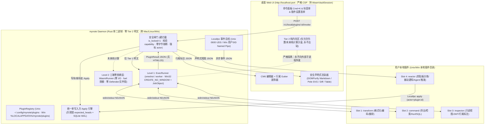

# `my-note` 插件化可行性与跨平台架构深度调研（含 macOS / Linux / Windows）

> **文档分类与状态**：调研报告（`research/converted/`，`Converted`）。本报告涉及的两项核心选型（Windows 升为一等桌面平台、路线 B `wasmi` 零依赖优先双宿主插件体系）已于 2026-11-28 拍板并转化为正式方案决策 **D9 / D10**（对应 [`architecture-proposal.md`](../../docs/architecture-proposal.md) `ADR-12` / `ADR-13` 及配套 `docs/` SSOT 规范）。本文仅作调研背景、方案对比与决策追溯归档，**严禁直接作为开发实施依据**；一切实现、接口与安全边界一律以 `docs/` 正式方案为准。


> **调研基线**：结合 `my-note` `v0.3.2` 真实代码结构（[formatters.rs](../../crates/mynote-cli/src/formatters.rs)、[uds.rs](../../crates/mynote-cli/src/uds.rs)、[credentials.rs](../../crates/mynote-store/src/credentials.rs)、[threat-model.md](../../docs/threat-model.md)、[package.json](../../web/package.json)、[Cargo.toml](../../crates/mynote-cli/Cargo.toml)）及行业主流插件机制（含 Windows 实现细节）一手资料分析。

---

## 0. 结论先行（TL;DR）

**可以接入插件机制，而且现有基建已经铺好了约 60% 的协议底座——但一旦把 Windows 纳入一等公民平台，就不能只做 Unix 视角的「一次性脚本子进程」，必须升级为「跨平台 IPC（UDS / Named Pipe）+ 持久化 `exec` Worker + 提前规划 `wasmi` 纯计算沙盒」的三端同构极简架构。**

核心判断拆解为 5 句话：

1. **先面对仓库现状的诚实事实**：`my-note` `v0.3.2` 目前尚未接入 Windows CI/Release，且源码里存在多处 Windows 断层（[uds.rs](../../crates/mynote-cli/src/uds.rs#L366-L373) 在非 Unix 下直接返回 `Ok(None)` 无 IPC、[formatters.rs](../../crates/mynote-cli/src/formatters.rs#L137) 的 `env_clear()` 在 Windows 上会清掉 `SYSTEMROOT` 导致子进程崩溃、[credentials.rs](../../crates/mynote-store/src/credentials.rs#L76-L79) 无 Windows Credential Manager/DPAPI）。插件机制必须顺带把这套**跨平台本地 IPC 与子进程底座**一次建对，而不是打补丁。
2. **为什么不能照搬大厂插件平台**：VS Code、Raycast Store、Obsidian 投入数万行代码构建 Extension Host / 自定义 React Reconciler / 市场审核，服务的是「数千互不信任的外部作者 × 百万普通用户」。`my-note` 是**单人维护（C1 预算）、单二进制 `< 15 MB`、纯 Vanilla TS 零前端框架、`cloud-cf` 仅剩 21 行余量（929/950 LOC `[已测]`）、且网页内存持有解锁态 `VKEK` 的 E2EE 工具**——照搬任何重型运行时都会直接击穿安全边界或拖垮维护成本。
3. **为什么 Obsidian 式插件对 `my-note` 是绝对禁区**：`my-note` 桌面 UI 页持有 `WasmVaultSession`（解锁态 `VKEK` 与 Tier 2 明文）及 `HttpOnly` 本地会话。允许插件往 `http://localhost:<port>` 注入任意 JS 或操作主 DOM，等于主动引入永久 Stored XSS，直接废掉 [threat-model.md](../../docs/threat-model.md#L256-L279) 第 6 节全部防线。
4. **最优解是「四家之长嫁接 + Windows 专项加固」**：
   - 借 **VS Code**：声明式清单（Manifest）+ 懒激活 + 严禁碰主 DOM + **Unix Domain Socket / Windows Named Pipe 同构本地 IPC**；
   - 借 **Bob**：极窄垂直槽位（Category Slots）+ 声明式 `options` 自动生成配置表单；
   - 借 **Raycast（含 Raycast 2.0 Windows）**：任意语言脚本快速接入 + 插件只吐「受限声明式结构化结果」，由宿主内置安全组件统一渲染；
   - 借 **Git/`gh` + LSP 持久化 Worker + `wasmi`**：Level 1 `exec` 支持 `oneshot` 与 `worker` 双模式（抵消 Windows `CreateProcessW` + Defender 150–800 ms 冷启税 `[估算]`）；引入 Windows 后，**Level 2 `wasmi`（纯 Rust 解释器，+1–2 MB）的战略价值大幅上升**——它是唯一能做到 macOS / Linux / Windows 真正「一份 `.wasm` 零环境依赖、零 Defender 拦截、零文件锁、且可安全用于 Tier 2 加密块」的载体。
5. **AI 时代的开发体验红利**：对个人跨三端工具而言，未来 90% 的插件会由本地 AI Coding Agent 现场编写。协议越像标准 NDJSON-over-stdio（且屏蔽 Windows 的 shebang/GBK/路径陷阱），AI 写出的插件在 macOS / Omarchy / Windows 上一次性跑通的概率就越高。

---

## 1. 7 类成熟产品插件机制深度拆解

除题述 **Raycast、Bob、VS Code** 外，补充 4 个与 `my-note` 基因高度相关的参照系：**Obsidian**（同为 Local-First 笔记的反面安全样本）、**Zed/Zellij**（同为 Rust 单二进制的 WASM 沙盒样本）、**SilverBullet**（原方案对标过的 Local-First Web 笔记）、**Git/`gh`**（零运行时 CLI 扩展样本）。

### 1.1 核心架构横向对比矩阵

| 产品 / 范式 | 运行时与隔离模型 | 宿主通信方式 | UI 扩展机制 | 安全与沙盒边界 | 对 `my-note` 的核心借鉴与排雷 |
| --- | --- | --- | --- | --- | --- |
| **VS Code** | 独立 **Node.js Extension Host** 进程（Web 端为 Web Worker），与 UI 进程彻底解耦 | 异步 JSON-RPC IPC；`package.json` 声明 `contributes` + `activationEvents` 懒加载 | **严禁碰主 DOM**；标准入口走声明式贡献点，自定义 UI 放隔离 iframe `Webview` + `postMessage` + 严格 CSP | 进程防崩溃 + Workspace Trust + Webview CSP；但本地扩展仍具完整 Node OS 权限 | **借鉴**：声明式注册、懒加载、严禁碰主 DOM<br>**排雷**：绝不内嵌 Node.js 运行时，不维护庞大 RPC API |
| **Raycast（重腿：React Extensions）** | 独立 **Node.js Worker** 跑 React + 自定义 Reconciler | 虚拟树序列化为结构化 JSON 树，经 IPC 传给主进程 | **无 HTML/DOM**；仅开放 `<List>` / `<Grid>` / `<Detail>` / `<Form>` / `<ActionPanel>` 少数原语，宿主映射为原生 SwiftUI/AppKit | 进程隔离防崩 + 商店人工/静态审核；插件代码仍具 Node 能力 | **借鉴**：**「插件输出受限声明式视图数据，宿主统一渲染」**——既保质感又天然防 XSS<br>**排雷**：`my-note` 是纯 Vanilla TS，绝不引入 React Reconciler |
| **Raycast（轻腿：Script Commands）** | OS 原生子进程（Bash/Python/Swift/Node 等任意语言） | 扫描脚本顶部 `# @raycast.*` 注释注册；参数走 argv，结果走 stdout | 极简 `mode`（`silent` / `compact` / `inline` / `fullOutput`） | OS 同用户权限，无代码沙盒 | **强烈借鉴**：极低编写门槛，个人与 AI Agent 30 秒产出可用扩展 |
| **Bob**（macOS） | macOS 系统自带 **JavaScriptCore (`JSC`)** 引擎（非 Node、非浏览器） | `.bobplugin` zip（`info.json` + `main.js`）；按固定 `category`（`translate`/`ocr`/`tts`）回调 | **零自定义 UI**；`info.json` 声明 `options` 自动生成设置表单，结果按固定数据结构回显 | **强受控 API 注入**：无 `fs`/`process`/`fetch`，仅宿主注入 `$http`、`$option`、`$file`（限 `$sandbox/`） | **强烈借鉴**：**窄垂直槽位 + 声明式 `options` 表单 + 宿主代理受控能力**<br>**排雷**：`JSC` 绑定 macOS，Omarchy Linux 不可用 |
| **Obsidian** | **Electron 渲染进程内直接执行 JS**（同上下文加载 `main.js`） | 直接调用宿主对象 + 直接操作任意 DOM + 直接调用 Node `fs`/`child_process` | 无限自由（任意改 CSS/DOM/CM6 实例） | **零沙盒！** 仅靠社区上架人工审查与用户自担风险 | **反面教材（绝对禁用）**：会瞬间击穿 `my-note` 的 Tier 2 `VKEK` 内存防线与 `SEC-06` CSP |
| **Zed / Zellij** | Rust 内嵌 **Wasmtime** 运行 `.wasm` 字节码 | **WIT**（Component Model 接口契约）或 Protobuf over Wasm ABI | Zed 仅限声明式槽位（LSP/主题/语言）；Zellij 允许渲染受控终端 Pane | **硬能力沙盒**：独立线性内存、默认零文件/零网络，仅 WASI / WIT 显式授权 | **借鉴**：未来若要支持 **Tier 2 加密块内扩展** 或不可信社区插件，WASM 是唯一硬沙盒<br>**排雷**：`wasmtime` 默认体积巨大（见 §1.2），且 Rust→WASM 开发门槛过高 |
| **SilverBullet** | 浏览器独立 **Web Worker**（PlugOS） | `postMessage` 异步 `syscall` + `*.plug.yaml` 权限声明 | 不可直接操作主 DOM；通过受控 Widget / Slash Command 接入 | 浏览器 Worker 沙盒 + 显式权限校验 | **借鉴**：若前端跑纯计算插件，独立 Worker（或无 `allow-same-origin` 沙盒 iframe）可避免污染主线程 |
| **Git / `gh` CLI** | OS 独立子进程（`$PATH` 发现 `git-<name>` / `gh-<name>`） | argv + 环境变量 + stdio + 调用宿主 CLI/API | 纯命令行文本 / JSON / 退出码 | OS 进程隔离，无代码沙盒 | **强烈借鉴**：**0 字节二进制膨胀**、全语言自由，与 `my-note` 一等公民 CLI 天作之合 |

### 1.2 Rust 单二进制内嵌脚本/沙盒引擎实测体积对照（决定是否内嵌运行时）

如果你考虑在 `mynote` 单二进制（目标 `< 15 MB`）里效仿 Bob（JS）或 Zed（WASM）内嵌脚本运行时，必须直面真实的体积代价：

| 候选嵌入式引擎 | 语言 | 默认 Release 二进制增量 `[估算]` | 极致裁剪增量 `[估算]` | 核心取舍 |
| --- | --- | :---: | :---: | --- |
| **`wasmtime`**（默认 Cranelift JIT） | Rust / C++ | **+15 MB – 25 MB** | +2 MB – 3 MB（禁 JIT 改 Pulley 解释器） | 默认直接打穿 `< 15 MB` 预算；支持最全 Component Model / WASI |
| **`wasmi`**（纯 Rust 解释器） | 纯 Rust | **+1 MB – 3 MB** | < 1 MB | **纯 Rust 零 C 工具链**、自带 fuel 计费防死循环、硬内存隔离，解释执行对文本/计算块绰绰有余 |
| **`rquickjs`**（QuickJS-NG） | C + Rust 绑定 | **+300 KB – 600 KB** | ~250 KB | 体积惊人小、写 JS 门槛低；但引入 C 交叉编译链，且内存隔离不如 WASM 彻底 |
| **`mlua`**（Lua 5.4 / Luau） | C/C++ + Rust | **+200 KB – 500 KB** | ~150 KB | 极轻、极快（类似 Neovim/Yazi/WezTerm）；但小众语言，AI/Web 生态工具链弱于 Python/JS/Rust |
| **无内嵌（外部 `exec` 子进程）** | 任意语言 | **0 KB** `[保证]` | **0 KB** `[保证]` | 零膨胀、直接复用本机工具；但在 Windows 上受制于无 shebang、`CreateProcessW` + Defender 冷启税及 Job Object 管理 |

### 1.3 成熟产品在 Windows 上的插件落地对照（重点看 VS Code 与 Raycast 2.0）

| 维度 | VS Code on Windows | Raycast 2.0 on Windows | 对 `my-note` Windows 插件的直接启示 |
| --- | --- | --- | --- |
| **宿主与本地 IPC** | 主进程 ↔ 独立 `exthost` Node.js 进程，通过 **Windows Named Pipe**（`\\.\pipe\code-<hash>`）跑 JSON-RPC（Unix 自动映射 UDS） | WinUI / C# / Rust 外壳 + WebView2 渲染，Node.js 子进程经 IPC 传序列化 UI 树 | **`my-note` 的 `uds.rs` 必须抽成 `LocalIpc`**：Unix 用 `0600` UDS，Windows 用带当前用户 SID DACL 的 Named Pipe（`\\.\pipe\mynote-<hash>`） |
| **进程生命周期** | **长驻进程（Persistent）**：启动一次常驻内存，规避 Windows 反复冷启延迟 | **按命令会话启停（Ephemeral）**：轻量隔离、闲置回收，但仍依赖内嵌 Node 规避系统环境缺失 | `my-note` 的 `exec` 需同时提供 `oneshot`（低频 CLI/脚本）与 **`worker` 长驻模式**（高频调用省去 Windows 150–800 ms 冷启），并由 **Windows Job Object** 兜底防僵尸 |
| **系统依赖假设** | 自带完整 Node.js 运行时（体积百兆级） | 自带完整 Node.js 运行时 | `my-note` 严守 `< 15 MB` 预算，绝不捆绑 Node/Python；因此 **Windows 上无预装解释器时的跨端可移植性，只能靠 `wasmi`（纯 `.wasm` 插件）或静态编译二进制解决** |

---

## 2. 结合 `my-note` 特性的 6 大结构性张力（含 Windows 实测缺口）

任何脱离项目自身特性的插件设计都会水土不服。`my-note` 有 6 个与上述产品截然不同的结构性约束：

### 张力 1：Tier 2 Vault 零明文防线（Daemon 无 `VKEK` vs UI 内存有 `VKEK`）
在 [threat-model.md](../../docs/threat-model.md#L243-L245) 中，Tier 2 加密块有两条不可动摇的铁律：
- 常驻 Daemon 永不接触 `VKEK` 和加密块明文；
- 解锁态加密块严禁外发给 Layer 2 外部 CLI 子进程（只能走内存级 WASM）。

**直接推论**：
- 任何运行在 OS 子进程里的插件（Raycast Script / `gh` / `formatters.toml` 路线）**天然只能服务 Tier 1 普通块与剪贴板**；对 `is_locked == true` 的块，Daemon 本身就只有密文，从物理上就不可能把明文喂给外部插件——**这是一个极佳的结构性安全兜底！**
- 任何需要作用于**解锁态 Tier 2 块**的扩展，只能在「零网络、零落盘、只读单块明文、不接触 `VKEK`」的纯计算沙盒内执行（例如桌面 WASM / 零同源权限 Web Worker）。

### 张力 2：桌面前端是零框架 Vanilla TS + 严格 CSP（`script-src 'self' 'wasm-unsafe-eval'`）
核对 [web/package.json](../../web/package.json) 可知，`web/` 没有 React/Vue/Solid，全部是手工原生 TypeScript + CodeMirror 6，并由 `rust-embed` 编进二进制（绝不加载远端代码）。
- 这意味着你**不能**学 Raycast 去写自定义 React Reconciler，也**绝对不能**学 Obsidian 允许动态加载外部 `.js` 插件进页面（那样必须破坏 `'self'` CSP，且同源脚本可直接从内存窃取已解锁的 Tier 2 秘密或调用带 `HttpOnly` Cookie 的本地写 API）。
- **唯一安全的 UI 扩展模式**：**Data-Driven Declarative View（数据驱动声明式视图）**——插件在 Daemon 侧（或隔离沙盒侧）跑完逻辑，把纯 JSON 结果返回给主前端，主前端调用现有的 DOMPurify Markdown、Pele 纯 SVG、[diff.ts](../../web/src/render/diff.ts) 和 CM6 `Decoration` 安全渲染！

### 张力 3：反丢数（Anti-Wipe）与单写入方契约
`my-note` 的第一目标是 **G1 永不静默丢数**。如果允许插件直接去读写 `~/.local/share/mynote/mynote.db`，会瞬间引入 SQLite 锁竞争、绕过 Bootstrap Gate、绕过 `--expected-head` 多叶子检查、绕过零字节熔断、绕过加密信封生成。
- **硬规则**：插件**严禁直连写 SQLite**！所有变更必须经由 Daemon（[uds.rs](../../crates/mynote-cli/src/uds.rs) `ApplyRequest`）统一提交，自动附带 `expected_heads` 校验、零字节熔断、以及强制写入 `actor = "plugin:<plugin_id>"`——万一插件写崩了，一键 `mynote block revert --undo-actor plugin:<plugin_id>` 全量无损撤回！同时插件无法调用仅限 UI `confirm_nonce` 的 `trash empty / expedite / confirm`（守住防误删边界）。

### 张力 4：四端异构与三项硬预算
- **云端 `cloud-cf`（929 / 950 LOC `[已测]`）**：插件必须对云端 **100% 透明（0 LOC 改动）**。插件写出的普通块、触发的剪贴板推送，走的都是现有 `ops` 和 `MNC1` 管道，天然自动 E2EE 同步到三桌面（macOS / Omarchy / Windows）和手机 PWA。
- **手机只读 PWA（`304 / 350 KiB` `[已测]`）**：手机端不运行插件，但因为插件的持久化产出都是标准 Block（Markdown / JSON / Mermaid / Text），手机打开 PWA 就能原样阅读和复制！
- **三桌面跨平台（macOS + Omarchy Linux + Windows）**：绝不能依赖单一 OS 专有运行时（如 Bob 的 macOS `JavaScriptCore` 或 Unix-only 的 shebang / `chmod +x` / `AF_UNIX`）。

### 张力 5：多机插件分发的安全陷阱（绝对不能走 `my-note` 云同步！）
一个极易忽略的致命问题：你在 Mac 装了一个插件，Omarchy 和 Windows 上怎么也有？
> [!CAUTION]
> **严禁把可执行插件代码放进 `my-note` 的笔记/同步流里实现「插件自动云同步并执行」！**
> 原因：在 [threat-model.md](../../docs/threat-model.md#L33) T2/T8 中，桌面端不执行云端下发的代码，这是桌面机密性与安全性的基石。一旦云端同步流能自动下发可执行插件代码并在另一台桌面运行，**任何单点同步凭据或 Cloudflare 账号失守，都会立刻升级为全平台桌面自动 RCE！**
> 正确做法：插件代码像 `formatters.toml` 和 dotfiles 一样，由用户自己的 Git 仓库 / 包管理器手工同步与审计，与笔记数据流物理隔离。

### 张力 6：Windows 平台的 7 个底层暗坑与 `v0.3.2` 现状核验（源码级审计）

逐行审计 `crates/` 后，若要在 Windows 上提供与 macOS/Linux 同等可靠的插件机制，必须正面解决以下 **7 个真实工程问题**（其中前 3 项已存在于当前 `v0.3.2` 源码中）：

| # | Windows 工程暗坑 | 仓库当前现状（源码实测） | 必须落实的根治方案 |
| :-: | --- | --- | --- |
| **1** | **本地 IPC 缺失 + Named Pipe 默认 DACL 越权** | [uds.rs](../../crates/mynote-cli/src/uds.rs#L366-L373) 在 `#[cfg(not(unix))]` 下直接返回 `Ok(None)`，Windows 零本地 IPC | 抽象 `LocalIpc`：Windows 使用 `tokio::net::windows::named_pipe`（`\\.\pipe\mynote-<hash>`），首实例强制 **`FILE_FLAG_FIRST_PIPE_INSTANCE`**（防抢注劫持），并传显式 `SECURITY_ATTRIBUTES` + SDDL **仅放行当前用户 SID + `PIPE_REJECT_REMOTE_CLIENTS`**（拒绝默认的 `Everyone` 读写与 SMB 远程管道！） |
| **2** | **`env_clear()` 清除 `SYSTEMROOT` 致子进程崩溃** | [formatters.rs](../../crates/mynote-cli/src/formatters.rs#L137-L141) 仅留 `PATH` 与 `LC_ALL`；在 Windows 上丢失 `SYSTEMROOT`/`COMSPEC`/`PATHEXT`/`TEMP` 会导致 WinSock、Python、PowerShell、.NET 初始化失败 | Windows 子进程强制保留最小系统环境白名单：`SYSTEMROOT`、`WINDIR`、`COMSPEC`、`PATHEXT`、`TEMP`、`TMP`、`USERPROFILE`、`LOCALAPPDATA`、`APPDATA`、`SystemDrive`、`PATH` |
| **3** | **无 `0600` 文件权限 & 无 Windows 密管** | [credentials.rs](../../crates/mynote-store/src/credentials.rs#L76-L79) 在 Windows 上退化为无权限约束普通文件 | 插件 `type = "secret"` 配置与设备凭据在 Windows 上走 **Windows Credential Manager（`CredWriteW`/`CredReadW`）或用户态 DPAPI（`CryptProtectData`）** + NTFS 当前用户专属 DACL |
| **4** | **无 Shebang（`#!`）+ `.bat`/`.cmd` 注入漏洞（BatBadBut）** | Windows `CreateProcessW` 不解析 `#!/usr/bin/env python3`，直接运行 `./run.py` 报 `OS Error 193`；经 `cmd.exe` 执行 `.bat`/`.cmd` 存在参数逃逸风险（CVE-2024-24576） | `plugin.toml` 支持分平台 `[entry]` 或显式解释器声明 `launcher = "python" \| "node" \| "pwsh" \| "native"`（宿主直接定位真实 `.exe`，**禁止经 `cmd.exe` 启动**，**100% 业务载荷走 `stdin` UTF-8 JSON，严禁放 argv**） |
| **5** | **黑框闪屏（Console Flash）+ 孤儿僵尸进程树** | Windowless Daemon 启动控制台子进程会自动弹出黑色 `conhost` 窗口；Rust `child.kill()` 仅杀直接子进程，其孙进程会泄漏并锁死文件 | `CommandExt::creation_flags(CREATE_NO_WINDOW \| CREATE_SUSPENDED)` → 立即绑定 **Windows Job Object（`JOB_OBJECT_LIMIT_KILL_ON_JOB_CLOSE`）** → `ResumeThread`；超时或 Daemon 崩溃时由内核原子击杀整棵子进程树 |
| **6** | **中文 Windows GBK（CP936）乱码 + CRLF 差异** | 中文 Windows 下 Python/PowerShell 默认 stdio 编码常为 GBK，JSON 中文字符直接炸 `UnicodeDecodeError`；换行符混入 `\r\n` 破坏 diff 与哈希 | 宿主对 Windows 子进程自动注入 `PYTHONUTF8=1`、`PYTHONIOENCODING=utf-8`、`POWERSHELL_TELEMETRY_OPTOUT=1`，并在 `stdin/stdout` 协议层强制严格 UTF-8 与 `\n` 归一化 |
| **7** | **Windows Defender / `CreateProcessW` 150–800 ms 冷启税 & `.exe` 文件锁** | 每次调用短命脚本在 Windows 上明显比 Linux/macOS 慢一个数量级；运行中的 `.exe` 无法热覆盖（`ERROR_SHARING_VIOLATION`） | ① `exec` 支持 **`mode = "worker"` 持久化 NDJSON 长驻子进程**（冷启只付一次，后续 `< 1 ms`，闲置 5 分钟自动回收）；② **将 `wasmi`（纯内存字节加载，0 进程创建、0 Defender 扫描、0 文件锁）提升为跨三端一等公民规划** |

> **补充（Windows 剪贴板与原生壳对齐说明）**：若后续把 `my-note` 核心本身扩展到 Windows，剪贴板监听（对应 macOS `ConcealedType` / Wayland `x-kde-passwordManagerHint`）需硬过滤 Windows 官方敏感剪贴板格式 **`ExcludeClipboardContentFromMonitorProcessing`** 与 **`CanIncludeInClipboardHistory`**；可选轻量原生壳可参考 `apps/macos/MyNote.app`，用极简 **Win32 + WebView2** 通过上述用户 SID Named Pipe 拿 `open_ticket`，同样不碰凭据库和 SQLite。

---

## 3. 推荐架构：「协议优先、双层四槽位」极简扩展体系

与其凭空造一个重型平台，不如把 `my-note` 已经有的 [formatters.rs](../../crates/mynote-cli/src/formatters.rs)（外部格式化器）+ [uds.rs](../../crates/mynote-cli/src/uds.rs)（本地单写入方 IPC）+ `/v1/local/ws`（本地事件总线）做一次干净的**正交抽象**，形成一套**云端 0 LOC、前端零新框架、Rust 核心 `< 900 LOC` `[估算]`** 的轻量插件架构：



### 3.1 统一声明式清单：`plugin.toml`（融合 VS Code + Bob + Raycast + 三平台入口）

插件扫描目录按平台规范隔离（均可通过 `MYNOTE_PLUGINS_DIR` 覆盖）：
- **macOS / Linux**：`${XDG_CONFIG_HOME:-~/.config}/mynote/plugins/<plugin-id>/plugin.toml`
- **Windows**：`%LOCALAPPDATA%\mynote\plugins\<plugin-id>\plugin.toml`（不放 Roaming `%APPDATA%`，避免二进制/缓存拖慢漫游配置）

Daemon 启动或手动重载时仅解析 TOML，**零代码预执行、彻底懒加载**；现有 `formatters.toml` 保持 100% 向后兼容，内部直接编译为 `Slot 1: transform` 条目！

```toml
schema = 1
id = "http-hurl"                    # 全局唯一，自动映射 actor = "plugin:http-hurl"
name = "Hurl HTTP Runner"
version = "0.1.0"
runtime = "exec"                    # Level 1: "exec"；Level 2 三端无依赖: "wasm"
exec_mode = "worker"                # "oneshot"（默认）| "worker"（长驻 NDJSON，消除 Windows 冷启税，闲置自动回收）
timeout_ms = 5000                   # 单次请求硬超时，到期击杀整个进程树（Unix PGID / Win Job Object）

# 跨平台入口二选一：
# 方式 A：声明通用解释器（宿主在 Unix 找 python3，在 Windows 找 py -3 / python.exe，零 shebang 依赖！）
[entry]
launcher = "python"                 # 支持: "python" | "node" | "pwsh" | "native"
script = "run.py"                   # 相对插件目录路径，严格拒绝 .. 路径穿越与 .bat/.cmd
# 方式 B（若为原生二进制，可按 OS 分发）：
# unix = ["./bin/plugin"]
# windows = ["./bin/plugin.exe"]

[capabilities]
# exec 运行时硬禁止访问 Tier 2 加密块（写 true 也会在加载时直接报错拒绝！）
tier2 = false
# 显式声明所需权限，未声明一律拦截
scopes = ["block:read", "block:insert"]   # 可选: block:read / block:write / block:insert / clip:read / clip:write
# 仅把额外列出的环境变量名传给子进程（宿主已自动保留各 OS 运行所需的最小系统环境变量）
env_passthrough = ["HTTP_PROXY", "HTTPS_PROXY"]

# 借鉴 Bob info.json: 宿主自动渲染设置表单，敏感项走 OS 凭据库（macOS Keychain / Linux Secret Service / Win Credential Manager+DPAPI）
[[options]]
key = "timeout_sec"
title = "Request Timeout (s)"
type = "number"
default = 10

[[options]]
key = "api_token"
title = "Optional Bearer Token"
type = "secret"

# 借鉴 VS Code contributes + Bob category: 声明式注册槽位
[[contributes.commands]]
id = "run-http"
title = "Run HTTP Block with Hurl"
languages = ["http", "text"]        # 仅在匹配语言的块菜单高亮显示
shortcut_hint = "Run"
```

### 3.2 四大垂直扩展槽位（克制且正交）

学习 **Bob** 只开放 `translate`/`ocr`/`tts` 三个极窄槽位的纪律，`my-note` 只开放以下 4 个与 Scratchpad 强绑定的槽位，**绝不开放“任意改编辑器内部状态”的宽 API**：

| 槽位 | 触发时机 | 输入 JSON（宿主 → 插件 `stdin`） | 允许返回（`PluginResult`） | 典型场景 |
| --- | --- | --- | --- | --- |
| **1. `transform`** | 块格式化 / 转换动作（`Cmd+Shift+F` 或动作菜单） | `{ slot: "transform", action, lang, content, options }` | 仅 `{ kind: "replace_content", content }`（强制走零字节熔断） | 外部语言格式化、`json→ts`、日志脱敏、AI 翻译/润色、Base64/Protobuf 解码 |
| **2. `command`** | 命令面板 `Cmd+K` / 块右上角动作 / CLI `mynote ext <id>` | `{ slot: "command", command_id, block?, args?, options }` | `insert_block` / `replace_content` / `view` / `clip_push` / `toast` | 离线 HTML 导出、`hurl`/`duckdb` 运行块、按时间线生成复盘报告、推外部 Webhook |
| **3. `inspector`** | 切到块预览态或显式点击「检视」（只读、零副作用） | `{ slot: "inspector", lang, content, options }` | 仅只读展示：`view`（`markdown`/`mermaid`/`table`/`kv`/`diff`）或 `gutter` | 结构化 JSON/JWT 深度检视、Cron 语义解释、CIDR 子网展开、CSV 表格视图 |
| **4. `reactor`** | 后台事件触发（`block.saved` / `clip.received` / `clip.ephemeral`） | `{ slot: "reactor", event, payload, options }` | `insert_block` / `toast` / `notify` / `noop`（带速率限制与防回环 `actor` 过滤！） | 手机剪贴板自动分拣进 `inbox`、跨机 Agent 白板事件唤醒、被动系统通知 |

> **关键防回环机制（`reactor` 必备）**：正如 M4b 剪贴板监听有双重防回环（[clip_watch.rs](../../crates/mynote-cli/src/clip_watch.rs#L11)），`reactor` 事件载荷必须携带 `actor`，且**宿主默认不把由插件自己触发的事件回投给同一个插件**（防止 `A 改块 → 触发 A → A 再改块` 无限刷爆 OpLog 和 Cloudflare DO！），外加与 M4b 相同的滚动 60s 速率上限（如每插件 `≤ 20 次/分`）。

### 3.3 声明式安全 UI 返回协议（`PluginResult` —— 零 DOM 权限、零 XSS 破口）

这是把 **Raycast 的统一体验** 与 **`my-note` 的 `SEC-06` 严格 CSP** 融合的关键。插件永远只吐结构化 JSON，由前端内置的 6 种安全原语承接：

```typescript
type PluginResult =
  | { kind: "noop" }
  | { kind: "toast"; level: "info" | "warn" | "error"; message: string }
  | { kind: "replace_content"; content: string; lang?: string }
  | { kind: "insert_block"; buffer?: string; after_block_id?: string; lang: string; content: string }
  | { kind: "gutter"; annotations: Array<{ line: number; text: string; copy?: string }> }
  | {
      kind: "view";
      title: string;
      view:
        | { type: "markdown"; source: string }          // 走现有 marked + DOMPurify
        | { type: "mermaid"; source: string }           // 走现有 Pele 纯 SVG + Copy PNG
        | { type: "diff"; left: string; right: string; left_label?: string; right_label?: string } // 走现有 render/diff.ts
        | { type: "table"; columns: string[]; rows: string[][] } // 纯 textContent 渲染
        | { type: "kv"; items: Array<{ key: string; value: string; copyable?: boolean }> }
        | { type: "code"; lang: string; source: string };
    };
```

**看看这个协议的优雅之处**：
- 前端不需要新增任何三方 UI 库；
- 100% 保持现有 CSP（`script-src 'self' 'wasm-unsafe-eval'`），**零 `iframe`、零 `eval`、零 `innerHTML` 漏洞面**；
- 深浅色主题、中英文视觉一致性、移动端只读兼容（持久化为块时）全部自动对齐！

### 3.4 两级运行时演进策略（三平台视角下的最优组合）

| 阶段 | 运行时 | 体积增量 | 适用边界 | 跨三端（含 Windows）表现 |
| --- | --- | :---: | --- | --- |
| **Level 1（首选基线）** | `exec`（OS 子进程 + NDJSON stdio，支持 `oneshot` 与 `worker` 长驻） | **0 KB** `[保证]` | 仅 Tier 1 普通块 + 剪贴板；需访问本地工具链（`hurl`/`duckdb`/`git`/`pwsh`）或网络的 `command` / `reactor` 插件 | 需配齐 Win32 加固（`CREATE_NO_WINDOW`、Job Object、`SYSTEMROOT` 白名单、`PYTHONUTF8=1`、launcher 映射）；`worker` 模式可消除 Windows 冷启延迟 |
| **Level 2（纳入中期规划）** | `wasmi`（纯 Rust 解释器 + fuel 计费，零 I/O 纯函数 ABI） | **+1–2 MB** `[估算]`（纯 Rust 零 C 链，MSVC 编译零摩擦） | **解锁态 Tier 2 加密块纯内存计算** + 所有纯文本/数据类 `transform` & `inspector` 插件（如自定义格式化、编码解码、语法校验、语义 Diff） | **三端终极体验**：单个 `.wasm` 文件丢进 macOS / Omarchy / Windows 即刻跑通——**零 Python/Node 依赖、零 shebang、零 Defender 拦截、零 `.exe` 文件锁、零平台差异** |

---

## 4. 实战检验：用 [10 个发散方向探索调研](../pending/2026-11-28-10-directions-infra-analysis.md) 反向验证该架构

检验一套插件抽象是不是「过度设计」或「漏掉核心场景」，最好的办法是把刚才发散的 10 个具体方向全部套进去跑一遍：

| 上一轮方向 | 归属判定 | 映射槽位 / 理由 |
| --- | :---: | --- |
| **1. 反应式活算纸 `calc`** | **留核心（不走 `exec`）** | 按键级 `< 10 ms` 实时重算 + 需支持加密块，走子进程会卡顿且拒 Tier 2；但它的 UI 展示**复用同一套 CM6 `gutter` 渲染原语**！ |
| **2. 跨机 Agent 白板 & 唤醒** | **完美适配插件** | `reactor` 监听 `block.saved`（过滤指定 `handoff` Buffer）+ `command` 一键交棒 |
| **3. `vault exec` 零落盘注入** | **必须留核心 CLI** | 必须直接交互 `/dev/tty` 并持有内存态 `VKEK`，绝不能下放插件域 |
| **4. `clip-write` 盲投递箱** | **完美适配外部脚本 + 插件** | 外部 VPS 走 `clip-write` 推入，本机 `reactor` 按规则处理回传的告警与图表 |
| **5. 语义 Diff / JSON 检视 / 实时图** | **完美适配插件** | 规范化对比与各类解码器全走 `inspector`（返回 `diff` / `kv` / `table`）；核心零膨胀 |
| **6. OpLog 排障黑匣子导出** | **完美适配插件** | 开放只读 CLI `mynote history/timeline --json` 后，复盘模板生成完全做成 `command` 插件 |
| **7. 手机捕获 → 桌面自动分拣** | **完美适配插件** | 只在一台常驻桌面节点装一个 40 行 `reactor` 插件（订阅 `clip.received` → 返回 `insert_block` 进 `inbox`），核心代码零特殊逻辑！ |
| **8. 跨机微接力（被动通知）** | **完美适配插件** | 本机 `reactor` 订阅 `clip.ephemeral` → 仅发被动系统通知（绝不自动执行远程指令），核心完全干净 |
| **9. 离线单文件 Pele / 密囊导出** | **完美适配插件** | `command` 插件调用渲染/打包脚本写出 `.html` 并返回 `toast` |
| **10. 可执行 HTTP / SQL 调试块** | **最大赢家！安全剥离出核心** | 彻底避免污染 `mynote` 核心安全模型；用户自行在本机装 `hurl` / `duckdb` 的 `command` 插件，结果用 `insert_block` 插在下方，风险边界清晰且不碰 Tier 2！ |

**反演结论**：10 个方向里 **8 个直接干净外置为插件**，仅 2 个真正触及核心不变量/高频延迟的能力（`calc` 核心算子、`vault exec`）留在内核——说明这 4 个槽位切得恰到好处，**没有多余抽象，也没有能力死角**。

---

## 5. 冷酷盲区审计（Brutal Advisor：开做前先泼 5 盆冷水）

在写第一行插件框架代码前，必须直面以下 5 个现实风险，避免把一个精悍的 `my-note` 改造成失控的「小 VS Code」：

1. **盲区 1（违背 F-08 的“先造框架后找需求”风险）**：
   - 你现在还没有在日常里真正跑起来 **3 个外部脚本需求**。很多个人开源项目死于「为了可能存在的未来扩展，先花 3 周写一套抽象精美的插件框架，结果最后自己一共只写了 1 个插件」。
   - **对策**：强制走 **Rule of Three**——先在外部用现有 CLI 跑通 2–3 个真实高频脚本（如 `hurl` 块运行、剪贴板自动分拣、复盘导出），确认真实的输入/输出/UI 痛点，再抽进 Daemon！
2. **盲区 2（高频交互误用 `exec` 导致的体感灾难）**：
   - 每次按键或滚动都 fork 一个 Python 进程（冷启 30–80 ms），UI 会肉眼可见地卡顿和耗电。
   - **铁律**：`exec` 插件只服务**显式点击/快捷键触发**（`transform` / `command` / 显式 `inspector`）和**低频异步事件**（`reactor`）。绝不把 `onKeystroke` 暴露给外部子进程！
3. **盲区 3（把 Level 1 `exec` 误吹成“安全沙盒”）**：
   - 必须延续 `my-note` 一贯的诚实安全文化（T5）：Level 1 `exec` 插件运行在同用户 UID 下，虽然防住了主进程崩溃、主 DOM XSS、Tier 2 加密块泄露和绕过乐观锁删数，但它**不能**阻止一个恶意外部脚本自己去读你磁盘上的普通文件（就像 `formatters.toml` 一样）。文档与 UI 必须明确标注：「仅安装自己编写、AI 生成后审阅过或完全信任的本地插件」。
4. **盲区 4（插件配置漂移与双机不一致）**：
   - Mac 装了某个插件、Omarchy 没装，切到 Omarchy 打开同一个块会不会报错？
   - **设计保障**：插件永远只作用于**行为/衍生视图**，绝不发明云端/另一台设备不认识的专有底层数据格式！块里存的依然是纯文本 `content` 和标准 `lang`；另一台没装插件的设备（包括手机 PWA）照常无损阅读原文。
5. **盲区 5（破坏 `evals/` 确定性门禁与冷启速度）**：
   - 插件扫描必须在 Daemon 启动时严格异步/惰性解析 `plugin.toml`，**无插件时增加延迟 `< 1 ms` `[目标]`**，绝不能拖慢 CLI `< 15 ms` 读写预算；且默认不加载任何插件，保证现有 `evals/golden/` `G01–G11` 与 `SEC-01..09` 100% 不受影响。

---

## 6. 最小可验证落地切片（三平台同构，云端全程 `0 LOC`）

遵循「先减后加、每步可验证」原则，拆为 4 个独立小 PR，**云端全程 `0 LOC`**：

1. **Slice P0（Windows 基座补齐 + 跨平台 `LocalIpc`，~350 LOC Rust）**：
   - 将 [uds.rs](../../crates/mynote-cli/src/uds.rs) 抽象为 `LocalIpc`：Unix 维持 `0600` UDS，Windows 实现 `tokio::net::windows::named_pipe`（`\\.\pipe\mynote-<hash>` + `FILE_FLAG_FIRST_PIPE_INSTANCE` + 当前用户 SID SDDL + `PIPE_REJECT_REMOTE_CLIENTS`）；
   - 修复 [formatters.rs](../../crates/mynote-cli/src/formatters.rs) 的 Windows 环境白名单（保留 `SYSTEMROOT`/`COMSPEC`/`PATHEXT`/`TEMP` + `CREATE_NO_WINDOW` + Job Object）；
   - 在 [ci.yml](../../.github/workflows/ci.yml) 增加 `windows-latest` 的 Rust 编译与 IPC/子进程单测门禁（含验证无黑框、超时杀进程树、中文 UTF-8 管道不乱码）。
2. **Slice P1（跨平台事件流底座 `mynote watch`，~250 LOC Rust）**：
   - 在 `LocalIpc` 上新增只读 `Subscribe` 帧与 `mynote watch [--buf] [--clip] --jsonl`；
   - 此时**不用写任何插件框架**，就已经在 macOS / Omarchy / Windows 三端立刻解锁外部 `reactor` 脚本（剪贴板分拣、跨机 Agent 监听、被动通知），先按 Rule of Three 跑通 3 个真实扩展！
3. **Slice P2（统一 `plugin.toml` + `ExecRunner` [`oneshot`/`worker`] + `transform`/`command` 槽位，~600 LOC Rust）**：
   - 抽离通用跨平台 `ExecRunner`（兼容 `formatters.toml`、`launcher` 映射、拒绝 `.bat`/`.cmd`、长驻 `worker` 闲置回收、硬拒绝 `is_locked == true`、强制 `actor = "plugin:<id>"`）；
   - 补齐 Windows Credential Manager / DPAPI 承接插件 `secret` 配置项；
   - 增加 `GET /v1/local/plugins`、`POST /v1/local/plugins/:id/invoke` 与 CLI `mynote ext ls / run <id>`。
4. **Slice P3（桌面 UI 声明式渲染承接 + 可选 `wasmi` 纯计算层，~350 LOC TS + 按需 `wasmi`）**：
   - 在 `Cmd+K` 命令面板与块菜单挂载已声明的 `command`/`transform`/`inspector`，实现 6 种 `PluginResult` 声明式安全渲染与 Playwright `SEC-10` 门禁；
   - 当需要「三端零解释器依赖分发纯计算插件」或「支持 Tier 2 加密块扩展」时，直接接入 `wasmi` 实现 `runtime = "wasm"`，复用同一份 `plugin.toml` 与 `PluginResult` 协议。
