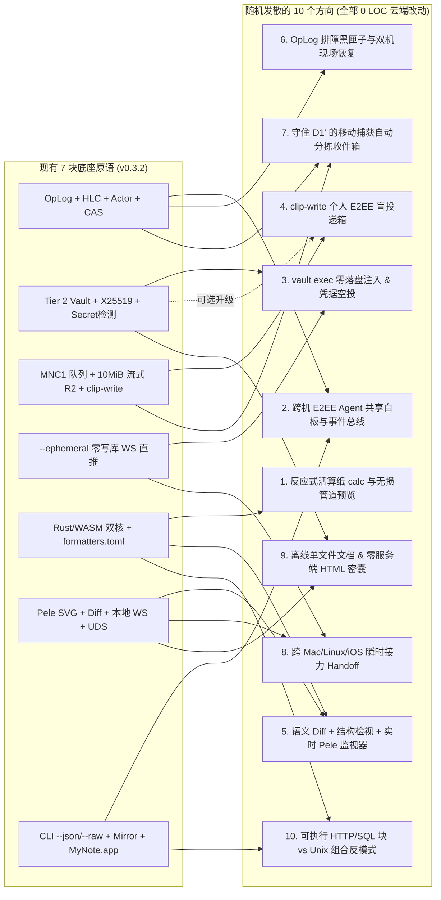

# `my-note` 基建能力外延：10 个发散方向的深度调研与架构审视

> **文档分类与状态**：调研报告（`research/pending/`，`Pending` — 尚未转化为正式方案）。本文仅作基于 `v0.3.2` 基建的能力外延探索与约束分析，**严禁直接作为开发、原型或实施依据**。若其中任一方向后续经明确确认进入路线图，必须先转化为 `docs/` 下的正式方案正文并移入 `research/converted/` 后方可实施。


> **基线核验**：基于仓库 `main` @ `v0.3.2`（`ad7f979`）实测代码撰写，所有基建断言均已核对源码，数字按仓库规范标注 `[已测]` / `[保证]` / `[目标]` / `[估算]`。

---

## 0. 顶层认知重构：你手里其实不是一个「记事本」

如果只把 `my-note` 看作「Heynote + iCloud 的替代品」，想象力会被锁死在「加标签、加双链、加看板」这类传统笔记软件的红海套路里。

剥离表层 UI，盘点 `v0.3.2` 已经上线跑通的 **62.8k LOC** `[已测]` 代码，你实际上已经建成了一套**个人级、跨 NAT、零运维、端到端加密的分布式个人基础设施（Personal E2EE Substrate）**，包含 7 块高度可组合的底层原语：

1. **不可变 E2EE 状态日志引擎**（[model.rs](../../crates/mynote-core/src/model.rs)、[sync.rs](../../crates/mynote-core/src/sync.rs)）：块级全量 `zstd` 历史、精准 `HLC`、`device_id`、`actor` 归属、多叶子因果 DAG、乐观锁 `--expected-head`、幂等键 `--idempotency-key`。
2. **双层零知识密码原语 + 可控碎纸**（[crypto.rs](../../crates/mynote-core/src/crypto.rs)、[vault.rs](../../crates/mynote-core/src/vault.rs)）：`XChaCha20-Poly1305`、`Argon2id (32768, 2, 1)`、`X25519` 非对称封装（`MNRS`）、`zeroize` 内存擦除、常驻 Daemon 零 Tier 2 明文、凭据正则检测 `detect_secret_pattern`。
3. **物理隔离的「流式大对象 + 零写库瞬时推送」双管道**（[clip.rs](../../crates/mynote-core/src/clip.rs)、[index.ts](../../cloud-cf/src/index.ts#L303-L382)）：
   - `MNC1` 100 条环形队列（7 天自动过期）+ R2 `clip/blobs/` 10 MiB 流式加密二进制（零 Worker 内存暴涨、0 进入 DO PITR）；
   - `--ephemeral`（`≤ 256 KiB`）纯内存 WebSocket 直推（0 写库、0 写 R2、无在线桌面诚实返回 `409 NO_ONLINE_DESKTOP`）；
   - 四态最小权限令牌（尤其是无 `SMK`、全 `GET` 返回 `403` 的单向只写令牌 `clip-write`）。
4. **双目标纯 Rust 计算核 + 沙盒外部管道**（[format.rs](../../crates/mynote-core/src/format.rs)、[formatters.rs](../../crates/mynote-cli/src/formatters.rs)）：`mynote-core` 同时编进原生二进制与 WASM（且**桌面 WASM `web/src/wasm/pkg` 与 PWA WASM `web/src/wasm/pkg-pwa` 已物理拆包**），外加带超时和零字节熔断的 `formatters.toml` 子进程执行器。
5. **本地单写入方数据总线**（[daemon.rs](../../crates/mynote-cli/src/daemon.rs)、[uds.rs](../../crates/mynote-cli/src/uds.rs)）：SQLite `STRICT + WAL + FTS5`、只读 Markdown Mirror、`0600 daemon.sock` UDS IPC、`/v1/local/ws` 实时推送。
6. **离线防 XSS 渲染与原生壳层**（[diagram.ts](../../web/src/render/diagram.ts)、[diff.ts](../../web/src/render/diff.ts)、[AppDelegate.swift](../../apps/macos/Sources/MyNoteShell/AppDelegate.swift)）：CM6 + Vim + DOMPurify Markdown + 离线 Pele 纯 SVG（支持 Copy PNG）+ 可视化 Diff + 零三方依赖纯 Swift `MyNote.app` 全局热键壳 + Omarchy Hyprland。
7. **Agent-Native 稳定 CLI 契约**（[cli.rs](../../crates/mynote-cli/src/cli.rs)、[SKILL.md](../../skill/SKILL.md)）：`--json`/`--jsonl`/`--raw`、稳定退出码 `0..8`、`< 250 tokens` 技能定义。

### 任何新方向都必须面对的 3 条硬天花板

> [!IMPORTANT]
> 调研和筛选一切新功能之前，必须先认清仓库当前的**硬工程预算**：
> 1. **云端代码预算已贴顶**：`cloud-cf/src/` 当前为 **929 / 950 LOC** `[已测]`（[index.ts](../../cloud-cf/src/index.ts) 835 行 + [wire.ts](../../cloud-cf/src/wire.ts) 94 行），仅剩 ~21 行余量。**凡是需要改 `cloud-cf` 路由或表结构的想法，默认处于极高负杠杆区间**；真正高价值的方向应当做到 **云端 0 LOC 改动**。
> 2. **PWA 首屏 WASM 预算吃紧**：`pkg-pwa` 实测 `304,412 B` gzip-9 vs `350 KiB` 上限 `[已测]`，仅剩 ~46 KiB。重型前端/WASM 计算能力必须隔离在**桌面专属 `pkg` 包**，严禁污染手机只读 PWA。
> 3. **不可交易的红线（[AGENTS.md](../../AGENTS.md) §3）**：不破坏 G1 永不丢数、不破开 D1′ 手机禁写笔记、不让 Daemon 持有 `VKEK` 或 Tier 2 明文、不引入云端/本地 MCP、不违背 C1 单人可维护预算。



---

## 1. 10 个发散方向全景对比矩阵

| # | 方向 | 形态 | 云端改动 | 客户端/核心改动 | 红线风险 | 独特性 | 综合评级 |
| :-: | --- | --- | :-: | --- | :-: | :-: | :-: |
| **1** | **纯 Rust/WASM 反应式活算纸（`calc`）** | 桌面产品功能 | **0 LOC** | `mynote-core` ~400 行 + 桌面 WASM + CM6 装饰 | 低（隔离 `pkg-pwa`） | 补齐 Heynote 唯一遗珠 | **S（最值得进 M5）** |
| **2** | **Mac ↔ Omarchy 跨机 Agent 共享白板** | 现成用法 + 极小 CLI 增强 | **0 LOC** | 今天 0 行可玩；增强 `mynote watch` ~250 行 | 中（防提示注入） | 跨 NAT + 人类可读 + 审计 | **S（零成本高杠杆）** |
| **3** | **`vault exec` 零落盘注入 & 凭据空投** | CLI 安全新能力 | **0 LOC** | `mynote-cli` ~200 行（复用现有解锁路径） | 低（恪守 T5 边界） | 开发者临时 `.env` 杀手 | **A（高实用价值）** |
| **4** | **基于 `clip-write` 的个人 E2EE 盲投递箱** | 现成用法 + 独立小脚本 | **0 LOC** | 今天 0 行可玩（VPS/CI/脚本直接发图发日志） | 低（隔离 `SMK`） | 被严重低估的隐藏神器 | **A（零成本惊喜用法）** |
| **5** | **语义 Diff + JSON/JWT 检视 + 实时 Pele 监视器** | UI 提效 + CLI 玩法 | **0 LOC** | 实时图 0 行可玩；块间 Diff/检视 ~400 行 TS | 极低（纯只读视图） | 替代 DiffChecker/DevToys | **A（高频日用增益）** |
| **6** | **OpLog 排障黑匣子 & 双机切换现场恢复** | CLI/UI 只读查询 | **0 LOC** | 纯读 `sync_ops`，CLI ~300 行 + UI 抽屉 | 极低（需兼容碎纸空洞） | 榨干全量历史结构红利 | **B（优雅但中频）** |
| **7** | **移动捕获 → 桌面常驻节点自动分拣收件箱** | Daemon 本地规则引擎 | **0 LOC** | Daemon 规则 + 确定性 `block_id` ~300 行 | 中（7 天 TTL 丢数边界） | 不破 D1′ 补齐手机录入 | **B（适合有常驻桌面节点）** |
| **8** | **跨 Mac/Linux/iOS 的 E2EE 瞬时接力（Handoff）** | Daemon 本地动作钩子 | **0 LOC** | 客户端约定 JSON + 通知/弹窗确认 ~250 行 | **高（严防 RCE！）** | 跨生态 Apple Handoff | **C（受限于安全收敛）** |
| **9** | **离线单文件 Pele 报告 & 零服务端「HTML 密囊」** | CLI/UI 导出器 | **0 LOC** | 导出模板打包 ~350 行 | 低（不含云端分享） | 不破单人定位实现交付 | **B（偶发极爽能力）** |
| **10** | **可执行 HTTP/SQL 调试块（反模式对照）** | 架构边界压测 | **0 LOC** | **不应内建**；30 行外部 Unix 管道替代 | **极高（破沙盒/SSRF）** | 划清「工具边界」标本 | **D（严禁内建，走管道）** |

---

## 2. 10 个方向逐一深度调研与工程剖析

---

### 方向 1：纯 Rust/WASM 反应式活算纸（`calc` 块）与无损转换预览

#### 1.1 场景与趣味性
回顾 [architecture-proposal.md](../../docs/architecture-proposal.md#L89)，Heynote 令人上瘾的三大核心能力是「多语言分块」「一键格式化」和 **「内联 Math.js 活算纸」**。`my-note` 在前两项上已经反超 Heynote，但第三项目前仍是空白。
开发者日常在 Scratchpad 里算东西的频率极高，而且和普通计算器完全不同——开发者算的是**带变量上下文的工程算术**：
- 估算云成本与吞吐：`ops_per_day = 500`, `bytes = 1.2 KiB`, `yearly = ops_per_day * 365 * bytes -> MiB`
- 进制与位运算：`0x1f40 & 0xff`, `1 << 20`, `0b101101 -> hex`
- 时间与容量换算：`7 days in ms`, `10 MiB / 512 KiB`, `2026-11-28 + 37d`
- 简单多行汇总：`subtotal = sum`, `after_tax = subtotal * 1.13`

如果把一个块的语言切成 `lang = "calc"`，编辑器右侧行尾（Right Gutter）实时以只读装饰器显示每一行的计算结果，点击结果一键复制，且**原始文本里完全不污染计算结果**（不会像某些工具那样把 `= 123` 写进正文破坏版本 diff）。更进一步：同一套非破坏性预览机制还可以挂在现有 `format.rs` 的转换动作上（例如光标停在 JWT 或 Unix 时间戳上，行尾直接浮现解码后的过期时间与 RFC3339，而不改写原文）。

#### 1.2 基建复用解剖
- **数据层**：直接复用 `BlockContent.lang` 的字段级 LWW，新增语言值 `"calc"`，线格式与 `cloud-cf` **0 LOC 改动**。
- **计算核**：`crates/mynote-core` 已经负责纯 Rust 离线计算（[format.rs](../../crates/mynote-core/src/format.rs)），且 `web/src/wasm/` 已经拆分成桌面包（`pkg/`）和手机 PWA 包（`pkg-pwa/`）。
- **加密兼容**：因为计算器运行在桌面 `mynote-wasm` 内，**解锁后的 Tier 2 加密块（比如算薪资、税务、资产配置）也能在内存中实时运算**，绝不向 Daemon 或云端泄露明文！
- **CLI 复利**：`mynote format --lang calc` 或 `mynote calc` 可在终端管道直接运行，甚至作为 Agent 的确定性算术验证器（彻底杜绝 LLM 心算翻车）。

#### 1.3 技术深潜与关键设计
- **严禁引入 `mathjs` 或重型符号计算库**：`mathjs` 光 JS bundle 就数百 KB，且会破坏 Rust/TS 同构。应当在 `mynote-core` 里手写一个零外部依赖（或极轻量）的 **Pratt 递归下降求值器**（约 400–600 行 Rust `[估算]`），支持：
  - `f64` + 可选 `i128` 精确整数/位运算模式（避免 `1 << 55` 精度丢失）；
  - 工程单位制（`B/KiB/MiB/GiB/TiB`、`KB/MB/GB`、`ms/s/m/h/d/w`、`%`）；
  - 单块内自顶向下环境（`var = expr`、隐式引用上一行 `prev`、区间求和 `sum` / `avg`）；
  - 严格确定性、无 I/O、无死循环（无函数定义与循环语句，天然 $O(n)$ 停机保证 `[保证]`）。
- **编译隔离守住 PWA 预算**：在 `mynote-core/Cargo.toml` 用 Cargo feature（如 `calc`，桌面与 `pkg` 启用，`pkg-pwa` 禁用），保证 PWA WASM 体积增加 **0 字节** `[保证]`，桌面 WASM 增量控制在 `< 15 KiB` gzip `[估算]`。
- **UI 交互**：CM6 用 `ViewPlugin` + `Decoration.widget`（`side: 1`）在行尾渲染淡色等宽结果标签；遇到语法不完整行静默跳过不报红（草稿纸体验优先）；点击结果复制数值并显示极轻反馈。

#### 1.4 冷酷盲区审计
- **别做成半吊子电子表格或汇率查询器**：一旦有人提议「联网拉实时汇率」，立刻违背「桌面离线纯本地、零隐式外联」的安全哲学（[interface-contracts.md](../../docs/interface-contracts.md#L161)）。汇率只允许用户在块顶部手写 `usd = 7.25`。
- **浮点数陷阱**：财务加减用 `f64` 会出现 `0.1 + 0.2 = 0.30000000000000004`。若做 `calc`，显示层必须做有效数字规整或底层直接用定点数 / `rust_decimal`（需先测 WASM 增量）。

#### 1.5 落地判定
- **评级：S（最高优先级的产品级 M5 候选）**。零云端改动、直接补齐 Heynote 替代闭环的最后一块体验缺口，同时给终端和 AI Agent 附送了一个确定性工程计算器。

---

### 方向 2：Mac ↔ Omarchy 跨机 E2EE AI Agent 共享白板与事件总线

#### 2.1 场景与趣味性
你的真实工作环境是 **macOS + Omarchy（Arch/Hyprland）双桌面**，两边都跑着 Claude Code / Codex / OpenCode / Antigravity。目前跨机让 Agent 交接工作通常要靠：推一个临时 Git 分支、走 SSH 复制粘贴、或者配重型调度系统。

但 `my-note` 的现有基建恰好天然满足「**跨机 Agent 短期工作记忆白板（Ephemeral Blackboard）**」的所有苛刻条件：
1. **跨 NAT 亚秒级直达**：无需打通内网或 SSH 隧道，Cloudflare DO WebSocket 唤醒让 Mac Agent 写下的内容在 **150–400 ms** `[目标]` 内同步到 Omarchy 的本地 SQLite 与只读 Markdown 镜像；
2. **原生并发防覆写**：每个 Agent 通过 `--actor claude-mac` / `--actor codex-omarchy` 标识身份，更新时强制带 `--expected-head <op_id>`，两台机器上的 Agent 同时修改同一块时会收到退出码 `4`（`HEAD_MISMATCH`）和 `actual_heads`，天然实现乐观锁 CAS；
3. **人类全程可透视、可介入**：你在 `MyNote.app` 或 iPhone PWA 上能实时看到两台机器 Agent 正在协作的 Markdown 任务单和 Pele 架构图，随时用 `block revert --undo-actor codex-omarchy` 一键回滚某台 Agent 写坏的改动！

#### 2.2 基建复用解剖
- **今天就能 0 代码开玩**：`--actor`、`--expected-head`、`--idempotency-key`、`--json`、`block history`、`block revert --undo-actor`、只读 Markdown 镜像、`SKILL.md` **全部已上线**（[cli.rs](../../crates/mynote-cli/src/cli.rs)、[SKILL.md](../../skill/SKILL.md)）。
- **极小增强解锁事件驱动**：Daemon 内部已有 `/v1/local/ws` 广播 `blocks_changed` / `clip_changed`（[interface-contracts.md](../../docs/interface-contracts.md#L242-L248)）。只要在 CLI 增加一个约 200 行 `[估算]` 的只读子命令 `mynote watch [--buf <name>] [--clip] --jsonl`（通过 `0600 daemon.sock` 订阅事件流，绝不暴露 HTTP Cookie），任意本地脚本或后台 Agent 就能从「定时轮询」升级为「**毫秒级事件触发**」。

#### 2.3 技术深潜与关键设计
- **标准白板约定（纯用法层）**：建一个名为 `handoff` 或 `agent-board` 的 Buffer：
  - 块 1（`lang = "json"`）：机器可读状态机（`{"task": "...", "owner": "omarchy", "status": "running", "artifact_commit": "..."}`），用 `--expected-head` 做原子领单/交棒（CAS 抢锁）；
  - 块 2（`lang = "markdown"`）：人类可读上下文 + 内嵌 Mermaid 状态图（手机随时可看进度）；
  - 块 3+：各机器 Agent 用 `mynote add --buf handoff --idempotency-key <step_id>` 追加结构化诊断日志。
- **人机审批闸门（Human-in-the-Loop）**：结合现有红线，Agent 无法执行 `trash confirm` / 无法解密 Tier 2 Vault。可以构造一种反直觉的「**物理审批模式**」：Agent 把待确认的高危变更计划写入 `handoff` 并 `--ephemeral` 推送提醒；人类核验后，由人类在桌面手动把某个标记块状态改为 `approved`（记录 `actor = "human"`），下游脚本校验最后一次修改的 `actor == "human"` 且 `device_id` 为受信任桌面才继续放行！

#### 2.4 冷酷盲区审计
- **最大盲区：Prompt Injection 跨机传染**！如果普通 `scratch` Buffer 里粘贴过第三方网页或外部报错日志，同时又让 Agent 扫描全库，恶意文本可能借同步通道从一台机器感染另一台机器上的 Agent。**强制纪律**：给 Agent 的协作约定必须限定在显式白名单 Buffer（`--buf handoff`），绝不自动执行白板里的原始文本作为 shell 指令。
- **不要与独立长期记忆库 / 多机任务调度器 / Git 抢职责**：`my-note` 的白板是**热态、短周期、偏草稿和可视化交接**的；跨会话长期记忆归独立记忆系统，多机 DAG 任务调度归专用调度器，代码变更归 Git。硬把 `my-note` 改造成完整工单系统会破坏简洁性。
- **验证 `actor == "human"` 不是密码学防线**：同 UID 下恶意 Agent 可以伪造 `--actor human`（符合 [threat-model.md](../../docs/threat-model.md) T5 诚实边界），它只防误触和浅层注入，不防本地提权攻击者。

#### 2.5 落地判定
- **评级：S（今天 0 代码即可实战；`mynote watch --jsonl` 作为极轻增强性价比爆表）**。

---

### 方向 3：`mynote vault exec` 零落盘 `.env` 注入 & 阅后即焚跨机凭据空投

#### 3.1 场景与趣味性
开发者最容易泄密的两个高频瞬间：
1. 在项目根目录随手建一个 `.env.local` 或 `.env.agents` 塞 API Key、测试数据库密码、Cloudflare 临时 Token，结果忘了加 `.gitignore`、被备份软件扫走、或者换一台机器（Mac → Omarchy）又得重新翻微信/Bitwarden 手动贴一遍；
2. 手机收到验证码 / 另一台电脑生成了一个临时 SSH 密码或一次性 API Key，只想立刻传给另一台电脑用一次，**绝不想它留在任何云端数据库或 30 天 PITR 备份里**。

`my-note` 已经为这两件事打好了 95% 的地基，只差临门一脚的 CLI 胶水！

#### 3.2 基建复用解剖
- **玩法 A（`mynote vault exec`）**：复用已有的 Tier 2 Vault（`VKEK` 仅在短生命周期 CLI 进程内存解锁，退出即 `zeroize`，常驻 Daemon 零明文，[vault.rs](../../crates/mynote-core/src/vault.rs#L27-L86)）与 `mynote block get <id> --decrypt`（强制 `/dev/tty` 交互口令）。
- **玩法 B（阅后即焚空投）**：复用已有的 `--ephemeral` 零写库 WS 通道（[index.ts](../../cloud-cf/src/index.ts#L313-L323)）+ 桌面剪贴板回滚栈 `mynote clip undo` + 定时清空剪贴板机制。
- **云端改动**：**0 LOC**。

#### 3.3 技术深潜与关键设计
- **`mynote vault exec <block_id> [--format dotenv|json] -- <cmd> [args...]`**（~150–200 行 Rust `[估算]`）：
  1. 严格要求 `/dev/tty` 交互（非 TTY 返回退出码 `2` `INTERACTION_REQUIRED`，与现有 `vault` 契约一致）；
  2. 在短生命周期 CLI 进程内存中用口令解出 `VKEK` → 解开指定块（支持 `KEY=VALUE` dotenv 或顶层扁平 JSON 对象）；
  3. 用 `Zeroizing` 包装解析出的键值表，通过 `std::process::Command::envs()` 直接注入子进程环境；
  4. 立即在父进程等待期间或退出时擦除内存，**磁盘上永远不产生 `.env` 文件，Shell 历史里不留任何明文值**；
  5. 可选配合 `public_hint`（如 `public_hint = "env:my-project-staging"`），让命令支持 `mynote vault exec --hint env:my-project-staging -- cargo test`，不必记 26 位 ULID！
- **阅后即焚空投增强（`--burn-after <seconds>`）**：
  - 接收端收到 `clip_ephemeral` 帧且用户确认应用到剪贴板后，Daemon 记录当前系统剪贴板哈希，启动定时器（默认 30s / 60s）：到期时若系统剪贴板仍等于该敏感内容哈希，自动调用 `clip undo` 恢复原剪贴板（或清空）。结合现有的 macOS `ConcealedType` / Wayland 敏感提示标记，连本地剪贴板历史工具（Maccy/`cliphist`）都拦截记录！

#### 3.4 冷酷盲区审计
- **严守诚实威胁边界（T5）**：必须清晰写进文档——在 Linux 上同 UID 进程可以读 `/proc/<child_pid>/environ`，在 macOS/Linux 上子进程自身也可以把环境变量打印到日志。`vault exec` 防的是**磁盘明文残留、意外 `git add`、Spotlight/TimeMachine 索引泄露和云端存储暴露**，绝不是防恶意子进程或同 UID 持久化木马。
- **防范围蔓延：不要做成第二个 Bitwarden / 1Password**：绝不加浏览器自动填充、TOTP 2FA 托管、多用户共享密钥库、SSH Agent 协议模拟。定位死守「**开发者临时开发块/环境变量的零落盘执行**」。

#### 3.5 落地判定
- **评级：A（投入极小、开发者爽感极高、完美契合 G4 安全哲学）**。

---

### 方向 4：基于 `clip-write`（及进阶 X25519 Sealed Box）的个人 E2EE 盲投递箱（Dead-Drop）

#### 4.1 场景与趣味性
在 [cloud-cf/src/index.ts](../../cloud-cf/src/index.ts#L445-L455) 里，你为了 iOS 快捷指令造了一样极其精妙但被低估的原语：**`clip-write` 单向只写令牌**。
回顾它的权限矩阵：
- 配对票据里**完全不含 `SMK` 和 `VKEK`**；
- 对所有笔记路由、密钥路由、碎纸路由、甚至 **`GET /v1/clip*` 读取路由**全部返回 `403 TOKEN_SCOPE_FORBIDDEN`；
- 唯一放行 `POST /v1/clip`（≤ 64 KiB 文本 / 256 KiB `--ephemeral`）和 `PUT /v1/clip/blob`（**10 MiB 流式加密图片或长文本直写 R2，7/8 天自动焚毁**）。

这本质上已经是一个**零额外月费的个人加密 Push / Webhook 投递箱（Self-Hosted E2EE Pushover + Imgur + Wormhole）**！
想一想你能把 `clip-write` 令牌部署到哪些「你不敢放完整同步密钥（SMK）」的半可信外部节点上：
1. **公网 VPS / 远程算力机 / CI Runner**：深夜跑完一个 3 小时的训练、压测、构建或爬虫脚本，直接把 Markdown 摘要或者生成的 Matplotlib/火焰图 PNG（≤ 10 MiB）加密推送到 `PUT /v1/clip/blob`——你早起打开手机 PWA 或 Mac `MyNote.app` 剪贴板抽屉，图表已经端到端加密静静躺在那里，7 天后自动清理不留垃圾！
2. **公用电脑 / 临时测试容器 / 浏览器 Bookmarklet**：不登录全量笔记，只挂一个可随时吊销的 `clip-write` 令牌，一键把抓包 JSON 或网页截图丢回主力机。
3. **家庭 IoT / 监控告警**：低频关键告警带一张现场快照 PNG 直接加密直推到个人剪贴板，完全不经过第三方 Telegram/飞书/Bark 服务器中转明文！

#### 4.2 基建复用解剖
- **今天就能 0 代码开玩**：只需运行 `mynote device add --name vps-drop --scope clip-write`，配合仓库里现成的 [mynote-clip-push.js](../../deploy/ios-shortcuts/mynote-clip-push.js) 思路（或写一个 <120 行独立 Python/Shell/Rust 小脚本做 `MNC1` 封装），即可在任意无头 Linux 上零安装投递图文。
- **云端改动**：**0 LOC**。

#### 4.3 技术深潜与密码学盲区进阶
- **深挖当前对称 `ClipKey` 的细微缺口**：
  - `clip-write` 虽然不能调用 `GET /v1/clip*`，但因为 `MNC1` 使用对称密钥 `ClipKey`，那个半可信 VPS 本地仍存有 `ClipKey`。如果攻击者**同时**攻破该 VPS **且**攻破你的 Cloudflare 账号/网络（拿走 R2/DO 密文），他就能解密过去 7 天内其他设备发出的剪贴板。
  - 常规处置很简单：只把 `clip-write` 发给你的自有 VPS/手机；一旦怀疑泄露，`mynote device revoke <id>` + `mynote clip rotate-key` 瞬间清空云端并换钥（现有能力已完整支持！）。
- **真正酷的密码学升级（无需改云端！）**：
  - 注意 `mynote-core` 已经内置了 **`x25519_dalek` 非对称封装（`MNRS`）**（[crypto.rs](../../crates/mynote-core/src/crypto.rs#L11)）！
  - 如果将来想把投递箱发给**完全不可信的第三方（甚至做成公开的「给我发加密匿名消息/文件」投递页）**，可以在 `MNC1` 之外定义一个客户端侧的纯非对称 `SealedClip` 载荷（或把 `ClipMetaV1` 封进 X25519 公钥信封）：投递方只拿 **公钥**，连解密自己刚发出去的内容都做不到！而对 `cloud-cf` 来说它依然是一段不透明的 `meta_envelope` 字节流（**0 LOC 云端改动**）。

#### 4.4 冷酷盲区审计
- **队列踩踏（Eviction）风险**：`CLIP_MAX_ITEMS = 100` 是全局环形队列（[index.ts](../../cloud-cf/src/index.ts#L258-L265)）。如果某个失控的 VPS 监控脚本陷入死循环疯狂推送告警，会在几分钟内把你正常的 100 条剪贴板全部顶出淘汰！
  - **对策**：千万别把高频日志流（如每秒一条的 syslog）接进 `clip-write`；只接低频高价值完成事件/人工触发投递，且最好在本地脚本侧加硬频率上限。
- **R2 免费额度边界**：单月 100 万次 Class A（写）完全够用，但 10 GB 存储上限下 100 条 × 10 MiB 极端也就 1 GiB `[保证]`，成本依然 **\$0** `[估算]`。

#### 4.5 落地判定
- **评级：A（今天零代码改写就能开发出极酷用法；包装一个轻量独立 `mynote-drop` CLI/脚本即可封神）**。

---

### 方向 5：排障可视化工作台——任意块/剪贴板语义 Diff + 结构化检视 + CLI 驱动实时 Pele 监视器

#### 5.1 场景与趣味性
开发者每天都在做三类高频微操作，往往被迫切去在线网站（还有泄密风险！）或笨重 IDE：
1. **临时对比两段输出**：线上环境 vs 测试环境的 API JSON（字段顺序还不一样！）、改前 vs 改后的 SQL、刚才复制的剪贴板 vs 草稿纸里存的基准配置；
2. **解剖一坨巨型 JSON / JWT / URL**：200 KB 嵌套 JSON，只想折叠树看结构、点某个叶子复制 `jq` 路径、一眼看出里面的 `1795521600` 是哪天几点、`exp` 过没过期；
3. **画动态可视化图表**：写脚本跑依赖分析、抓状态机流转、统计模块耗时，想在屏幕一角实时看到渲染好的 Mermaid 图。

你其实已经把 80% 的轮子写完了——[diff.ts](../../web/src/render/diff.ts)（多叶子/历史 diff）、[format.rs](../../crates/mynote-core/src/format.rs)（JSON/YAML/TOML 规范化、JWT/时间戳/Query 解码）、[diagram.ts](../../web/src/render/diagram.ts)（离线 Pele 纯 SVG + 平移缩放 + Copy PNG）和 `/v1/local/ws` 实时刷新！

#### 5.2 基建复用解剖
- **玩法 A（实时流式 Pele 图表监视器 —— 今天 0 代码可玩！）**：
  - 新建一个 `lang = "mermaid"` 块，在浏览器/`MyNote.app` 切到预览态。
  - 在终端里跑任意脚本，每次状态更新执行：`generate_mermaid | mynote block update <id> --force`（或循环持最新 `head_op_ids`）。
  - Daemon 写入 WAL 后立刻经 `/v1/local/ws` 推送 `blocks_changed`，前端 `DiagramWidgetHandle.update(nextSource)`（[diagram.ts](../../web/src/render/diagram.ts#L33)）直接平滑重绘纯 SVG！一键点 Copy PNG 就能贴进 PR 或文档。
- **玩法 B（任意两块 / 剪贴板语义 Diff）**：
  - 复用 [diff.ts](../../web/src/render/diff.ts)，在块头加一个「钉住为基准（Pin as Diff Base）」按钮，点击任意另一块（或 Clip Drawer 里的一条文本）即弹出并排 Diff 视图；
  - 对 `json` / `yaml` / `toml` 块提供「**规范化语义 Diff（Canonical Diff）**」开关：先调用内存里的 `mynote-wasm` 把两边键按字典序重排并统一缩进，再喂给 `diff.ts`——彻底消除 JSON 键乱序造成的全屏假红绿！而且因为走 WASM，**两个解锁态的 Tier 2 加密配置块也能纯内存语义对比**！
- **玩法 C（只读 JSON/JWT 结构检视模式）**：
  - 类似现有 Markdown 的「源码/预览」双模切换，给 `json` 块加一个轻量纯只读「Tree 检视」模式：可折叠节点、悬停显示完整 JSONPath/`jq` 路径一键复制、自动把 10/13 位疑似 Unix 时间戳和三段式 JWT 在右侧浅色标注解码摘要。

#### 5.3 技术深潜与关键设计
- **云端改动**：**0 LOC**；**SQLite Schema 改动**：**0**；**PWA 体积影响**：**0**（全部仅打包进桌面前端 `web/src/`）。
- **关于高频流式更新 OpLog 膨胀的注意**：如果真有人拿「实时 Pele 监视器」每 1 秒写一次 `block update`，1 小时就会产生 3,600 条永久 `ops` 污染同步日志！
  - **专业玩法建议**：低频（几分钟一次，如 CI/排障阶段图）直接走 `block update`；高频（秒级监控）绝不该进永久 OpLog，可以改推到一个本地非持久化内存态视图或放弃此高频用法。

#### 5.4 冷酷盲区审计
- **严防 SEC-06 XSS 退化**：新增 JSON Tree / 语义 Diff 视图必须 100% 使用 `textContent` / DOM API 构造节点，绝不使用 `innerHTML` 拼接未清洗文本，保持现有 Playwright SEC-06 门禁全绿。
- **别把前端做成重型 IDE**：JSON Tree 检视器手写一个 250 行 `[估算]` 的虚拟化/懒展开 DOM 树即可，严禁引入 React JSON Viewer 之类庞大三方依赖破坏轻量定位。

#### 5.5 落地判定
- **评级：A（实时图表今天就能玩；「任意两块/剪贴板规范化 Diff」是极高频、极低维护成本的桌面杀手特性）**。

---

### 方向 6：开发者排障「黑匣子」——基于永久全量 OpLog 的时间线复盘与双机切换现场恢复

#### 6.1 场景与趣味性
因为 **D3** 放弃了复杂的 delta 链（`SPAN_PATCH`），你现在每一条 `sync_ops` 记录都存着**完整的 `zstd` 载荷 + 精确 `HLC` + `device_id` + `actor` + `parent_op_ids`**（[model.rs](../../crates/mynote-core/src/model.rs#L42-L52)）。
绝大多数人只把这套 OpLog 当作「防丢数和单块 Time Travel 的保险丝」，却忽略了它横跨**所有 Buffer、所有设备、所有 Agent** 的全局时间线价值：

1. **双机切换「现场恢复面板」（Context Handoff Digest）**：早上在 Mac 上查了半小时 Bug，下午坐到 Omarchy 电脑前，往往忘了刚才顺手记在哪个 Buffer 里。一个极简命令/快捷键 `mynote recent --other-device`（或 UI 顶部小入口）按 `HLC` 倒序拉出「**过去 2 小时在另一台设备上改过/建过的 Top 8 块 + 最近 5 条剪贴板**」，1 秒接回心流！
2. **线上排障 Postmortem 自动生成（`mynote timeline --since "2h ago" --export md`）**：昨晚折腾一个诡异故障 2 小时，往 `scratch` 里陆续贴了报错日志、SQL、curl 响应、改动前后的配置，期间还让 Claude 写了两次分析。事后一键按时间聚类（相隔 <15 分钟的编辑折叠为一个事件），输出一份带时间戳、设备标、Actor 标、自动跳过加密块的**结构化复盘草稿 Markdown**，直接贴进团队复盘文档或个人知识库！

#### 6.2 基建复用解剖
- **零新增写入路径、零新表、零云端改动**：所有数据已经在本地 `mynote.db` 的 `sync_ops`、`blocks`、`buffers`、`clip_items` 里安静躺着。
- **复用只读安全边界**：加密块（`is_locked == 1`）在时间线导出里统一只输出 `[LOCKED BLOCK: <public_hint>]` 占位符，遵循与只读 Markdown 镜像完全一致的零泄密纪律。

#### 6.3 技术深潜与关键设计
- **正确处理 D2′ 加密碎纸留下的历史空洞**：
  - 因为已删除或「换钥加锁」的旧 `key_id` 会在宽限期满后被置空（`KEY_SHREDDED`），扫描 `sync_ops` 时不能假设每条 op 都能解密。
  - 时间线查询遇到已碎纸的 `key_id` 时，优雅渲染为元数据节点（`14:22 · Mac · [已碎纸版本]`），绝不报错中断。
- **去噪聚合算法（关键体验决定成败）**：
  - 正常打字防抖 500ms 刷一次盘，2 分钟编辑同一块可能产生 15 条 op。如果直接裸打印 `sync_ops` 会像一坨流水账垃圾。
  - 必须做 **Session 窗口聚合**：同一 `(block_id, device_id, actor)` 在连续 `Δt ≤ 5 min` 内的多次 `UPDATE` 合并为一个「编辑会话」，仅展示首尾 diff 摘要（新增/删除行数 + 首行预览）。

#### 6.4 冷酷盲区审计
- **真实频次审视**：`mynote recent --other-device`（双机切换现场恢复）是**每天触发多次**的真痛点，几十行 SQL 查询就能落地；而「Postmortem 时间线导出」属于**月级低频**动作，千万别给它画复杂的甘特图或时间轴可视化 UI——保持为纯 CLI 子命令 `mynote timeline` 即可，做到极低维护成本。

#### 6.5 落地判定
- **评级：B（「双机现场恢复」建议做进快捷命令面板；「黑匣子复盘导出」做成极轻 CLI 子命令，不做重 UI）**。

---

### 方向 7：守住 D1′ 的合法破局——「移动端捕获 → 桌面常驻节点自动分拣收件箱」

#### 7.1 场景与趣味性
回顾 [review/2026-11-24-first-principles-review.md](../../review/2026-11-24-first-principles-review.md) §9：
- **D1′** 明确砍掉了「手机编辑/追加笔记」，因为一旦让手机写 `ops`，就会把 outbox、iOS IndexedDB 驱逐丢数、冲突合并 UI、移动端编辑器全套灾难重新拖回系统；
- **D8** 却开放了物理隔离的 `/v1/clip*` 通道，且手机端已经有 **iOS Shortcuts / Scriptable 一键投递** + **Android PWA `share_target`**！

这就出现了一个极具巧思的**结构性套利**：**永远不让手机写笔记，但让家里/桌面上受信任的 `read-write` Daemon 帮手机把特定剪贴板“提升”成笔记！**
体验流：
1. 你在地铁上用 iPhone 看到一篇好文章、冒出一个架构灵感，或用语音转文字口述一段待办，点一下 iOS 共享菜单里的「存入 mynote 收件箱」（发往 `clip-write`，内容前缀带约定的魔术标签如 `@inbox` 或 JSON 元标签，或者来自专属设备名 `iphone-inbox`）；
2. 300ms 内，家里常驻开机的桌面 Daemon（如常驻桌面主机，或恢复开机后的 Mac/Omarchy）收到 `clip_wake` → 自动匹配本地分拣规则 → 调用内部 `promote` 将其写入 `inbox` Buffer（甚至自动识别 URL / JSON 触发格式化）→ 自动把原 clip 从剪贴板队列删除或标已处理；
3. 几百毫秒后，手机 PWA 同步新状态快照/尾部 op，你在手机的 `inbox` Buffer 里已经看到整理好的正式笔记！

#### 7.2 基建复用解剖
- **云端改动**：**0 LOC**！手机令牌依然是 `clip-write` / `read+clip`，对 `/v1/sync/push` 依然 `403`，D1′ 铁律丝毫无损。
- **复用现有能力**：`mynote clip promote` 已实现（[runner_clip.rs](../../crates/mynote-cli/src/runner_clip.rs)），`clip_items` 已携带 `device_id`、`created_at_ms`、`kind`、`text`。

#### 7.3 技术深潜：双桌面同时在线的竞态陷阱（源码级核验！）
乍一看「两台桌面都开自动分拣，用确定性 `op_id` 和 `key_id` 去重」似乎很美——**但核对 [index.ts](../../cloud-cf/src/index.ts#L134-L140) 后发现这是个大坑！**
- 如果 Mac 和 Omarchy 同时为同一条 `clip_id` 强行生成相同的 `key_id`，由于双方随机生成的 `BDEK` 和 `nonce` 不同，第二台提交到 DO `upsertKeyRecord` 时会直接撞上 **`409 INTEGRITY_ERROR: conflicting key_record at wrap_gen=1`**！
- 而且 `MNS1` AAD 绑定了作者 `device_id`，强行共用 `op_id` 也会导致本地和云端作者不一致。

**真正干净且符合现有协议的解法（二选一）**：
1. **单机指定模式（最简推荐）**：像 M4b `watch_enabled` 一样，本地配置 `clip_auto_promote = false`（默认关闭），**只在一台 24×7 常驻机（如常驻桌面主机）上开启**，并用本地 SQLite `local_meta` 记录已处理的 `clip_id`（幂等防重）。零并发竞态、零协议技巧！
2. **多桌面兜底去重**：如果两台桌面都开，不共享 `key_id`/`op_id`，而是按设备字典序设退避延迟（`device_id` 大的延迟 5 秒，先 `pull` 检查是否已有带 `public_hint = "clip:<clip_id>"` 或确定性 `block_id = ULID(created_at_ms, BLAKE3("promote:" || clip_id)[0..10])` 的块；已存在则直接跳过）。即便极端双离线并发，最多在同一个 `block_id` 下产生两个内容完全相同的叶子，绝不触发 `409 INTEGRITY_ERROR`，也绝不丢数！

#### 7.4 冷酷盲区审计
- **必须诚实面对 7 天 TTL 丢数边界**：如果所有桌面端连续关机超过 7 天（比如出国旅行两周且常驻桌面主机断电），停留在 `clip_items` 里的未分拣灵感会被 DO Alarm 按 7 天 TTL 永久清理！
- **结论**：这是一个**依赖常驻桌面节点（如常驻桌面主机）才成立的高级工作流**，绝不能对外包装成「离线永久可靠的移动端写作」。必须诚实告知这一边界。

#### 7.5 落地判定
- **评级：B（对拥有多台桌面机含 24×7 常驻节点的拓扑极具实用价值，但属于纯 opt-in 本地规则功能，需严守 7 天边界诚实披露）**。

---

### 方向 8：跨 macOS ↔ Arch/Hyprland ↔ iPhone 的「E2EE 瞬时接力（Micro-Handoff）」

#### 8.1 场景与趣味性
Apple 生态有 Handoff / AirDrop，KDE 有 KDE Connect（但只走局域网 mDNS，跨网段/公网/iOS 基本废了）。你用 **macOS + Omarchy Linux + iPhone** 混搭，恰恰卡在生态断层里。

而你已经在 Cloudflare DO 上养了一条**免费休眠（Hibernation）、跨公网 NAT、端到端加密、亚秒级送达、带在线确认（`delivered_to` / `409 NO_ONLINE_DESKTOP`）的实时 WebSocket 通道**：`POST /v1/clip { ephemeral: true }`（[index.ts](../../cloud-cf/src/index.ts#L313-L323)）！

在这个 0 写库、0 PITR 的纯内存广播通道上，只需在客户端约定一种极轻的 JSON 信封前缀（例如 `text` 字段识别 `mynote-handoff/v1` 或纯客户端 opt-in 策略），就能白捡跨三平台的微协同能力：
1. **跨生态 Send Tab**：iPhone 看一半的长文档 / Mac 正在看的文档链接，一键「发送到另一台桌面打开」；
2. **跨机长任务完成提醒**：Omarchy 上编译大工程/跑完 eval 后，`mynote notify "cargo test 全部通过 (42s)"`（底层走 `--ephemeral`），Mac 右上角立刻弹出原生系统通知（由 `MyNote.app` 或 `osascript` 呈现）；
3. **截图即看接力**：手机拍一张纸质草图或 Mac 截一张报错图，推给另一台机器直接弹出轻量预览窗口（无需手动切窗口找文件）。

#### 8.2 基建复用解剖
- **云端改动**：**0 LOC**！现有 `POST /v1/clip { ephemeral: true }`（限 256 KiB）已天然提供「只发给其他在线 `read-write` 桌面 + 0 落盘 + 返回送达数量 `delivered_to`」。
- **桌面端**：`MyNote.app`（原生 Swift `AppKit`）与 Omarchy（`notify-send` / `xdg-open`）天然具备系统通知与打开 URL 能力。

#### 8.3 冷酷盲区审计（⚠️ 极高危安全警告！）

> [!CAUTION]
> **这是 10 个方向里最容易不小心埋下致命 RCE（远程代码执行）漏洞的一个！**
> 1. 千万不要把 `--ephemeral` 拓展成「远程执行 Shell 命令」或「静默自动打开任意 URI Scheme」！
> 2. 原因：`clip-write` 令牌（手机快捷指令、甚至方向 4 里的半可信 VPS）**有权调用 `POST /v1/clip { ephemeral: true }`**（见 [index.ts](../../cloud-cf/src/index.ts#L445-L448)）。一旦某个 `clip-write` 节点沦陷，若桌面 Daemon 自动执行收到的命令或无条件拉起 `file://` / `ssh://` / `javascript:` 链接，攻击者立刻获得你 Mac 和 Omarchy 的直接控制权！
> 3. **硬防御护栏**：
>    - 接收端默认**绝不自动执行任何动作**；
>    - 最多只弹出带「点击打开」按钮的被动系统通知（`https://` / `http://` 严格白名单，拒绝一切其他 scheme）；
>    - 真正想做「双机遥控」应该走你已有的 Tailscale + SSH，而不是污染剪贴板密钥信任域！

#### 8.4 落地判定
- **评级：C（仅限于「跨机被动系统通知 + 人工点击确认的 HTTPS 链接接力」还算好玩且安全；任何超越被动通知的自动执行一律禁止）**。

---

### 方向 9：离线单文件 Pele 技术简报导出 & 零服务端密码保护「HTML 密囊」

#### 9.1 场景与趣味性
`my-note` 的非目标写得很死：「不做多人协作、共享与权限管理」——这是对的，加多租户 ACL 和公开分享链接会直接摧毁云端极简架构和零知识承诺。

但实际工作中，单人开发者**仍然经常需要把某个块里的内容一次性交付给别人**：
- **场景 A（精美技术说明交付）**：你在 `my-note` 里写了一段带代码高亮、GFM 表格和 **3 张 Mermaid 架构图**的 Markdown 块，想发给同事看。直接复制 Markdown 源码，对方在微信/飞书/邮件里看不到 Mermaid 图；截长图又无法选中复制代码。
- **场景 B（一次性加密传递敏感信息）**：想给合作方发一组临时服务器配置、接口密钥或内部排查文档，不想明文发 IM，也不想架设 PrivateBin / PasteBin 服务器。

#### 9.2 基建复用解剖
- **云端改动**：**0 LOC**！完全不触碰 Cloudflare Worker，不暴露任何公网链接，保持 100% 单人私有云。
- **复用的现有重资产**：
  - 离线 Markdown 渲染器 + DOMPurify（[markdown.ts](../../web/src/render/markdown.ts)）+ 离线 Pele 纯 SVG 渲染器（[diagram.ts](../../web/src/render/diagram.ts)）+ 现成双主题设计 token（[tokens.css](../../web/src/tokens.css)）；
  - 客户端加密原语（[crypto.rs](../../crates/mynote-core/src/crypto.rs)）。

#### 9.3 技术深潜与关键设计
- **玩法 A：`Export Single-File HTML`（桌面 UI 一键导出）**：
  - 直接从当前 DOM/渲染管线提取已由 DOMPurify 清洗后的 HTML + Pele 产出的纯内联 `<svg>`（已剥离 `foreignObject`/`script`/`style` 等高危标签）+ 压缩后的 CSS Token，包成**单个无任何外部 CDN 请求的 `.html` 文件**（典型体积 `20–60 KiB` `[估算]`）。对方断网双击即看，亮暗主题自适应，代码块支持一键复制。
- **玩法 B：`Export Encrypted HTML Capsule`（零服务端密码保护单文件密囊）**：
  - 给该离线 HTML 的正文（压缩后）配一个临时口令，导出一个内置极简解密页的单 `.html` 文件，哪怕扔进公开群聊或网盘，没有口令打不开；
  - **关键技术取舍（诚实对比两条密码学路径）**：
    - *路径 1（复用 `mynote-wasm`）*：密码原语 100% 统一（Argon2id + XChaCha20-Poly1305），但每个导出的 `.html` 都要内嵌约 300 KiB Base64 WASM（文件偏大 ~420 KiB `[估算]`）；
    - *路径 2（浏览器原生 WebCrypto `PBKDF2-SHA256 (600,000次) + AES-256-GCM`）*：仅需 ~60 行内联 Vanilla JS，**零 WASM 依赖**，导出文件仅比明文大 ~3 KiB `[估算]`，且可在所有现代浏览器的 `file://` 本地文件协议下运行（需注意部分老浏览器在 `file://` 下对 `crypto.subtle` 的安全上下文限制——实测现代 Chrome/Safari/Firefox 对 `file://` 支持度需先做 10 分钟真机验证！）。

#### 9.4 冷酷盲区审计
- **安全上下文暗坑**：WebCrypto `crypto.subtle` 在规范中要求 Secure Context；虽然现代 Chromium/Safari 在 `file://` 下通常放行，但微信内置浏览器、部分移动 WebView 直接打开本地 HTML 附件时常被禁用 JS 或拦截 `file://`。所以「HTML 密囊」适合**桌面开发者之间互传**，不要幻想手机微信点开直接能解密。
- **防误操作泄露**：导出功能必须明确提示「导出文件已脱离 `my-note` 的 37 天加密碎纸边界」，且默认不导出未解锁的 Tier 2 块（必须人工显式解锁并二次确认）。

#### 9.5 落地判定
- **评级：B（「离线单文件 Pele 技术简报导出」极干净、开发量极小、几乎零维护负担；「HTML 密囊」可作为加分项，需先验证 `file://` 兼容性）**。

---

### 方向 10（架构边界压测与反模式标本）：可执行 HTTP / SQL 调试块 vs Unix 外部生态组合

#### 10.1 诱人的想法
开发者在 Scratchpad 里贴得最多的东西除了 JSON，就是 `curl` / HTTP 请求、GraphQL、SQL 查询和 Shell 片段。很容易冒出一个「超酷」的念头：
> 「既然已经有 `lang = "sql"`、Tier 2 Vault（藏 Bearer Token）和 `formatters.toml` 子进程运行器，不如把 Block 升级成**可执行工单（Executable Scratchpad）**——按 `Cmd+Shift+R` 直接运行一个 `http` 块发请求，把响应 JSON 格式化后自动插到下一块，或者直接连本地 DuckDB/SQLite 跑 SQL 画表！」

#### 10.2 冷酷的第一性原理拆解：为什么**绝不能**把它内建进 `my-note`？

按 逆向批判审视（Brutal Advisor） 准则追问三个致命问题：

1. **它直接击穿 `my-note` 的核心安全与沙盒边界**：
   - [interface-contracts.md](../../docs/interface-contracts.md#L156) 对外部子进程的定位是「纯函数式格式化过滤器（stdin → stdout、2s 超时、无副作用）」；
   - 一旦允许块在 UI/Daemon 内发起网络 HTTP 请求或读写外部数据库，你就把一个「无副作用记事本」变成了一个**可被同步内容触发的 SSRF / 凭证外泄引擎**（想想看：一个粘贴进来的 `http` 块配合 Vault 变量引用，或者被注入的 Agent 改写请求目标 URL，直接就能把秘密 POST 到外部服务器！）；
   - 而且还必须把 `VKEK` 解出的明文喂给外部网络请求进程，这直接违背「解锁态加密块严禁外发外部 CLI 子进程」红线（[AGENTS.md](../../AGENTS.md#L79)）。
2. **它会立刻把项目拖进「劣质 Postman / Jupyter 克隆」的复杂度泥潭**：
   - 跑完第一个 HTTP 请求，你紧接着就会要 Cookie Jar、环境变量集合、multipart 文件上传、TLS 证书忽略、流式 SSE 响应、取消长请求、数据库连接池、查询结果分页……轻轻松松膨胀上万行代码，直接击碎 **C1 单人可维护预算**。
3. **你其实早已拥有 90% 同等威力、0% 膨胀代价的解法——Unix 管道组合 + 系统启动器桥接！**

#### 10.3 正确的替代方案（0 行核心代码，生态联动）
既然 `mynote` 是一等公民 CLI（`< 15 ms`、`--raw`、`--after`、`--format`）且维护了只读 SQLite FTS5 + 只读 Markdown 镜像，所有「执行」和「系统级外延」都应当放在 **`mynote` 之外组合**：

- **无膨胀的「可执行块」工作流（外部 10 行 shell 函数）**：
  ```bash
  # 在终端里直接把某个 http 块喂给 hurl/curl，结果格式化后自动插到该块正下方！
  mynote-run-http() {
    local id="$1"
    mynote block get "$id" --raw | hurl --very-verbose 2>&1 \
      | mynote add --lang json --format --after "$id" --actor "runner:hurl"
  }
  ```
  - 想要 SQL？`mynote block get "$id" --raw | duckdb my.db -markdown | mynote add --lang markdown --format --after "$id"`。
  - **零攻击面扩张、零 Daemon 联网风险、零代码维护成本**，工具链永远是你最顺手的 `hurl` / `duckdb` / `jq` / `nu`！
- **系统级全局启动器与旁路语义检索（真正值得做的外部伴侣脚本）**：
  - **Omarchy（Hyprland + Fuzzel/Rofi）& macOS（Raycast Script Command）**：利用 `mynote ls --json` / `mynote search <q> --json` / `mynote clip history --json` 写 30 行启动器脚本，**不打开 `my-note` 窗口就能全局模糊搜块、搜 100 条剪贴板并直接复制粘贴**；
  - **只读本地语义搜索旁路（Local Semantic Index Sidecar）**：不污染 `mynote.db` 和主二进制体积，而是直接监听已有的只读 Markdown 镜像 `~/.local/share/mynote/mirror/*.md`（天然跳过所有 Tier 2 加密块！），用独立外部工具（如本地轻量 embedding / `qmd` / `zvec`）建旁路向量索引，搜到文件块 ID 后直接调 `mynote open` 或 CLI 读取。

#### 10.4 落地判定
- **评级：D（反面警示：严禁内建 HTTP/SQL/Shell 执行器进 Daemon/UI）**；但其反向推导出的 **「外部 Unix 组合配方 + Raycast/Fuzzel 启动器脚本 + 基于只读 Mirror 的旁路生态」** 属于 **A 级零侵入高杠杆用法**！

---

## 3. 横向收束与行动优先级（Brutal Advisor 决策框架）

### 一条元原则：零云端增量扩张法则
在 `cloud-cf/src/` 已经达到 **929 / 950 LOC** `[已测]` 的当下，后续一切功能演进建议奉行一条铁律：
> **新能力必须证明能 100% 复用现有四条云端原语（`ops` 盲日志 / `MNC1` 环形队列 / `clip/blobs/` 流式 R2 / `--ephemeral` 零写库 WS）之一，云端代码增量强制为 `0 LOC`。** 如果某个想法必须改云端表结构或新增云端业务状态机，先怀疑是不是在走错方向。

### 按投入产出比排序的 4 档落地建议

| 档位 | 具体事项 | 工作量 `[估算]` | 为什么现在做 / 不做 |
| --- | --- | --- | --- |
| **第 1 档：今天 0 代码直接玩起来（纯用法红利）** | 1. **方向 2**：建 `handoff` Buffer 当 Mac ↔ Omarchy 双机 Agent 共享白板<br>2. **方向 4**：给常用 VPS/CI 发一把 `clip-write` 令牌，做 E2EE 完工告警/图表回传<br>3. **方向 5（子项）**：脚本 `block update` 驱动离线 Pele 实时架构图监视器<br>4. **方向 10（替代方案）**：配 Raycast / Hyprland Fuzzel 全局搜块与剪贴板脚本 + `hurl`/`duckdb` 管道函数 | 0 行核心代码（仅配脚本/习惯） | **边际维护成本 = 0**，立即放大现有 62.8k 行基建的实际日常使用频次，顺便用真实痛点数据验证哪些值得产品化（F-08） |
| **第 2 档：高杠杆 M5 候选切片（小代码大体验）** | 1. **方向 1**：纯 Rust Pratt 活算纸 `lang = "calc"`（仅进桌面 `pkg` WASM，隔离 `pkg-pwa`）<br>2. **方向 5（子项）**：桌面 UI「钉住任意两块 / 剪贴板做规范化语义 Diff」<br>3. **方向 3**：`mynote vault exec` 零落盘 `.env` 注入 + 敏感空投剪贴板倒计时自动擦除<br>4. **方向 2（增强）**：`mynote watch --jsonl`（UDS 本地事件流） | 各约 200–500 LOC，云端 **0 LOC** | 每一项都精准打在开发者每天 5–20 次的高频动作上，不破任何安全/同步不变量，且单人完全可长期维护 |
| **第 3 档：按需精简落地（中频/特定拓扑）** | 1. **方向 6**：双机切换「另一台设备最近活跃块」快速面板 + `mynote timeline` CLI<br>2. **方向 7**：仅在单台常驻桌面节点开启的 opt-in 剪贴板自动分拣收件箱（诚实标明 7 天 TTL）<br>3. **方向 9**：桌面 UI「导出单文件离线 Pele HTML 报告」 | 各约 250–350 LOC，云端 **0 LOC** | 有趣且优雅，等第 1、2 档真实跑稳后按体感触发（F-08）再做 |
| **第 4 档：明确叫停的破窗陷阱** | 1. **方向 10（内建版）**：在 Daemon/UI 内置 HTTP/SQL/Shell 执行器<br>2. **方向 8（越界版）**：允许 `--ephemeral` 自动执行远程指令或非 `https://` scheme<br>3. **方向 3（越界版）**：往全功能密码管理器（自动填充/TOTP）方向蔓延 | — | 直接击穿安全边界或拖垮 C1 复杂度预算，收益远低于长期心智与安全负债 |
